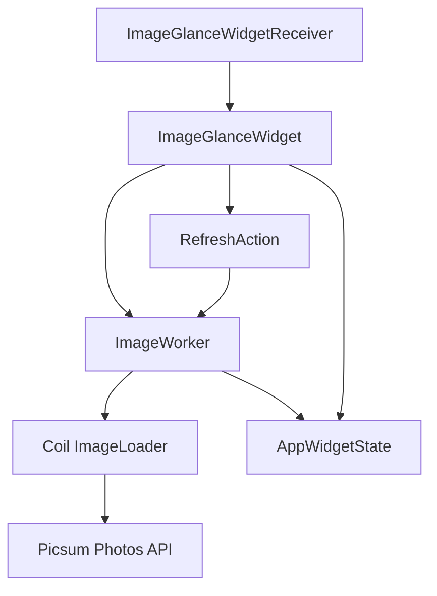
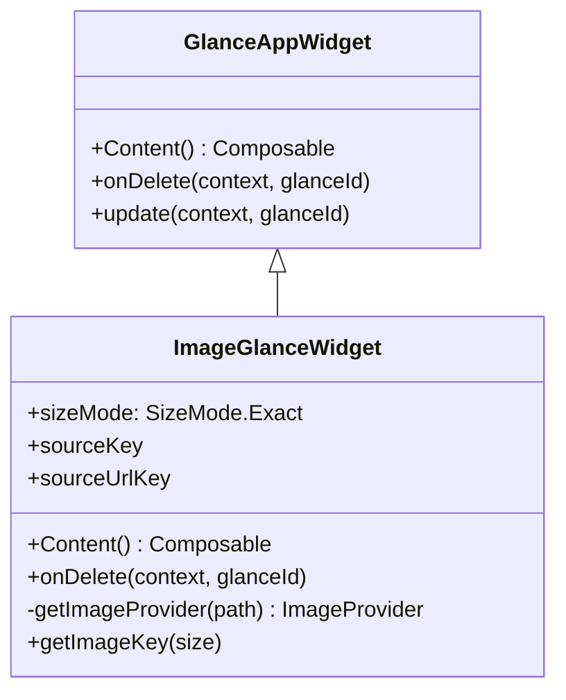
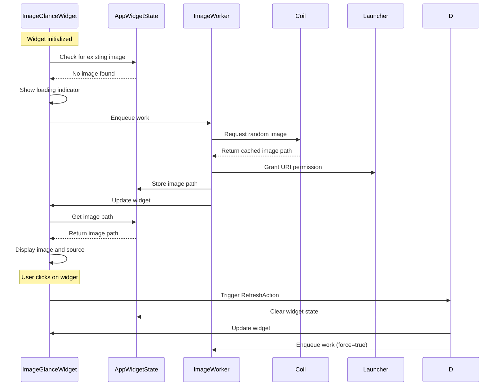

<!-- source: DeepWiki mcp.deepwiki.com · repo android/user-interface-samples · extra page Image Widget Example · fetched 2026-10-23 -->

# Image Widget Example

<details>
<summary>Relevant source files</summary>

The following files were used as context for generating this wiki page:

- [AppWidget/app/src/main/java/com/example/android/appwidget/glance/GlanceKtx.kt](AppWidget/app/src/main/java/com/example/android/appwidget/glance/GlanceKtx.kt)
- [AppWidget/app/src/main/java/com/example/android/appwidget/glance/buttons/ButtonsGlanceWidget.kt](AppWidget/app/src/main/java/com/example/android/appwidget/glance/buttons/ButtonsGlanceWidget.kt)
- [AppWidget/app/src/main/java/com/example/android/appwidget/glance/image/ImageGlanceWidget.kt](AppWidget/app/src/main/java/com/example/android/appwidget/glance/image/ImageGlanceWidget.kt)
- [AppWidget/app/src/main/java/com/example/android/appwidget/glance/image/ImageWorker.kt](AppWidget/app/src/main/java/com/example/android/appwidget/glance/image/ImageWorker.kt)
- [AppWidget/app/src/main/java/com/example/android/appwidget/glance/list/ListGlanceWidget.kt](AppWidget/app/src/main/java/com/example/android/appwidget/glance/list/ListGlanceWidget.kt)
- [AppWidget/app/src/main/res/drawable-nodpi/image_widget_preview.png](AppWidget/app/src/main/res/drawable-nodpi/image_widget_preview.png)
- [AppWidget/app/src/main/res/layout/widget_image_preview.xml](AppWidget/app/src/main/res/layout/widget_image_preview.xml)
- [AppWidget/app/src/main/res/xml/app_widget_buttons_glance.xml](AppWidget/app/src/main/res/xml/app_widget_buttons_glance.xml)
- [AppWidget/app/src/main/res/xml/app_widget_buttons_rv.xml](AppWidget/app/src/main/res/xml/app_widget_buttons_rv.xml)
- [AppWidget/app/src/main/res/xml/app_widget_image_glance.xml](AppWidget/app/src/main/res/xml/app_widget_image_glance.xml)
- [AppWidget/app/src/main/res/xml/app_widget_list_rv.xml](AppWidget/app/src/main/res/xml/app_widget_list_rv.xml)
- [AppWidget/app/src/main/res/xml/image_paths.xml](AppWidget/app/src/main/res/xml/image_paths.xml)

</details>


## Purpose and Scope

This document details the Image Widget Example in the Android User Interface Samples repository. This example demonstrates how to implement an app widget that displays random images from a web service using the Glance framework, WorkManager, and Coil image loading library. It showcases efficient background loading, state management, and user interaction patterns for home screen widgets.

For information on other widget examples, see [Glance Widgets](#4.2) and [Weather Widget Example](#4.2.1).

## Architecture Overview

The Image Widget Example implements a home screen widget that loads and displays random images from Picsum Photos. It handles loading states, user interactions, and proper image attribution.

### Component Diagram



Sources:
- [AppWidget/app/src/main/java/com/example/android/appwidget/glance/image/ImageGlanceWidget.kt:193-195]()
- [AppWidget/app/src/main/java/com/example/android/appwidget/glance/image/ImageGlanceWidget.kt:71-175]()
- [AppWidget/app/src/main/java/com/example/android/appwidget/glance/image/ImageGlanceWidget.kt:177-191]()
- [AppWidget/app/src/main/java/com/example/android/appwidget/glance/image/ImageWorker.kt:48-189]()

## Widget Implementation

### ImageGlanceWidget Class

The core of the example is the `ImageGlanceWidget` class which extends `GlanceAppWidget`. This class:

1. Defines the widget UI using Glance composables
2. Manages widget state to store image paths and source information
3. Handles user interactions like refresh actions
4. Triggers background image loading jobs



The `ImageGlanceWidget` uses `SizeMode.Exact` which ensures the widget renders at the exact size provided by the launcher, important for correctly sizing images.

Sources:
- [AppWidget/app/src/main/java/com/example/android/appwidget/glance/image/ImageGlanceWidget.kt:71-84]()
- [AppWidget/app/src/main/java/com/example/android/appwidget/glance/image/ImageGlanceWidget.kt:86-147]()
- [AppWidget/app/src/main/java/com/example/android/appwidget/glance/image/ImageGlanceWidget.kt:152-155]()

### Widget UI Structure

The widget UI is defined in the `Content()` composable function and handles two main states:

1. **Loading State**: Displays a circular progress indicator while the image loads
2. **Image Display State**: Shows the loaded image with a source attribution overlay

The UI layout is structured as follows:

```
Box (fills entire widget area)
├── When image is loaded:
│   ├── Image (fills box, clickable for refresh)
│   └── Text (attribution at bottom, clickable to open source URL)
└── When no image is loaded:
    ├── CircularProgressIndicator
    └── SideEffect to trigger image loading
```

The widget UI adapts to different sizes using the `LocalSize` composable environment variable, which is crucial for loading appropriately sized images.

Sources:
- [AppWidget/app/src/main/java/com/example/android/appwidget/glance/image/ImageGlanceWidget.kt:86-146]()
- [AppWidget/app/src/main/java/com/example/android/appwidget/glance/GlanceKtx.kt:73-80]()

### State Management

The widget uses `AppWidgetState` to persist three key pieces of information:

| State Key | Purpose |
|-----------|---------|
| `getImageKey(size)` | Stores the path to the image file for the current widget size |
| `sourceKey` | Stores the attribution text (e.g., "Picsum Photos") |
| `sourceUrlKey` | Stores the URL to the source website |

These preference keys are defined as string preferences keys in the companion object:

```kotlin
companion object {
    val sourceKey = stringPreferencesKey("image_source")
    val sourceUrlKey = stringPreferencesKey("image_source_url")
    
    fun getImageKey(size: DpSize) = getImageKey(size.width.value.toPx, size.height.value.toPx)
    
    fun getImageKey(width: Float, height: Float) = stringPreferencesKey(
        "uri-$width-$height"
    )
}
```

The widget retrieves these values using `currentState()` in the Composable function to render the UI.

Sources:
- [AppWidget/app/src/main/java/com/example/android/appwidget/glance/image/ImageGlanceWidget.kt:73-81]()
- [AppWidget/app/src/main/java/com/example/android/appwidget/glance/image/ImageGlanceWidget.kt:90]()
- [AppWidget/app/src/main/java/com/example/android/appwidget/glance/image/ImageGlanceWidget.kt:114]()
- [AppWidget/app/src/main/java/com/example/android/appwidget/glance/image/ImageGlanceWidget.kt:130]()

## Image Loading Process

### Workflow Diagram



Sources:
- [AppWidget/app/src/main/java/com/example/android/appwidget/glance/image/ImageGlanceWidget.kt:86-146]()
- [AppWidget/app/src/main/java/com/example/android/appwidget/glance/image/ImageWorker.kt:57-92]()
- [AppWidget/app/src/main/java/com/example/android/appwidget/glance/image/ImageWorker.kt:101-118]()
- [AppWidget/app/src/main/java/com/example/android/appwidget/glance/image/ImageGlanceWidget.kt:177-191]()

### ImageWorker Class

The `ImageWorker` class extends `CoroutineWorker` and is responsible for loading images in the background using WorkManager. Key aspects include:

1. **Work Enqueuing**: Static methods to schedule one-time work for image loading
2. **Image Fetching**: Uses Coil to load random images from Picsum Photos
3. **URI Permissions**: Grants read permissions to the launcher
4. **State Updates**: Updates the widget state with the loaded image path

The worker is scheduled using this pattern:

```kotlin
fun enqueue(context: Context, size: DpSize, glanceId: GlanceId, force: Boolean = false) {
    val manager = WorkManager.getInstance(context)
    val requestBuilder = OneTimeWorkRequestBuilder<ImageWorker>().apply {
        addTag(glanceId.toString())
        setExpedited(OutOfQuotaPolicy.RUN_AS_NON_EXPEDITED_WORK_REQUEST)
        setInputData(
            Data.Builder()
                .putFloat("width", size.width.value.toPx)
                .putFloat("height", size.height.value.toPx)
                .putBoolean("force", force)
                .build()
        )
    }
    val workPolicy = if (force) {
        ExistingWorkPolicy.REPLACE
    } else {
        ExistingWorkPolicy.KEEP
    }

    manager.enqueueUniqueWork(
        uniqueWorkName + size.width + size.height,
        workPolicy,
        requestBuilder.build()
    )
}
```

The worker uses unique work names based on size to ensure correct image dimensions for each widget size.

Sources:
- [AppWidget/app/src/main/java/com/example/android/appwidget/glance/image/ImageWorker.kt:48-99]()
- [AppWidget/app/src/main/java/com/example/android/appwidget/glance/image/ImageWorker.kt:57-91]()
- [AppWidget/app/src/main/java/com/example/android/appwidget/glance/image/ImageWorker.kt:101-119]()

### Image Loading and Caching

The `getRandomImage` method in `ImageWorker` handles:

1. Fetching a random image from Picsum Photos with the correct dimensions
2. Caching the image using Coil
3. Creating a content URI for the image
4. Granting read permissions to the launcher

```kotlin
private suspend fun getRandomImage(width: Float, height: Float, force: Boolean): String {
    val url = "https://picsum.photos/${width.roundToInt()}/${height.roundToInt()}"
    // Request the image to be loaded
    with(context.imageLoader) {
        if (force) {
            diskCache?.remove(url)
            memoryCache?.remove(MemoryCache.Key(url))
        }
        val result = execute(request)
        if (result is ErrorResult) {
            throw result.throwable
        }
    }
    
    // Get path from disk cache and create a content URI
    val path = context.imageLoader.diskCache?.get(url)?.use { snapshot ->
        val imageFile = snapshot.data.toFile()
        val contentUri = getUriForFile(
            context,
            "com.example.android.appwidget.fileprovider",
            imageFile
        )
        
        // Grant permissions to launcher
        val launcherName = resolveInfo?.activityInfo?.packageName
        if (launcherName != null) {
            context.grantUriPermission(
                launcherName,
                contentUri,
                FLAG_GRANT_READ_URI_PERMISSION or FLAG_GRANT_PERSISTABLE_URI_PERMISSION
            )
        }
        contentUri.toString()
    }
    
    return requireNotNull(path)
}
```

This method ensures images are appropriately sized, cached, and accessible to the launcher.

Sources:
- [AppWidget/app/src/main/java/com/example/android/appwidget/glance/image/ImageWorker.kt:138-188]()
- [AppWidget/app/src/main/res/xml/image_paths.xml:17-19]()

## User Interaction

### RefreshAction

The `RefreshAction` class handles user requests to refresh the displayed image:

```kotlin
class RefreshAction : ActionCallback {
    override suspend fun onAction(context: Context, glanceId: GlanceId, parameters: ActionParameters) {
        // Clear the state to show loading screen
        updateAppWidgetState(context, glanceId) { prefs ->
            prefs.clear()
        }
        ImageGlanceWidget().update(context, glanceId)

        // Enqueue a job for each size the widget can be shown
        GlanceAppWidgetManager(context).getAppWidgetSizes(glanceId).forEach { size ->
            ImageWorker.enqueue(context, size, glanceId, force = true)
        }
    }
}
```

When a user clicks the image, this action:

1. Clears the current widget state to show the loading indicator
2. Updates the widget to reflect the cleared state
3. Forces a reload of new images for all potential widget sizes by setting `force=true` in the worker request

Sources:
- [AppWidget/app/src/main/java/com/example/android/appwidget/glance/image/ImageGlanceWidget.kt:177-191]()
- [AppWidget/app/src/main/java/com/example/android/appwidget/glance/image/ImageGlanceWidget.kt:111]()

### Source Attribution

The widget displays source attribution at the bottom of the image with a clickable text element:

```kotlin
Text(
    text = "Source: ${currentState(sourceKey)}",
    style = TextStyle(
        color = GlanceTheme.colors.onPrimary,
        fontSize = 12.sp,
        fontStyle = FontStyle.Italic,
        textAlign = TextAlign.End,
        textDecoration = TextDecoration.Underline
    ),
    modifier = GlanceModifier
        .fillMaxWidth()
        .padding(8.dp)
        .background(GlanceTheme.colors.primary)
        .clickable(
            actionStartActivity(
                Intent(
                    Intent.ACTION_VIEW,
                    Uri.parse(currentState(sourceUrlKey))
                )
            )
        )
)
```

Clicking on this attribution text launches a browser with the source website.

Sources:
- [AppWidget/app/src/main/java/com/example/android/appwidget/glance/image/ImageGlanceWidget.kt:113-134]()
- [AppWidget/app/src/main/java/com/example/android/appwidget/glance/image/ImageWorker.kt:127-128]()

## Widget Configuration

### XML Definition

The widget is configured in `app_widget_image_glance.xml`:

```xml
<appwidget-provider xmlns:android="http://schemas.android.com/apk/res/android"
    android:description="@string/app_widget_image_description"
    android:initialLayout="@layout/widget_loading"
    android:minWidth="110dp"
    android:minHeight="96dp"
    android:minResizeWidth="96dp"
    android:minResizeHeight="64dp"
    android:previewImage="@drawable/image_widget_preview"
    android:previewLayout="@layout/widget_image_preview"
    android:resizeMode="horizontal|vertical"
    android:targetCellWidth="3"
    android:targetCellHeight="2"
    android:updatePeriodMillis="86400000"
    android:widgetCategory="home_screen" />
```

Key configuration aspects include:

| Configuration | Value | Purpose |
|---------------|-------|---------|
| `minWidth`, `minHeight` | 110dp, 96dp | Default minimum widget dimensions |
| `minResizeWidth`, `minResizeHeight` | 96dp, 64dp | Minimum dimensions when resizing |
| `resizeMode` | "horizontal\|vertical" | Allows resizing in both directions |
| `targetCellWidth`, `targetCellHeight` | 3, 2 | Default grid size in launcher |
| `updatePeriodMillis` | 86400000 (24 hours) | Update interval |

Sources:
- [AppWidget/app/src/main/res/xml/app_widget_image_glance.xml:16-30]()
- [AppWidget/app/src/main/res/layout/widget_image_preview.xml:17-36]()

### Preview Implementation

The widget provides both a static preview image and a preview layout for the widget picker:

```xml
<FrameLayout xmlns:android="http://schemas.android.com/apk/res/android"
    android:layout_width="210dp"
    android:layout_height="186dp"
    android:background="@drawable/image_widget_preview"
    android:theme="@style/Theme.AppWidget.AppWidgetContainer">

    <TextView
        android:layout_width="match_parent"
        android:layout_height="wrap_content"
        android:layout_gravity="bottom"
        android:background="@color/colorPrimary"
        android:gravity="end"
        android:padding="8dp"
        android:text="Source: Unknown"
        android:textAlignment="viewEnd"
        android:textColor="@color/colorOnPrimary"
        android:textSize="12sp"
        android:textStyle="italic" />
</FrameLayout>
```

This preview matches the actual widget appearance with a static image and attribution text.

Sources:
- [AppWidget/app/src/main/res/layout/widget_image_preview.xml:17-36]()
- [AppWidget/app/src/main/res/drawable-nodpi/image_widget_preview.png:1-300]()

## Image Provider Implementation

The `ImageGlanceWidget` class includes a helper method to create appropriate `ImageProvider` instances for different image sources:

```kotlin
private fun getImageProvider(path: String): ImageProvider {
    if (path.startsWith("content://")) {
        return ImageProvider(path.toUri())
    }
    val bitmap = BitmapFactory.decodeFile(path)
    return ImageProvider(bitmap)
}
```

This method handles both content URIs (for images in content providers) and direct file paths.

Sources:
- [AppWidget/app/src/main/java/com/example/android/appwidget/glance/image/ImageGlanceWidget.kt:168-174]()

## Cleanup on Widget Removal

When the widget is removed, it's important to clean up ongoing tasks. The `ImageGlanceWidget` class overrides the `onDelete` method to cancel any background work:

```kotlin
override suspend fun onDelete(context: Context, glanceId: GlanceId) {
    super.onDelete(context, glanceId)
    ImageWorker.cancel(context, glanceId)
}
```

This ensures no background operations continue when the widget is no longer in use.

Sources:
- [AppWidget/app/src/main/java/com/example/android/appwidget/glance/image/ImageGlanceWidget.kt:152-155]()
- [AppWidget/app/src/main/java/com/example/android/appwidget/glance/image/ImageWorker.kt:96-98]()

## Summary

The Image Widget Example demonstrates a complete implementation of a Glance-based home screen widget that loads and displays images from a web service. Key features include:

1. Declarative UI with Glance composables
2. Background image loading using WorkManager and Coil
3. State management with AppWidgetState
4. User interactions for refreshing content
5. Proper image attribution and source linking
6. Efficient handling of different widget sizes
7. Cleanup of resources when the widget is removed

This example serves as a foundation for building rich, interactive app widgets that integrate with web services and display dynamic content.

---

