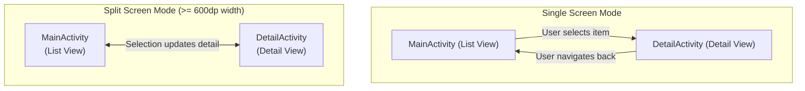
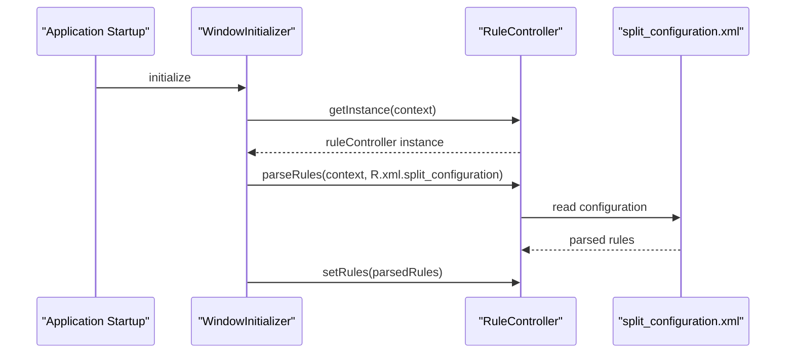
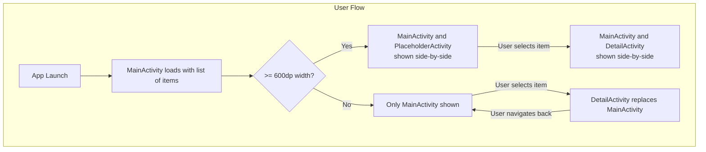
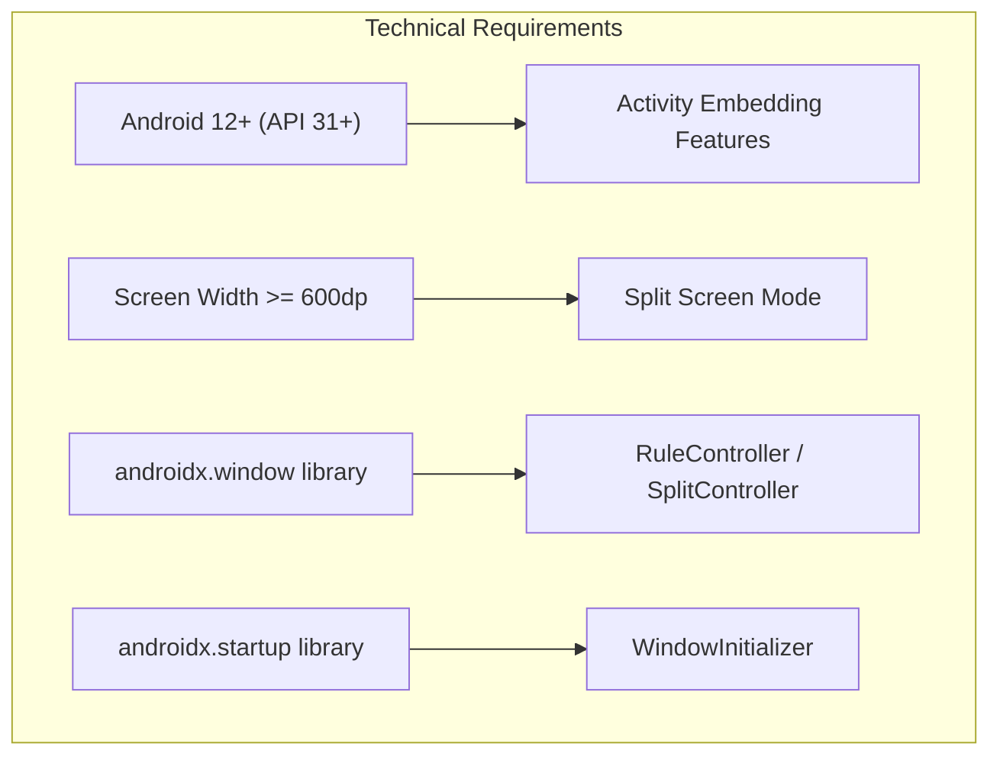

<!-- source: DeepWiki mcp.deepwiki.com · repo android/user-interface-samples · extra page List-Detail with Activity Embedding · fetched 2026-10-23 -->

# List-Detail with Activity Embedding

<details>
<summary>Relevant source files</summary>

The following files were used as context for generating this wiki page:

- [CanonicalLayouts/list-detail-activity-embedding/app/build.gradle](CanonicalLayouts/list-detail-activity-embedding/app/build.gradle)
- [CanonicalLayouts/list-detail-activity-embedding/app/src/androidTest/java/com/example/activityembedding/MainActivityTest.kt](CanonicalLayouts/list-detail-activity-embedding/app/src/androidTest/java/com/example/activityembedding/MainActivityTest.kt)
- [CanonicalLayouts/list-detail-activity-embedding/app/src/main/AndroidManifest.xml](CanonicalLayouts/list-detail-activity-embedding/app/src/main/AndroidManifest.xml)
- [CanonicalLayouts/list-detail-activity-embedding/app/src/main/java/com/example/activityembedding/WindowInitializer.kt](CanonicalLayouts/list-detail-activity-embedding/app/src/main/java/com/example/activityembedding/WindowInitializer.kt)
- [CanonicalLayouts/list-detail-activity-embedding/app/src/main/res/layout/list_item.xml](CanonicalLayouts/list-detail-activity-embedding/app/src/main/res/layout/list_item.xml)
- [CanonicalLayouts/list-detail-activity-embedding/app/src/main/res/xml/split_configuration.xml](CanonicalLayouts/list-detail-activity-embedding/app/src/main/res/xml/split_configuration.xml)
- [CanonicalLayouts/list-detail-activity-embedding/build.gradle](CanonicalLayouts/list-detail-activity-embedding/build.gradle)
- [CanonicalLayouts/list-detail-activity-embedding/gradle.properties](CanonicalLayouts/list-detail-activity-embedding/gradle.properties)
- [CanonicalLayouts/list-detail-activity-embedding/gradle/wrapper/gradle-wrapper.properties](CanonicalLayouts/list-detail-activity-embedding/gradle/wrapper/gradle-wrapper.properties)
- [CanonicalLayouts/list-detail-sliding-pane/app/src/main/res/layout/fragment_list.xml](CanonicalLayouts/list-detail-sliding-pane/app/src/main/res/layout/fragment_list.xml)

</details>


## Purpose and Scope

This document describes the implementation of the List-Detail pattern using Activity Embedding, a feature introduced in Android 12L that allows multiple activities to be displayed side-by-side on large screens. Unlike other List-Detail pattern implementations that use fragments or Jetpack Compose (see [List-Detail with Compose](#3.1.1) and [List-Detail with Sliding Pane](#3.1.2)), this approach leverages separate activities to create a responsive UI that adapts to different screen sizes.

## Overview

Activity Embedding enables a multi-activity experience where two activities can be displayed simultaneously when the device has sufficient screen real estate. This sample demonstrates how to implement a List-Detail pattern where:

- On smaller screens: A list activity and a detail activity are shown sequentially
- On larger screens (>= 600dp width): Both activities are displayed side-by-side automatically



Sources: [app/src/main/AndroidManifest.xml](), [app/src/main/res/xml/split_configuration.xml]()

## Implementation Architecture

The Activity Embedding implementation relies on three key components:

1. **Split configuration rules**: XML-defined rules that determine when and how activities should be displayed together
2. **Window Manager API integration**: Initializes and applies the embedding rules
3. **Activity structure**: Separate activities for list and detail views

```mermaid
classDiagram
    class "WindowInitializer" {
        +create(context: Context): RuleController
        +dependencies(): List
    }
    
    class "RuleController" {
        +setRules(rules)
        +parseRules(context, resourceId)
    }
    
    class "split_configuration.xml" {
        +SplitPairRule
        +SplitPlaceholderRule
    }
    
    class "MainActivity" {
        +RecyclerView list
        +CustomAdapter adapter
    }
    
    class "DetailActivity" {
        +showDetails(itemId)
    }
    
    class "PlaceholderActivity" {
        +placeholder for MainActivity
    }
    
    "WindowInitializer" --> "RuleController" : initializes
    "RuleController" --> "split_configuration.xml" : parses rules from
    "MainActivity" --> "DetailActivity" : launches
    "PlaceholderActivity" --> "MainActivity" : complements in split mode
```

Sources: [app/src/main/java/com/example/activityembedding/WindowInitializer.kt](), [app/src/main/res/xml/split_configuration.xml](), [app/src/main/AndroidManifest.xml]()

### Split Configuration Rules

The split configuration is defined in an XML file and specifies:

1. **SplitPairRule**: Determines when two specific activities should be displayed side-by-side
2. **SplitPlaceholderRule**: Defines a placeholder activity to be shown alongside an activity when no secondary activity is present

```xml
<SplitPairRule
    window:splitRatio="0.3"
    window:splitMinWidthDp="600"
    window:finishPrimaryWithSecondary="adjacent"
    window:finishSecondaryWithPrimary="always">
    <SplitPairFilter
        window:primaryActivityName=".MainActivity"
        window:secondaryActivityName=".DetailActivity"/>
</SplitPairRule>

<SplitPlaceholderRule
    window:placeholderActivityName=".PlaceholderActivity"
    window:splitRatio="0.3"
    window:splitMinWidthDp="600">
    <ActivityFilter
        window:activityName=".MainActivity"/>
</SplitPlaceholderRule>
```

The key attributes in the split configuration:

| Attribute | Description |
|-----------|-------------|
| `splitRatio` | The ratio of screen width allocated to the primary activity (0.3 = 30%) |
| `splitMinWidthDp` | Minimum screen width required for splitting (600dp) |
| `finishPrimaryWithSecondary` | When to finish the primary activity when secondary is finished |
| `finishSecondaryWithPrimary` | When to finish the secondary activity when primary is finished |
| `primaryActivityName` | The activity to be displayed on the left/top |
| `secondaryActivityName` | The activity to be displayed on the right/bottom |
| `placeholderActivityName` | Activity to display when no secondary activity is visible |

Sources: [app/src/main/res/xml/split_configuration.xml]()

### Window Manager Integration

The embedding functionality is initialized through the `WindowInitializer` class, which implements the `Initializer` interface from the Android Startup library:



The Android Manifest registers the `WindowInitializer` and enables activity embedding through:

```xml
<property
    android:name="android.window.PROPERTY_ACTIVITY_EMBEDDING_SPLITS_ENABLED"
    android:value="true" />

<provider
    android:name="androidx.startup.InitializationProvider"
    android:authorities="${applicationId}.androidx-startup"
    android:exported="false"
    tools:node="merge">
    <meta-data
        android:name="com.example.activityembedding.WindowInitializer"
        android:value="androidx.startup" />
</provider>
```

Sources: [app/src/main/java/com/example/activityembedding/WindowInitializer.kt](), [app/src/main/AndroidManifest.xml]()

### Activity Structure

The sample consists of three activities:

1. **MainActivity**: Contains a RecyclerView listing items that can be selected
2. **DetailActivity**: Displays detailed information about the selected item
3. **PlaceholderActivity**: Serves as a placeholder in split screen mode when no item is selected

A key attribute for the `DetailActivity` is `android:launchMode="singleTop"`, which ensures that selecting different items in the list won't create multiple instances of the detail activity.

Sources: [app/src/main/AndroidManifest.xml]()

## User Experience Flow

The user experience adapts based on the screen size:



Sources: [app/src/main/res/xml/split_configuration.xml](), [app/src/androidTest/java/com/example/activityembedding/MainActivityTest.kt]()

## Technical Requirements and Considerations

### System Requirements

- Minimum API level: 31 (Android 12)
- Target features: Large screens, foldables, tablets
- Dependencies:
  - `androidx.window:window:1.3.0`: For Window Manager API
  - `androidx.startup:startup-runtime:1.1.1`: For initialization



Sources: [app/build.gradle]()

### Best Practices

1. **Configure activity lifecycle behavior**: Use attributes like `finishPrimaryWithSecondary` and `finishSecondaryWithPrimary` to control how activities depend on each other

2. **Consider launch modes**: Using `singleTop` for the DetailActivity prevents unnecessary instances

3. **Test on various screen sizes**: Behavior differs between small and large screens

4. **Handle back navigation properly**: In split mode, back navigation works differently as both activities are visible

Sources: [app/src/main/res/xml/split_configuration.xml](), [app/src/main/AndroidManifest.xml]()

## Comparison with Other List-Detail Implementations

| Feature | Activity Embedding | SlidingPaneLayout | Jetpack Compose |
|---------|-------------------|-------------------|-----------------|
| API Level | Requires Android 12+ | Works on older Android versions | Works on older Android versions |
| Architecture | Separate activities | Single activity, multiple fragments | Single composable with multiple states |
| Integration with existing code | Good for activity-based apps | Good for fragment-based apps | Requires Compose adoption |
| Back stack behavior | Managed by system | Requires custom handling | Requires custom handling |
| Configuration changes | Handled by Activity system | Requires custom state saving | Handled by Compose state |

Sources: [app/build.gradle](), [app/src/main/AndroidManifest.xml]()

## Conclusion

Activity Embedding provides a system-level approach to implementing the List-Detail pattern that takes advantage of large screens while maintaining compatibility with smaller screens. It's particularly useful for applications that already use an activity-based architecture and target devices running Android 12 or later.

For other implementations of the List-Detail pattern, see [List-Detail with Compose](#3.1.1) and [List-Detail with Sliding Pane](#3.1.2).

---

