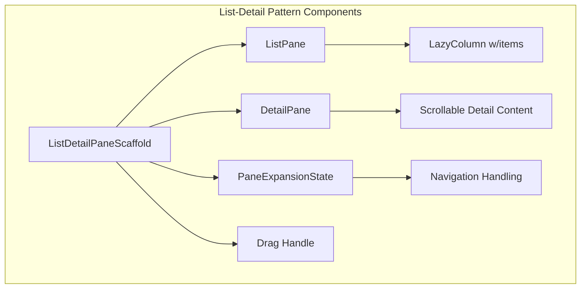
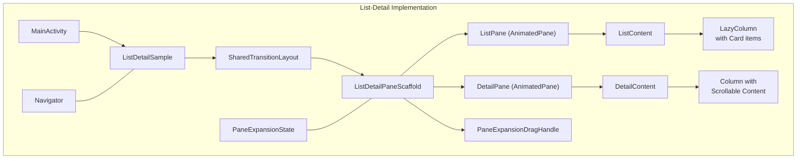
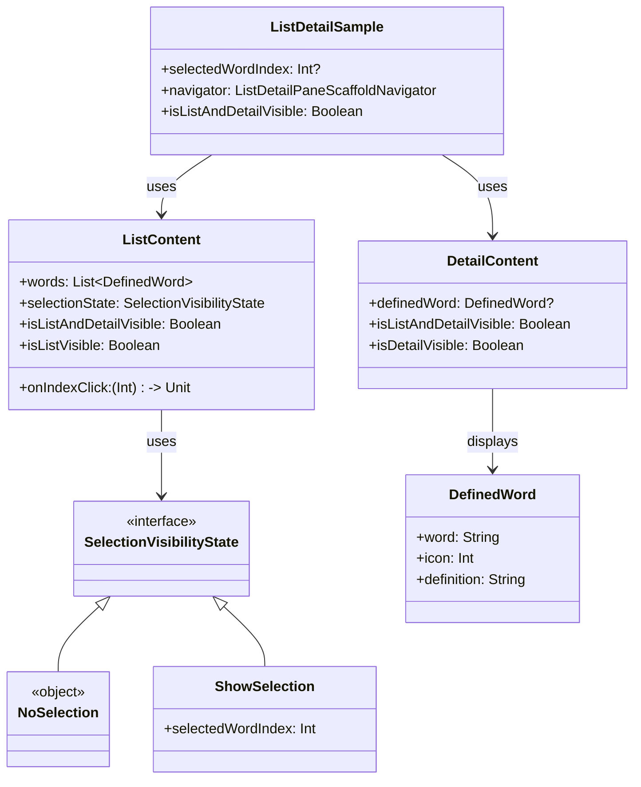
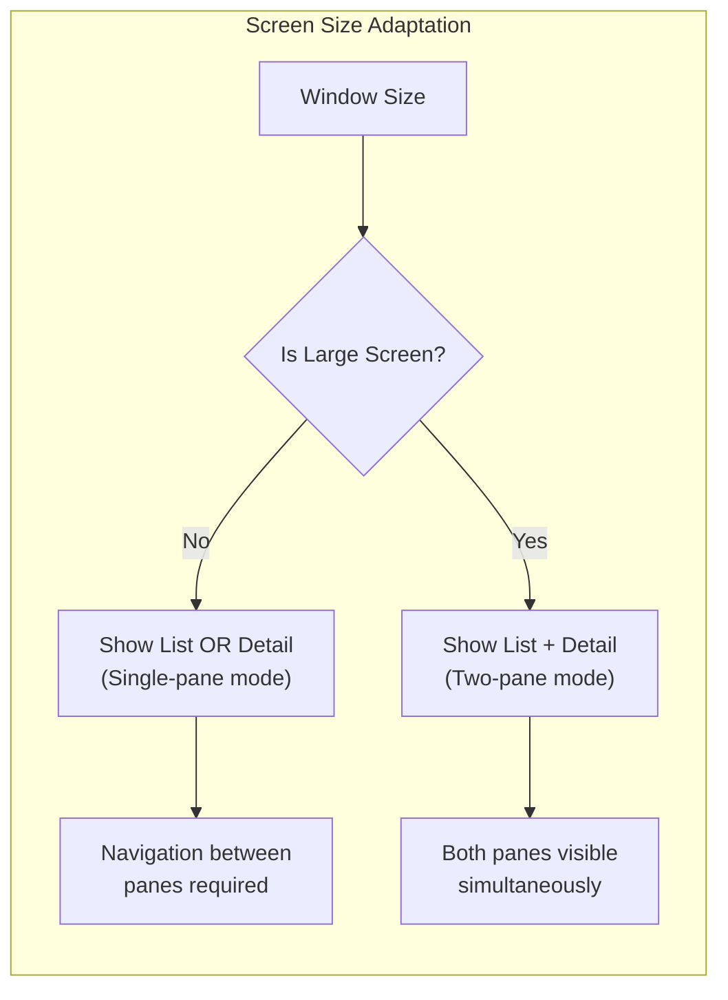

<!-- source: DeepWiki mcp.deepwiki.com · repo android/user-interface-samples · extra page List-Detail with Compose · fetched 2026-10-23 -->

# List-Detail with Compose

<details>
<summary>Relevant source files</summary>

The following files were used as context for generating this wiki page:

- [CanonicalLayouts/list-detail-compose/app/build.gradle](CanonicalLayouts/list-detail-compose/app/build.gradle)
- [CanonicalLayouts/list-detail-compose/app/src/main/java/com/example/listdetailcompose/MainActivity.kt](CanonicalLayouts/list-detail-compose/app/src/main/java/com/example/listdetailcompose/MainActivity.kt)
- [CanonicalLayouts/list-detail-compose/app/src/main/java/com/example/listdetailcompose/ui/ListDetailSample.kt](CanonicalLayouts/list-detail-compose/app/src/main/java/com/example/listdetailcompose/ui/ListDetailSample.kt)
- [CanonicalLayouts/list-detail-compose/app/src/main/res/drawable/ic_food.xml](CanonicalLayouts/list-detail-compose/app/src/main/res/drawable/ic_food.xml)
- [CanonicalLayouts/list-detail-compose/app/src/main/res/drawable/ic_no_food.xml](CanonicalLayouts/list-detail-compose/app/src/main/res/drawable/ic_no_food.xml)
- [CanonicalLayouts/list-detail-compose/app/src/main/res/values/strings.xml](CanonicalLayouts/list-detail-compose/app/src/main/res/values/strings.xml)
- [CanonicalLayouts/list-detail-compose/build.gradle](CanonicalLayouts/list-detail-compose/build.gradle)
- [CanonicalLayouts/list-detail-compose/gradle/wrapper/gradle-wrapper.properties](CanonicalLayouts/list-detail-compose/gradle/wrapper/gradle-wrapper.properties)

</details>


This document explains the implementation of the List-Detail UI pattern using Jetpack Compose. The List-Detail pattern is a canonical UI layout where a list of items is displayed on one pane, and selecting an item shows its details in another pane. This pattern adapts responsively to different screen sizes and device configurations, making it particularly valuable for large screen devices like tablets and foldables.

For information about implementing the List-Detail pattern with SlidingPaneLayout, see [List-Detail with Sliding Pane](#3.1.2). For information about implementing the pattern with Activity Embedding, see [List-Detail with Activity Embedding](#3.1.3).

## Overview

The List-Detail with Compose sample demonstrates how to implement an adaptive UI that:

1. On smaller screens: Shows either the list or the detail pane (one at a time)
2. On larger screens: Shows both the list and detail panes simultaneously
3. Provides smooth transitions between these states
4. Incorporates shared element transitions for visual continuity



Sources: [CanonicalLayouts/list-detail-compose/app/src/main/java/com/example/listdetailcompose/ui/ListDetailSample.kt:98-171]()

## Architecture

The implementation is built on top of Jetpack Compose's Material 3 Adaptive components, specifically using `ListDetailPaneScaffold` which provides the foundation for implementing the list-detail pattern.



Sources: 
- [CanonicalLayouts/list-detail-compose/app/src/main/java/com/example/listdetailcompose/ui/ListDetailSample.kt:98-171]()
- [CanonicalLayouts/list-detail-compose/app/src/main/java/com/example/listdetailcompose/MainActivity.kt:27-38]()

## Key Components

### ListDetailPaneScaffold

The `ListDetailPaneScaffold` is the fundamental component that manages the overall layout structure. It handles how the list and detail panes are displayed based on the window size and device configuration.

Key properties:
- `directive`: Controls how the scaffold should lay out its panes
- `value`: The current state of each pane (expanded or not)
- `listPane`: Composable content for the list pane
- `detailPane`: Composable content for the detail pane
- `paneExpansionState`: Manages the expansion state of panes
- `paneExpansionDragHandle`: Optional drag handle for manual pane resizing

Sources: [CanonicalLayouts/list-detail-compose/app/src/main/java/com/example/listdetailcompose/ui/ListDetailSample.kt:113-167]()

### ListDetailPaneScaffoldNavigator

The navigator manages transitions between list and detail panes and handles back navigation. It's responsible for:

1. Tracking the current scaffold state
2. Providing navigation between panes
3. Handling back button presses
4. Storing and restoring navigation state

Sources: [CanonicalLayouts/list-detail-compose/app/src/main/java/com/example/listdetailcompose/ui/ListDetailSample.kt:100-109]()

### SharedTransitionLayout

The sample implements smooth visual transitions using `SharedTransitionLayout`, which enables shared element transitions between the list and detail panes. This creates a fluid user experience when an item is selected from the list.

Sources: [CanonicalLayouts/list-detail-compose/app/src/main/java/com/example/listdetailcompose/ui/ListDetailSample.kt:111-170]()

## Implementation Details

### Main Components Structure



Sources:
- [CanonicalLayouts/list-detail-compose/app/src/main/java/com/example/listdetailcompose/ui/ListDetailSample.kt:98-171]()
- [CanonicalLayouts/list-detail-compose/app/src/main/java/com/example/listdetailcompose/ui/ListDetailSample.kt:176-192]()
- [CanonicalLayouts/list-detail-compose/app/src/main/java/com/example/listdetailcompose/ui/ListDetailSample.kt:89-93]()

### Data Model

The sample uses a simple data model for demonstration purposes:

```
DefinedWord
- word: String
- icon: Int
- definition: String
```

A list of sample words is predefined for the demonstration, with each word having a name, an icon, and a Lorem Ipsum definition.

Sources: [CanonicalLayouts/list-detail-compose/app/src/main/java/com/example/listdetailcompose/ui/ListDetailSample.kt:73-93]()

## Responsive Behavior

The List-Detail implementation adapts to different screen sizes through the `ListDetailPaneScaffold`:

1. **Single-pane mode**: On smaller screens, either the list pane or the detail pane is shown at a time
2. **Two-pane mode**: On larger screens, both list and detail panes are shown simultaneously

The component automatically determines the appropriate layout based on the available screen space.



Sources: [CanonicalLayouts/list-detail-compose/app/src/main/java/com/example/listdetailcompose/ui/ListDetailSample.kt:98-104]()

## State Management

### Selection State

The implementation manages selection state using a sealed interface:

- `NoSelection`: When no item is selected or when in list-only view
- `ShowSelection`: When an item is selected, containing the index of the selected item

This state determines:
1. The visual appearance of list items (selected vs. unselected)
2. The item whose details are displayed in the detail pane
3. The interaction behavior (clickable vs. selectable)

Sources: [CanonicalLayouts/list-detail-compose/app/src/main/java/com/example/listdetailcompose/ui/ListDetailSample.kt:176-192]()

### Navigation State

Navigation state is managed by the `ListDetailPaneScaffoldNavigator`, which tracks:

1. Whether the list pane is expanded or collapsed
2. Whether the detail pane is expanded or collapsed
3. Navigation history for back button handling

Sources: [CanonicalLayouts/list-detail-compose/app/src/main/java/com/example/listdetailcompose/ui/ListDetailSample.kt:100-109]()

## Animations and Transitions

### Shared Element Transitions

The implementation uses shared element transitions to create smooth visual continuity when navigating between the list and detail panes. When an item is selected from the list, its icon smoothly animates to its new position in the detail view.

This is implemented using:
- `SharedTransitionLayout`: Wraps the entire UI to enable shared transitions
- `sharedElement` modifier: Applied to elements that should animate between states
- `rememberSharedContentState`: Tracks the state of shared elements

Sources: 
- [CanonicalLayouts/list-detail-compose/app/src/main/java/com/example/listdetailcompose/ui/ListDetailSample.kt:111-112]()
- [CanonicalLayouts/list-detail-compose/app/src/main/java/com/example/listdetailcompose/ui/ListDetailSample.kt:272-282]()
- [CanonicalLayouts/list-detail-compose/app/src/main/java/com/example/listdetailcompose/ui/ListDetailSample.kt:324-334]()

### AnimatedPane

The `AnimatedPane` component is used to animate the entry and exit of panes:

```kotlin
AnimatedPane {
    ListContent(...)
}
```

This creates smooth transitions when switching between the list and detail views.

Sources: [CanonicalLayouts/list-detail-compose/app/src/main/java/com/example/listdetailcompose/ui/ListDetailSample.kt:120-139]()

## Implementation Details

### List Pane

The list pane is implemented as a `LazyColumn` containing cards for each item. Key features:

1. Items can be clickable or selectable based on the current selection state
2. Visual styling changes based on selection state (border, background color)
3. Shared elements are configured for transition animations

Sources: [CanonicalLayouts/list-detail-compose/app/src/main/java/com/example/listdetailcompose/ui/ListDetailSample.kt:198-300]()

### Detail Pane

The detail pane is implemented as a scrollable column showing:

1. The icon of the selected item (shared element with the list)
2. The name of the selected item
3. The detailed description of the item

If no item is selected, a placeholder message is displayed.

Sources: [CanonicalLayouts/list-detail-compose/app/src/main/java/com/example/listdetailcompose/ui/ListDetailSample.kt:306-355]()

## Dependencies

The implementation relies on several key dependencies:

| Dependency | Purpose |
|------------|---------|
| `androidx.compose.material3.adaptive:adaptive-layout` | Provides the `ListDetailPaneScaffold` component |
| `androidx.compose.material3.adaptive:adaptive-navigation` | Provides navigation utilities for the pane scaffold |
| `androidx.compose.animation:animation` | Enables animations and shared transitions |
| `androidx.window:window` | Underlying window size detection |

Sources: [CanonicalLayouts/list-detail-compose/app/build.gradle:69-86]()

## Usage

To use the List-Detail pattern in your own application:

1. Add the required dependencies to your `build.gradle` file
2. Create your data model for list items
3. Implement the list content and detail content
4. Set up the `ListDetailPaneScaffold` with appropriate navigation handling
5. Implement shared transitions if desired

The pattern is particularly useful for applications like:
- Email clients (list of emails, email content)
- File managers (list of files, file preview/details)
- Settings screens (categories list, specific settings)
- E-commerce (product list, product details)

Sources: 
- [CanonicalLayouts/list-detail-compose/app/build.gradle:69-86]()
- [CanonicalLayouts/list-detail-compose/app/src/main/java/com/example/listdetailcompose/ui/ListDetailSample.kt:98-171]()
- [CanonicalLayouts/list-detail-compose/app/src/main/java/com/example/listdetailcompose/MainActivity.kt:27-38]()

---

