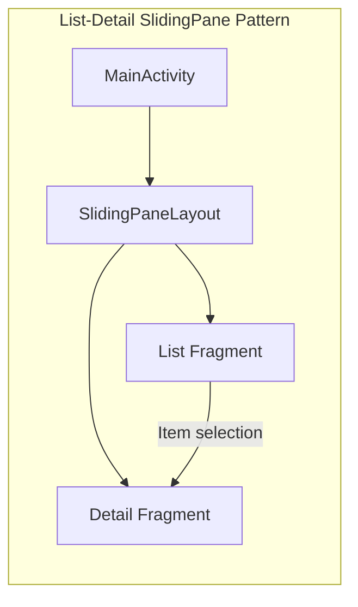
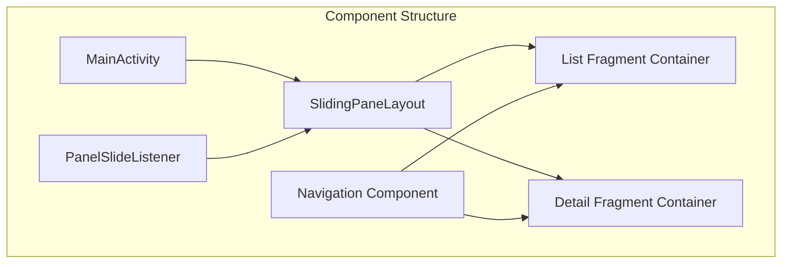
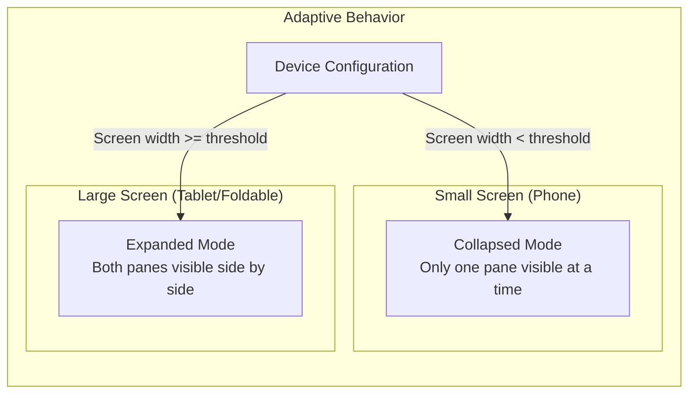
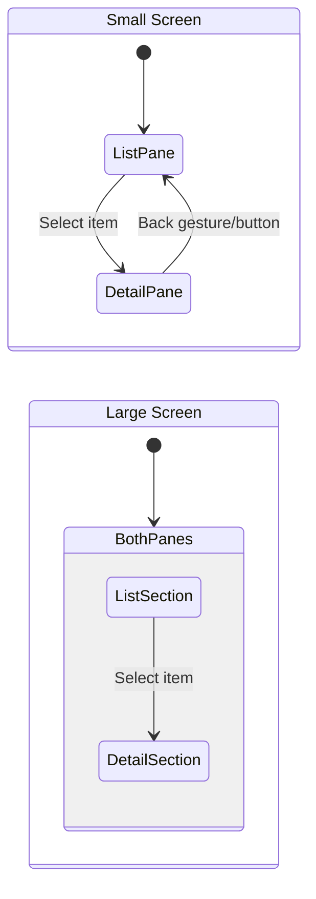
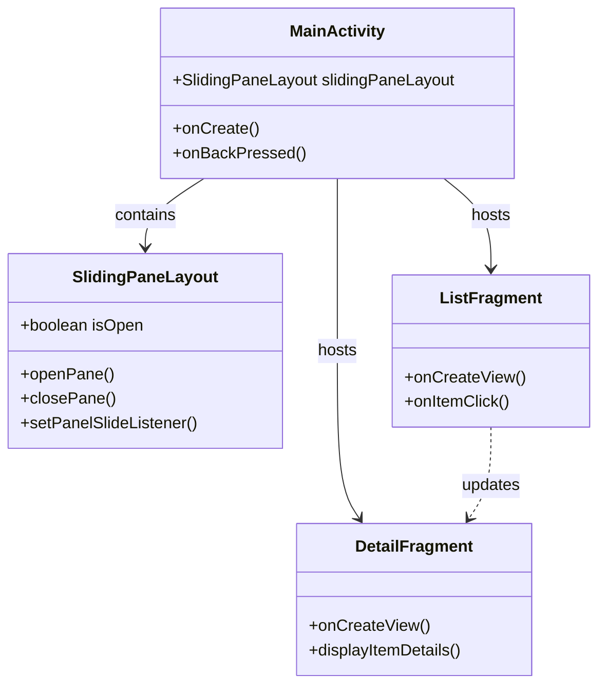

<!-- source: DeepWiki mcp.deepwiki.com · repo android/user-interface-samples · extra page List-Detail with Sliding Pane · fetched 2026-10-23 -->

# List-Detail with Sliding Pane

<details>
<summary>Relevant source files</summary>

The following files were used as context for generating this wiki page:

- [CanonicalLayouts/README.md](CanonicalLayouts/README.md)
- [CanonicalLayouts/list-detail-sliding-pane/app/build.gradle](CanonicalLayouts/list-detail-sliding-pane/app/build.gradle)
- [CanonicalLayouts/list-detail-sliding-pane/app/src/main/AndroidManifest.xml](CanonicalLayouts/list-detail-sliding-pane/app/src/main/AndroidManifest.xml)
- [CanonicalLayouts/list-detail-sliding-pane/build.gradle](CanonicalLayouts/list-detail-sliding-pane/build.gradle)
- [CanonicalLayouts/list-detail-sliding-pane/gradle.properties](CanonicalLayouts/list-detail-sliding-pane/gradle.properties)
- [CanonicalLayouts/list-detail-sliding-pane/gradle/wrapper/gradle-wrapper.properties](CanonicalLayouts/list-detail-sliding-pane/gradle/wrapper/gradle-wrapper.properties)

</details>


## Purpose and Scope

This page documents the List-Detail pattern implementation using `SlidingPaneLayout`, a component in the AndroidX library that enables a responsive two-pane UI layout. This implementation uses standard Android Views and Fragments to create a UI that seamlessly adapts between single-pane (for phones) and two-pane (for tablets, foldables, and large screens) layouts.

For alternative implementations of the List-Detail pattern, see [List-Detail with Compose](#3.1.1) or [List-Detail with Activity Embedding](#3.1.3).

## Overview

The List-Detail pattern is a canonical layout that shows a master list of items on one side and the details of a selected item on the other. It's particularly effective for large screens where both the list and detail can be shown simultaneously.



Sources: [CanonicalLayouts/README.md:1-30]()

## Architecture

The implementation uses a single activity with a `SlidingPaneLayout` as its root layout, hosting two fragments - one for the list and one for the details.



Sources: [CanonicalLayouts/list-detail-sliding-pane/app/build.gradle:54-67]()

### Key Components

- **MainActivity**: The host activity containing the `SlidingPaneLayout`
- **SlidingPaneLayout**: AndroidX component that manages the sliding interaction between list and detail panes
- **Navigation Component**: Used to handle fragment transactions and back stack behavior
- **PanelSlideListener**: Interface to monitor and react to sliding panel state changes

## Technical Implementation

The implementation uses the AndroidX `SlidingPaneLayout` library (version 1.2.0) to provide the sliding behavior between panels. It's combined with the Navigation component for fragment management.

### Dependencies

```
implementation "androidx.slidingpanelayout:slidingpanelayout:1.2.0"
implementation "androidx.navigation:navigation-fragment-ktx:2.7.7"
implementation "androidx.navigation:navigation-ui-ktx:2.7.7"
```

Sources: [CanonicalLayouts/list-detail-sliding-pane/app/build.gradle:54-67]()

### Responsive Behavior

The `SlidingPaneLayout` automatically adapts to different screen sizes:



Sources: [CanonicalLayouts/README.md:1-30]()

## Screen States

### Phone Mode (Collapsed)
In phone mode, the `SlidingPaneLayout` shows only one pane at a time, either:
- List view (with the detail pane hidden off-screen)
- Detail view (sliding in to replace the list view)

The user can swipe to navigate back from detail to list, or use the system back button/gesture.

### Tablet/Foldable Mode (Expanded)
On larger screens, the `SlidingPaneLayout` displays both the list and detail panes side by side. Selecting an item in the list updates the content in the detail pane without needing to slide between views.

## User Flow



Sources: [CanonicalLayouts/README.md:1-30]()

## Implementation Details

The implementation uses ViewBinding for efficient view access and Navigation component for managing fragments. The `SlidingPaneLayout` handles the physical sliding animation between panes.



Sources: [CanonicalLayouts/list-detail-sliding-pane/app/build.gradle:35-37](), [CanonicalLayouts/list-detail-sliding-pane/app/build.gradle:61-63]()

## Integration with System Back Button

The implementation properly integrates with the Android system back button, using `enableOnBackInvokedCallback` for newer Android versions:

```
android:enableOnBackInvokedCallback="true"
```

When the detail pane is open on a phone, pressing back will slide it away to reveal the list pane. Only when the list pane is showing will back exit the app.

Sources: [CanonicalLayouts/list-detail-sliding-pane/app/src/main/AndroidManifest.xml:29]()

## Advantages of SlidingPaneLayout Approach

1. **Native Android Views**: Uses standard Android Views and Fragments, making it compatible with existing codebases
2. **Built-in Animations**: The sliding animation between panes is handled automatically
3. **Responsive Design**: Automatically adapts to different screen sizes without additional code
4. **System Integration**: Properly handles back button behavior and system configuration changes
5. **Low Dependencies**: Only requires the standard AndroidX libraries

## Comparison with Other List-Detail Implementations

| Feature | SlidingPane (This Page) | Compose ([#3.1.1](#3.1.1)) | Activity Embedding ([#3.1.3](#3.1.3)) |
|---------|------------------------|----------------------------|--------------------------------------|
| UI Framework | Views & Fragments | Jetpack Compose | Activities |
| Min SDK | 21 | 21 | 24 |
| Animation | Built-in slide animation | Custom animations | Window-based transitions |
| State Management | Fragment arguments | Compose state | Activity intent extras |
| Complexity | Medium | Medium | High |
| Best For | Existing View-based apps | New Compose-based apps | Multi-window scenarios |

Sources: [CanonicalLayouts/list-detail-sliding-pane/app/build.gradle:25-33](), [CanonicalLayouts/README.md:12-15]()

## Best Practices

1. **Handle Configuration Changes**: Ensure proper state preservation during rotation and fold/unfold events
2. **Responsive Content**: Optimize detail content to work well in both narrow and wide layouts
3. **PanelSlideListener**: Implement this listener to react to panel state changes
4. **Accessibility**: Ensure proper focus handling when transitioning between panes
5. **Fragment Communication**: Use shared ViewModel or interface callbacks for communication between list and detail fragments

## Conclusion

The List-Detail pattern with `SlidingPaneLayout` provides a responsive solution for displaying master-detail content across different screen sizes. It's particularly well-suited for existing Android applications using Views and Fragments that need to adapt to large screens like tablets and foldables.

To learn about other canonical layouts for large screens, return to the [Canonical UI Layouts](#3) overview.

---

