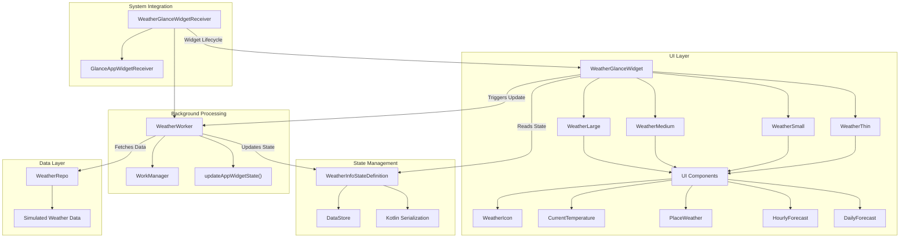
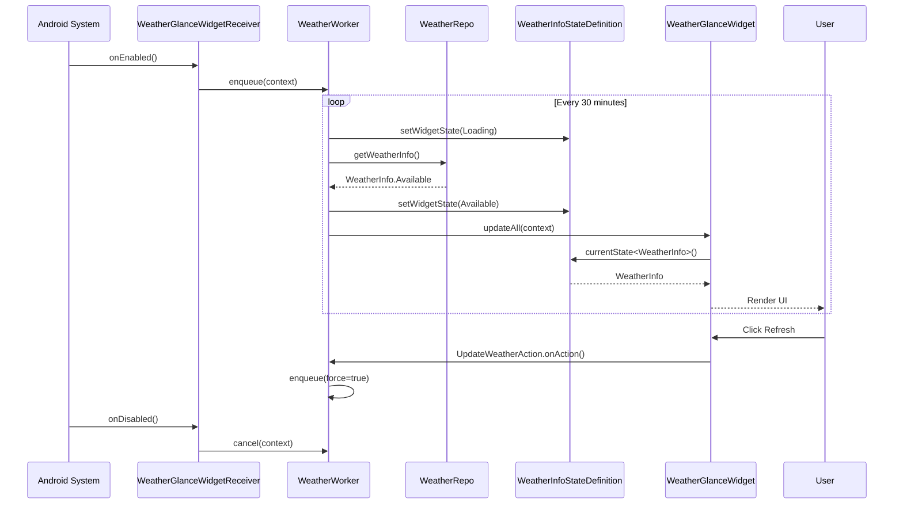
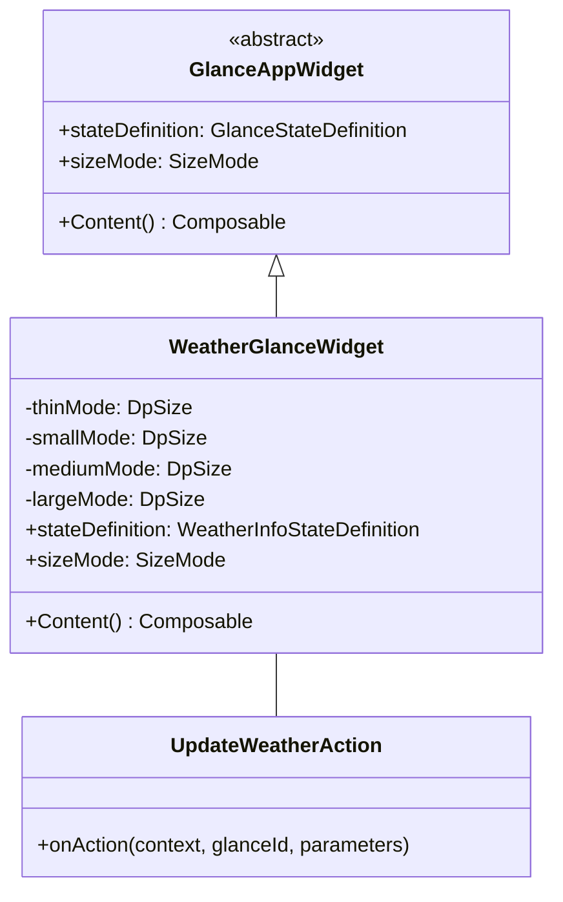
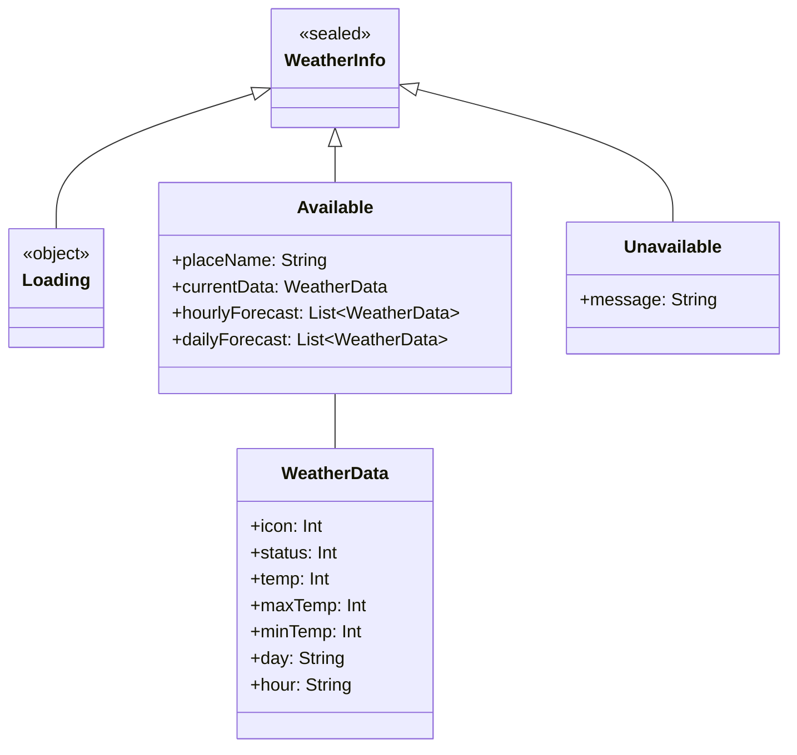
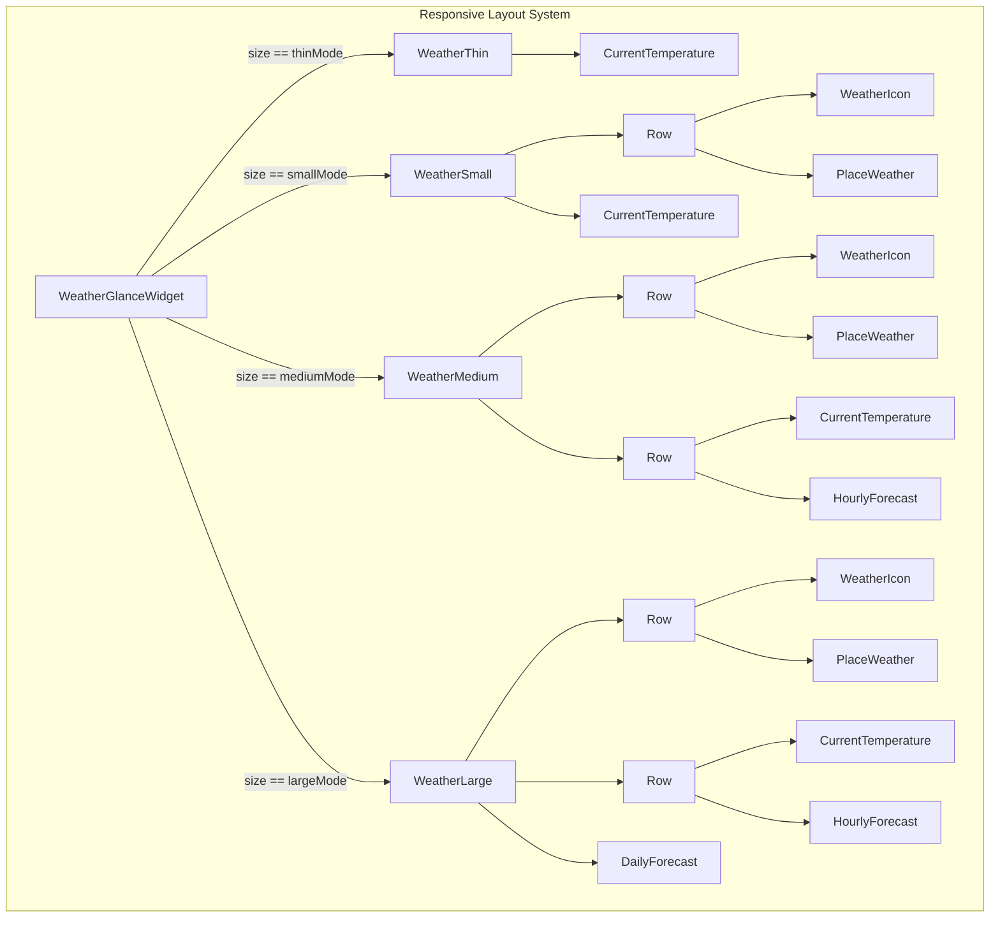
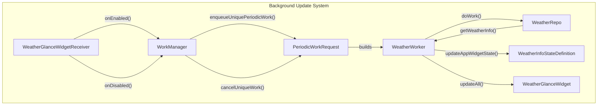
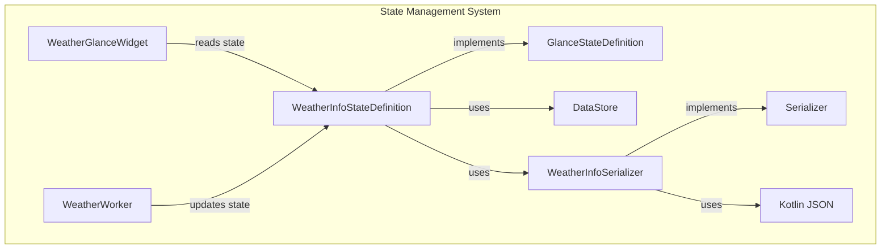
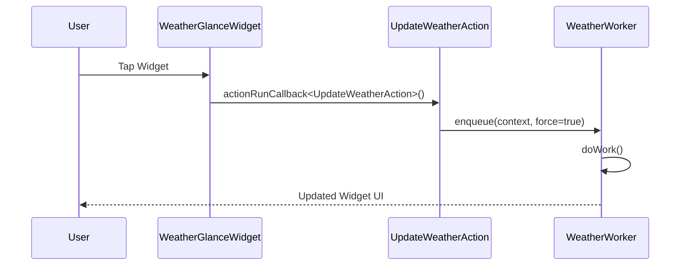

<!-- source: DeepWiki mcp.deepwiki.com · repo android/user-interface-samples · extra page Weather Widget Example · fetched 2026-10-23 -->

# Weather Widget Example

Relevant source files

The following files were used as context for generating this wiki page:

- [AppWidget/app/src/main/java/com/example/android/appwidget/glance/GlanceTheme.kt](AppWidget/app/src/main/java/com/example/android/appwidget/glance/GlanceTheme.kt)
- [AppWidget/app/src/main/java/com/example/android/appwidget/glance/weather/WeatherGlanceWidget.kt](AppWidget/app/src/main/java/com/example/android/appwidget/glance/weather/WeatherGlanceWidget.kt)
- [AppWidget/app/src/main/java/com/example/android/appwidget/glance/weather/WeatherGlanceWidgetReceiver.kt](AppWidget/app/src/main/java/com/example/android/appwidget/glance/weather/WeatherGlanceWidgetReceiver.kt)
- [AppWidget/app/src/main/java/com/example/android/appwidget/glance/weather/WeatherInfoStateDefinition.kt](AppWidget/app/src/main/java/com/example/android/appwidget/glance/weather/WeatherInfoStateDefinition.kt)
- [AppWidget/app/src/main/java/com/example/android/appwidget/glance/weather/WeatherRepo.kt](AppWidget/app/src/main/java/com/example/android/appwidget/glance/weather/WeatherRepo.kt)
- [AppWidget/app/src/main/java/com/example/android/appwidget/glance/weather/WeatherWorker.kt](AppWidget/app/src/main/java/com/example/android/appwidget/glance/weather/WeatherWorker.kt)
- [AppWidget/screenshots/image-gif.gif](AppWidget/screenshots/image-gif.gif)
- [AppWidget/screenshots/run-widget-config.png](AppWidget/screenshots/run-widget-config.png)
- [AppWidget/screenshots/todo-gif.gif](AppWidget/screenshots/todo-gif.gif)
- [AppWidget/screenshots/weather-gif.gif](AppWidget/screenshots/weather-gif.gif)

This document provides a technical overview of the Weather Widget Example implemented using Glance for Android. The example demonstrates how to create a responsive, data-driven home screen widget with multiple layouts based on size, persistent state management, and background updates.

For information about other widget examples, see [Glance Widgets](#4.2) and [Image Widget Example](#4.2.2).

## Overview

The Weather Widget Example illustrates how to build a home screen widget that displays weather data with varying levels of detail based on the available space. It showcases several important capabilities of the Glance framework, including:

- Responsive layouts that adapt to different widget sizes
- Background data refreshing with WorkManager
- Custom state management using DataStore
- Handling widget lifecycle events
- Material design theming

The sample provides a simulated weather data source to avoid external dependencies, focusing on implementation patterns rather than actual weather forecasting.

Sources: [AppWidget/app/src/main/java/com/example/android/appwidget/glance/weather/WeatherGlanceWidget.kt:17-42]()

## Architecture

The Weather Widget is built using a layered architecture with clear separation of concerns:

Sources: [AppWidget/app/src/main/java/com/example/android/appwidget/glance/weather/WeatherGlanceWidget.kt:42-94](), [AppWidget/app/src/main/java/com/example/android/appwidget/glance/weather/WeatherWorker.kt:27-69](), [AppWidget/app/src/main/java/com/example/android/appwidget/glance/weather/WeatherInfoStateDefinition.kt:36-78](), [AppWidget/app/src/main/java/com/example/android/appwidget/glance/weather/WeatherGlanceWidgetReceiver.kt:27-49]()

## Data Flow

The following diagram illustrates the data flow within the Weather Widget system:

Sources: [AppWidget/app/src/main/java/com/example/android/appwidget/glance/weather/WeatherWorker.kt:71-106](), [AppWidget/app/src/main/java/com/example/android/appwidget/glance/weather/WeatherGlanceWidget.kt:361-370](), [AppWidget/app/src/main/java/com/example/android/appwidget/glance/weather/WeatherGlanceWidgetReceiver.kt:37-49]()

## Key Components

### WeatherGlanceWidget

The `WeatherGlanceWidget` class is the main UI component that extends `GlanceAppWidget`. It defines the widget's appearance and handles user interactions.

Key features:
- Defines four different size modes for responsive layout
- Uses a custom state definition (`WeatherInfoStateDefinition`)
- Provides different UI compositions based on widget size
- Handles the refresh action through `UpdateWeatherAction`

Sources: [AppWidget/app/src/main/java/com/example/android/appwidget/glance/weather/WeatherGlanceWidget.kt:42-94](), [AppWidget/app/src/main/java/com/example/android/appwidget/glance/weather/WeatherGlanceWidget.kt:361-370]()

### Widget State

The widget's state is managed using a sealed class with three possible states:

The state is persisted using `WeatherInfoStateDefinition`, which implements `GlanceStateDefinition` with Kotlin serialization.

Sources: [AppWidget/app/src/main/java/com/example/android/appwidget/glance/weather/WeatherInfoStateDefinition.kt:36-78]()

### WeatherWorker

`WeatherWorker` is responsible for background updates of the weather information. It's implemented as a `CoroutineWorker` and uses WorkManager for scheduling.

Key features:
- Enqueues periodic work requests (every 30 minutes)
- Supports force refreshing when requested by the user
- Handles data loading, success, and error states
- Updates the widget state and triggers UI updates

Sources: [AppWidget/app/src/main/java/com/example/android/appwidget/glance/weather/WeatherWorker.kt:27-107]()

### WeatherRepo

`WeatherRepo` is a simulated data source that provides weather information. In a real application, this would connect to a weather API.

Key features:
- Simulates network loading with delays
- Generates random weather data
- Provides the current weather, hourly forecast, and daily forecast

Sources: [AppWidget/app/src/main/java/com/example/android/appwidget/glance/weather/WeatherRepo.kt:25-62]()

### WeatherGlanceWidgetReceiver

`WeatherGlanceWidgetReceiver` handles the widget lifecycle events by extending `GlanceAppWidgetReceiver`.

Key features:
- Starts the worker when the first widget instance is added
- Cancels the worker when the last widget instance is removed
- Associates the widget implementation with system events

Sources: [AppWidget/app/src/main/java/com/example/android/appwidget/glance/weather/WeatherGlanceWidgetReceiver.kt:27-49]()

## Responsive Layout System

The Weather Widget supports four different size modes, each with a specific layout:

| Size Mode | Dimensions | Layout Components |
|-----------|------------|-------------------|
| Thin      | 120dp × 120dp | Current temperature only |
| Small     | 184dp × 184dp | Weather icon, place info, current temperature |
| Medium    | 260dp × 200dp | All of small + hourly forecast |
| Large     | 260dp × 280dp | All of medium + daily forecast |

Each layout reuses common UI components but arranges them differently based on the available space.

Sources: [AppWidget/app/src/main/java/com/example/android/appwidget/glance/weather/WeatherGlanceWidget.kt:54-58](), [AppWidget/app/src/main/java/com/example/android/appwidget/glance/weather/WeatherGlanceWidget.kt:74-80](), [AppWidget/app/src/main/java/com/example/android/appwidget/glance/weather/WeatherGlanceWidget.kt:96-146]()

## UI Components

The Weather Widget is built from several reusable UI components:

1. **WeatherIcon**: Displays the weather condition icon
2. **CurrentTemperature**: Shows current temperature with min/max values
3. **PlaceWeather**: Displays location name and weather condition
4. **HourlyForecast**: Shows hourly weather predictions
5. **DailyForecast**: Shows daily weather predictions with a scrollable list

Each component is implemented as a Composable function that accepts a `WeatherInfo.Available` object and optional modifiers.

Sources: [AppWidget/app/src/main/java/com/example/android/appwidget/glance/weather/WeatherGlanceWidget.kt:172-356]()

## Background Updates and WorkManager Integration

The Weather Widget uses WorkManager to perform background updates:

Key aspects:
- Uses `PeriodicWorkRequest` for regular updates (every 30 minutes)
- Can be triggered on-demand via `UpdateWeatherAction`
- Handles retry logic with exponential backoff
- Manages the loading state by updating the widget before and after data fetching

Sources: [AppWidget/app/src/main/java/com/example/android/appwidget/glance/weather/WeatherWorker.kt:27-107](), [AppWidget/app/src/main/java/com/example/android/appwidget/glance/weather/WeatherGlanceWidgetReceiver.kt:37-49]()

## State Management and Persistence

The widget state is managed using a custom implementation of `GlanceStateDefinition`:

Key aspects:
- Uses DataStore for persistent storage
- Custom serializer with Kotlin JSON serialization
- Shared state between all widget instances
- Supports three state types: Loading, Available, Unavailable

Sources: [AppWidget/app/src/main/java/com/example/android/appwidget/glance/weather/WeatherInfoStateDefinition.kt:36-78]()

## User Interaction Handling

The Weather Widget handles user interactions through action callbacks:

1. **Widget Refresh**: When the user taps the widget, the `UpdateWeatherAction` is triggered, which forces the worker to update data immediately.

Sources: [AppWidget/app/src/main/java/com/example/android/appwidget/glance/weather/WeatherGlanceWidget.kt:361-370](), [AppWidget/app/src/main/java/com/example/android/appwidget/glance/weather/WeatherGlanceWidget.kt:98-104]()

## Theming Integration

The Weather Widget uses a custom theming implementation called `GlanceTheme`:

Key aspects:
- Provides a consistent color system across widget components
- Supports Material Design color roles (primary, secondary, surface, etc.)
- Allows theming to be applied at the composition level

Sources: [AppWidget/app/src/main/java/com/example/android/appwidget/glance/GlanceTheme.kt:31-126]()

## Summary

The Weather Widget Example demonstrates a comprehensive implementation of a data-driven, responsive home screen widget using the Glance framework. It showcases:

1. **Responsive UI**: Adapting layouts to different widget sizes
2. **Background Processing**: Using WorkManager for timely updates
3. **State Management**: Persisting widget state with DataStore
4. **Widget Lifecycle**: Handling system events appropriately
5. **User Interaction**: Responding to user actions
6. **Theming**: Applying consistent visual styling

This example provides a solid foundation for building other types of widgets with similar requirements.

---

