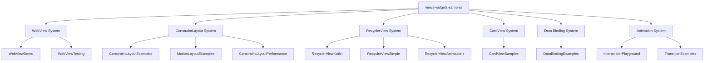
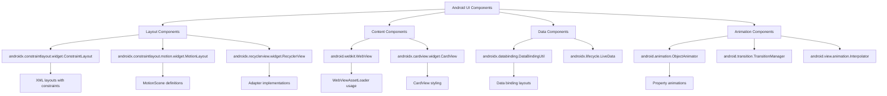

<!-- source: DeepWiki mcp.deepwiki.com · repo android/views-widgets-samples · page 1 Android Views and Widgets Samples - Overview · fetched 2026-10-23 -->

# Android Views and Widgets Samples - Overview

Relevant source files

The following files were used as context for generating this wiki page:

- [.gitignore](.gitignore)
- [CONTRIBUTING.md](CONTRIBUTING.md)
- [ConstraintLayoutExamples/README.md](ConstraintLayoutExamples/README.md)
- [LICENSE](LICENSE)
- [README.md](README.md)

## Purpose and Scope

This repository contains a collection of individual Android Studio projects that demonstrate various Android UI components, specifically focusing on views and widgets. Each project is self-contained and showcases specific implementation techniques, design patterns, and best practices for working with Android's UI framework.

The repository serves as a reference resource for developers looking to implement and understand different Android UI components through practical examples rather than theoretical explanations.

**Important Note**: This repository is being migrated to the new [platform-samples repository](https://github.com/android/platform-samples). Migrated samples can be found in the [user-interface section](https://github.com/android/platform-samples/tree/main/samples/user-interface).

Sources: [README.md:1-11]()

## Repository Structure

The repository is organized into several major systems, each demonstrating different UI components and patterns.

### Repository Architecture

Sources: Repository diagrams provided in the prompt, [README.md:7-11]()

## Major Systems Overview

### UI Component Relationships

Sources: Repository diagrams provided in the prompt

## WebView System

The WebView system is the most prominent component in the repository. It demonstrates how to integrate web content within Android applications using:

- `WebViewAssetLoader` for securely loading local HTML, JavaScript, and CSS assets
- JavaScript interface implementation with `@JavascriptInterface` annotations for two-way communication
- Support for dark mode through CSS variables and theme detection
- Proper handling of window insets for edge-to-edge displays

The implementation focuses on displaying weather information with location selection capabilities and data sharing features.

Sources: Repository diagrams provided in the prompt

## ConstraintLayout and MotionLayout System

The ConstraintLayout system demonstrates advanced layout techniques and animations. It includes a comprehensive set of examples:

| Category | Example | Key Components |
|----------|---------|----------------|
| Basic Motion | Basic transitions | `MotionLayout`, `ConstraintSet`, start/end states |
| Custom Attributes | Animating properties | `CustomAttribute`, attribute modification |
| Image Effects | Filter transitions | `ImageFilterView`, saturation/contrast controls |
| Keyframe Animations | Position control | `KeyPosition`, `KeyAttribute`, `KeyCycle` |
| Layout Integration | CoordinatorLayout | `CoordinatorLayout`, `AppBarLayout` integration |
| Custom Components | DrawerLayout | Custom drawer implementations |
| ViewPager | Page transitions | ViewPager with synchronized animations |
| Complex Motion | Multi-element coordination | Coordinated element animations |

Sources: [ConstraintLayoutExamples/README.md:9-57]()

## RecyclerView System

The RecyclerView system showcases different implementation approaches:

- Simple implementations with basic adapters
- Kotlin implementations with MVVM architecture
- Custom animations with specialized `ItemAnimator` classes
- Various `LayoutManager` configurations

The Kotlin implementation is the most extensive, featuring a flower catalog with add/remove functionality, detail views, and proper separation of concerns.

Sources: Repository diagrams provided in the prompt

## Additional UI Components

### CardView System
Demonstrates card-based UI implementations with proper styling and integration with other components.

### Data Binding System
Showcases the Android Data Binding library with:
- List and RecyclerView integration
- MVVM architecture implementation
- Observable data patterns

### Animation System
Features interpolator implementations and transition animations:
- Custom `Interpolator` classes
- Transition animations using the Transitions framework
- Property animations with `ObjectAnimator`

Sources: Repository diagrams provided in the prompt

## Technical Requirements

- Android Studio 3.3 or higher
- Constraint Layout library 2.0.0-alpha5 or higher (for ConstraintLayout examples)
- AndroidX libraries

Sources: [ConstraintLayoutExamples/README.md:15-18]()

## Using These Samples

Each sample is a standalone Android Studio project. To use them:

1. Clone the repository
2. Open the specific sample in Android Studio
3. Build and run on an emulator or device
4. Examine the code to understand implementation details

For ConstraintLayout examples, the samples are best understood by viewing the constraints in the Design mode of the layout editor.

Sources: [ConstraintLayoutExamples/README.md:20-24]()

## Contributing

Contributions to this repository are welcome. See the [contributing guidelines](CONTRIBUTING.md) for details on:
- Contributor License Agreement requirements
- Code review process
- Community guidelines

Sources: [CONTRIBUTING.md:1-28]()

## License

This repository is licensed under the Apache License, Version 2.0. See the [LICENSE](LICENSE) file for complete terms.

Sources: [LICENSE:1-191]()

---

