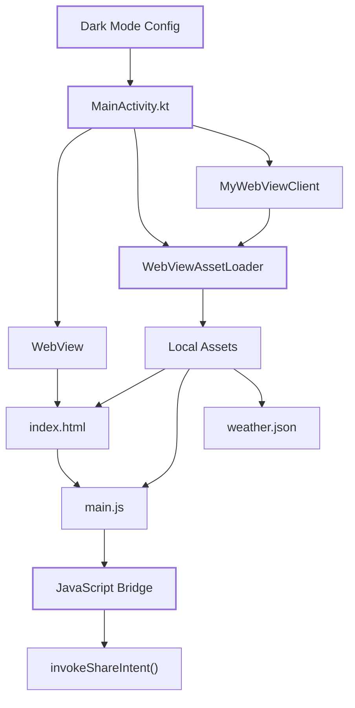
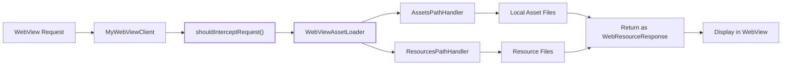
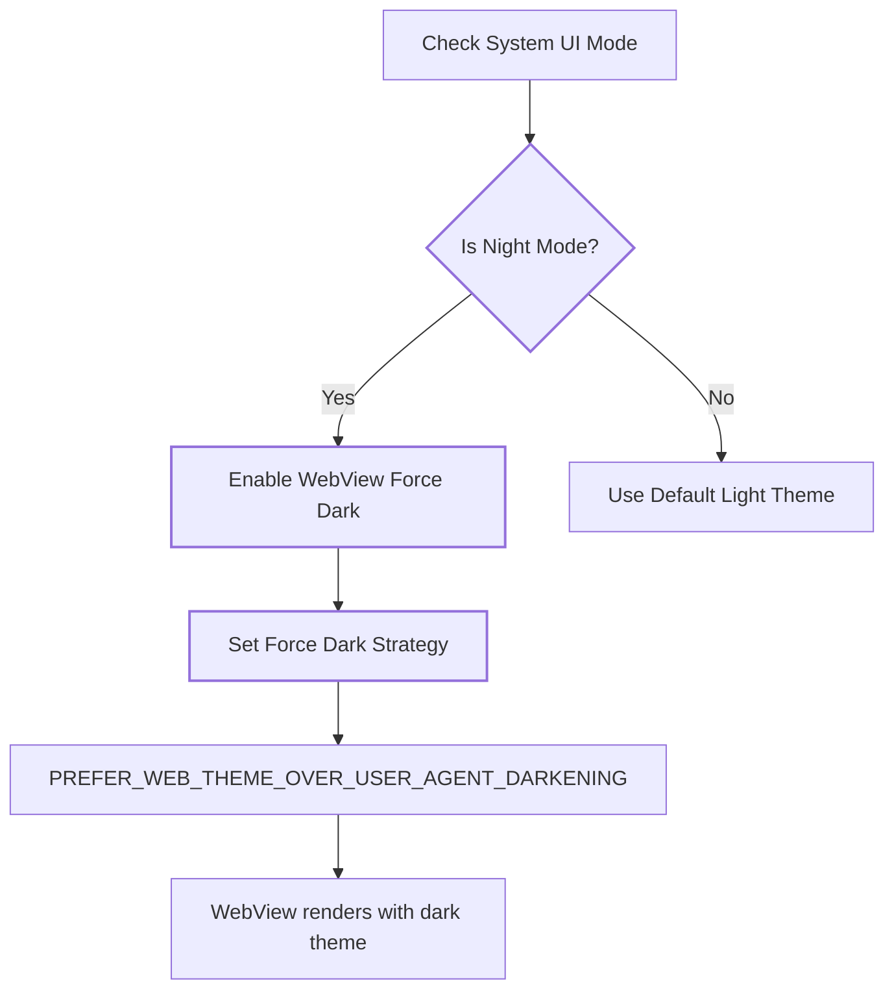
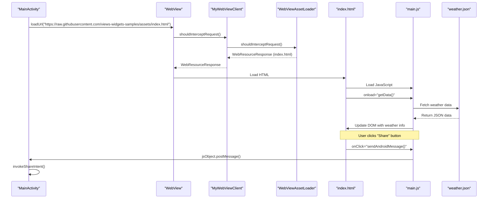

<!-- source: DeepWiki mcp.deepwiki.com · repo android/views-widgets-samples · page 2 WebView System · fetched 2026-10-23 -->

# WebView System

<details>
<summary>Relevant source files</summary>

The following files were used as context for generating this wiki page:

- [WebView/.gitignore](WebView/.gitignore)
- [WebView/README.md](WebView/README.md)
- [WebView/app/.gitignore](WebView/app/.gitignore)
- [WebView/app/proguard-rules.pro](WebView/app/proguard-rules.pro)
- [WebView/app/src/main/assets/index.html](WebView/app/src/main/assets/index.html)
- [WebView/app/src/main/assets/main.js](WebView/app/src/main/assets/main.js)
- [WebView/app/src/main/java/com/android/samples/webviewdemo/MainActivity.kt](WebView/app/src/main/java/com/android/samples/webviewdemo/MainActivity.kt)
- [WebView/app/src/main/res/drawable-v24/ic_launcher_foreground.xml](WebView/app/src/main/res/drawable-v24/ic_launcher_foreground.xml)
- [WebView/app/src/main/res/drawable/ic_launcher_background.xml](WebView/app/src/main/res/drawable/ic_launcher_background.xml)
- [WebView/app/src/main/res/values/strings.xml](WebView/app/src/main/res/values/strings.xml)
- [WebView/sampleData/weather.json](WebView/sampleData/weather.json)

</details>


## Overview and Purpose

The WebView System is a demonstration of best practices for embedding web content in Android applications using the AndroidX WebKit API. This system showcases a weather information application that implements secure loading of local assets, bidirectional communication between JavaScript and Android code, and responsive design with proper dark mode support.

For detailed implementation specifics, see [WebView Implementation](#2.1) and [WebView Testing](#2.2). For styling-related information, refer to [WebView Styling and Theming](#2.3).

## System Architecture



**Diagram: WebView System Architecture**

Sources: [WebView/app/src/main/java/com/android/samples/webviewdemo/MainActivity.kt:36-151]()

## Key Components

### 1. WebViewAssetLoader

The WebViewAssetLoader securely serves local content to the WebView through HTTPS URLs, maintaining compliance with the Same-Origin policy.



**Diagram: Asset Loading Process**

Sources: [WebView/app/src/main/java/com/android/samples/webviewdemo/MainActivity.kt:104-125](), [WebView/app/src/main/java/com/android/samples/webviewdemo/MainActivity.kt:38-46]()

The implementation configures a custom domain and path handlers:

```kotlin
val assetLoader = WebViewAssetLoader.Builder()
    .setDomain("raw.githubusercontent.com")
    .addPathHandler(
        "/views-widgets-samples/assets/",
        WebViewAssetLoader.AssetsPathHandler(this)
    )
    .addPathHandler(
        "/views-widgets-samples/res/",
        WebViewAssetLoader.ResourcesPathHandler(this)
    )
    .build()
```

This setup allows loading local files through URLs like `https://raw.githubusercontent.com/views-widgets-samples/assets/index.html`, which maintains web security standards while serving local content.

Sources: [WebView/app/src/main/java/com/android/samples/webviewdemo/MainActivity.kt:115-125]()

### 2. JavaScript Bridge

The system implements a JavaScript bridge that enables two-way communication between the Android application and web content.

| Direction | Mechanism | Purpose |
|-----------|-----------|---------|
| JavaScript to Android | `jsObject.postMessage()` | Share weather information via Android's native sharing mechanism |
| Android to JavaScript | JavaScript function calls | Update UI elements with data or trigger actions |

In the JavaScript side, the system uses `postMessage()` to communicate with Android:

```javascript
function sendAndroidMessage() {
    jsObject.postMessage("The weather in " + `${document.getElementById("title").innerText}` + " today is " +
    `${document.getElementById("shortDescription").innerText} `);
}
```

On the Android side, this message is received and processed by the `invokeShareIntent()` method.

Sources: [WebView/app/src/main/java/com/android/samples/webviewdemo/MainActivity.kt:143-147](), [WebView/app/src/main/assets/main.js:16-23]()

### 3. Dark Mode Support

The WebView System includes proper dark mode support that respects the system theme settings:



**Diagram: Dark Mode Configuration Flow**

The implementation detects the current UI mode and applies appropriate dark mode settings to the WebView when needed:

```kotlin
if (nightModeFlag == Configuration.UI_MODE_NIGHT_YES) {
    // Switch WebView to dark mode
    if (WebViewFeature.isFeatureSupported(WebViewFeature.FORCE_DARK)) {
        WebSettingsCompat.setForceDark(
            binding.webview.settings,
            WebSettingsCompat.FORCE_DARK_ON
        )
    }
    
    if (WebViewFeature.isFeatureSupported(WebViewFeature.FORCE_DARK_STRATEGY)) {
        WebSettingsCompat.setForceDarkStrategy(
            binding.webview.settings,
            DARK_STRATEGY_PREFER_WEB_THEME_OVER_USER_AGENT_DARKENING
        )
    }
}
```

The HTML also specifies a `color-scheme` meta tag to support this behavior:

```html
<meta name="color-scheme" content="dark light">
```

Sources: [WebView/app/src/main/java/com/android/samples/webviewdemo/MainActivity.kt:67-102](), [WebView/app/src/main/assets/index.html:20]()

## Data Flow



**Diagram: WebView System Data Flow**

Sources: [WebView/app/src/main/java/com/android/samples/webviewdemo/MainActivity.kt:150](), [WebView/app/src/main/assets/index.html:23-35](), [WebView/app/src/main/assets/main.js:16-56]()

## Content Structure

The WebView System displays weather information for different locations:

| Component | Description | Implementation |
|-----------|-------------|----------------|
| Location Selector | Dropdown menu to select different cities | HTML `<select>` element in index.html |
| Weather Display | Shows current temperature and conditions | HTML elements updated by JavaScript |
| Weather Icons | Visual representation of weather conditions | Local drawable resources accessed via WebViewAssetLoader |
| Share Button | Triggers native Android sharing | JavaScript to Android bridge |

The content is structured in HTML, with styling applied from CSS and behavior implemented in JavaScript:

```
index.html
└── Loads and uses:
    ├── style.css (styling)
    ├── main.js (functionality)
    │   └── Fetches data from:
    │       └── weather.json (sample data)
    └── Images from:
        └── Android drawable resources
```

Sources: [WebView/app/src/main/assets/index.html:17-36](), [WebView/app/src/main/assets/main.js:26-56](), [WebView/sampleData/weather.json:1-26]()

## Security Considerations

The WebView System implements several security best practices:

1. **Local Asset Access**: Uses WebViewAssetLoader to securely access local assets without exposing them directly
2. **JavaScript Enable**: Only enables JavaScript for the specific domain needed
3. **Debugging Configuration**: Only enables WebView debugging for debug builds
4. **Origin Rules**: Specifies allowed origin rules for JavaScript communication

```kotlin
// Setup debugging only for debug builds
if (applicationInfo.flags and ApplicationInfo.FLAG_DEBUGGABLE != 0) {
    WebView.setWebContentsDebuggingEnabled(true)
}

// Enable JavaScript
binding.webview.settings.javaScriptEnabled = true
```

Sources: [WebView/app/src/main/java/com/android/samples/webviewdemo/MainActivity.kt:134-139]()

## Integration Points

The WebView System demonstrates integration with the following Android components:

1. **Sharing Functionality**: Invokes native Android sharing via Intent
2. **UI Mode Detector**: Responds to system dark/light theme changes
3. **WebView Configuration**: Configures WebView with proper settings for performance and security

```kotlin
// Invokes native android sharing
private fun invokeShareIntent(message: String) {
    val sendIntent: Intent = Intent().apply {
        action = Intent.ACTION_SEND
        putExtra(Intent.EXTRA_TEXT, message)
        type = "text/plain"
    }
    val shareIntent = Intent.createChooser(sendIntent, null)
    startActivity(this@MainActivity, shareIntent, null)
}
```

Sources: [WebView/app/src/main/java/com/android/samples/webviewdemo/MainActivity.kt:49-57]()

## Summary

The WebView System provides a comprehensive demonstration of best practices for embedding web content in Android applications. It showcases:

1. Secure loading of local assets using WebViewAssetLoader
2. Two-way communication between JavaScript and Android
3. Proper dark mode support and responsive design
4. Accessing local resources from web content
5. Integration with native Android functionality (sharing)

This sample serves as a reference implementation for Android developers who need to embed web content in their applications while maintaining security, proper theming, and native integration.

Sources: [WebView/app/src/main/java/com/android/samples/webviewdemo/MainActivity.kt:17-151](), [WebView/README.md:1-28]()

---

