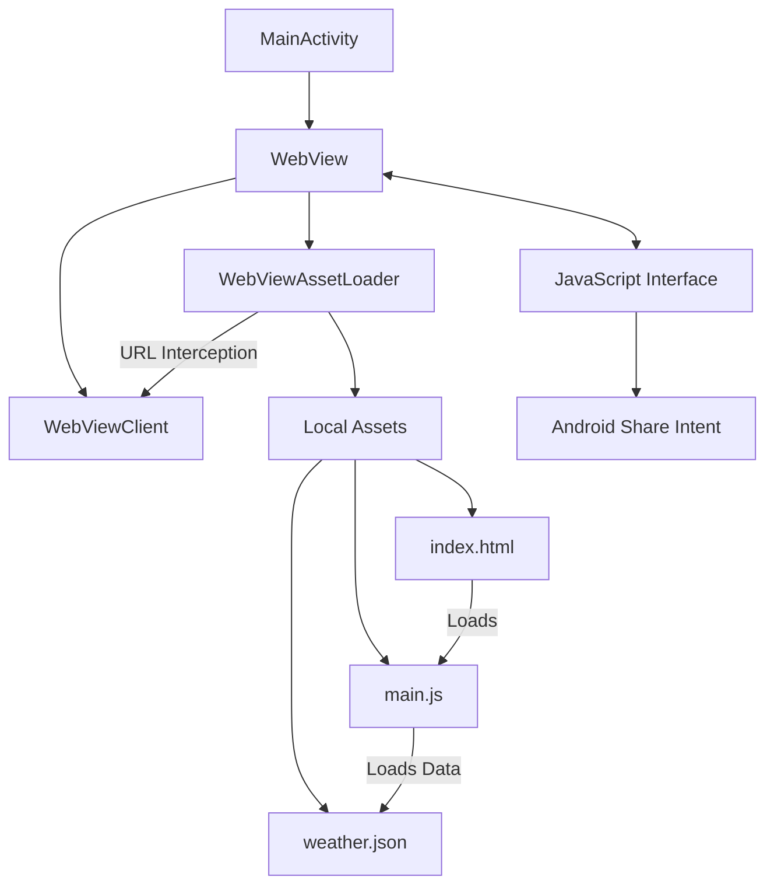
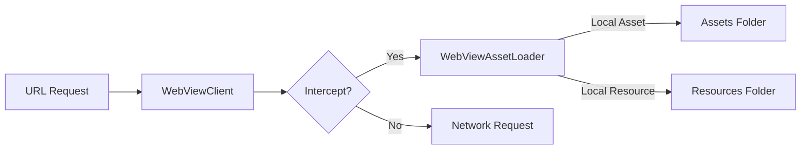
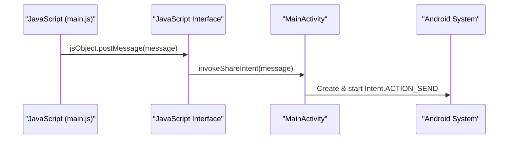
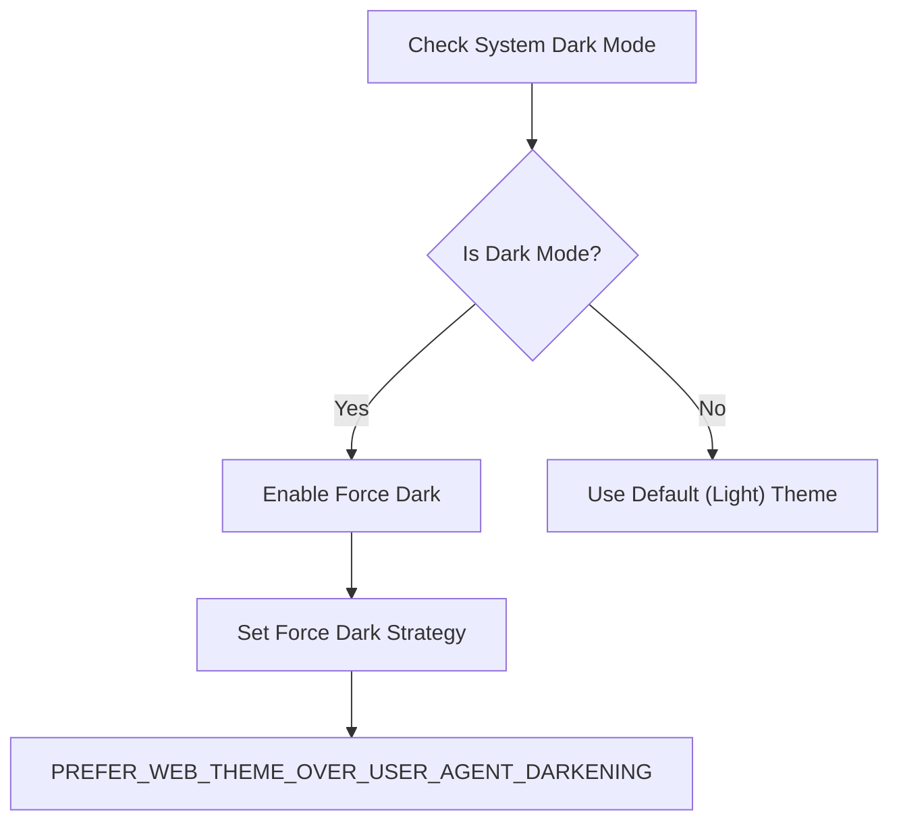
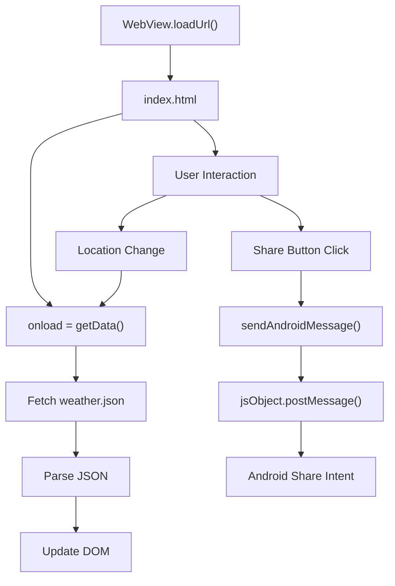

<!-- source: DeepWiki mcp.deepwiki.com · repo android/views-widgets-samples · page 2.1 WebView Implementation · fetched 2026-10-23 -->

# WebView Implementation

<details>
<summary>Relevant source files</summary>

The following files were used as context for generating this wiki page:

- [WebView/app/src/main/assets/index.html](WebView/app/src/main/assets/index.html)
- [WebView/app/src/main/assets/main.js](WebView/app/src/main/assets/main.js)
- [WebView/app/src/main/java/com/android/samples/webviewdemo/MainActivity.kt](WebView/app/src/main/java/com/android/samples/webviewdemo/MainActivity.kt)
- [WebView/app/src/main/res/layout/activity_main.xml](WebView/app/src/main/res/layout/activity_main.xml)
- [WebView/app/src/main/res/values/strings.xml](WebView/app/src/main/res/values/strings.xml)
- [WebView/build.gradle](WebView/build.gradle)
- [WebView/gradle/wrapper/gradle-wrapper.properties](WebView/gradle/wrapper/gradle-wrapper.properties)
- [WebView/sampleData/weather.json](WebView/sampleData/weather.json)

</details>


## Purpose and Scope

This document examines the implementation of WebView in the Android Views and Widgets Samples repository, focusing on how to properly integrate web content with Android applications. The implementation demonstrates best practices for loading local assets securely, facilitating JavaScript-Android communication, supporting dark mode, and configuring WebView for development. For information about testing WebView components, see [WebView Testing](#2.2), and for styling details, see [WebView Styling and Theming](#2.3).

## Architecture Overview



Sources: [WebView/app/src/main/java/com/android/samples/webviewdemo/MainActivity.kt:36-151](), [WebView/app/src/main/assets/index.html:16-36](), [WebView/app/src/main/assets/main.js:16-56]()

The WebView implementation showcases a weather application that loads local HTML, JavaScript, and CSS assets while also fetching remote JSON data. The architecture enables two-way communication between web content and native Android code, with proper handling of dark mode and security considerations.

## WebView Configuration

The WebView is configured in the `MainActivity` with several key settings:

### WebViewAssetLoader Setup

The WebViewAssetLoader acts as a bridge between the Android filesystem and web content, allowing local assets to be loaded securely via HTTPS:



Sources: [WebView/app/src/main/java/com/android/samples/webviewdemo/MainActivity.kt:104-125](), [WebView/app/src/main/java/com/android/samples/webviewdemo/MainActivity.kt:38-46]()

The WebViewAssetLoader is configured with:

- Custom domain: `raw.githubusercontent.com`
- Asset path handler: Maps `/views-widgets-samples/assets/` to local assets
- Resource path handler: Maps `/views-widgets-samples/res/` to app resources

This configuration allows the web content to access local files using URL patterns that don't conflict with real web addresses, maintaining security while supporting the same-origin policy.

### WebView Client Implementation

A custom WebViewClient intercepts resource requests and redirects them to local assets when appropriate:

```kotlin
private class MyWebViewClient(private val assetLoader: WebViewAssetLoader) :
    WebViewClientCompat() {
    override fun shouldInterceptRequest(
        view: WebView,
        request: WebResourceRequest
    ): WebResourceResponse? {
        return assetLoader.shouldInterceptRequest(request.url)
    }
}
```

Sources: [WebView/app/src/main/java/com/android/samples/webviewdemo/MainActivity.kt:38-46](), [WebView/app/src/main/java/com/android/samples/webviewdemo/MainActivity.kt:128]()

### JavaScript and Debugging

JavaScript is enabled in the WebView, and debugging is configured to support Chrome DevTools for WebViews in debug builds:

```kotlin
// Enable Javascript
binding.webview.settings.javaScriptEnabled = true

// Setup debugging
if (applicationInfo.flags and ApplicationInfo.FLAG_DEBUGGABLE != 0) {
    WebView.setWebContentsDebuggingEnabled(true)
}
```

Sources: [WebView/app/src/main/java/com/android/samples/webviewdemo/MainActivity.kt:134-139]()

## JavaScript Bridge Implementation

The implementation provides communication between JavaScript and Android through a JavaScript interface object:



Sources: [WebView/app/src/main/java/com/android/samples/webviewdemo/MainActivity.kt:49-57](), [WebView/app/src/main/java/com/android/samples/webviewdemo/MainActivity.kt:142-147](), [WebView/app/src/main/assets/main.js:16-23]()

The JavaScript interface is created in `MainActivity` and injected into the WebView. When a user clicks the "Share" button in the weather app, JavaScript calls the interface to trigger an Android share intent with weather information.

## Dark Mode Support

The implementation includes comprehensive dark mode support, detecting system appearance settings and adjusting the WebView's rendering accordingly:



Sources: [WebView/app/src/main/java/com/android/samples/webviewdemo/MainActivity.kt:67-102]()

Key aspects of the dark mode implementation:

1. Checks the system's UI mode using `Configuration.UI_MODE_NIGHT_MASK`
2. If dark mode is enabled:
   - Sets force dark mode on the WebView using `WebSettingsCompat.setForceDark()`
   - Configures the dark mode strategy to prefer web theme over user agent darkening
3. The HTML includes a meta tag to support color scheme detection: `<meta name="color-scheme" content="dark light">`

This ensures a consistent experience that respects both the system's appearance settings and the web content's theming capabilities.

## Asset Loading and Data Flow

The WebView demo includes a complete end-to-end implementation of local and remote asset loading:



Sources: [WebView/app/src/main/java/com/android/samples/webviewdemo/MainActivity.kt:150](), [WebView/app/src/main/assets/index.html:23-35](), [WebView/app/src/main/assets/main.js:16-56]()

The key components in this flow:

1. MainActivity loads the initial URL: `https://raw.githubusercontent.com/views-widgets-samples/assets/index.html`
2. WebViewClient intercepts this request and maps it to the local asset
3. HTML loads, and the `getData()` JavaScript function executes
4. The function fetches weather data from a remote JSON file
5. DOM is updated with weather information
6. User can select different locations or share the weather information

## HTML and JavaScript Implementation

### HTML Structure

The HTML implementation provides a simple weather application interface with:

- Location selector dropdown
- Weather information display (temperature, description)
- Share button that communicates with Android

Sources: [WebView/app/src/main/assets/index.html:16-36]()

### JavaScript Functionality

The JavaScript implementation handles:

1. Loading and parsing weather data
2. Updating the UI based on selected location
3. Communicating with Android through the JavaScript interface

Key functions:

- `getData()`: Fetches weather data and updates the UI
- `sendAndroidMessage()`: Creates a message with current weather data and sends it to Android
- `getIcon()`: Maps weather descriptions to appropriate icons

Sources: [WebView/app/src/main/assets/main.js:16-56]()

## WebView Layout Integration

The WebView is integrated into the Android UI through a simple layout file:

```xml
<FrameLayout xmlns:android="http://schemas.android.com/apk/res/android"
    android:layout_width="fill_parent"
    android:layout_height="fill_parent"
    xmlns:tools="http://schemas.android.com/tools"
    tools:context=".MainActivity">

    <WebView
        android:id="@+id/webview"
        android:layout_width="match_parent"
        android:layout_height="match_parent" />
</FrameLayout>
```

Sources: [WebView/app/src/main/res/layout/activity_main.xml:18-28]()

## Dependencies

The implementation relies on several key dependencies:

- androidx.webkit:webkit - Provides WebViewAssetLoader and other WebView extensions
- Kotlin standard library - For Kotlin language support

Sources: [WebView/build.gradle:17-53]()

## Summary

The WebView implementation demonstrates best practices for integrating web content with Android applications, including:

1. Secure loading of local assets using WebViewAssetLoader
2. Proper JavaScript-to-Android communication
3. Comprehensive dark mode support
4. WebView debugging setup
5. Handling of local and remote resources

This implementation serves as a reference for developers looking to integrate web content into their Android applications while maintaining security and providing a seamless user experience.

---

