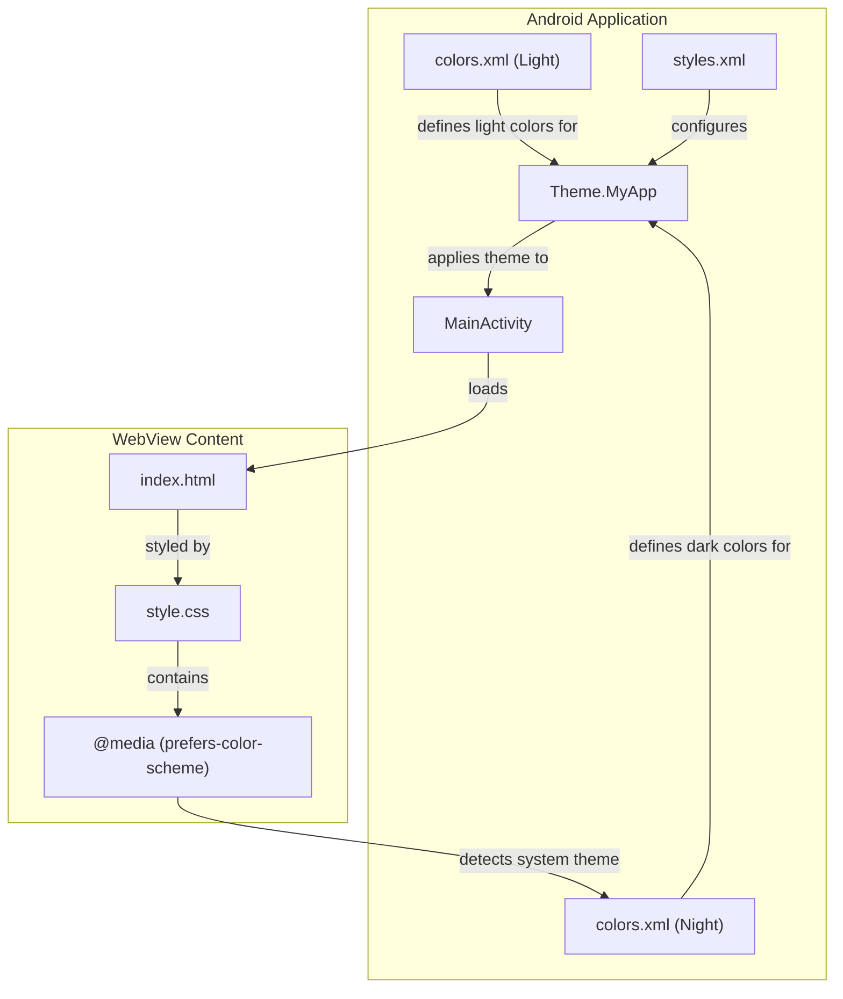
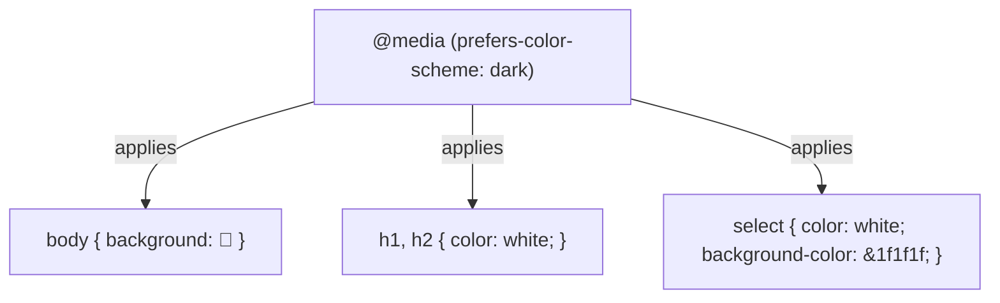
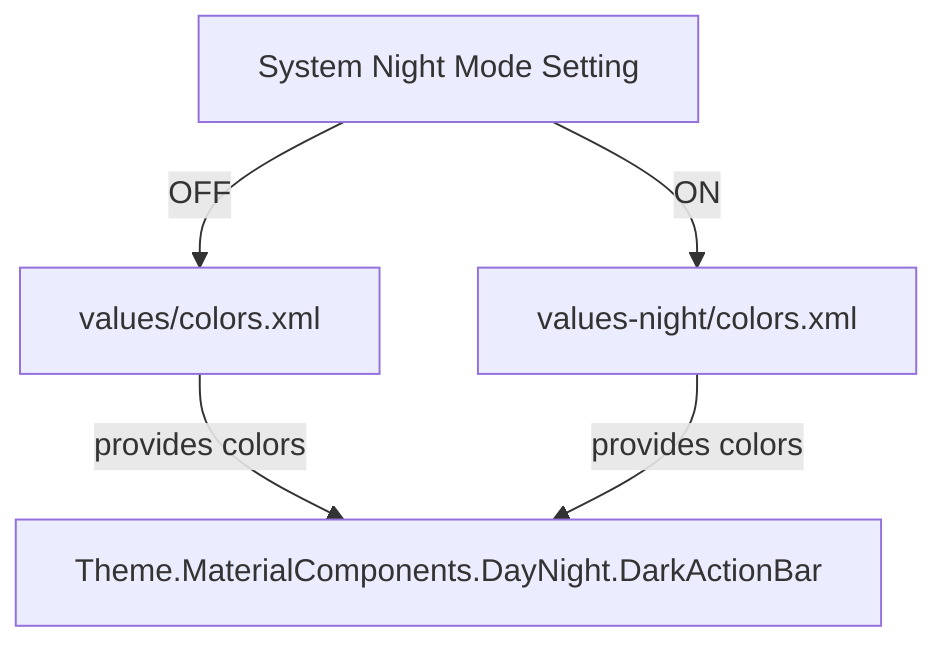
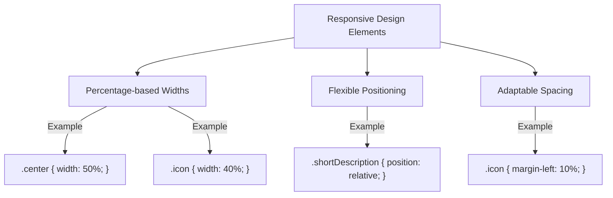

<!-- source: DeepWiki mcp.deepwiki.com · repo android/views-widgets-samples · page 2.3 WebView Styling and Theming · fetched 2026-10-23 -->

# WebView Styling and Theming

<details>
<summary>Relevant source files</summary>

The following files were used as context for generating this wiki page:

- [WebView/app/src/main/AndroidManifest.xml](WebView/app/src/main/AndroidManifest.xml)
- [WebView/app/src/main/assets/style.css](WebView/app/src/main/assets/style.css)
- [WebView/app/src/main/res/drawable-v24/partly_cloudy.png](WebView/app/src/main/res/drawable-v24/partly_cloudy.png)
- [WebView/app/src/main/res/drawable-v24/rain.png](WebView/app/src/main/res/drawable-v24/rain.png)
- [WebView/app/src/main/res/drawable-v24/sunny.png](WebView/app/src/main/res/drawable-v24/sunny.png)
- [WebView/app/src/main/res/values-night/colors.xml](WebView/app/src/main/res/values-night/colors.xml)
- [WebView/app/src/main/res/values/colors.xml](WebView/app/src/main/res/values/colors.xml)
- [WebView/app/src/main/res/values/styles.xml](WebView/app/src/main/res/values/styles.xml)

</details>


## Purpose and Scope

This document explains the styling and theming implementation for WebView in the views-widgets-samples repository. It covers how CSS styling is applied to WebView content, how dark mode is supported, and how Android themes integrate with WebView styling. For information about the basic WebView implementation and JavaScript bridging, see [WebView Implementation](#2.1). For testing approaches for WebView components, see [WebView Testing](#2.2).

## WebView Styling Architecture

The WebView demo application implements a responsive design that adapts to both light and dark themes while maintaining visual consistency with the Android application's theme. The styling system consists of two main components:

1. **Android Theme** - Defines the native UI appearance using Material Design themes
2. **WebView CSS** - Styles the web content loaded into the WebView component



Sources: [WebView/app/src/main/res/values/styles.xml:19-25](), [WebView/app/src/main/res/values/colors.xml:18-22](), [WebView/app/src/main/res/values-night/colors.xml:18-22](), [WebView/app/src/main/assets/style.css:16-101]()

## CSS Styling Implementation

The WebView demo uses a single CSS file (`style.css`) to style all HTML content. The CSS defines styles for basic elements and custom classes used in the weather application UI.

### Key Styling Elements

The CSS includes styling for:

| Element/Class | Purpose | CSS Properties |
|---------------|---------|----------------|
| `body` | Main background | Background color |
| `h1, h2` | Headings | Text alignment, color |
| `p`, `label` | Text content | Font family, size |
| `.button` | Interactive buttons | Colors, border-radius, padding |
| `.center` | Centered elements | Margin, display, width |
| `.icon`, `.currentTemp` | Weather display | Width, margins, floating |
| `.shortDescription`, `.longDescription` | Weather information | Positioning, padding |

The styling provides a clean, readable interface for displaying weather information with appropriate spacing and visual hierarchy.

```mermaid
classDiagram
    class "WebView CSS Structure" {
        +Base Elements
        +UI Components
        +Layout Classes
        +Dark Mode Support
    }
    
    class "Base Elements" {
        +body
        +h1, h2
        +p
        +label
        +img
    }
    
    class "UI Components" {
        +.button
        +.share
    }
    
    class "Layout Classes" {
        +.center
        +.icon
        +.currentTemp
        +.shortDescription
        +.longDescription
        +.day
    }
    
    class "Dark Mode Support" {
        +@media (prefers-color-scheme: dark)
    }
    
    "WebView CSS Structure" --> "Base Elements"
    "WebView CSS Structure" --> "UI Components"
    "WebView CSS Structure" --> "Layout Classes"
    "WebView CSS Structure" --> "Dark Mode Support"
```

Sources: [WebView/app/src/main/assets/style.css:16-88]()

## Dark Mode Support

One of the key features of the WebView styling system is its support for dark mode. The implementation follows a two-pronged approach:

1. **Native Android UI** - Uses `values-night/colors.xml` to define dark theme colors
2. **WebView Content** - Uses CSS media queries to detect and apply dark theme

### CSS Dark Mode Implementation

The CSS file implements dark mode support through a media query that detects the system's color scheme preference:



When the system is in dark mode, the WebView content automatically adjusts its background color, text colors, and form elements to match the darker palette.

Sources: [WebView/app/src/main/assets/style.css:89-101]()

### Android Theme Integration

The application uses Material Design's DayNight theme to automatically switch between light and dark themes based on system settings:



The theme defined in `styles.xml` references color resources that change depending on whether the device is in light or dark mode.

Sources: [WebView/app/src/main/res/values/styles.xml:19-25](), [WebView/app/src/main/res/values/colors.xml:18-22](), [WebView/app/src/main/res/values-night/colors.xml:18-22]()

## Responsive Design Elements

The styling in the WebView demo implements responsive design principles to ensure the content looks good on different screen sizes and orientations.

### Key Responsive Techniques

1. **Percentage-based widths** - Many elements use percentage widths (e.g., `.center { width: 50%; }`)
2. **Flexible positioning** - Using relative positioning to maintain layout relationships
3. **Adaptable spacing** - Using percentage margins to scale spacing with screen size



Sources: [WebView/app/src/main/assets/style.css:58-88]()

## Button Styling

The application includes custom button styling that maintains visual consistency with Material Design principles while adapting to the WebView context.

### Button Style Components

The `.button` class defines a Material-inspired button with:

- Teal background color (`#03DAC6`) matching the app's accent color
- Rounded corners with 8px border-radius
- Proper padding and text styling
- Active state changes (slight position shift on click)

This styling ensures that interactive elements in the WebView match the look and feel of native Android buttons.

Sources: [WebView/app/src/main/assets/style.css:36-54](), [WebView/app/src/main/res/values/colors.xml:21]()

## Image Handling

The WebView styling includes specific handling for images to ensure they display properly:

1. **Rounded corners** - All images have a slight border radius (4px)
2. **Proper padding** - 5px padding provides visual spacing
3. **Weather icons** - Specialized positioning for weather condition icons

The application includes specific image assets for different weather conditions (sunny, rainy, partly cloudy) that are styled consistently through the CSS.

Sources: [WebView/app/src/main/assets/style.css:32-35](), [WebView/app/src/main/res/drawable-v24/sunny.png](), [WebView/app/src/main/res/drawable-v24/rain.png](), [WebView/app/src/main/res/drawable-v24/partly_cloudy.png]()

## Best Practices Demonstrated

The WebView styling and theming implementation demonstrates several best practices:

1. **Theme consistency** - Maintaining visual consistency between native UI and web content
2. **Dark mode support** - Properly handling light and dark themes in both contexts
3. **Responsive design** - Using flexible layouts that adapt to different screen sizes
4. **Material Design principles** - Following Material Design guidelines for colors, typography, and component styling
5. **Clean CSS organization** - Logically organizing CSS with clear component separation

These practices ensure a seamless user experience that feels native and responds appropriately to system settings and user preferences.

---

