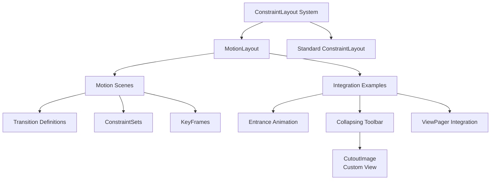
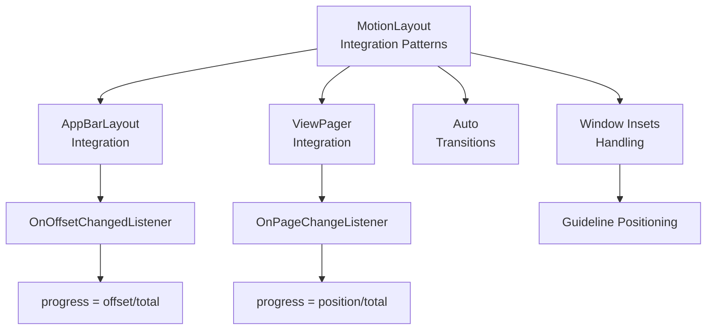
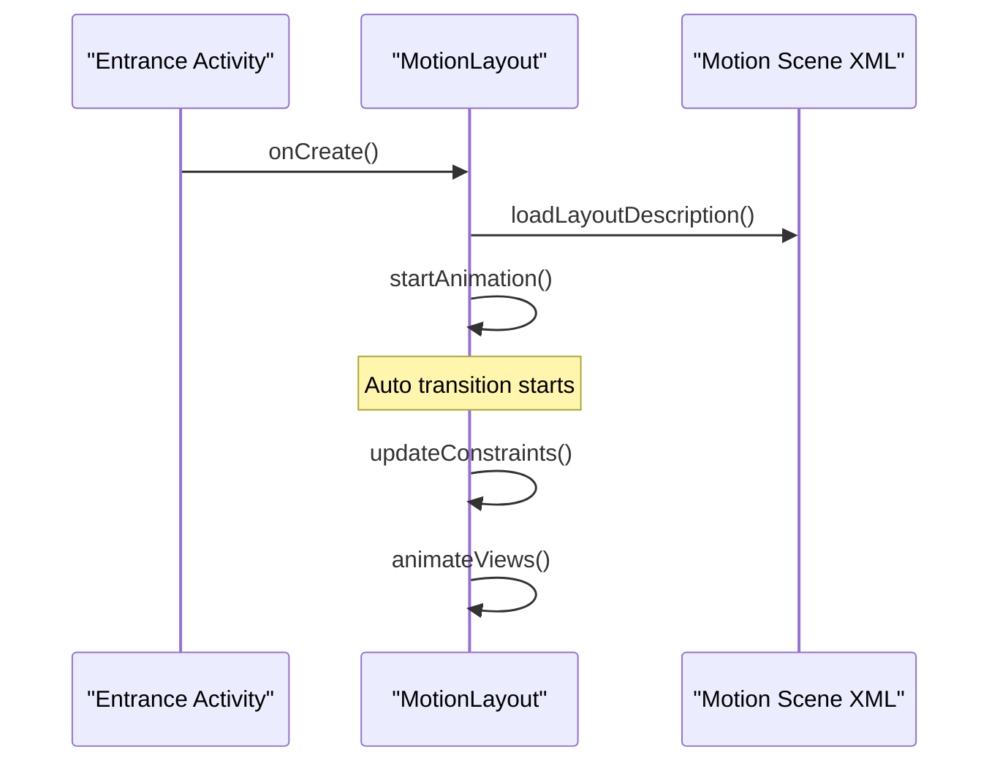
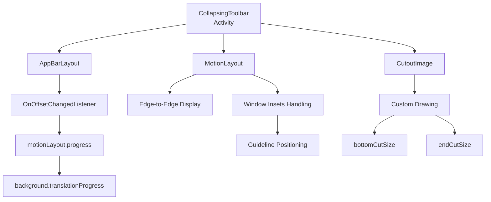
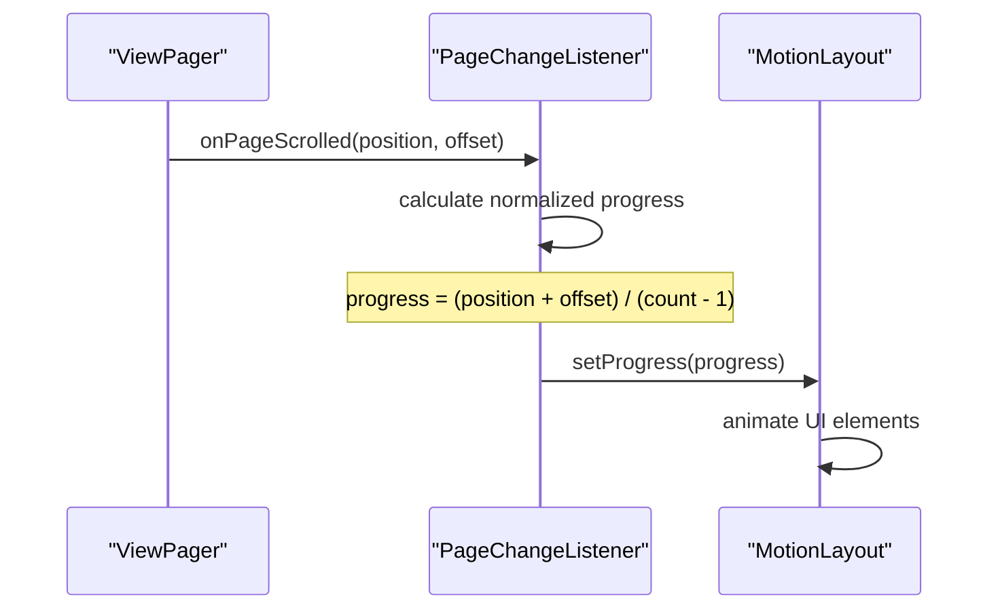
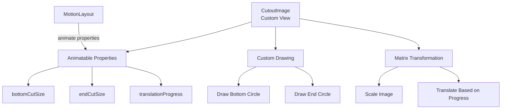
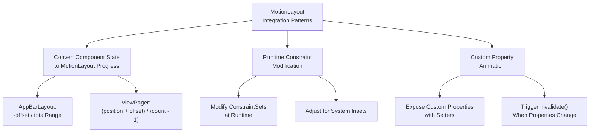

<!-- source: DeepWiki mcp.deepwiki.com · repo android/views-widgets-samples · page 3 ConstraintLayout and MotionLayout System · fetched 2026-10-23 -->

# ConstraintLayout and MotionLayout System

<details>
<summary>Relevant source files</summary>

The following files were used as context for generating this wiki page:

- [ConstraintLayoutExamples/build.gradle](ConstraintLayoutExamples/build.gradle)
- [ConstraintLayoutExamples/motionlayoutintegrations/src/main/AndroidManifest.xml](ConstraintLayoutExamples/motionlayoutintegrations/src/main/AndroidManifest.xml)
- [ConstraintLayoutExamples/motionlayoutintegrations/src/main/java/com/example/androidstudio/motionlayoutintegrations/CollapsingToolbar.kt](ConstraintLayoutExamples/motionlayoutintegrations/src/main/java/com/example/androidstudio/motionlayoutintegrations/CollapsingToolbar.kt)
- [ConstraintLayoutExamples/motionlayoutintegrations/src/main/java/com/example/androidstudio/motionlayoutintegrations/Entrance.kt](ConstraintLayoutExamples/motionlayoutintegrations/src/main/java/com/example/androidstudio/motionlayoutintegrations/Entrance.kt)
- [ConstraintLayoutExamples/motionlayoutintegrations/src/main/java/com/example/androidstudio/motionlayoutintegrations/MainActivity.kt](ConstraintLayoutExamples/motionlayoutintegrations/src/main/java/com/example/androidstudio/motionlayoutintegrations/MainActivity.kt)
- [ConstraintLayoutExamples/motionlayoutintegrations/src/main/java/com/example/androidstudio/motionlayoutintegrations/ViewPagerIntegration.kt](ConstraintLayoutExamples/motionlayoutintegrations/src/main/java/com/example/androidstudio/motionlayoutintegrations/ViewPagerIntegration.kt)
- [ConstraintLayoutExamples/motionlayoutintegrations/src/main/res/layout/activity_view_pager_integration.xml](ConstraintLayoutExamples/motionlayoutintegrations/src/main/res/layout/activity_view_pager_integration.xml)

</details>


## Purpose and Scope

This document provides a comprehensive overview of the ConstraintLayout and MotionLayout system within the Android Views and Widgets Samples. It focuses on advanced layout techniques and animations using MotionLayout, which is an extension of ConstraintLayout. The system demonstrates sophisticated animation patterns, integration with other Android components, and proper handling of system UI elements.

For information about general Android Views and Widgets, see [Android Views and Widgets Samples - Overview](#1).

## System Architecture

The ConstraintLayout and MotionLayout system consists of several key components that work together to create fluid animations and responsive layouts.

### System Components



Sources:
- [ConstraintLayoutExamples/build.gradle:25-37]()
- [ConstraintLayoutExamples/motionlayoutintegrations/src/main/AndroidManifest.xml:28-48]()
- [ConstraintLayoutExamples/motionlayoutintegrations/src/main/java/com/example/androidstudio/motionlayoutintegrations/MainActivity.kt:26-48]()

### Integration Patterns



The diagram shows how MotionLayout integrates with other Android components through listeners and progress calculation.

Sources:
- [ConstraintLayoutExamples/motionlayoutintegrations/src/main/java/com/example/androidstudio/motionlayoutintegrations/CollapsingToolbar.kt:51-58]()
- [ConstraintLayoutExamples/motionlayoutintegrations/src/main/java/com/example/androidstudio/motionlayoutintegrations/ViewPagerIntegration.kt:52-69]()

## Key Examples

The system includes three main examples demonstrating different aspects of MotionLayout.

### Entrance Animation

The Entrance animation example shows how to create an engaging application launch animation using MotionLayout's auto-transition capability.



The implementation is minimalist, with most of the animation logic defined declaratively in the motion scene XML. The `Entrance` class simply inflates the layout that contains the MotionLayout.

Sources:
- [ConstraintLayoutExamples/motionlayoutintegrations/src/main/java/com/example/androidstudio/motionlayoutintegrations/Entrance.kt:23-35]()

### Collapsing Toolbar

The Collapsing Toolbar example demonstrates a sophisticated implementation of the Material Design collapsing toolbar pattern using MotionLayout. It features edge-to-edge display with proper handling of window insets.



Key features of the Collapsing Toolbar implementation:

1. **AppBarLayout Integration**: Uses `OnOffsetChangedListener` to synchronize scroll position with MotionLayout progress
2. **Edge-to-Edge UI**: Extends content under the status bar with proper inset handling
3. **Custom View Animation**: The `CutoutImage` class demonstrates how to create custom views that work with MotionLayout

The implementation uses the following pattern for converting AppBarLayout scrolling to MotionLayout progress:

```kotlin
val listener = AppBarLayout.OnOffsetChangedListener { appBar, verticalOffset ->
    // convert offset into % scrolled
    val seekPosition = -verticalOffset / appBar.totalScrollRange.toFloat()
    // inform both MotionLayout and CutoutImage of the progress
    binding.motionLayout.progress = seekPosition
    binding.background.translationProgress = (100 * seekPosition).toInt()
}
```

Window insets are handled by adjusting guidelines in the ConstraintSets:

```kotlin
ViewCompat.setOnApplyWindowInsetsListener(binding.motionLayout) { _, insets: WindowInsetsCompat ->
    // resize the motionLayout in collapsed state to add the needed inset height
    val insetTopHeight = insets.systemWindowInsetTop
    binding.motionLayout.minimumHeight = desiredToolbarHeight + insetTopHeight
    
    // modify ConstraintSets to account for insets
    val endConstraintSet = binding.motionLayout.getConstraintSet(R.id.collapsed)
    endConstraintSet.setGuidelineEnd(R.id.inset, desiredToolbarHeight)
    endConstraintSet.setGuidelineEnd(R.id.collapsed_top, desiredToolbarHeight + insetTopHeight)
    
    insets
}
```

Sources:
- [ConstraintLayoutExamples/motionlayoutintegrations/src/main/java/com/example/androidstudio/motionlayoutintegrations/CollapsingToolbar.kt:40-96]()
- [ConstraintLayoutExamples/motionlayoutintegrations/src/main/java/com/example/androidstudio/motionlayoutintegrations/CollapsingToolbar.kt:108-234]()

### ViewPager Integration

The ViewPager Integration example shows how to synchronize MotionLayout animations with ViewPager swiping gestures, creating smooth transitions between pages.



The key implementation pattern is converting ViewPager position and offset to normalized MotionLayout progress:

```kotlin
binding.pager.addOnPageChangeListener(object : ViewPager.OnPageChangeListener {
    override fun onPageScrolled(position: Int, positionOffset: Float, positionOffsetPixels: Int) {
        // calculate the swipe progress to a percent between 0f and 1f
        val progress = (position + positionOffset) / (adapter.count - 1)
        // ask MotionLayout to snap to the current progress
        binding.motionLayout.progress = progress
    }
    // other methods omitted
})
```

This integration allows the MotionLayout animation to precisely track user swipe gestures in the ViewPager.

Sources:
- [ConstraintLayoutExamples/motionlayoutintegrations/src/main/java/com/example/androidstudio/motionlayoutintegrations/ViewPagerIntegration.kt:34-71]()
- [ConstraintLayoutExamples/motionlayoutintegrations/src/main/res/layout/activity_view_pager_integration.xml:26-48]()

## Custom View Integration with MotionLayout

The `CutoutImage` class in the Collapsing Toolbar example demonstrates how to create custom views that integrate with MotionLayout animations.



Key aspects of the `CutoutImage` implementation:

1. **Animatable Properties**: The class exposes properties that can be animated by MotionLayout
   - `bottomCutSize`: Controls the size of the circular cutout at the bottom
   - `endCutSize`: Controls the size of the circular cutout at the end
   - `translationProgress`: Controls the vertical translation of the image

2. **Custom Drawing**: The `onDraw` method draws circular cutouts based on the current property values

3. **Property Invalidation**: When animated properties change, the view invalidates itself to trigger redrawing

The properties are implemented with custom getters and setters:

```kotlin
var bottomCutSize: Float
    get() = _bottomCutSize
    set(value) {
        _bottomCutSize = value
        invalidate()
    }
```

This allows MotionLayout to animate the property values, causing the view to redraw with the new values.

Sources:
- [ConstraintLayoutExamples/motionlayoutintegrations/src/main/java/com/example/androidstudio/motionlayoutintegrations/CollapsingToolbar.kt:108-234]()

## Integration Patterns and Best Practices

Based on the examples in this system, several patterns and best practices for using MotionLayout emerge:

### MotionLayout Integration Patterns



### Best Practices Table

| Pattern | Implementation | When to Use |
|---------|----------------|-------------|
| Component Integration | Convert component state to normalized progress (0.0-1.0) | When synchronizing MotionLayout with scrollable components |
| Window Inset Handling | Adjust guidelines in ConstraintSets based on insets | For edge-to-edge UIs that extend under system bars |
| Custom View Animation | Expose properties with setters that trigger invalidation | For complex custom views that need to be animated |
| Auto Transitions | Define `autoTransition="animateToEnd"` in motion scene | For entrance animations that play automatically |

Sources:
- [ConstraintLayoutExamples/motionlayoutintegrations/src/main/java/com/example/androidstudio/motionlayoutintegrations/CollapsingToolbar.kt:51-82]()
- [ConstraintLayoutExamples/motionlayoutintegrations/src/main/java/com/example/androidstudio/motionlayoutintegrations/ViewPagerIntegration.kt:52-69]()

## Summary

The ConstraintLayout and MotionLayout System in this repository demonstrates advanced UI animation techniques using MotionLayout. Through three main examples - Entrance Animation, Collapsing Toolbar, and ViewPager Integration - the system showcases how to create complex, interactive animations with minimal code.

Key takeaways:
1. MotionLayout extends ConstraintLayout to add animation capabilities
2. Motion scenes define transitions between constraint sets
3. MotionLayout can be synchronized with other components like AppBarLayout and ViewPager
4. Custom views can expose properties for MotionLayout to animate
5. Runtime modification of constraints allows for proper handling of window insets

These examples provide reusable patterns that can be applied to a wide range of Android UI development scenarios.

Sources:
- [ConstraintLayoutExamples/motionlayoutintegrations/src/main/java/com/example/androidstudio/motionlayoutintegrations/MainActivity.kt:26-48]()
- [ConstraintLayoutExamples/motionlayoutintegrations/src/main/java/com/example/androidstudio/motionlayoutintegrations/Entrance.kt:23-35]()
- [ConstraintLayoutExamples/motionlayoutintegrations/src/main/java/com/example/androidstudio/motionlayoutintegrations/CollapsingToolbar.kt:40-234]()
- [ConstraintLayoutExamples/motionlayoutintegrations/src/main/java/com/example/androidstudio/motionlayoutintegrations/ViewPagerIntegration.kt:34-127]()

---

