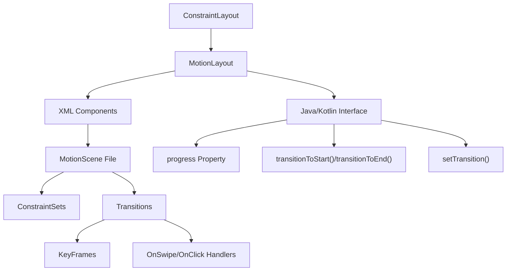
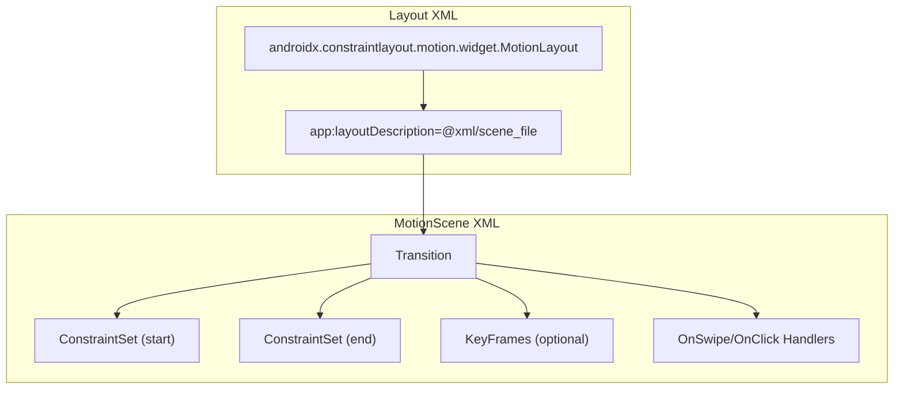
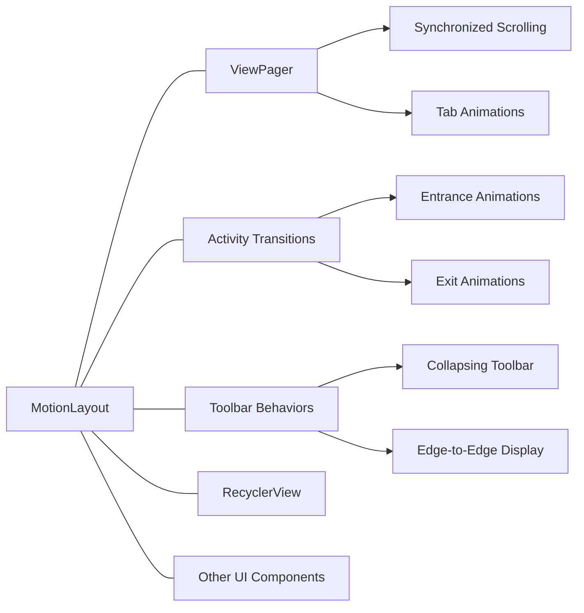
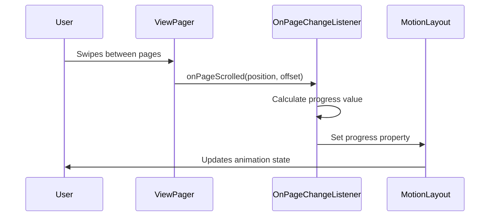
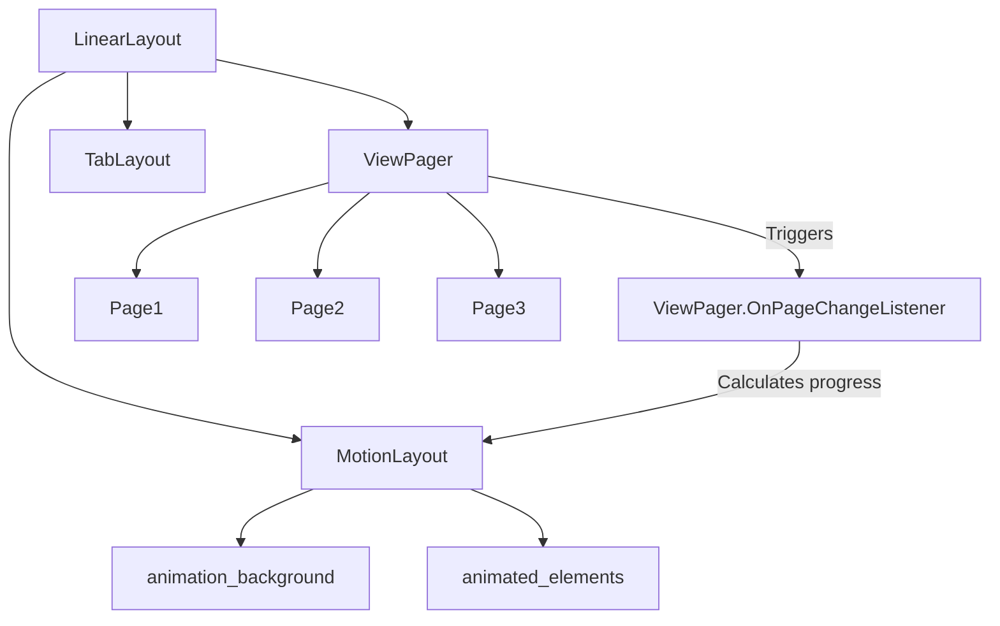

<!-- source: DeepWiki mcp.deepwiki.com · repo android/views-widgets-samples · page 3.1 MotionLayout Basics and Integration · fetched 2026-10-23 -->

# MotionLayout Basics and Integration

<details>
<summary>Relevant source files</summary>

The following files were used as context for generating this wiki page:

- [ConstraintLayoutExamples/motionlayout/src/main/java/com/google/androidstudio/motionlayoutexample/viewpagerdemo/ViewPagerActivity.kt](ConstraintLayoutExamples/motionlayout/src/main/java/com/google/androidstudio/motionlayoutexample/viewpagerdemo/ViewPagerActivity.kt)
- [ConstraintLayoutExamples/motionlayoutintegrations/src/main/AndroidManifest.xml](ConstraintLayoutExamples/motionlayoutintegrations/src/main/AndroidManifest.xml)
- [ConstraintLayoutExamples/motionlayoutintegrations/src/main/java/com/example/androidstudio/motionlayoutintegrations/MainActivity.kt](ConstraintLayoutExamples/motionlayoutintegrations/src/main/java/com/example/androidstudio/motionlayoutintegrations/MainActivity.kt)
- [ConstraintLayoutExamples/motionlayoutintegrations/src/main/java/com/example/androidstudio/motionlayoutintegrations/ViewPagerIntegration.kt](ConstraintLayoutExamples/motionlayoutintegrations/src/main/java/com/example/androidstudio/motionlayoutintegrations/ViewPagerIntegration.kt)
- [ConstraintLayoutExamples/motionlayoutintegrations/src/main/res/drawable/collapsing.png](ConstraintLayoutExamples/motionlayoutintegrations/src/main/res/drawable/collapsing.png)
- [ConstraintLayoutExamples/motionlayoutintegrations/src/main/res/drawable/entrance.png](ConstraintLayoutExamples/motionlayoutintegrations/src/main/res/drawable/entrance.png)
- [ConstraintLayoutExamples/motionlayoutintegrations/src/main/res/layout/activity_main.xml](ConstraintLayoutExamples/motionlayoutintegrations/src/main/res/layout/activity_main.xml)
- [ConstraintLayoutExamples/motionlayoutintegrations/src/main/res/layout/activity_view_pager_integration.xml](ConstraintLayoutExamples/motionlayoutintegrations/src/main/res/layout/activity_view_pager_integration.xml)
- [ConstraintLayoutExamples/motionlayoutintegrations/src/main/res/values/strings.xml](ConstraintLayoutExamples/motionlayoutintegrations/src/main/res/values/strings.xml)

</details>


This page provides an introduction to MotionLayout and explains how it can be integrated with other Android UI components. MotionLayout is a powerful layout type in the ConstraintLayout library that helps create complex animations and transitions. For detailed information about animation scenes and transitions, see [Animation Scenes and Transitions](#3.2). For advanced MotionLayout use cases like collapsing toolbars, see [Advanced MotionLayout: Collapsing Toolbar](#3.3).

## What is MotionLayout?

MotionLayout is a subclass of ConstraintLayout that provides a declarative way to create rich motion and animations. It enables you to build fluid UI transitions by defining start and end constraint states with keyframes in between.



Sources: [ConstraintLayoutExamples/motionlayoutintegrations/src/main/res/layout/activity_view_pager_integration.xml:26-48]()

## Key Components of MotionLayout

MotionLayout relies on several key components to define and control animations:

1. **MotionLayout**: The actual ViewGroup container that extends ConstraintLayout
2. **MotionScene**: An XML file that defines all animation-related information
3. **ConstraintSets**: Define the start and end states of your views
4. **Transitions**: Define how to animate between constraint sets
5. **KeyFrames**: Allow for fine-grained control over animation paths



Sources: [ConstraintLayoutExamples/motionlayoutintegrations/src/main/res/layout/activity_view_pager_integration.xml:26-48]()

## Integration Patterns

MotionLayout can be integrated with various Android components to create rich, interactive UIs. The sample project demonstrates three primary integration patterns:

1. **ViewPager Integration**: Synchronizing ViewPager swipes with MotionLayout animations
2. **Entrance Animations**: Complex entrance animations when a screen is loaded
3. **Collapsing Toolbar**: Implementation of a collapsing toolbar using MotionLayout



Sources: [ConstraintLayoutExamples/motionlayoutintegrations/src/main/java/com/example/androidstudio/motionlayoutintegrations/MainActivity.kt:35-46]()

## ViewPager Integration Example

The most detailed integration example shows how to synchronize a ViewPager's swipe gestures with a MotionLayout animation. This creates a dynamic header that responds to the user's swipe between tabs.

### Implementation Overview



Sources: [ConstraintLayoutExamples/motionlayoutintegrations/src/main/java/com/example/androidstudio/motionlayoutintegrations/ViewPagerIntegration.kt:52-69]()

### Code Structure

The key components involved in the ViewPager integration are:

1. **LinearLayout**: Root container with vertical orientation
2. **MotionLayout**: Container for animated elements
3. **TabLayout**: Tab navigation control
4. **ViewPager**: Swipeable content container
5. **OnPageChangeListener**: Listener that calculates animation progress

The integration works by:

1. Setting up a ViewPager with fragments and TabLayout
2. Adding a PageChangeListener to the ViewPager
3. Converting the page position and offset to a normalized progress value (0.0-1.0)
4. Setting this progress value on the MotionLayout



Sources: [ConstraintLayoutExamples/motionlayoutintegrations/src/main/java/com/example/androidstudio/motionlayoutintegrations/ViewPagerIntegration.kt:34-70](), [ConstraintLayoutExamples/motionlayoutintegrations/src/main/res/layout/activity_view_pager_integration.xml:18-61]()

### Implementing the ViewPager Connection

The critical part of the integration is the OnPageChangeListener implementation that synchronizes the ViewPager's scroll state with the MotionLayout's animation progress:

In the `ViewPagerIntegration.kt` file, a page change listener is attached to the ViewPager:

```kotlin
binding.pager.addOnPageChangeListener(object : ViewPager.OnPageChangeListener {
    override fun onPageScrolled(position: Int, positionOffset: Float, positionOffsetPixels: Int) {
        // calculate the swipe progress to a percent between 0f and 1f, where 0f is the
        // first tab and 1f is the last tab
        val progress = (position + positionOffset) / (adapter.count - 1)
        // ask MotionLayout to snap to the current progress
        binding.motionLayout.progress = progress
    }
    
    // Other methods omitted for brevity
})
```

This elegant approach allows the MotionLayout animation to be directly driven by the user's swipe gestures.

Sources: [ConstraintLayoutExamples/motionlayoutintegrations/src/main/java/com/example/androidstudio/motionlayoutintegrations/ViewPagerIntegration.kt:52-69]()

## Integration with Other Components

The samples repository also includes examples of other integration patterns:

### Entrance Animation

The Entrance example demonstrates how to create a complex entrance animation when entering a screen. This uses MotionLayout's auto-transition capability to automatically start the animation when the layout is displayed.

### Collapsing Toolbar

The Collapsing Toolbar example shows how to implement a collapsing toolbar pattern with edge-to-edge display support using MotionLayout. This provides a modern UI pattern that gracefully handles window insets.

## Summary of Integration Approaches

| Integration Pattern | Key Mechanism | Use Case |
|---------------------|---------------|----------|
| ViewPager | `OnPageChangeListener` calculates progress value | Tab navigation with synchronized animations |
| Entrance Animation | Auto-transition and `transitionToEnd()` | Welcoming animations on screen entry |
| Collapsing Toolbar | OnSwipe handler in MotionScene | Responsive toolbar that collapses on scroll |

Sources: [ConstraintLayoutExamples/motionlayoutintegrations/src/main/java/com/example/androidstudio/motionlayoutintegrations/MainActivity.kt:27-47](), [ConstraintLayoutExamples/motionlayoutintegrations/src/main/res/values/strings.xml:22-24]()

## Best Practices for MotionLayout Integration

When integrating MotionLayout with other components:

1. **Separation of concerns**: Use MotionLayout for animation only, not for business logic
2. **Progress property**: Use the progress property to programmatically control animations
3. **MotionScene organization**: Keep MotionScene files well-organized for complex animations
4. **Performance**: Be mindful of animation complexity on lower-end devices
5. **Testing**: Test animations on various device sizes and orientations

Sources: [ConstraintLayoutExamples/motionlayoutintegrations/src/main/java/com/example/androidstudio/motionlayoutintegrations/ViewPagerIntegration.kt:34-70]()

---

