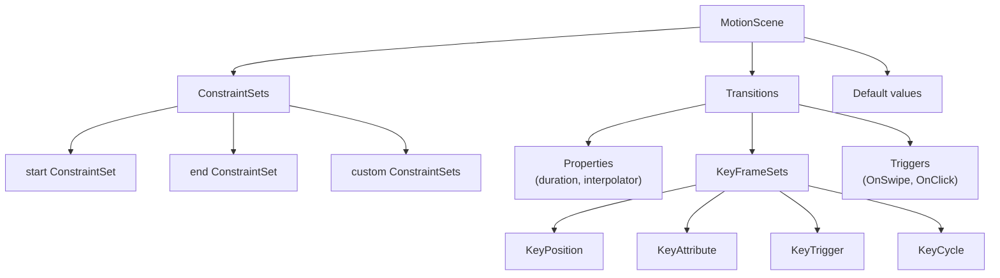
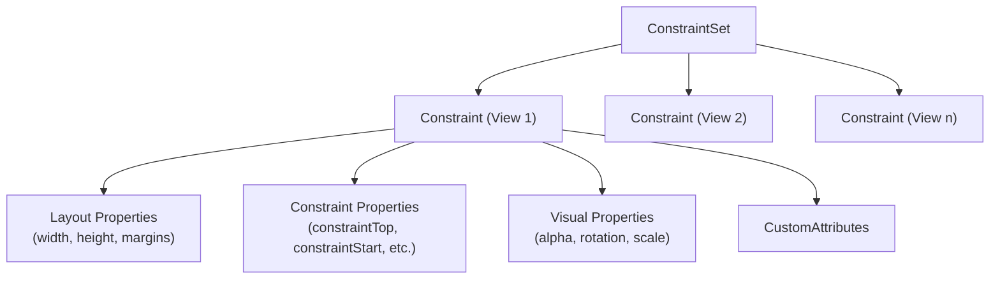
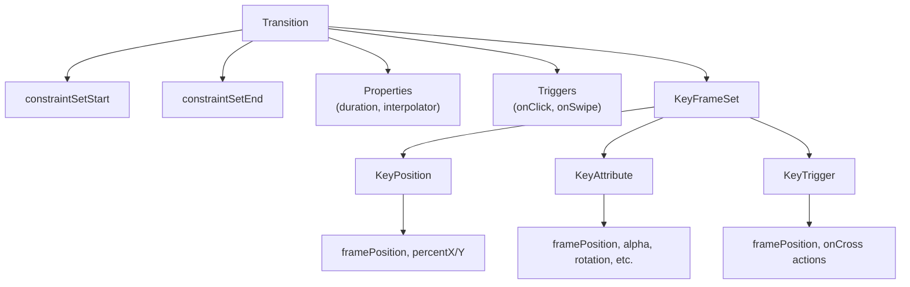
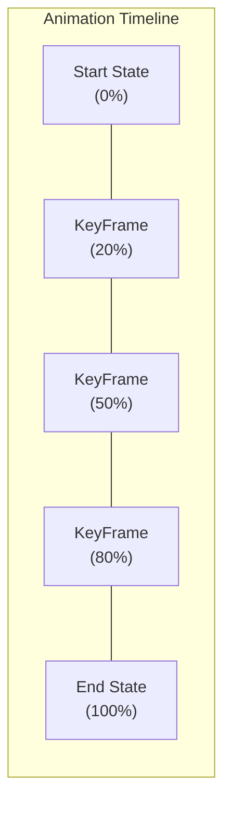
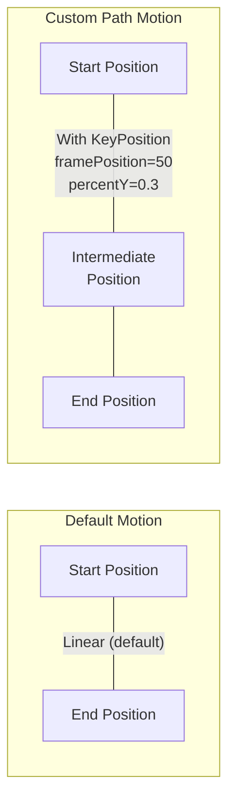
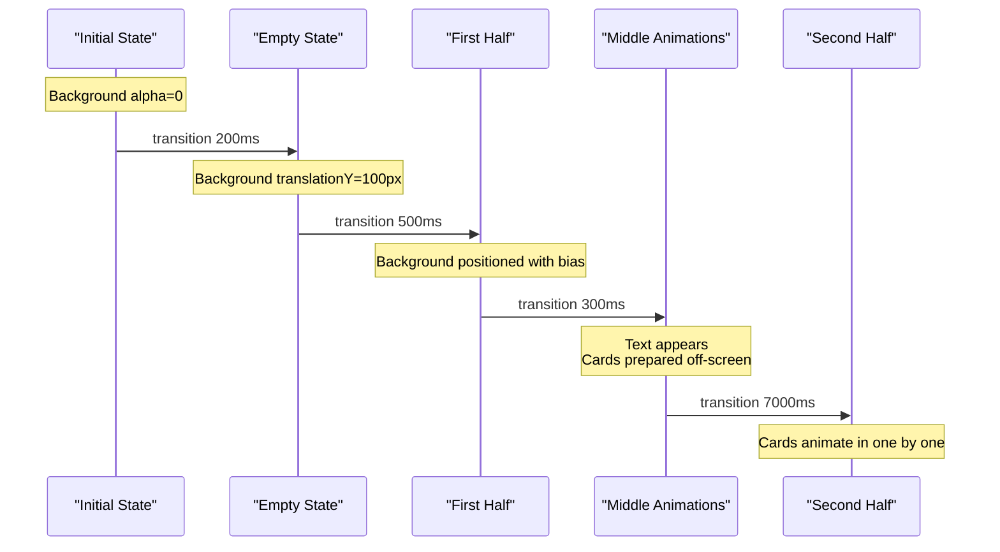
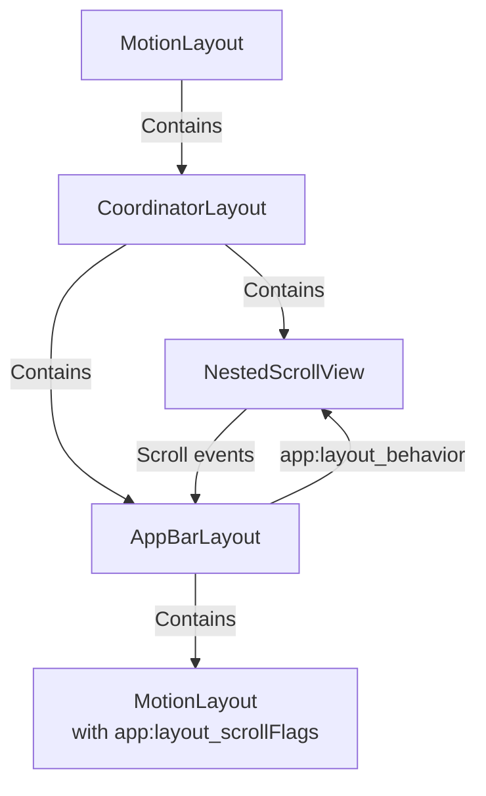
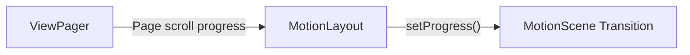

<!-- source: DeepWiki mcp.deepwiki.com · repo android/views-widgets-samples · page 3.2 Animation Scenes and Transitions · fetched 2026-10-23 -->

# Animation Scenes and Transitions

<details>
<summary>Relevant source files</summary>

The following files were used as context for generating this wiki page:

- [ConstraintLayoutExamples/motionlayout/src/main/res/layout/motion_23_parallax.xml](ConstraintLayoutExamples/motionlayout/src/main/res/layout/motion_23_parallax.xml)
- [ConstraintLayoutExamples/motionlayout/src/main/res/xml/scene_17.xml](ConstraintLayoutExamples/motionlayout/src/main/res/xml/scene_17.xml)
- [ConstraintLayoutExamples/motionlayout/src/main/res/xml/scene_18.xml](ConstraintLayoutExamples/motionlayout/src/main/res/xml/scene_18.xml)
- [ConstraintLayoutExamples/motionlayout/src/main/res/xml/scene_19.xml](ConstraintLayoutExamples/motionlayout/src/main/res/xml/scene_19.xml)
- [ConstraintLayoutExamples/motionlayout/src/main/res/xml/scene_23.xml](ConstraintLayoutExamples/motionlayout/src/main/res/xml/scene_23.xml)
- [ConstraintLayoutExamples/motionlayout/src/main/res/xml/scene_25.xml](ConstraintLayoutExamples/motionlayout/src/main/res/xml/scene_25.xml)
- [ConstraintLayoutExamples/motionlayoutintegrations/README.md](ConstraintLayoutExamples/motionlayoutintegrations/README.md)
- [ConstraintLayoutExamples/motionlayoutintegrations/src/main/res/drawable-xxxhdpi/star_parallax.jpg](ConstraintLayoutExamples/motionlayoutintegrations/src/main/res/drawable-xxxhdpi/star_parallax.jpg)
- [ConstraintLayoutExamples/motionlayoutintegrations/src/main/res/layout/activity_collapsing_toolbar.xml](ConstraintLayoutExamples/motionlayoutintegrations/src/main/res/layout/activity_collapsing_toolbar.xml)
- [ConstraintLayoutExamples/motionlayoutintegrations/src/main/res/layout/activity_entrance.xml](ConstraintLayoutExamples/motionlayoutintegrations/src/main/res/layout/activity_entrance.xml)
- [ConstraintLayoutExamples/motionlayoutintegrations/src/main/res/xml/activity_collapsing_toolbar_scene.xml](ConstraintLayoutExamples/motionlayoutintegrations/src/main/res/xml/activity_collapsing_toolbar_scene.xml)
- [ConstraintLayoutExamples/motionlayoutintegrations/src/main/res/xml/activity_entrance_scene.xml](ConstraintLayoutExamples/motionlayoutintegrations/src/main/res/xml/activity_entrance_scene.xml)
- [ConstraintLayoutExamples/motionlayoutintegrations/src/main/res/xml/activity_view_pager_integration_scene.xml](ConstraintLayoutExamples/motionlayoutintegrations/src/main/res/xml/activity_view_pager_integration_scene.xml)

</details>


This page provides a technical overview of MotionScene files and how they define animations in MotionLayout. It covers the structure of animation scenes, transitions between constraint sets, and how to use various features like KeyFrames to create complex animations in Android applications.

For information about MotionLayout basics and integration with other components, see [MotionLayout Basics and Integration](#3.1). For advanced MotionLayout examples like the Collapsing Toolbar, see [Advanced MotionLayout: Collapsing Toolbar](#3.3).

## MotionScene Overview

A MotionScene is an XML resource that defines animations in MotionLayout by describing the start and end states (ConstraintSets) and how to transition between them. MotionScenes separate the animation logic from the layout, providing a clear structure for complex animations.



Sources:
- [ConstraintLayoutExamples/motionlayoutintegrations/src/main/res/xml/activity_entrance_scene.xml:18-276]()
- [ConstraintLayoutExamples/motionlayoutintegrations/src/main/res/xml/activity_collapsing_toolbar_scene.xml:18-217]()

## ConstraintSets: Defining Animation States

ConstraintSets define the visual state of views at specific points in an animation. Each MotionScene typically contains at least two ConstraintSets: a starting state and an ending state. You can also define intermediate states for more complex animations.

### Core Components of a ConstraintSet



In the entrance animation example, multiple ConstraintSets define different stages of the animation:

```xml
<ConstraintSet android:id="@+id/initial">
    <!-- Initial invisible state -->
</ConstraintSet>

<ConstraintSet android:id="@+id/empty">
    <!-- Empty state with background translationY -->
</ConstraintSet>

<ConstraintSet android:id="@+id/first_half" motion:deriveConstraintsFrom="@+id/empty">
    <!-- First animation phase using derived constraints -->
</ConstraintSet>

<!-- More constraint sets for subsequent animation phases -->
```

The `deriveConstraintsFrom` attribute is used to inherit constraints from another ConstraintSet, allowing you to specify only the changes needed for the next animation phase.

Sources:
- [ConstraintLayoutExamples/motionlayoutintegrations/src/main/res/xml/activity_entrance_scene.xml:33-201]()
- [ConstraintLayoutExamples/motionlayoutintegrations/README.md:36-43]()

## Transitions: Animating Between States

Transitions define how to animate from one ConstraintSet to another. They specify properties such as duration, interpolation, and triggers for the animation.

### Transition Structure



### Auto Transitions

MotionLayout supports automatic progression through a sequence of transitions using the `autoTransition` attribute:

```xml
<Transition
    motion:constraintSetStart="@+id/initial"
    motion:constraintSetEnd="@+id/empty"
    motion:motionInterpolator="linear"
    motion:autoTransition="animateToEnd"
    motion:duration="200" />
```

The entrance animation example uses chained auto transitions to create a complex animation sequence:

```mermaid
flowchart LR
    Initial["Initial State"] -->|"autoTransition=animateToEnd"| Empty["Empty State"]
    Empty -->|"autoTransition=animateToEnd"| FirstHalf["First Half State"]
    FirstHalf -->|"autoTransition=animateToEnd"| MiddleAnimations["Middle Animations State"]
    MiddleAnimations -->|"autoTransition=animateToEnd"| SecondHalf["Second Half State"]
```



Sources:
- [ConstraintLayoutExamples/motionlayoutintegrations/src/main/res/xml/activity_entrance_scene.xml:204-275]()
- [ConstraintLayoutExamples/motionlayoutintegrations/README.md:30-43]()

## KeyFrames: Controlling Animation Details

KeyFrames define specific points in an animation transition to precisely control motion paths, attributes, or trigger events. They are grouped in a `KeyFrameSet` within a transition.

### Types of KeyFrames

1. **KeyPosition**: Controls the motion path of a view during animation
2. **KeyAttribute**: Modifies view attributes at specific points in the animation
3. **KeyTrigger**: Executes actions when animation crosses specific points
4. **KeyCycle**: Creates oscillatory motion effects

Example of KeyFrameSet from the entrance animation:

```xml
<KeyFrameSet>
    <KeyAttribute
        motion:motionTarget="@+id/spacemoji_text"
        motion:framePosition="20"
        android:alpha="1" />

    <KeyAttribute
        motion:motionTarget="@+id/spacemoji_subtext"
        motion:framePosition="80"
        android:alpha="0" />
</KeyFrameSet>
```

In this example, `spacemoji_text` becomes fully visible at 20% of the animation, while `spacemoji_subtext` starts fading out at 80%.

### Visual Representation of KeyFrames in Animation



Sources:
- [ConstraintLayoutExamples/motionlayoutintegrations/src/main/res/xml/activity_entrance_scene.xml:224-236]()
- [ConstraintLayoutExamples/motionlayoutintegrations/src/main/res/xml/activity_entrance_scene.xml:244-274]()
- [ConstraintLayoutExamples/motionlayoutintegrations/src/main/res/xml/activity_collapsing_toolbar_scene.xml:25-105]()

## KeyPositions: Controlling Motion Paths

KeyPosition elements are particularly powerful for creating natural motion. They allow you to control the path a view takes as it moves between start and end positions.



Example from ViewPager integration:

```xml
<KeyPosition
    motion:motionTarget="@+id/ship_emoji"
    motion:keyPositionType="parentRelative"
    motion:framePosition="25"
    motion:percentY=".6" />
```

This creates a curved path by positioning the view at 60% of the Y-axis height when the animation is at 25%.

Sources:
- [ConstraintLayoutExamples/motionlayoutintegrations/src/main/res/xml/activity_view_pager_integration_scene.xml:27-32]()
- [ConstraintLayoutExamples/motionlayoutintegrations/src/main/res/xml/activity_entrance_scene.xml:245-269]()

## Custom Attributes Animation

MotionLayout can animate custom attributes of views through the `CustomAttribute` element. This is useful for animating properties not directly supported by MotionLayout.

In the collapsing toolbar example, custom attributes are used to animate the `bottomCutSize` and `endCutSize` of a custom view:

```xml
<KeyAttribute
    app:motionTarget="@id/background"
    app:framePosition="60">
    <CustomAttribute app:attributeName="bottomCutSize" app:customDimension="0dp" />
</KeyAttribute>
```

Sources:
- [ConstraintLayoutExamples/motionlayoutintegrations/src/main/res/xml/activity_collapsing_toolbar_scene.xml:88-92]()
- [ConstraintLayoutExamples/motionlayoutintegrations/src/main/res/xml/activity_collapsing_toolbar_scene.xml:147-149]()

## Connecting MotionLayout to MotionScene

To use a MotionScene, your layout must be a `MotionLayout` and reference the MotionScene XML file using the `layoutDescription` attribute:

```xml
<androidx.constraintlayout.motion.widget.MotionLayout
    android:id="@+id/motion_layout"
    android:layout_width="match_parent"
    android:layout_height="match_parent"
    app:layoutDescription="@xml/activity_entrance_scene">
    
    <!-- Child views here -->
    
</androidx.constraintlayout.motion.widget.MotionLayout>
```

Sources:
- [ConstraintLayoutExamples/motionlayoutintegrations/src/main/res/layout/activity_entrance.xml:18-26]()
- [ConstraintLayoutExamples/motionlayoutintegrations/src/main/res/layout/activity_collapsing_toolbar.xml:40-46]()

## Complex Animation Example: Entrance Animation

The entrance animation demonstrates how to use multiple constraint sets with auto transitions to create a seamless animation sequence.



The animation uses:
- 5 constraint sets to define different states
- 4 transitions that automatically chain together
- KeyAttributes to control alpha values
- KeyPositions to control animation paths

Sources:
- [ConstraintLayoutExamples/motionlayoutintegrations/src/main/res/xml/activity_entrance_scene.xml:33-275]()
- [ConstraintLayoutExamples/motionlayoutintegrations/README.md:27-48]()

## Integration with User Input

MotionLayout can be driven by user input like swipes using the `OnSwipe` tag:

```xml
<Transition
    motion:constraintSetEnd="@+id/end"
    motion:constraintSetStart="@+id/start">
    <OnSwipe
        motion:dragDirection="dragUp"
        motion:touchAnchorId="@+id/motionLayout"
        motion:touchAnchorSide="bottom" />
</Transition>
```

This is commonly used in UI patterns like collapsible headers and bottom sheets.

Sources:
- [ConstraintLayoutExamples/motionlayout/src/main/res/xml/scene_17.xml:24-27]()
- [ConstraintLayoutExamples/motionlayout/src/main/res/xml/scene_18.xml:24-27]()

## KeyTriggers for Action-Based Events

KeyTrigger elements allow you to call methods on views when the animation passes a specific point:

```xml
<KeyTrigger
    motion:framePosition="10"
    motion:motionTarget="@id/fab"
    motion:onPositiveCross="show" />
```

This triggers the `show()` method on a FloatingActionButton when the animation passes the 10% mark in the forward direction.

Sources:
- [ConstraintLayoutExamples/motionlayout/src/main/res/xml/scene_25.xml:34-37]()
- [ConstraintLayoutExamples/motionlayout/src/main/res/xml/scene_25.xml:43-46]()

## Motion Editor Integration

Android Studio 4.0+ includes a Motion Editor for visually creating and editing MotionScenes. This makes it easier to design complex animations without manually editing XML.

As noted in the entrance animation scene:

```xml
<!-- This animation uses a series of autoprogress between different ConstraintSet to build
keyframes of the animation.

As the animation plays, MotionLayout will display each ConstraintSet in turn.

The structure of this animation is best viewed and edited in the Motion
Editor in Android Studio
-->
```

Sources:
- [ConstraintLayoutExamples/motionlayoutintegrations/src/main/res/xml/activity_entrance_scene.xml:22-32]()
- [ConstraintLayoutExamples/motionlayoutintegrations/README.md:6-8]()

## Common Animation Patterns

### 1. Coordinated Animations with External Components

MotionLayout can be integrated with scrolling components like NestedScrollView:



### 2. Progress-Based Animations

Animations can be driven by external progress values, such as from ViewPager:



Sources:
- [ConstraintLayoutExamples/motionlayoutintegrations/src/main/res/layout/activity_collapsing_toolbar.xml:21-33]()
- [ConstraintLayoutExamples/motionlayout/src/main/res/layout/motion_23_parallax.xml:1-16]()

## Best Practices

1. **Separate concerns**: Keep layout structure in the layout XML and animation logic in the MotionScene XML.

2. **Use derived ConstraintSets**: For complex animations with multiple states, use `deriveConstraintsFrom` to inherit constraints and only specify the changes.

3. **Understand KeyFrames**: Use KeyFrames to control the details of an animation, particularly to create natural motion paths.

4. **Break down complex animations**: Divide complex animations into smaller transitions with `autoTransition` to chain them together.

5. **Use the Motion Editor**: Take advantage of Android Studio's Motion Editor for visual design and debugging of animations.

Sources:
- [ConstraintLayoutExamples/motionlayoutintegrations/README.md:36-42]()
- [ConstraintLayoutExamples/motionlayoutintegrations/src/main/res/xml/activity_entrance_scene.xml:56-57]()
- [ConstraintLayoutExamples/motionlayoutintegrations/src/main/res/xml/activity_entrance_scene.xml:204-276]()

## Related Resources

For more details on specific animation techniques, see:
- [MotionLayout Basics and Integration](#3.1) for fundamental concepts
- [Advanced MotionLayout: Collapsing Toolbar](#3.3) for a complete example of an advanced animation
- [Animation Systems](#5.1) for other animation approaches in Android

---

