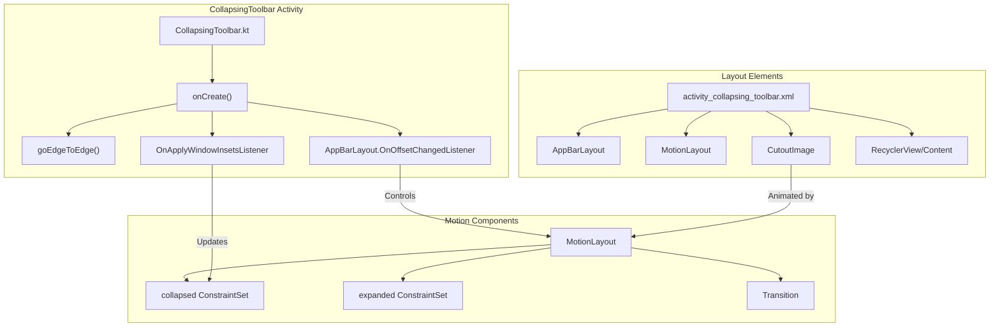
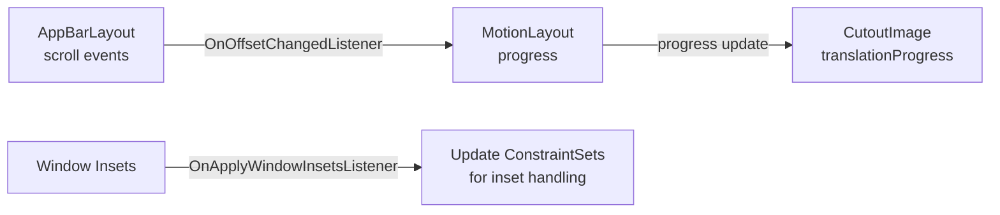
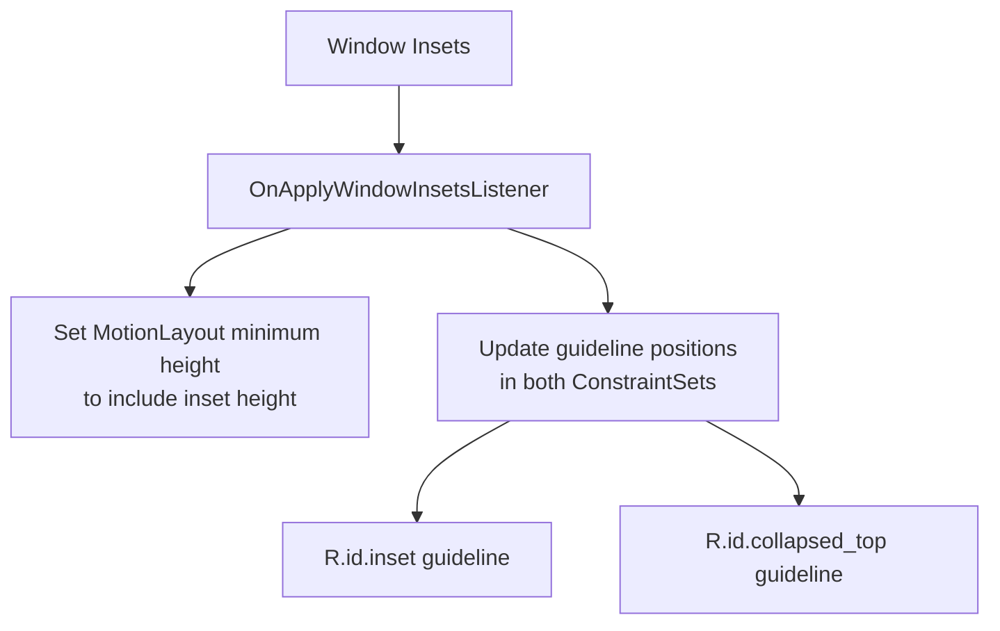
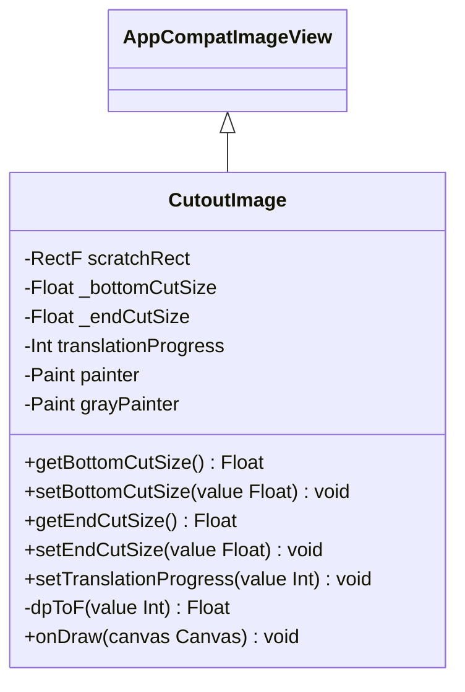
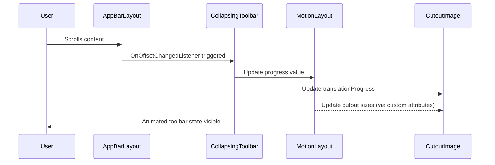

<!-- source: DeepWiki mcp.deepwiki.com · repo android/views-widgets-samples · page 3.3 Advanced MotionLayout: Collapsing Toolbar · fetched 2026-10-23 -->

# Advanced MotionLayout: Collapsing Toolbar

<details>
<summary>Relevant source files</summary>

The following files were used as context for generating this wiki page:

- [ConstraintLayoutExamples/build.gradle](ConstraintLayoutExamples/build.gradle)
- [ConstraintLayoutExamples/motionlayoutintegrations/src/main/AndroidManifest.xml](ConstraintLayoutExamples/motionlayoutintegrations/src/main/AndroidManifest.xml)
- [ConstraintLayoutExamples/motionlayoutintegrations/src/main/java/com/example/androidstudio/motionlayoutintegrations/CollapsingToolbar.kt](ConstraintLayoutExamples/motionlayoutintegrations/src/main/java/com/example/androidstudio/motionlayoutintegrations/CollapsingToolbar.kt)
- [ConstraintLayoutExamples/motionlayoutintegrations/src/main/java/com/example/androidstudio/motionlayoutintegrations/Entrance.kt](ConstraintLayoutExamples/motionlayoutintegrations/src/main/java/com/example/androidstudio/motionlayoutintegrations/Entrance.kt)
- [ConstraintLayoutExamples/motionlayoutintegrations/src/main/java/com/example/androidstudio/motionlayoutintegrations/MainActivity.kt](ConstraintLayoutExamples/motionlayoutintegrations/src/main/java/com/example/androidstudio/motionlayoutintegrations/MainActivity.kt)
- [ConstraintLayoutExamples/motionlayoutintegrations/src/main/java/com/example/androidstudio/motionlayoutintegrations/ViewPagerIntegration.kt](ConstraintLayoutExamples/motionlayoutintegrations/src/main/java/com/example/androidstudio/motionlayoutintegrations/ViewPagerIntegration.kt)
- [ConstraintLayoutExamples/motionlayoutintegrations/src/main/res/layout/activity_view_pager_integration.xml](ConstraintLayoutExamples/motionlayoutintegrations/src/main/res/layout/activity_view_pager_integration.xml)

</details>


## Purpose and Scope

This document provides a technical explanation of the Collapsing Toolbar implementation using MotionLayout in the Android Views and Widgets samples repository. It covers how to create a collapsing toolbar that properly handles edge-to-edge display with system insets, and demonstrates the integration of MotionLayout with AppBarLayout and custom views. This page focuses specifically on the advanced collapsing toolbar implementation, not on basic MotionLayout concepts (for those basics, see [MotionLayout Basics and Integration](#3.1)).

## System Overview

The Collapsing Toolbar system demonstrates how to use MotionLayout to create a modern, animated toolbar that collapses during scrolling. Unlike traditional approaches using CollapsingToolbarLayout, this implementation leverages MotionLayout's animation capabilities while correctly handling system insets for edge-to-edge display.

### Architecture Diagram



Sources: [ConstraintLayoutExamples/motionlayoutintegrations/src/main/java/com/example/androidstudio/motionlayoutintegrations/CollapsingToolbar.kt:40-96]()

## Key Components

### CollapsingToolbar Activity

The `CollapsingToolbar` activity serves as the main controller for the implementation. It configures the edge-to-edge display, connects the AppBarLayout's scroll events to the MotionLayout animations, and handles system window insets.



Sources: [ConstraintLayoutExamples/motionlayoutintegrations/src/main/java/com/example/androidstudio/motionlayoutintegrations/CollapsingToolbar.kt:40-83]()

### Implementation Details

#### Edge-to-Edge Display

The implementation goes "edge-to-edge" by:
1. Making the status bar transparent
2. Setting system UI flags for fullscreen layout
3. Properly handling window insets to ensure content isn't hidden behind system bars

```kotlin
private fun Window.goEdgeToEdge() {
    if (Build.VERSION.SDK_INT >= Build.VERSION_CODES.LOLLIPOP) {
        addFlags(WindowManager.LayoutParams.FLAG_DRAWS_SYSTEM_BAR_BACKGROUNDS)
        statusBarColor = Color.TRANSPARENT
    }
    decorView.systemUiVisibility = View.SYSTEM_UI_FLAG_LAYOUT_FULLSCREEN
}
```

Sources: [ConstraintLayoutExamples/motionlayoutintegrations/src/main/java/com/example/androidstudio/motionlayoutintegrations/CollapsingToolbar.kt:88-95]()

#### AppBarLayout Integration

The collapsing behavior is synchronized with scroll events using an `AppBarLayout.OnOffsetChangedListener`. This listener:
1. Converts the vertical offset into a progress value between 0 and 1
2. Updates the MotionLayout's progress to match
3. Also updates the `CutoutImage`'s `translationProgress` to sync all animations

```kotlin
val listener = AppBarLayout.OnOffsetChangedListener { appBar, verticalOffset ->
    // convert offset into % scrolled
    val seekPosition = -verticalOffset / appBar.totalScrollRange.toFloat()
    // inform both both MotionLayout and CutoutImage of the animation progress.
    binding.motionLayout.progress = seekPosition
    binding.background.translationProgress = (100 * seekPosition).toInt()
}
binding.appbarLayout.addOnOffsetChangedListener(listener)
```

Sources: [ConstraintLayoutExamples/motionlayoutintegrations/src/main/java/com/example/androidstudio/motionlayoutintegrations/CollapsingToolbar.kt:51-58]()

#### Window Insets Handling

A critical aspect of modern Android UI is properly handling system insets (areas occupied by the status bar, navigation bar, etc.). The implementation uses `setOnApplyWindowInsetsListener` to:

1. Resize the MotionLayout to account for the inset height
2. Update guidelines in the collapsed and expanded ConstraintSets to properly position UI elements



Sources: [ConstraintLayoutExamples/motionlayoutintegrations/src/main/java/com/example/androidstudio/motionlayoutintegrations/CollapsingToolbar.kt:65-82]()

### CutoutImage Custom View

A distinctive feature of this implementation is the `CutoutImage` custom view that displays circular cutouts on an image, controlled by MotionLayout animation.

#### CutoutImage Architecture



Sources: [ConstraintLayoutExamples/motionlayoutintegrations/src/main/java/com/example/androidstudio/motionlayoutintegrations/CollapsingToolbar.kt:108-234]()

The `CutoutImage` uses three key properties that can be animated by MotionLayout:

1. `bottomCutSize`: Controls the diameter of the circular cutout at the bottom of the image
2. `endCutSize`: Controls the diameter of the circular cutout at the end (right side) of the image
3. `translationProgress`: Controls the vertical translation of the background image

These properties can be directly manipulated in XML using MotionLayout's property set mechanism and custom attributes.

#### Image Translation

The `translationProgress` property uses a matrix transformation to scroll the background image as the animation progresses:

```kotlin
var translationProgress: Int = 0
    set(value) {
        field = value
        val matrix = imageMatrix
        val imageWidth = drawable.intrinsicWidth.toFloat()
        val scaleFactor = width.toFloat() / imageWidth
        matrix.setScale(scaleFactor, scaleFactor)
        matrix.postTranslate(0f, -100f + value)
        imageMatrix = matrix
    }
```

Sources: [ConstraintLayoutExamples/motionlayoutintegrations/src/main/java/com/example/androidstudio/motionlayoutintegrations/CollapsingToolbar.kt:150-159]()

#### Drawing Custom Cutouts

The `onDraw` method renders the image with circular cutouts:

```kotlin
override fun onDraw(canvas: Canvas?) {
    // let the parent draw the bitmap
    super.onDraw(canvas)

    // draw the bottom circle at the correct position and size
    canvas?.drawCircle(
        width.toFloat() / 2, // midpoint of view
        height.toFloat(), // bottom of view
        _bottomCutSize / 2, // radius from diameter
        painter
    )

    // draw the end circle at the correct position and size
    val margin = dpToF(16)
    canvas?.drawCircle(
        width - margin, // end of view, with custom margin applied
        2 * height.toFloat() / 3, // 2/3 down on view
        _endCutSize / 2, // radius from diameter
        painter
    )
    
    // add a 1px gray line for visual division
    canvas?.drawLine(
        width - margin - _endCutSize / 2,
        height.toFloat(),
        width.toFloat(),
        height.toFloat(),
        grayPainter
    )
}
```

Sources: [ConstraintLayoutExamples/motionlayoutintegrations/src/main/java/com/example/androidstudio/motionlayoutintegrations/CollapsingToolbar.kt:201-233]()

## Data Flow During Scrolling

The following diagram illustrates the data flow that occurs when a user scrolls the content:



Sources: [ConstraintLayoutExamples/motionlayoutintegrations/src/main/java/com/example/androidstudio/motionlayoutintegrations/CollapsingToolbar.kt:51-58]()

## Implementation Techniques

### 1. Registering with the Activity Lifecycle

The activity uses ViewBinding to access views and sets up listeners that coordinate the animation:

```kotlin
override fun onCreate(savedInstanceState: Bundle?) {
    super.onCreate(savedInstanceState)

    window.goEdgeToEdge()

    val binding = ActivityCollapsingToolbarBinding.inflate(layoutInflater)
    setContentView(binding.root)
    
    // Set up AppBarLayout listener and Window Insets listener...
}
```

Sources: [ConstraintLayoutExamples/motionlayoutintegrations/src/main/java/com/example/androidstudio/motionlayoutintegrations/CollapsingToolbar.kt:42-48]()

### 2. Guideline Manipulation for Insets

A key technique in this implementation is the dynamic adjustment of guidelines in ConstraintSets to account for system insets:

```kotlin
val endConstraintSet = binding.motionLayout.getConstraintSet(R.id.collapsed)
// this guideline is the bottom of the inset area
endConstraintSet.setGuidelineEnd(R.id.inset, desiredToolbarHeight)
// this guideline is the top of the inset area (top of screen)
endConstraintSet.setGuidelineEnd(R.id.collapsed_top, desiredToolbarHeight + insetTopHeight)

// set the guideline for the start constraint set as well
val startConstraintSet = binding.motionLayout.getConstraintSet(R.id.expanded)
startConstraintSet.setGuidelineBegin(R.id.collapsed_top, insetTopHeight)
```

Sources: [ConstraintLayoutExamples/motionlayoutintegrations/src/main/java/com/example/androidstudio/motionlayoutintegrations/CollapsingToolbar.kt:71-79]()

## Configuration in AndroidManifest.xml

The `CollapsingToolbar` activity uses the Material Components theme without an action bar to allow for the custom toolbar implementation:

```xml
<activity android:name=".CollapsingToolbar"
    android:exported="true"
    android:theme="@style/Theme.MaterialComponents.DayNight.NoActionBar"
/>
```

Sources: [ConstraintLayoutExamples/motionlayoutintegrations/src/main/AndroidManifest.xml:36-39]()

## Summary

The Collapsing Toolbar implementation demonstrates how to:

1. Create a modern, animated toolbar using MotionLayout instead of the traditional CollapsingToolbarLayout
2. Properly handle window insets for edge-to-edge display
3. Synchronize MotionLayout animations with AppBarLayout scrolling
4. Implement a custom view (CutoutImage) that can be animated by MotionLayout
5. Use guidelines in ConstraintSets to adapt layouts for different device configurations and system UI states

This approach offers more flexibility and animation possibilities compared to the standard CollapsingToolbarLayout, while still properly handling modern Android UI requirements like edge-to-edge display.

---

