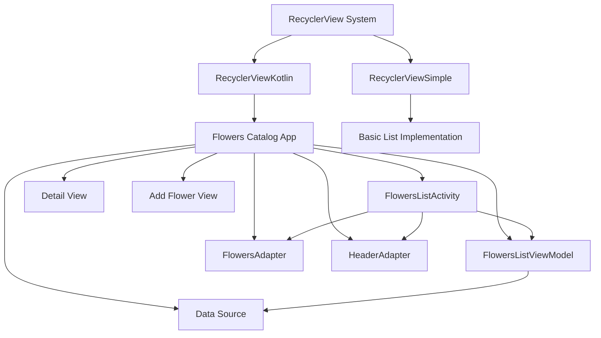
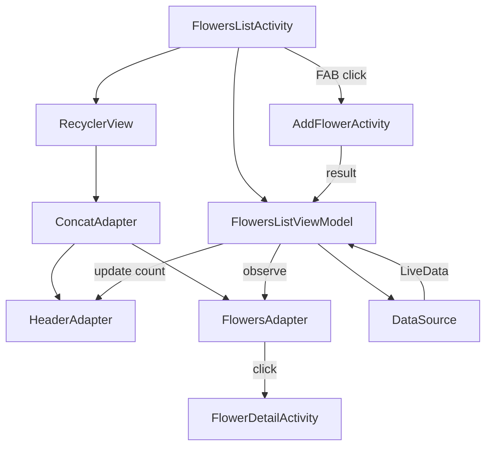

<!-- source: DeepWiki mcp.deepwiki.com · repo android/views-widgets-samples · page 4 RecyclerView System · fetched 2026-10-23 -->

# RecyclerView System

<details>
<summary>Relevant source files</summary>

The following files were used as context for generating this wiki page:

- [RecyclerViewKotlin/.google/packaging.yaml](RecyclerViewKotlin/.google/packaging.yaml)
- [RecyclerViewKotlin/README.md](RecyclerViewKotlin/README.md)
- [RecyclerViewKotlin/app/build.gradle](RecyclerViewKotlin/app/build.gradle)
- [RecyclerViewKotlin/app/src/main/java/com/example/recyclersample/flowerList/FlowersListActivity.kt](RecyclerViewKotlin/app/src/main/java/com/example/recyclersample/flowerList/FlowersListActivity.kt)
- [RecyclerViewKotlin/app/src/main/java/com/example/recyclersample/flowerList/FlowersListViewModel.kt](RecyclerViewKotlin/app/src/main/java/com/example/recyclersample/flowerList/FlowersListViewModel.kt)
- [RecyclerViewKotlin/app/src/main/res/drawable/ic_add_black_24dp.xml](RecyclerViewKotlin/app/src/main/res/drawable/ic_add_black_24dp.xml)
- [RecyclerViewKotlin/app/src/main/res/layout/activity_main.xml](RecyclerViewKotlin/app/src/main/res/layout/activity_main.xml)
- [RecyclerViewKotlin/app/src/main/res/layout/add_flower_layout.xml](RecyclerViewKotlin/app/src/main/res/layout/add_flower_layout.xml)
- [RecyclerViewKotlin/app/src/main/res/layout/flower_detail_activity.xml](RecyclerViewKotlin/app/src/main/res/layout/flower_detail_activity.xml)
- [RecyclerViewKotlin/app/src/main/res/mipmap-anydpi-v26/ic_launcher_round.xml](RecyclerViewKotlin/app/src/main/res/mipmap-anydpi-v26/ic_launcher_round.xml)
- [RecyclerViewSimple/.gitignore](RecyclerViewSimple/.gitignore)
- [RecyclerViewSimple/app/.gitignore](RecyclerViewSimple/app/.gitignore)
- [RecyclerViewSimple/app/build.gradle](RecyclerViewSimple/app/build.gradle)
- [RecyclerViewSimple/build.gradle](RecyclerViewSimple/build.gradle)
- [RecyclerViewSimple/gradle.properties](RecyclerViewSimple/gradle.properties)

</details>


This document provides an overview of the RecyclerView system implementations in the Android Views and Widgets Samples repository. It covers the architecture, key components, and features demonstrated in both the Kotlin and Simple implementations of RecyclerView.

## Purpose and Scope

The RecyclerView system demonstrates efficient list rendering using RecyclerView, a flexible view for providing a limited window into a large data set. The samples showcase different implementation approaches ranging from simple to more complex patterns, including:

- Basic RecyclerView implementation with adapters
- Advanced patterns with ListAdapter, DiffUtil, and ViewHolders
- Integration with MVVM architecture
- Headers and multiple view types
- Handling item clicks and navigation

For animation-specific RecyclerView implementations, see [RecyclerView Animations](#4.3).

## System Overview

### RecyclerView System Architecture



Sources: 
- [RecyclerViewKotlin/README.md]()
- [RecyclerViewKotlin/.google/packaging.yaml]()
- [RecyclerViewKotlin/app/src/main/java/com/example/recyclersample/flowerList/FlowersListActivity.kt]()

## Key Implementations

The repository contains two main RecyclerView implementations:

| Implementation | Complexity | Key Features |
|----------------|------------|--------------|
| RecyclerViewKotlin | Intermediate | ListAdapter, DiffUtil, Headers, MVVM, Detail Views |
| RecyclerViewSimple | Basic | Simple adapter pattern, Linear layout |

Sources:
- [RecyclerViewKotlin/README.md:4-6]()
- [RecyclerViewKotlin/.google/packaging.yaml:13]()

## RecyclerViewKotlin Implementation

The RecyclerViewKotlin sample demonstrates a more advanced implementation with a Flowers Catalog application using MVVM architecture.

### Component Architecture



Sources:
- [RecyclerViewKotlin/app/src/main/java/com/example/recyclersample/flowerList/FlowersListActivity.kt:36-93]()
- [RecyclerViewKotlin/app/src/main/java/com/example/recyclersample/flowerList/FlowersListViewModel.kt:26-46]()

### Key Components

#### 1. FlowersListActivity

The main activity serves as the entry point for the application and orchestrates the following responsibilities:

- Setting up the RecyclerView with appropriate adapters
- Observing the LiveData from the ViewModel
- Handling FAB clicks to add new flowers
- Managing navigation to detail views

Key implementation details:

```
- Uses ConcatAdapter to combine HeaderAdapter and FlowersAdapter
- Observes flowersLiveData to update the UI when data changes
- Implements click handling for list items and FAB
```

Sources:
- [RecyclerViewKotlin/app/src/main/java/com/example/recyclersample/flowerList/FlowersListActivity.kt:36-93]()
- [RecyclerViewKotlin/app/src/main/res/layout/activity_main.xml:19-23]()

#### 2. FlowersListViewModel

The ViewModel follows MVVM architecture principles by:

- Maintaining a LiveData object containing the flower list
- Handling business logic for adding new flowers
- Acting as the interface between UI and data

Implementation:

```
- Uses LiveData to expose the list of flowers
- Provides insertFlower method to add new flowers
- Uses ViewModelProvider.Factory for initialization
```

Sources:
- [RecyclerViewKotlin/app/src/main/java/com/example/recyclersample/flowerList/FlowersListViewModel.kt:26-46]()

#### 3. Adapters

The sample demonstrates two adapters working together:

**HeaderAdapter**: Displays the count of flowers at the top of the list

**FlowersAdapter**: Handles the actual list of flowers using ListAdapter and DiffUtil for efficient updates

Sources:
- [RecyclerViewKotlin/app/src/main/java/com/example/recyclersample/flowerList/FlowersListActivity.kt:46-50]()

#### 4. Supporting Components

**Add Flower UI**: Allows users to add new flowers to the list via a dedicated activity

**Detail View**: Shows detailed information about a selected flower

Sources:
- [RecyclerViewKotlin/app/src/main/res/layout/add_flower_layout.xml]()
- [RecyclerViewKotlin/app/src/main/res/layout/flower_detail_activity.xml]()

## RecyclerViewSimple Implementation

The RecyclerViewSimple sample provides a basic implementation of RecyclerView that demonstrates:

- Setting up a simple RecyclerView with a LinearLayoutManager
- Basic adapter implementation
- Minimal setup without MVVM or other architectural patterns

Sources:
- [RecyclerViewSimple/app/build.gradle:51-52]()

## Key RecyclerView Concepts Demonstrated

### 1. Efficient List Rendering

The samples demonstrate how RecyclerView efficiently displays large datasets by:

- Recycling views that are no longer visible
- Only creating new ViewHolders when necessary
- Using a limited window into a large dataset

### 2. ListAdapter and DiffUtil

The RecyclerViewKotlin sample showcases:

- Using ListAdapter for more efficient list updates
- DiffUtil for calculating differences between lists
- Proper update animations with minimal resource usage

Sources:
- [RecyclerViewKotlin/README.md:15-17]()

### 3. Layout Management

The samples demonstrate:

- LinearLayoutManager for vertical list display
- Integration with ConstraintLayout for item layouts

Sources:
- [RecyclerViewKotlin/README.md:12-13]()
- [RecyclerViewKotlin/app/src/main/res/layout/activity_main.xml:23]()

### 4. ViewHolder Pattern

Both samples implement the ViewHolder pattern to:

- Cache view references for better performance
- Separate view binding logic from adapter logic
- Enable clean click handling

Sources:
- [RecyclerViewKotlin/README.md:17-18]()
- [RecyclerViewKotlin/.google/packaging.yaml:18]()

### 5. ConcatAdapter

The RecyclerViewKotlin sample demonstrates:

- Using ConcatAdapter to combine multiple adapters
- Displaying different view types (header and content) sequentially
- Maintaining separation of concerns between different adapter types

Sources:
- [RecyclerViewKotlin/app/src/main/java/com/example/recyclersample/flowerList/FlowersListActivity.kt:50]()

## Integration with Other Components

### 1. MVVM Architecture

The RecyclerViewKotlin sample integrates RecyclerView with:

- ViewModel to separate business logic
- LiveData for observable data changes
- Repository pattern via DataSource

Sources:
- [RecyclerViewKotlin/app/build.gradle:64-65]()
- [RecyclerViewKotlin/app/src/main/java/com/example/recyclersample/flowerList/FlowersListViewModel.kt]()

### 2. Material Design

The samples integrate with Material Design components including:

- FloatingActionButton for adding new items
- Material buttons and text fields
- Material text styles

Sources:
- [RecyclerViewKotlin/app/build.gradle:61-62]()
- [RecyclerViewKotlin/app/src/main/res/layout/activity_main.xml:25-33]()
- [RecyclerViewKotlin/app/src/main/res/layout/add_flower_layout.xml:32-45]()

### 3. Navigation Flow

The RecyclerViewKotlin sample demonstrates:

- Navigation from list to detail view
- Returning data from add screen to list
- Proper activity lifecycle handling

Sources:
- [RecyclerViewKotlin/app/src/main/java/com/example/recyclersample/flowerList/FlowersListActivity.kt:69-93]()

## Build Configuration

Both implementations include appropriate build dependencies:

```
- RecyclerView: androidx.recyclerview:recyclerview
- LiveData: androidx.lifecycle:lifecycle-livedata-ktx (Kotlin only)
- Material: com.google.android.material:material (Kotlin only)
```

Sources:
- [RecyclerViewKotlin/app/build.gradle:58-65]()
- [RecyclerViewSimple/app/build.gradle:51-52]()

---

