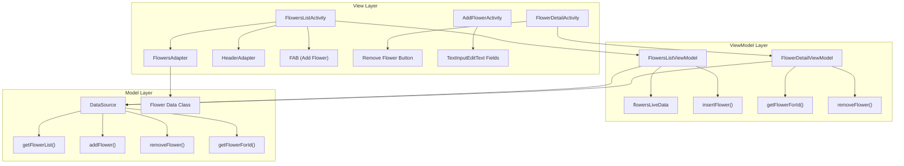
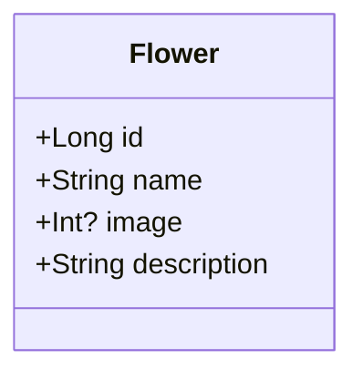
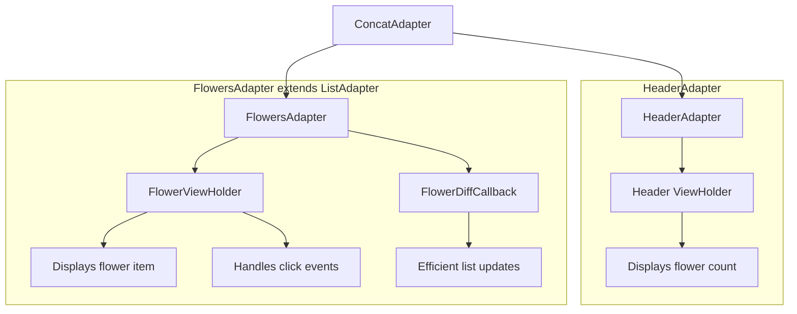
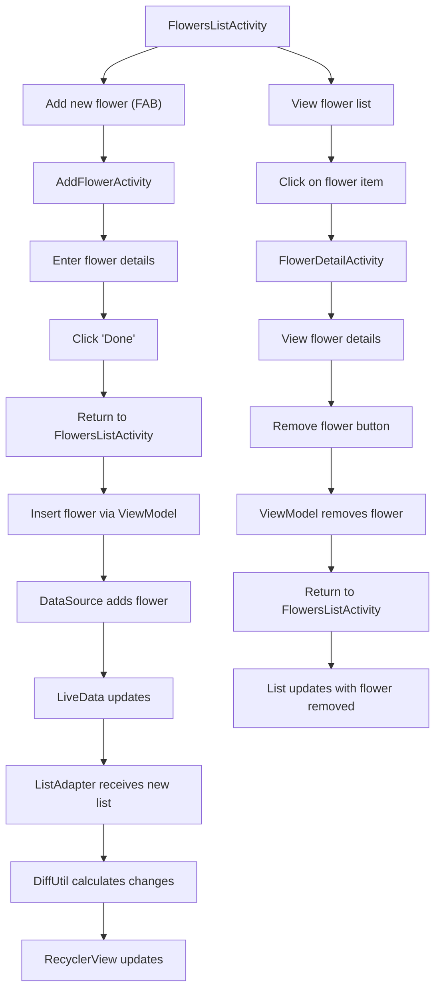

<!-- source: DeepWiki mcp.deepwiki.com · repo android/views-widgets-samples · page 4.1 RecyclerView in Kotlin · fetched 2026-10-23 -->

# RecyclerView in Kotlin

<details>
<summary>Relevant source files</summary>

The following files were used as context for generating this wiki page:

- [RecyclerViewKotlin/.google/packaging.yaml](RecyclerViewKotlin/.google/packaging.yaml)
- [RecyclerViewKotlin/README.md](RecyclerViewKotlin/README.md)
- [RecyclerViewKotlin/app/.gitignore](RecyclerViewKotlin/app/.gitignore)
- [RecyclerViewKotlin/app/build.gradle](RecyclerViewKotlin/app/build.gradle)
- [RecyclerViewKotlin/app/src/main/java/com/example/recyclersample/addFlower/AddFlowerActivity.kt](RecyclerViewKotlin/app/src/main/java/com/example/recyclersample/addFlower/AddFlowerActivity.kt)
- [RecyclerViewKotlin/app/src/main/java/com/example/recyclersample/data/DataSource.kt](RecyclerViewKotlin/app/src/main/java/com/example/recyclersample/data/DataSource.kt)
- [RecyclerViewKotlin/app/src/main/java/com/example/recyclersample/data/Flower.kt](RecyclerViewKotlin/app/src/main/java/com/example/recyclersample/data/Flower.kt)
- [RecyclerViewKotlin/app/src/main/java/com/example/recyclersample/data/Flowers.kt](RecyclerViewKotlin/app/src/main/java/com/example/recyclersample/data/Flowers.kt)
- [RecyclerViewKotlin/app/src/main/java/com/example/recyclersample/flowerDetail/FlowerDetailActivity.kt](RecyclerViewKotlin/app/src/main/java/com/example/recyclersample/flowerDetail/FlowerDetailActivity.kt)
- [RecyclerViewKotlin/app/src/main/java/com/example/recyclersample/flowerDetail/FlowerDetailViewModel.kt](RecyclerViewKotlin/app/src/main/java/com/example/recyclersample/flowerDetail/FlowerDetailViewModel.kt)
- [RecyclerViewKotlin/app/src/main/java/com/example/recyclersample/flowerList/FlowersAdapter.kt](RecyclerViewKotlin/app/src/main/java/com/example/recyclersample/flowerList/FlowersAdapter.kt)
- [RecyclerViewKotlin/app/src/main/java/com/example/recyclersample/flowerList/FlowersListActivity.kt](RecyclerViewKotlin/app/src/main/java/com/example/recyclersample/flowerList/FlowersListActivity.kt)
- [RecyclerViewKotlin/app/src/main/java/com/example/recyclersample/flowerList/FlowersListViewModel.kt](RecyclerViewKotlin/app/src/main/java/com/example/recyclersample/flowerList/FlowersListViewModel.kt)
- [RecyclerViewKotlin/app/src/main/res/drawable/ic_add_black_24dp.xml](RecyclerViewKotlin/app/src/main/res/drawable/ic_add_black_24dp.xml)
- [RecyclerViewKotlin/app/src/main/res/layout/activity_main.xml](RecyclerViewKotlin/app/src/main/res/layout/activity_main.xml)
- [RecyclerViewKotlin/app/src/main/res/layout/add_flower_layout.xml](RecyclerViewKotlin/app/src/main/res/layout/add_flower_layout.xml)
- [RecyclerViewKotlin/app/src/main/res/layout/flower_detail_activity.xml](RecyclerViewKotlin/app/src/main/res/layout/flower_detail_activity.xml)
- [RecyclerViewKotlin/app/src/main/res/layout/flower_item.xml](RecyclerViewKotlin/app/src/main/res/layout/flower_item.xml)
- [RecyclerViewKotlin/app/src/main/res/mipmap-anydpi-v26/ic_launcher_round.xml](RecyclerViewKotlin/app/src/main/res/mipmap-anydpi-v26/ic_launcher_round.xml)
- [RecyclerViewKotlin/app/src/main/res/values/strings.xml](RecyclerViewKotlin/app/src/main/res/values/strings.xml)
- [RecyclerViewKotlin/build.gradle](RecyclerViewKotlin/build.gradle)
- [RecyclerViewKotlin/gradle.properties](RecyclerViewKotlin/gradle.properties)

</details>


## Purpose and Scope

This document provides a detailed explanation of the Kotlin implementation of RecyclerView within the android/views-widgets-samples repository. It covers the MVVM architecture, adapters, view holders, and data handling patterns used in the RecyclerView Kotlin sample. For information about simple RecyclerView implementations, see [Simple RecyclerView Implementation](#4.2). For RecyclerView animations, see [RecyclerView Animations](#4.3).

## Overview

The RecyclerView Kotlin sample demonstrates a flower catalog application that efficiently displays a list of flowers using RecyclerView. It showcases proper implementation of ListAdapter with DiffUtil for efficient updates, header integration using ConcatAdapter, MVVM architecture with ViewModels, and click handlers for list items.

Sources: [RecyclerViewKotlin/README.md:1-25](), [RecyclerViewKotlin/.google/packaging.yaml:1-20]()

## Architecture

The sample follows the MVVM (Model-View-ViewModel) architecture pattern for separation of concerns and maintainable code organization.



Sources: [RecyclerViewKotlin/app/src/main/java/com/example/recyclersample/flowerList/FlowersListActivity.kt:1-94](), [RecyclerViewKotlin/app/src/main/java/com/example/recyclersample/flowerList/FlowersListViewModel.kt:1-59](), [RecyclerViewKotlin/app/src/main/java/com/example/recyclersample/data/DataSource.kt:1-79]()

## Key Components

### Data Model

The sample uses a simple `Flower` data class to represent each item in the RecyclerView.



Sources: [RecyclerViewKotlin/app/src/main/java/com/example/recyclersample/data/Flower.kt:1-27]()

### Data Source

The `DataSource` class manages the list of flowers and provides methods to access and modify the data. It uses `LiveData` to notify observers when the data changes.

| Method | Purpose |
|--------|---------|
| `getFlowerList()` | Returns LiveData containing the list of flowers |
| `addFlower(flower: Flower)` | Adds a new flower to the list |
| `removeFlower(flower: Flower)` | Removes a flower from the list |
| `getFlowerForId(id: Long)` | Returns a flower by its ID |
| `getRandomFlowerImageAsset()` | Returns a random flower image resource ID |

Sources: [RecyclerViewKotlin/app/src/main/java/com/example/recyclersample/data/DataSource.kt:1-79](), [RecyclerViewKotlin/app/src/main/java/com/example/recyclersample/data/Flowers.kt:1-92]()

### ViewModels

The application uses two ViewModels to handle business logic and maintain UI state across configuration changes:

1. **FlowersListViewModel**: Manages the list of flowers
   - Holds `flowersLiveData` for observing the flower list
   - Provides `insertFlower()` to add new flowers

2. **FlowerDetailViewModel**: Handles operations for flower details
   - Provides `getFlowerForId()` to retrieve a specific flower
   - Provides `removeFlower()` to delete a flower

Both ViewModels use `ViewModelProvider.Factory` to initialize with the `DataSource`.

Sources: [RecyclerViewKotlin/app/src/main/java/com/example/recyclersample/flowerList/FlowersListViewModel.kt:1-59](), [RecyclerViewKotlin/app/src/main/java/com/example/recyclersample/flowerDetail/FlowerDetailViewModel.kt:1-49]()

## RecyclerView Implementation

### Adapters

The application uses two adapters working together with `ConcatAdapter`:



1. **FlowersAdapter**: Extends `ListAdapter` for efficient updates
   - Uses `DiffUtil.ItemCallback` to detect changes
   - Implements `ViewHolder` pattern
   - Handles item click events

2. **HeaderAdapter**: Displays the count of flowers at the top of the list

Sources: [RecyclerViewKotlin/app/src/main/java/com/example/recyclersample/flowerList/FlowersAdapter.kt:1-84](), [RecyclerViewKotlin/app/src/main/java/com/example/recyclersample/flowerList/FlowersListActivity.kt:48-50]()

### ListAdapter and DiffUtil

The `FlowersAdapter` extends `ListAdapter` and uses `DiffUtil.ItemCallback` to efficiently update the RecyclerView when the data changes:

```
FlowerDiffCallback : DiffUtil.ItemCallback<Flower> {
    - areItemsTheSame(oldItem, newItem): Checks if items have the same identity
    - areContentsTheSame(oldItem, newItem): Checks if items have the same data
}
```

This approach provides several benefits:
- Calculates differences between lists on a background thread
- Only updates items that have changed
- Applies appropriate animations to item changes

Sources: [RecyclerViewKotlin/app/src/main/java/com/example/recyclersample/flowerList/FlowersAdapter.kt:76-84]()

### ViewHolder Pattern

The `FlowerViewHolder` inner class handles:
- Binding data to views
- Setting up click listeners
- Caching view references for better performance

```
FlowerViewHolder:
    - Holds references to views (flowerTextView, flowerImageView)
    - Initializes click listeners
    - Binds flower data to views in bind(flower) method
```

Sources: [RecyclerViewKotlin/app/src/main/java/com/example/recyclersample/flowerList/FlowersAdapter.kt:34-59]()

### ConcatAdapter for Headers

The sample uses `ConcatAdapter` to combine multiple adapters in a single RecyclerView:

```
val headerAdapter = HeaderAdapter()
val flowersAdapter = FlowersAdapter { flower -> adapterOnClick(flower) }
val concatAdapter = ConcatAdapter(headerAdapter, flowersAdapter)
recyclerView.adapter = concatAdapter
```

This approach allows adding headers, footers, or other special items to a RecyclerView without complicating the main adapter logic.

Sources: [RecyclerViewKotlin/app/src/main/java/com/example/recyclersample/flowerList/FlowersListActivity.kt:48-53]()

## User Interaction Flow

The sample demonstrates a complete user interaction flow for RecyclerView:



Sources: [RecyclerViewKotlin/app/src/main/java/com/example/recyclersample/flowerList/FlowersListActivity.kt:62-93](), [RecyclerViewKotlin/app/src/main/java/com/example/recyclersample/addFlower/AddFlowerActivity.kt:1-63](), [RecyclerViewKotlin/app/src/main/java/com/example/recyclersample/flowerDetail/FlowerDetailActivity.kt:1-72]()

## Layout Implementation

The RecyclerView is implemented with a LinearLayoutManager and a FloatingActionButton for adding new flowers:

```xml
<androidx.recyclerview.widget.RecyclerView
    android:id="@+id/recycler_view"
    android:layout_width="match_parent"
    android:layout_height="match_parent"
    app:layoutManager="LinearLayoutManager"/>

<com.google.android.material.floatingactionbutton.FloatingActionButton
    android:id="@+id/fab"
    android:layout_width="wrap_content"
    android:layout_height="wrap_content"
    android:layout_margin="16dp"
    android:contentDescription="@string/fab_content_description"
    android:src="@drawable/ic_add_black_24dp"
    app:layout_constraintBottom_toBottomOf="parent"
    app:layout_constraintEnd_toEndOf="parent"/>
```

Individual flower items use a simple layout with an image and text:

| Layout File | Purpose |
|-------------|---------|
| activity_main.xml | Main screen with RecyclerView and FAB |
| flower_item.xml | Individual flower item in the list |
| add_flower_layout.xml | Form for adding new flowers |
| flower_detail_activity.xml | Screen showing detailed flower information |

Sources: [RecyclerViewKotlin/app/src/main/res/layout/activity_main.xml:1-35](), [RecyclerViewKotlin/app/src/main/res/layout/flower_item.xml:1-42](), [RecyclerViewKotlin/app/src/main/res/layout/add_flower_layout.xml:1-70](), [RecyclerViewKotlin/app/src/main/res/layout/flower_detail_activity.xml:1-53]()

## Key Implementation Aspects

### LiveData Integration

The sample demonstrates proper integration with LiveData for reactive UI updates:

```kotlin
flowersListViewModel.flowersLiveData.observe(this, {
    it?.let {
        flowersAdapter.submitList(it as MutableList<Flower>)
        headerAdapter.updateFlowerCount(it.size)
    }
})
```

When the flower list changes:
1. LiveData notifies its observers
2. The adapter receives the new list via `submitList()`
3. DiffUtil calculates the differences between old and new lists
4. RecyclerView efficiently updates only the changed items

Sources: [RecyclerViewKotlin/app/src/main/java/com/example/recyclersample/flowerList/FlowersListActivity.kt:55-60]()

### Activity-ViewModel Communication

The sample follows best practices for communication between Activities and ViewModels:

1. Activities observe LiveData from ViewModels
2. Activities call ViewModel methods to update data
3. ViewModels interact with the data source
4. Data changes propagate back to the UI through LiveData

This pattern ensures separation of concerns and makes the code more testable and maintainable.

Sources: [RecyclerViewKotlin/app/src/main/java/com/example/recyclersample/flowerList/FlowersListActivity.kt:38-66](), [RecyclerViewKotlin/app/src/main/java/com/example/recyclersample/flowerList/FlowersListViewModel.kt:26-45]()

## Summary

The RecyclerView Kotlin sample demonstrates:

1. Efficient list management with ListAdapter and DiffUtil
2. MVVM architecture with clear separation of concerns
3. Proper LiveData integration for reactive UI updates
4. Multiple adapters working together with ConcatAdapter
5. ViewHolder pattern for optimal performance
6. Handler for item click events
7. Complete user flow for viewing, adding, and removing items

This implementation serves as a model for building performant, maintainable list-based UIs in Android applications using Kotlin and modern Android architecture components.

---

