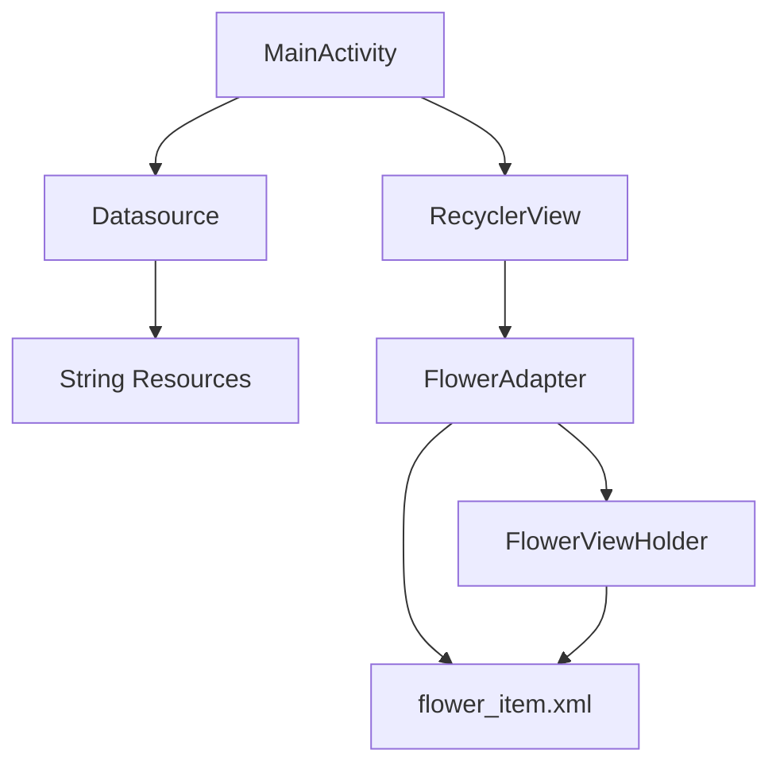
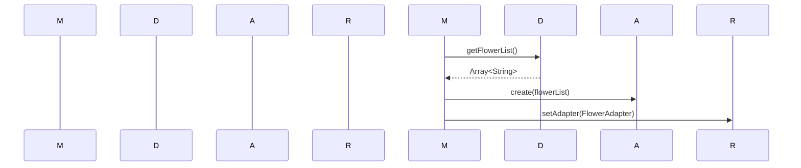
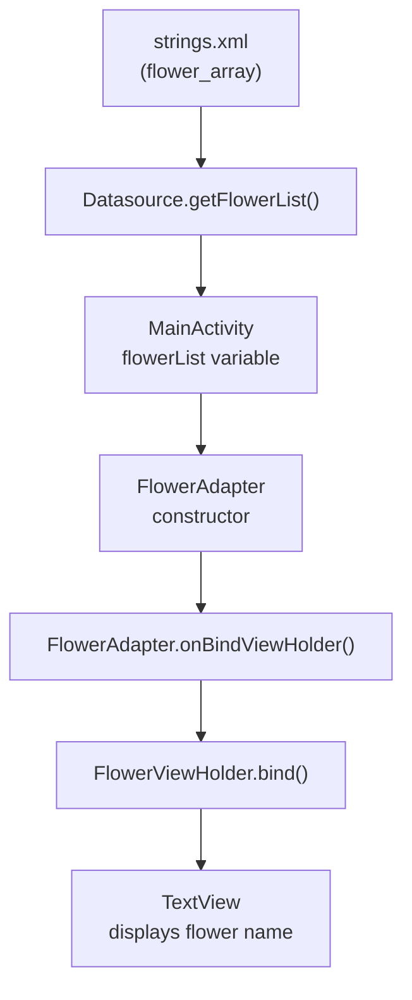

<!-- source: DeepWiki mcp.deepwiki.com · repo android/views-widgets-samples · page 4.2 Simple RecyclerView Implementation · fetched 2026-10-23 -->

# Simple RecyclerView Implementation

<details>
<summary>Relevant source files</summary>

The following files were used as context for generating this wiki page:

- [RecyclerViewSimple/.gitignore](RecyclerViewSimple/.gitignore)
- [RecyclerViewSimple/app/.gitignore](RecyclerViewSimple/app/.gitignore)
- [RecyclerViewSimple/app/build.gradle](RecyclerViewSimple/app/build.gradle)
- [RecyclerViewSimple/app/src/main/AndroidManifest.xml](RecyclerViewSimple/app/src/main/AndroidManifest.xml)
- [RecyclerViewSimple/app/src/main/java/com/example/recyclersample/Datasource.kt](RecyclerViewSimple/app/src/main/java/com/example/recyclersample/Datasource.kt)
- [RecyclerViewSimple/app/src/main/java/com/example/recyclersample/FlowerAdapter.kt](RecyclerViewSimple/app/src/main/java/com/example/recyclersample/FlowerAdapter.kt)
- [RecyclerViewSimple/app/src/main/java/com/example/recyclersample/MainActivity.kt](RecyclerViewSimple/app/src/main/java/com/example/recyclersample/MainActivity.kt)
- [RecyclerViewSimple/app/src/main/res/drawable-v24/ic_launcher_foreground.xml](RecyclerViewSimple/app/src/main/res/drawable-v24/ic_launcher_foreground.xml)
- [RecyclerViewSimple/app/src/main/res/drawable/ic_launcher_background.xml](RecyclerViewSimple/app/src/main/res/drawable/ic_launcher_background.xml)
- [RecyclerViewSimple/app/src/main/res/layout/activity_main.xml](RecyclerViewSimple/app/src/main/res/layout/activity_main.xml)
- [RecyclerViewSimple/app/src/main/res/layout/flower_item.xml](RecyclerViewSimple/app/src/main/res/layout/flower_item.xml)
- [RecyclerViewSimple/app/src/main/res/mipmap-anydpi-v26/ic_launcher.xml](RecyclerViewSimple/app/src/main/res/mipmap-anydpi-v26/ic_launcher.xml)
- [RecyclerViewSimple/app/src/main/res/values/strings.xml](RecyclerViewSimple/app/src/main/res/values/strings.xml)
- [RecyclerViewSimple/build.gradle](RecyclerViewSimple/build.gradle)
- [RecyclerViewSimple/gradle.properties](RecyclerViewSimple/gradle.properties)

</details>


## Introduction

This document explains the basic implementation of RecyclerView in Android using Kotlin, as demonstrated in the RecyclerViewSimple sample app. It covers the fundamental components needed to create a simple, functioning RecyclerView that displays a list of items.

This page focuses on the straightforward implementation without advanced features like item animations, item decorations, or complex data handling. For more advanced RecyclerView implementations, see [RecyclerView in Kotlin](#4.1) or [RecyclerView Animations](#4.3).

## Architecture Overview

The Simple RecyclerView implementation follows a clean, straightforward architecture with minimal components:



Sources:
[app/src/main/java/com/example/recyclersample/MainActivity.kt]()
[app/src/main/java/com/example/recyclersample/Datasource.kt]()
[app/src/main/java/com/example/recyclersample/FlowerAdapter.kt]()
[app/src/main/res/layout/activity_main.xml]()
[app/src/main/res/layout/flower_item.xml]()
[app/src/main/res/values/strings.xml]()

## Key Components

### 1. Data Source

The sample app uses a simple `Datasource` class to retrieve flower names from string resources:

```mermaid
classDiagram
    class "Datasource" {
        +context: Context
        +getFlowerList(): Array~String~
    }
```

The `Datasource` class has a single method `getFlowerList()` that retrieves a string array from resources.

Sources: 
[app/src/main/java/com/example/recyclersample/Datasource.kt]()
[app/src/main/res/values/strings.xml:21-35]()

### 2. Adapter and ViewHolder

The `FlowerAdapter` class connects the data to the RecyclerView:

```mermaid
classDiagram
    class "FlowerAdapter" {
        +flowerList: Array~String~
        +onCreateViewHolder(): FlowerViewHolder
        +onBindViewHolder(): void
        +getItemCount(): Int
    }
    
    class "FlowerViewHolder" {
        -flowerTextView: TextView
        +bind(word: String): void
    }
    
    "FlowerAdapter" *-- "FlowerViewHolder" : contains
```

The `FlowerAdapter`:
- Extends `RecyclerView.Adapter` with `FlowerViewHolder` as its view holder type
- Contains the `FlowerViewHolder` as an inner class
- Implements three required methods:
  - `onCreateViewHolder`: Creates new ViewHolder instances
  - `onBindViewHolder`: Binds data to ViewHolder at a specific position
  - `getItemCount`: Returns the total number of items

Sources:
[app/src/main/java/com/example/recyclersample/FlowerAdapter.kt:25-54]()

### 3. MainActivity Setup

The `MainActivity` initializes and connects the components:



The initialization follows these steps:
1. Retrieve data from `Datasource`
2. Initialize the adapter with the data
3. Set the adapter on the RecyclerView

Sources:
[app/src/main/java/com/example/recyclersample/MainActivity.kt:23-34]()

### 4. Layouts

#### RecyclerView Layout

The main activity layout contains a RecyclerView that uses a `LinearLayoutManager`:

```xml
<androidx.recyclerview.widget.RecyclerView
    android:id="@+id/recycler_view"
    android:layout_width="match_parent"
    android:layout_height="match_parent"
    app:layoutManager="LinearLayoutManager" />
```

Note that the `layoutManager` is set directly in XML with the `app:layoutManager` attribute.

#### Item Layout

Each item in the RecyclerView uses a simple layout with a TextView:

```xml
<FrameLayout>
    <TextView
        android:id="@+id/flower_text"
        android:layout_width="wrap_content"
        android:layout_height="wrap_content"
        android:textSize="50dp" />
</FrameLayout>
```

Sources:
[app/src/main/res/layout/activity_main.xml:22-26]()
[app/src/main/res/layout/flower_item.xml:17-28]()

## Implementation Details

### Data Structure

The sample uses a string array resource to store the flower names:

```xml
<string-array name="flower_array">
    <item>Lily</item>
    <item>Poppy</item>
    <item>Sunflower</item>
    <!-- more flowers... -->
</string-array>
```

The `Datasource` class provides access to this data:

```kotlin
class Datasource(val context: Context) {
    fun getFlowerList(): Array<String> {
        return context.resources.getStringArray(R.array.flower_array)
    }
}
```

Sources:
[app/src/main/res/values/strings.xml:21-35]()
[app/src/main/java/com/example/recyclersample/Datasource.kt:21-26]()

### Adapter Implementation

The `FlowerAdapter` class follows the standard RecyclerView adapter pattern:

1. **ViewHolder Definition**: Holds references to views for efficient recycling
2. **Creating ViewHolders**: Inflates the item layout and creates new ViewHolder instances
3. **Binding Data**: Binds data from the dataset to the ViewHolder's views
4. **Count Reporting**: Provides the total count of items

Key methods:

- `onCreateViewHolder`: Creates a new ViewHolder by inflating the item layout
- `onBindViewHolder`: Updates a ViewHolder with data at the given position
- `getItemCount`: Returns the size of the data list

The `bind` method in the ViewHolder sets the text of the TextView to the current flower name.

Sources:
[app/src/main/java/com/example/recyclersample/FlowerAdapter.kt:25-54]()

### RecyclerView Initialization

In `MainActivity`, the RecyclerView is initialized in the `onCreate` method:

```kotlin
override fun onCreate(savedInstanceState: Bundle?) {
    super.onCreate(savedInstanceState)
    setContentView(R.layout.activity_main)

    // Retrieves data from datasource
    val flowerList = Datasource(this).getFlowerList()

    val recyclerView: RecyclerView = findViewById(R.id.recycler_view)
    recyclerView.adapter = FlowerAdapter(flowerList)
}
```

This simple initialization:
1. Gets the flower list from the `Datasource`
2. Finds the RecyclerView by ID
3. Sets the adapter with the flower list

No additional configuration is needed because the `LinearLayoutManager` is already specified in the XML layout.

Sources:
[app/src/main/java/com/example/recyclersample/MainActivity.kt:23-34]()

## Data Flow

The data flow in the RecyclerView implementation follows this pattern:



Sources:
[app/src/main/res/values/strings.xml:21-35]()
[app/src/main/java/com/example/recyclersample/Datasource.kt:21-26]()
[app/src/main/java/com/example/recyclersample/MainActivity.kt:23-34]()
[app/src/main/java/com/example/recyclersample/FlowerAdapter.kt:25-54]()

## Implementation Summary

This simple RecyclerView implementation demonstrates the minimum components required for a working RecyclerView:

| Component | Purpose |
|-----------|---------|
| `MainActivity` | Initializes the RecyclerView and connects components |
| `Datasource` | Provides data for the adapter |
| `FlowerAdapter` | Connects data to the RecyclerView |
| `FlowerViewHolder` | Holds references to views in each item |
| `activity_main.xml` | Contains the RecyclerView with a layout manager |
| `flower_item.xml` | Defines the layout for each item |
| `strings.xml` | Stores the array of flower names |

The implementation follows the standard Android architecture pattern for list displays, with clean separation between data, adapter, and view components.

Sources:
[app/src/main/java/com/example/recyclersample/MainActivity.kt]()
[app/src/main/java/com/example/recyclersample/Datasource.kt]()
[app/src/main/java/com/example/recyclersample/FlowerAdapter.kt]()
[app/src/main/res/layout/activity_main.xml]()
[app/src/main/res/layout/flower_item.xml]()
[app/src/main/res/values/strings.xml]()

---

