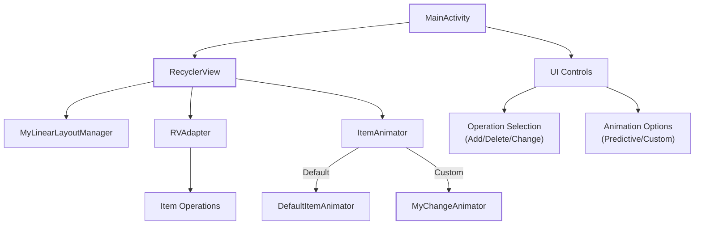
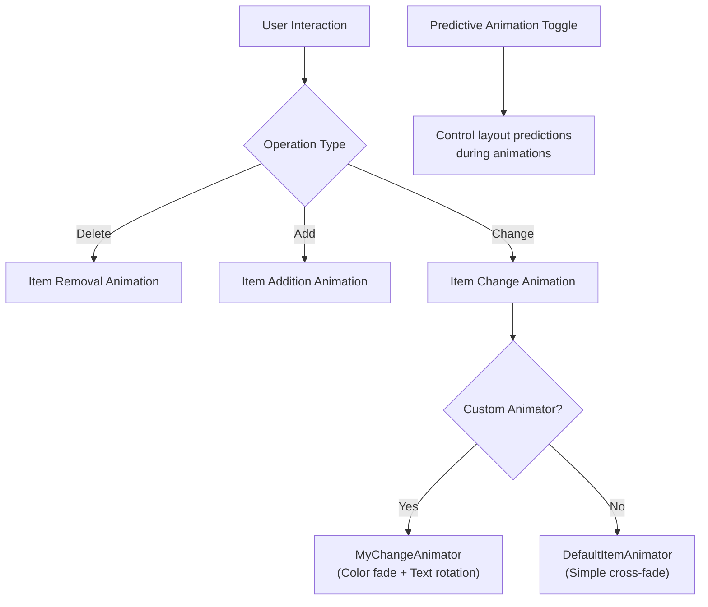
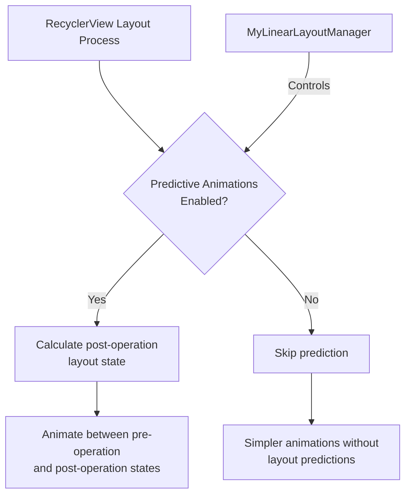
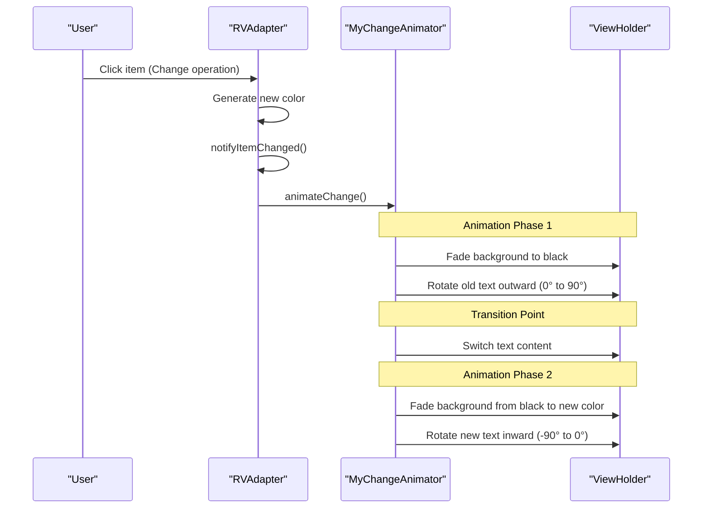

<!-- source: DeepWiki mcp.deepwiki.com · repo android/views-widgets-samples · page 4.3 RecyclerView Animations · fetched 2026-10-23 -->

# RecyclerView Animations

<details>
<summary>Relevant source files</summary>

The following files were used as context for generating this wiki page:

- [RecyclerViewAnimations/app/build.gradle](RecyclerViewAnimations/app/build.gradle)
- [RecyclerViewAnimations/app/src/main/java/examples/android/com/recyclerviewanimations/MainActivity.java](RecyclerViewAnimations/app/src/main/java/examples/android/com/recyclerviewanimations/MainActivity.java)
- [RecyclerViewAnimations/app/src/main/res/layout/activity_main.xml](RecyclerViewAnimations/app/src/main/res/layout/activity_main.xml)
- [RecyclerViewAnimations/build.gradle](RecyclerViewAnimations/build.gradle)
- [RecyclerViewAnimations/gradle.properties](RecyclerViewAnimations/gradle.properties)
- [RecyclerViewAnimations/gradle/wrapper/gradle-wrapper.properties](RecyclerViewAnimations/gradle/wrapper/gradle-wrapper.properties)

</details>


## Purpose and Scope

This document explains the RecyclerView Animations system, a demonstration of how to implement and customize animations for RecyclerView operations in Android. It focuses on:

- Custom item animations for add, remove, and change operations
- Implementing predictive animations in RecyclerView
- Creating sophisticated, interruptible animations for item changes

For general information about RecyclerView implementation, see [RecyclerView in Kotlin](#4.1) or [Simple RecyclerView Implementation](#4.2).

## System Overview

The RecyclerView Animations system demonstrates different types of animations that can occur when manipulating items in a RecyclerView, along with how to customize these animations for a more polished user experience.

### Architecture Diagram



Sources: [RecyclerViewAnimations/app/src/main/java/examples/android/com/recyclerviewanimations/MainActivity.java:48-479]()

## Key Components

### Main Activity and UI

The main activity sets up the RecyclerView and provides UI controls for demonstrating different animation types:

- A RecyclerView displaying colored items with hex values
- Radio buttons to select operations (Add, Delete, Change)
- Checkboxes to toggle animation options:
  - Predictive Animations
  - Custom Animator

### Animation Types and Controls



Sources: 
- [RecyclerViewAnimations/app/src/main/res/layout/activity_main.xml:28-77]()
- [RecyclerViewAnimations/app/src/main/java/examples/android/com/recyclerviewanimations/MainActivity.java:58-74]()

## RecyclerView Adapter

The `RVAdapter` class manages a list of color values and handles three main operations:

| Operation | Method | Description |
|-----------|--------|-------------|
| Delete | `deleteItem()` | Removes an item at the clicked position |
| Add | `addItem()` | Inserts a newly generated colored item at the clicked position |
| Change | `changeItem()` | Replaces the color of an item at the clicked position |

Each operation triggers a corresponding notification method (`notifyItemRemoved()`, `notifyItemInserted()`, or `notifyItemChanged()`), which in turn activates the appropriate animation.

Sources: [RecyclerViewAnimations/app/src/main/java/examples/android/com/recyclerviewanimations/MainActivity.java:82-166]()

## Predictive Animations

The sample demonstrates predictive animations with a custom `LinearLayoutManager`:



Sources: [RecyclerViewAnimations/app/src/main/java/examples/android/com/recyclerviewanimations/MainActivity.java:173-182]()

When predictive animations are enabled, the RecyclerView calculates item positions before and after an operation, creating smoother transitions as items move to their final positions. This is particularly noticeable during add and remove operations, where surrounding items need to reposition themselves.

## Custom Change Animation Implementation

The most sophisticated part of this sample is the custom `MyChangeAnimator`, which demonstrates how to create complex animations when an item's content changes.

### Change Animation Process



Sources: [RecyclerViewAnimations/app/src/main/java/examples/android/com/recyclerviewanimations/MainActivity.java:192-462]()

### Change Animation Components

The custom change animation consists of several coordinated parts:

1. **Color Transition**:
   - Fade from the old color to black
   - Fade from black to the new color

2. **Text Rotation**:
   - Rotate the old text from 0° to 90° (becoming perpendicular to the user)
   - Switch the text content when it's not visible to the user
   - Rotate the new text from -90° to 0°

3. **Animation Interruption Handling**:
   - Detects if a new change animation starts while one is in progress
   - Determines which phase is currently running
   - Cancels the current animation
   - Starts a new animation from the appropriate mid-point

Sources: [RecyclerViewAnimations/app/src/main/java/examples/android/com/recyclerviewanimations/MainActivity.java:273-432]()

## Change Animation Technical Details

### Custom ItemHolderInfo Class

The `ColorTextInfo` class extends `ItemHolderInfo` to store the state of items before and after changes:

```
ColorTextInfo {
    int color;       // Background color
    String text;     // Text content
}
```

This information is recorded in `recordPreLayoutInformation()` and `recordPostLayoutInformation()` methods.

### Animation State Management

The `AnimatorInfo` class stores references to all animators involved in a change animation:

```
AnimatorInfo {
    Animator overallAnim;           // The overall choreographed animation
    ObjectAnimator fadeToBlackAnim; // First phase color animation
    ObjectAnimator fadeFromBlackAnim; // Second phase color animation
    ObjectAnimator oldTextRotator;  // First phase text rotation
    ObjectAnimator newTextRotator;  // Second phase text rotation
}
```

These references allow the system to:
1. Track running animations per ViewHolder
2. Cancel animations when a new change occurs
3. Calculate the appropriate starting point for new animations

Sources: [RecyclerViewAnimations/app/src/main/java/examples/android/com/recyclerviewanimations/MainActivity.java:247-270]()

## Implementation Considerations

When implementing custom RecyclerView animations, consider:

1. **Performance**: Complex animations can impact performance, especially on older devices
2. **Animation Duration**: Keep animations brief to avoid delaying user interaction
3. **Interruption Handling**: Users may trigger multiple changes rapidly
4. **Resource Usage**: Animation objects should be properly managed to avoid memory leaks

## Resource Cleanup

The `MyChangeAnimator` implementation properly cleans up animation resources:

- `endAnimation()`: Cancels animations for a specific ViewHolder
- `isRunning()`: Checks if any animations are still in progress
- `endAnimations()`: Cancels all running animations

Sources: [RecyclerViewAnimations/app/src/main/java/examples/android/com/recyclerviewanimations/MainActivity.java:434-461]()

## Integration with RecyclerView

The custom animator is applied to the RecyclerView through the `setItemAnimator()` method, toggled by a checkbox in the UI:

```java
mRecyclerView.setItemAnimator(isChecked ? mChangeAnimator : mDefaultItemAnimator);
```

This allows switching between the default cross-fade animation and the custom animation at runtime.

Sources: [RecyclerViewAnimations/app/src/main/java/examples/android/com/recyclerviewanimations/MainActivity.java:69-74]()

---

