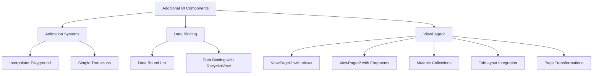
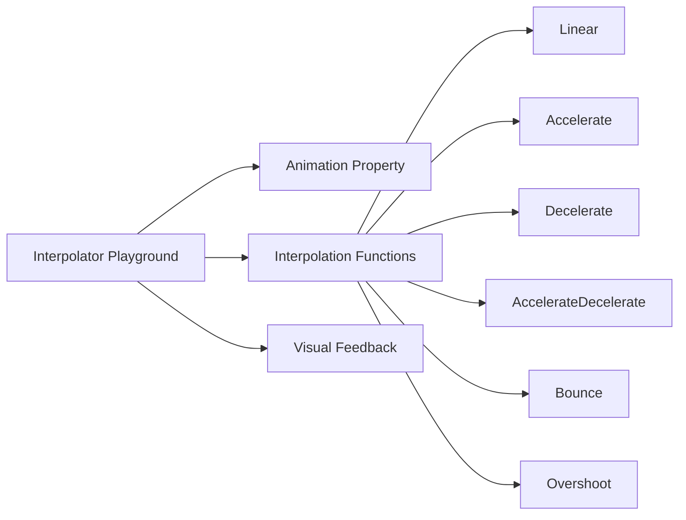
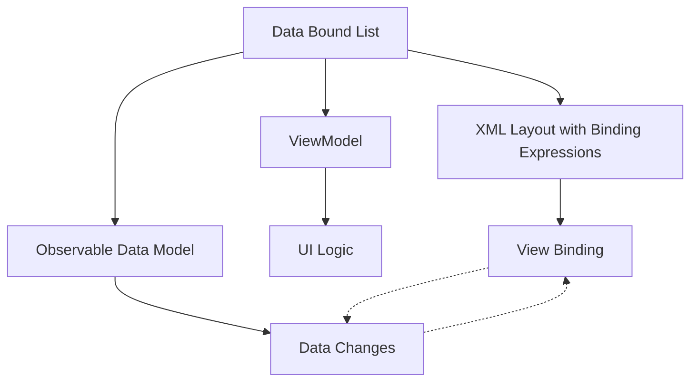
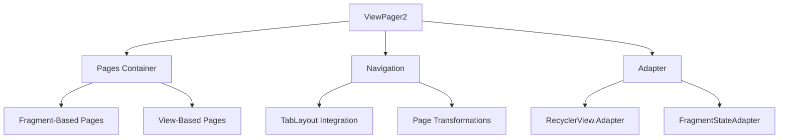
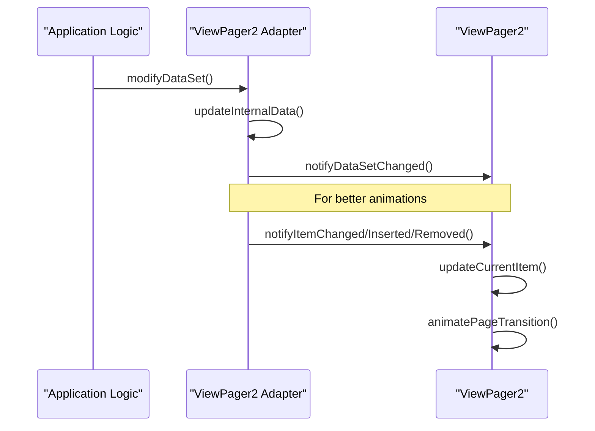
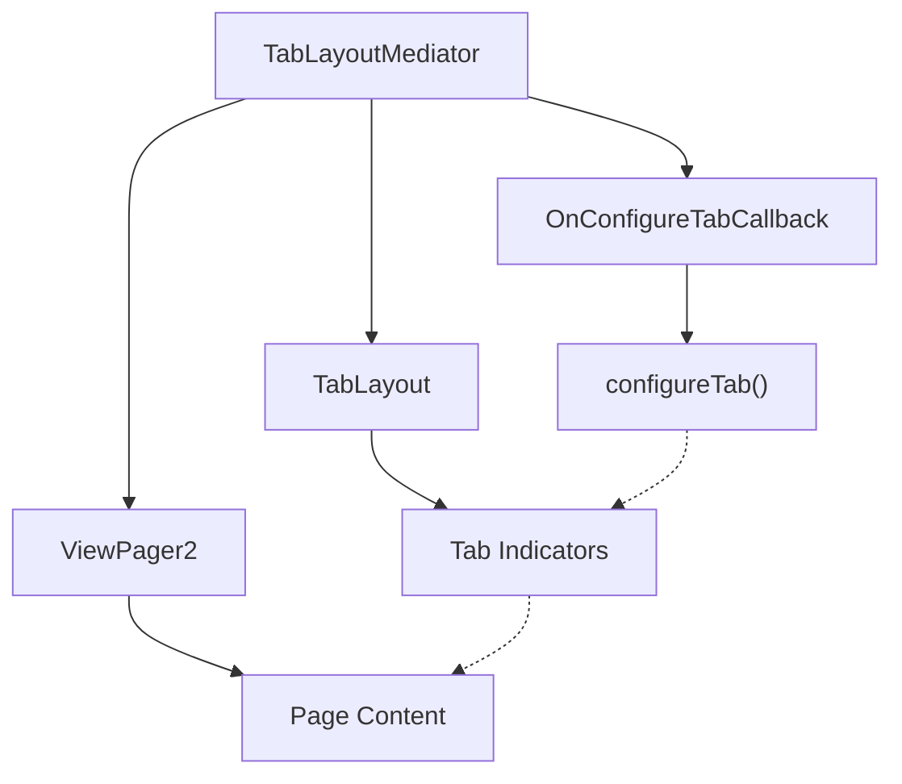
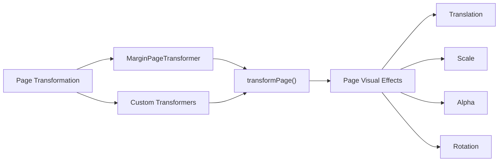
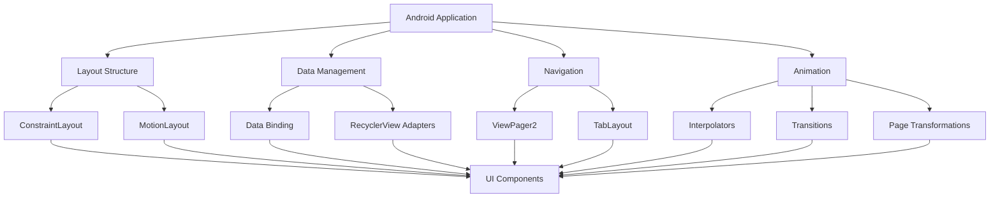

<!-- source: DeepWiki mcp.deepwiki.com · repo android/views-widgets-samples · page 5 Additional UI Components · fetched 2026-10-23 -->

# Additional UI Components

<details>
<summary>Relevant source files</summary>

The following files were used as context for generating this wiki page:

- [AnimationsInterpolatorPlayground/build.gradle](AnimationsInterpolatorPlayground/build.gradle)
- [AnimationsInterpolatorPlayground/gradle/wrapper/gradle-wrapper.properties](AnimationsInterpolatorPlayground/gradle/wrapper/gradle-wrapper.properties)
- [CardView/Application/build.gradle](CardView/Application/build.gradle)
- [CardView/gradle/wrapper/gradle-wrapper.properties](CardView/gradle/wrapper/gradle-wrapper.properties)
- [CardViewKotlin/build.gradle](CardViewKotlin/build.gradle)
- [CardViewKotlin/gradle/wrapper/gradle-wrapper.properties](CardViewKotlin/gradle/wrapper/gradle-wrapper.properties)
- [DataBindingDataBoundList/app/build.gradle](DataBindingDataBoundList/app/build.gradle)
- [DataBindingDataBoundList/build.gradle](DataBindingDataBoundList/build.gradle)
- [DataBindingDataBoundList/gradle.properties](DataBindingDataBoundList/gradle.properties)
- [DataBindingDataBoundList/gradle/wrapper/gradle-wrapper.properties](DataBindingDataBoundList/gradle/wrapper/gradle-wrapper.properties)
- [ViewPager2/.gitignore](ViewPager2/.gitignore)
- [ViewPager2/.google/packaging.yaml](ViewPager2/.google/packaging.yaml)
- [ViewPager2/README.md](ViewPager2/README.md)
- [ViewPager2/app/.gitignore](ViewPager2/app/.gitignore)
- [ViewPager2/app/proguard-rules.pro](ViewPager2/app/proguard-rules.pro)
- [ViewPager2/app/src/androidTest/java/androidx/viewpager2/integration/testapp/test/MarginPageTransformerTest.kt](ViewPager2/app/src/androidTest/java/androidx/viewpager2/integration/testapp/test/MarginPageTransformerTest.kt)
- [ViewPager2/app/src/androidTest/java/androidx/viewpager2/integration/testapp/test/MutableCollectionBaseTest.kt](ViewPager2/app/src/androidTest/java/androidx/viewpager2/integration/testapp/test/MutableCollectionBaseTest.kt)
- [ViewPager2/app/src/androidTest/java/androidx/viewpager2/integration/testapp/test/MutableCollectionFragmentTest.kt](ViewPager2/app/src/androidTest/java/androidx/viewpager2/integration/testapp/test/MutableCollectionFragmentTest.kt)

</details>


This page provides documentation for the additional UI components and patterns demonstrated in the Android Views and Widgets Samples repository beyond the main systems. These components enhance the Android user interface by providing animations, data management, and page navigation capabilities. For information about core layout systems, see [ConstraintLayout and MotionLayout System](#3), and for information about list displays, see [RecyclerView System](#4).

## Overview of Additional UI Components

The Android Views and Widgets Samples repository demonstrates several additional UI components that complement the core layout and list systems:



Sources: 
- [ViewPager2/README.md:1-96]()
- [AnimationsInterpolatorPlayground/build.gradle:1-26]()
- [DataBindingDataBoundList/build.gradle:1-42]()

## Animation Systems

The Animation Systems in the repository demonstrate different ways to add motion and visual dynamics to your Android applications.

### Interpolator Playground

The Interpolator Playground allows developers to experiment with different animation interpolators, which control the rate of change of an animation property over time.



Sources:
- [AnimationsInterpolatorPlayground/build.gradle:1-26]()
- [AnimationsInterpolatorPlayground/gradle/wrapper/gradle-wrapper.properties:1-7]()

## Data Binding System

The Data Binding system demonstrates how to connect UI components in layouts with data sources using a declarative format rather than programmatically.

### Data Bound List

This sample demonstrates data binding with a simple list view, enabling automatic synchronization between the data model and UI elements.



Sources:
- [DataBindingDataBoundList/build.gradle:1-42]()
- [DataBindingDataBoundList/app/build.gradle:1-42]()
- [DataBindingDataBoundList/gradle.properties:1-33]()

### Technical Implementation

Data binding requires enabling the feature in the module's build.gradle file. This is demonstrated in the sample code:

```
android {
    buildFeatures.dataBinding = true
    // other configurations...
}
```

This configuration can be found in [DataBindingDataBoundList/app/build.gradle:22]().

## ViewPager2

ViewPager2 is the replacement for the original ViewPager component, addressing many limitations of the original implementation and adding new features.



Sources:
- [ViewPager2/README.md:1-96]()
- [ViewPager2/.google/packaging.yaml:1-19]()

### Key Features and Capabilities

The ViewPager2 component offers several improvements over the original ViewPager:

| Feature | Description |
|---------|-------------|
| Right-to-Left Support | Native support for RTL layouts |
| Vertical Orientation | Ability to swipe vertically in addition to horizontally |
| Modifiable Collections | Support for dynamic changes to the underlying collection |
| Fragment State Management | Improved state management for Fragment-based pages |
| TabLayout Integration | Integration with TabLayout via TabLayoutMediator |

### Implementation Approaches

ViewPager2 supports two primary implementation approaches:

1. **View-based Pages**: Using a standard RecyclerView.Adapter to provide View items as pages.
2. **Fragment-based Pages**: Using FragmentStateAdapter to provide Fragment instances as pages, with built-in lifecycle management.

```mermaid
classDiagram
    class "ViewPager2" {
        +setAdapter()
        +setOrientation()
        +setOffscreenPageLimit()
        +registerOnPageChangeCallback()
    }
    
    class "RecyclerView.Adapter" {
        +getItemCount()
        +onCreateViewHolder()
        +onBindViewHolder()
    }
    
    class "FragmentStateAdapter" {
        +getItemCount()
        +createFragment()
    }
    
    class "TabLayoutMediator" {
        +attach()
    }
    
    "ViewPager2" --> "RecyclerView.Adapter"
    "ViewPager2" --> "FragmentStateAdapter"
    "TabLayoutMediator" --> "ViewPager2"
    "FragmentStateAdapter" --|> "RecyclerView.Adapter"
```

Sources:
- [ViewPager2/README.md:21-79]()
- [ViewPager2/.google/packaging.yaml:13-17]()

### Mutable Collections

One of the significant features of ViewPager2 is its support for mutable collections, allowing dynamic changes to the pages while maintaining proper state.



The repository includes two examples of mutable collections:
- Mutable Collection with Views
- Mutable Collection with Fragments, which demonstrates state preservation

Sources:
- [ViewPager2/README.md:13-16]()
- [ViewPager2/app/src/androidTest/java/androidx/viewpager2/integration/testapp/test/MutableCollectionBaseTest.kt:1-126]()

### TabLayout Integration

ViewPager2 can be integrated with TabLayout to provide tab-based navigation between pages:



This integration is achieved through the TabLayoutMediator class, which connects the ViewPager2 with a TabLayout and synchronizes their states.

Sources:
- [ViewPager2/README.md:58-70]()

### Page Transformations

ViewPager2 supports page transformations to add visual effects during page transitions. The MarginPageTransformer is specifically highlighted in the test files:



Sources:
- [ViewPager2/app/src/androidTest/java/androidx/viewpager2/integration/testapp/test/MarginPageTransformerTest.kt:1-177]()

### Testing ViewPager2

The repository includes comprehensive testing approaches for ViewPager2:

| Testing Approach | Description |
|------------------|-------------|
| UI Tests | Performing swipes or calling setCurrentItem programmatically |
| Idle Monitoring | Using IdlingResource or CountDownLatch to wait for transitions |
| Custom Actions | Espresso extensions for ViewPager2-specific actions |

Sources:
- [ViewPager2/README.md:73-92]()

## Component Integration

These additional UI components can be integrated with each other and with the core UI systems (ConstraintLayout, RecyclerView) to create comprehensive user interfaces:



Sources:
- [ViewPager2/README.md:1-96]()
- [AnimationsInterpolatorPlayground/build.gradle:1-26]()
- [DataBindingDataBoundList/build.gradle:1-42]()

## Summary

The additional UI components covered in this page provide essential tools for creating rich, interactive Android user interfaces:

1. **Animation Systems** offer ways to add motion and dynamic visual effects to your applications
2. **Data Binding** simplifies the process of connecting UI elements with data sources
3. **ViewPager2** enables swipeable navigation between views or fragments with advanced features

These components can be used independently or combined with other UI systems to create comprehensive user experiences.

---

