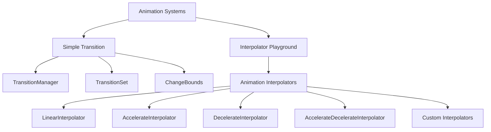
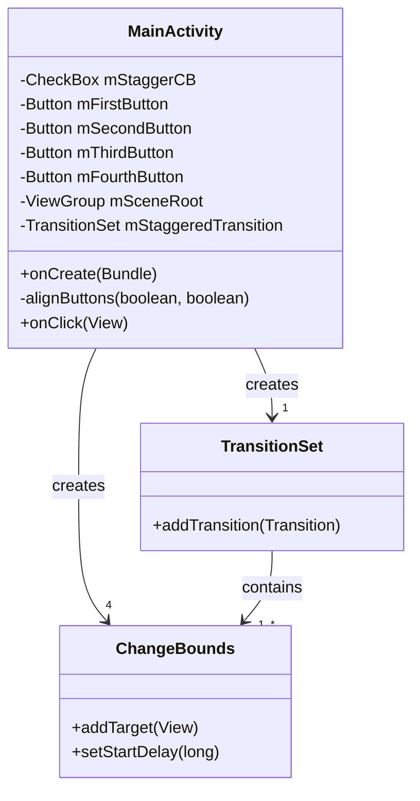
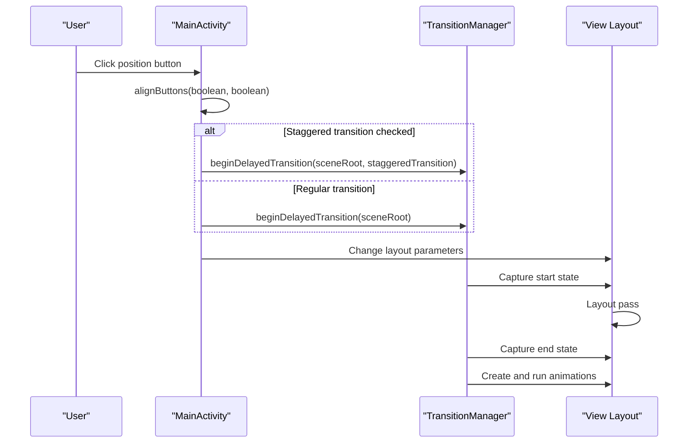
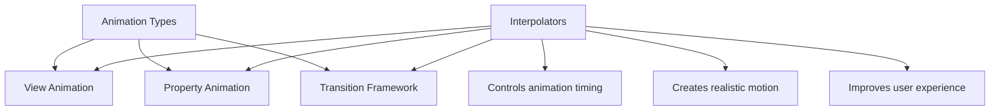

<!-- source: DeepWiki mcp.deepwiki.com · repo android/views-widgets-samples · page 5.1 Animation Systems · fetched 2026-10-23 -->

# Animation Systems

<details>
<summary>Relevant source files</summary>

The following files were used as context for generating this wiki page:

- [AnimationsInterpolatorPlayground/build.gradle](AnimationsInterpolatorPlayground/build.gradle)
- [AnimationsInterpolatorPlayground/gradle/wrapper/gradle-wrapper.properties](AnimationsInterpolatorPlayground/gradle/wrapper/gradle-wrapper.properties)
- [CardView/Application/build.gradle](CardView/Application/build.gradle)
- [CardView/gradle/wrapper/gradle-wrapper.properties](CardView/gradle/wrapper/gradle-wrapper.properties)
- [CardViewKotlin/build.gradle](CardViewKotlin/build.gradle)
- [CardViewKotlin/gradle/wrapper/gradle-wrapper.properties](CardViewKotlin/gradle/wrapper/gradle-wrapper.properties)
- [SimpleTransition/app/build.gradle](SimpleTransition/app/build.gradle)
- [SimpleTransition/app/src/main/java/com/android/example/simpletransition/MainActivity.java](SimpleTransition/app/src/main/java/com/android/example/simpletransition/MainActivity.java)
- [SimpleTransition/build.gradle](SimpleTransition/build.gradle)
- [SimpleTransition/gradle.properties](SimpleTransition/gradle.properties)
- [SimpleTransition/gradle/wrapper/gradle-wrapper.properties](SimpleTransition/gradle/wrapper/gradle-wrapper.properties)

</details>


## Purpose and Scope

This document covers the animation systems demonstrated in the Android Views and Widgets Samples repository. It focuses on two main animation examples: Simple Transition and Interpolator Playground. These samples illustrate how to implement smooth, visually appealing transitions and animations in Android applications using the AndroidX Transition framework and animation interpolators.

For information about MotionLayout animations, see [ConstraintLayout and MotionLayout System](#3).

## Animation Systems Overview

The repository includes two primary animation demonstration applications:

1. **Simple Transition** - Demonstrates the AndroidX Transition framework for animating changes to view layouts
2. **Interpolator Playground** - Showcases various animation interpolators that control the rate of change in animations



**Diagram: Animation Systems Components**

Sources: [SimpleTransition/app/src/main/java/com/android/example/simpletransition/MainActivity.java:1-140]()

## Simple Transition

The Simple Transition example demonstrates how to use the AndroidX Transition framework to animate layout changes between different UI states. It specifically showcases:

1. Basic transitions using `TransitionManager.beginDelayedTransition()`
2. Custom staggered transitions with `TransitionSet` and time delays
3. Target-specific transitions that only affect certain views

### Architecture and Implementation

The Simple Transition demo uses a straightforward architecture centered around the `MainActivity` class:



**Diagram: Simple Transition Class Structure**

Sources: [SimpleTransition/app/src/main/java/com/android/example/simpletransition/MainActivity.java:40-74]()

### Key Transition Components

1. **TransitionManager**: Coordinates transitions between UI states
2. **TransitionSet**: Groups multiple transitions together
3. **ChangeBounds**: Animates changes in view dimensions and positions

When a transition is triggered, the system captures the start and end states of views, then creates an animation to smoothly transition between them.

### Implementation Details

The Simple Transition example demonstrates two types of transitions:

1. **Standard Transition**: A basic transition where all views animate simultaneously
2. **Staggered Transition**: A custom transition where multiple views animate with a time offset

#### Setting Up Staggered Transitions

The staggered transition effect is created by:
1. Creating a `TransitionSet` to group multiple transitions
2. Adding multiple `ChangeBounds` transitions with different targets
3. Setting different start delays for each transition

```java
mStaggeredTransition = new TransitionSet();
Transition first = new ChangeBounds();
Transition second = new ChangeBounds();
Transition third = new ChangeBounds();
Transition fourth = new ChangeBounds();

first.addTarget(mFirstButton);
second.setStartDelay(50).addTarget(mSecondButton);
third.setStartDelay(100).addTarget(mThirdButton);
fourth.setStartDelay(150).addTarget(mFourthButton);

mStaggeredTransition.addTransition(first).addTransition(second)
    .addTransition(third).addTransition(fourth);
```

Sources: [SimpleTransition/app/src/main/java/com/android/example/simpletransition/MainActivity.java:59-73]()

#### Triggering Transitions

Transitions are triggered in the `alignButtons()` method when the user clicks a position button:

```java
// Trigger a transition to run after the next layout pass
if (mStaggerCB.isChecked()) {
    TransitionManager.beginDelayedTransition(mSceneRoot, mStaggeredTransition);
} else {
    TransitionManager.beginDelayedTransition(mSceneRoot);
}
```

Sources: [SimpleTransition/app/src/main/java/com/android/example/simpletransition/MainActivity.java:80-84]()

### Transition Flow

The transition flow in the application follows this sequence:



**Diagram: Transition Flow Sequence**

Sources: [SimpleTransition/app/src/main/java/com/android/example/simpletransition/MainActivity.java:76-119](), [SimpleTransition/app/src/main/java/com/android/example/simpletransition/MainActivity.java:121-139]()

## Interpolator Playground

The Interpolator Playground demonstrates different animation interpolators available in Android. Interpolators control the rate of change of an animation parameter over time, giving animations different feels like acceleration, deceleration, or bouncing.

### Key Interpolators in Android

| Interpolator | Effect |
|--------------|--------|
| LinearInterpolator | Constant rate of change |
| AccelerateInterpolator | Animation starts slowly and accelerates |
| DecelerateInterpolator | Animation starts quickly and decelerates |
| AccelerateDecelerateInterpolator | Animation starts slowly, accelerates in the middle, then slows down |
| AnticipateInterpolator | Starts backward then flings forward |
| OvershootInterpolator | Goes past the final position and comes back |
| AnticipateOvershootInterpolator | Combines anticipate and overshoot effects |
| BounceInterpolator | Bounces at the end of the animation |

### Integration with Animation Systems

Interpolators can be applied to various animation systems in Android:



**Diagram: Interpolators in Animation Systems**

Sources: [SimpleTransition/app/build.gradle:23-24]()

## Dependencies and Integration

The animation systems rely on specific AndroidX libraries:

* **androidx.transition:transition** - Used for the Transition framework components
* **androidx.appcompat:appcompat** - Provides compatibility support for animations across different Android versions

The SimpleTransition example requires:

```gradle
dependencies {
    implementation 'androidx.appcompat:appcompat:1.1.0'
    implementation 'androidx.transition:transition:1.1.0'
}
```

Sources: [SimpleTransition/app/build.gradle:22-25]()

## Conclusion

The animation systems demonstrated in this repository showcase different approaches to creating smooth, visually appealing transitions in Android applications:

1. The **Simple Transition** example demonstrates the power of the AndroidX Transition framework for creating layout transitions with minimal code.

2. The **Interpolator Playground** demonstrates how different interpolators can give animations distinct characteristics and feelings.

Together, these examples provide developers with tools to enhance user experience through fluid animations and transitions, making UI changes more intuitive and engaging.

---

