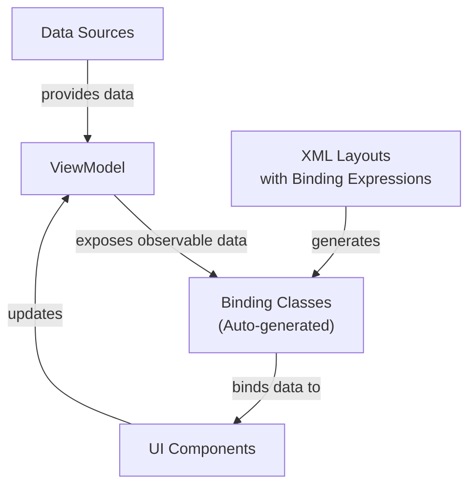
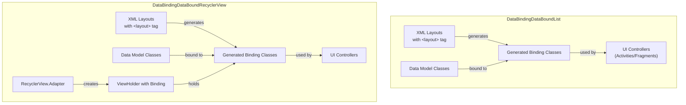
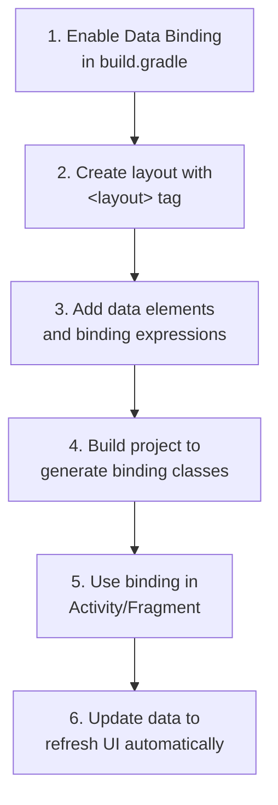
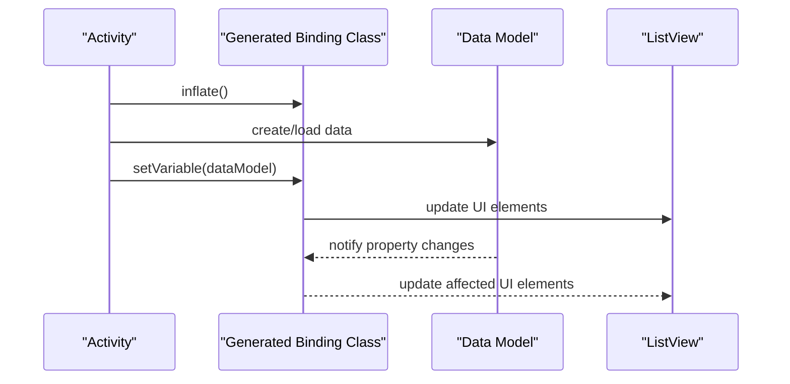
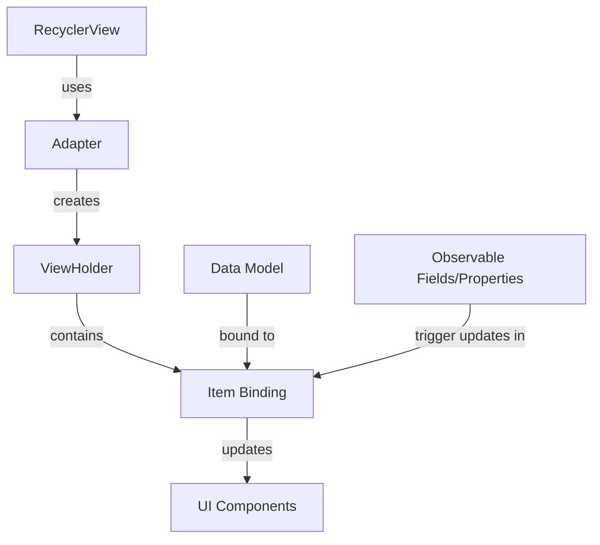
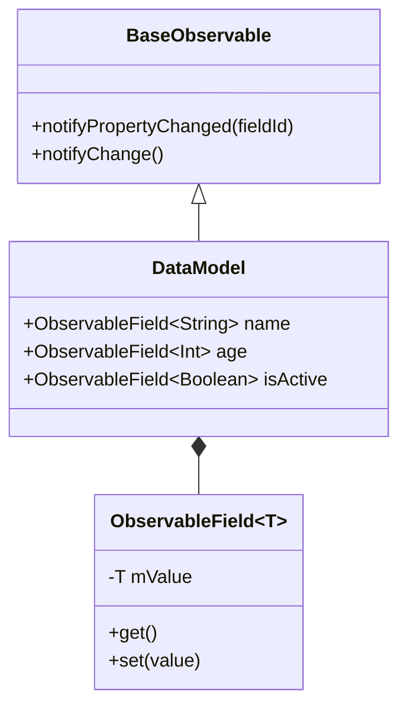
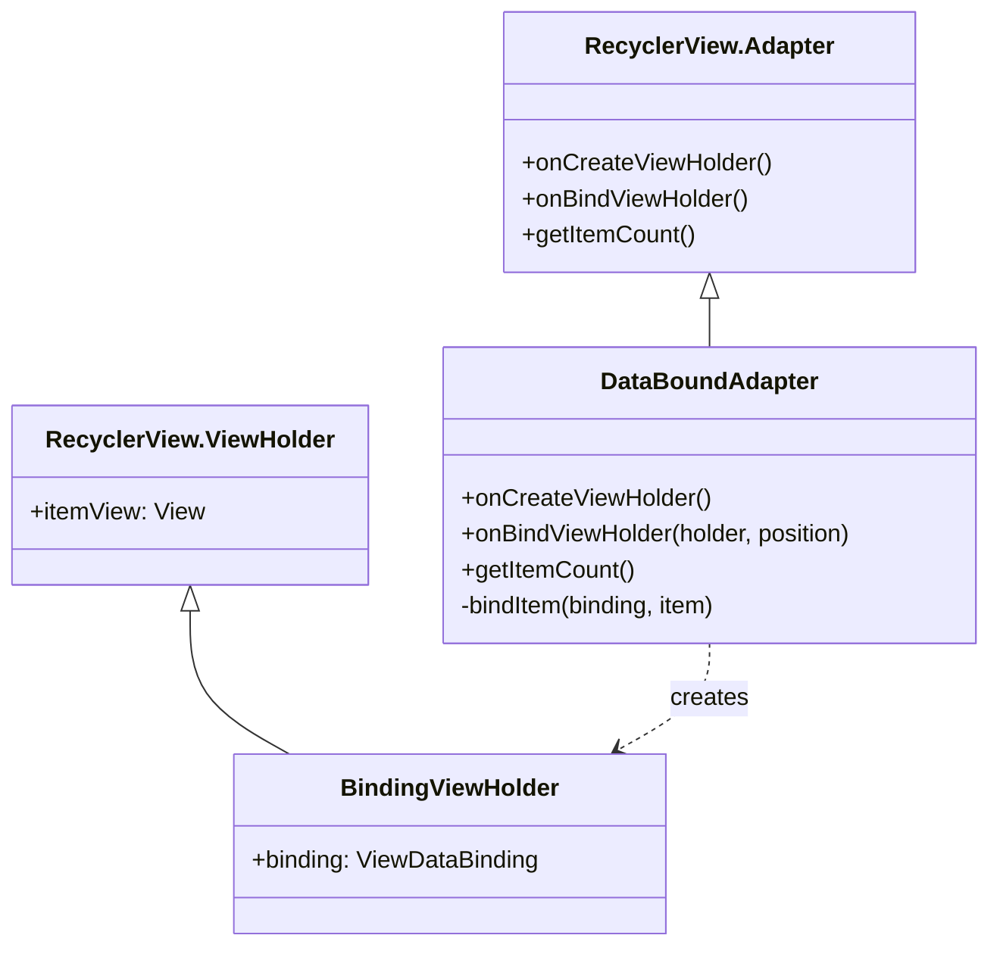

<!-- source: DeepWiki mcp.deepwiki.com · repo android/views-widgets-samples · page 5.2 Data Binding · fetched 2026-10-23 -->

# Data Binding

<details>
<summary>Relevant source files</summary>

The following files were used as context for generating this wiki page:

- [DataBindingDataBoundList/app/build.gradle](DataBindingDataBoundList/app/build.gradle)
- [DataBindingDataBoundList/build.gradle](DataBindingDataBoundList/build.gradle)
- [DataBindingDataBoundList/gradle.properties](DataBindingDataBoundList/gradle.properties)
- [DataBindingDataBoundList/gradle/wrapper/gradle-wrapper.properties](DataBindingDataBoundList/gradle/wrapper/gradle-wrapper.properties)
- [DataBindingDataBoundRecyclerView/build.gradle](DataBindingDataBoundRecyclerView/build.gradle)
- [DataBindingDataBoundRecyclerView/gradle/wrapper/gradle-wrapper.properties](DataBindingDataBoundRecyclerView/gradle/wrapper/gradle-wrapper.properties)

</details>


## Purpose and Scope

This document explains the Data Binding implementation in the Android Views and Widgets Samples repository. Data Binding is a support library that allows you to bind UI components in your layouts to data sources in your app using a declarative format rather than programmatically.

The repository contains two primary examples demonstrating Data Binding:
1. Data Binding with a simple List view
2. Data Binding with RecyclerView

For information about animation systems that may complement Data Binding implementations, see [Animation Systems](#5.1). For details about ViewPager2 which can also be used with Data Binding, see [ViewPager2](#5.3).

## Overview of Data Binding in Android

Data Binding eliminates the need for repetitive `findViewById()` calls and simplifies the process of updating UI elements when the underlying data changes.

### Data Binding Architecture



Sources: [DataBindingDataBoundList/app/build.gradle:22-22]()

## Key Components in the Repository Examples

The repository demonstrates Data Binding through two main example projects:

### 1. DataBindingDataBoundList

This example shows basic Data Binding with a standard list implementation. It demonstrates how to bind list data to UI components without using RecyclerView.

### 2. DataBindingDataBoundRecyclerView

This more advanced example illustrates Data Binding integration with RecyclerView, showcasing efficient binding for scrollable lists.

### Project Structure Comparison



Sources: [DataBindingDataBoundList/app/build.gradle:22-22]()

## Data Binding Configuration

To enable Data Binding in an Android project, you need to configure your build.gradle file to include Data Binding support.

```
android {
    ...
    buildFeatures.dataBinding = true
    ...
}
```

This configuration is present in both example projects.

Sources: [DataBindingDataBoundList/app/build.gradle:22-22]()

## Data Binding Implementation Flow

### Typical Implementation Process



Sources: [DataBindingDataBoundList/app/build.gradle:22-22]()

## Data Binding with ListView

The DataBindingDataBoundList example demonstrates how to implement Data Binding with a traditional ListView.

### Data Flow in DataBindingDataBoundList



Sources: [DataBindingDataBoundList/app/build.gradle:17-41]()

## Data Binding with RecyclerView

The DataBindingDataBoundRecyclerView example shows a more advanced implementation using RecyclerView, which is optimized for displaying large datasets.

### Components Interaction in DataBindingDataBoundRecyclerView



Sources: [DataBindingDataBoundRecyclerView/build.gradle:17-37]()

## Data Binding Expression Types

Android Data Binding supports various expression types in layout files. Here's a summary of what you can typically expect to see in the examples:

| Expression Type | Example Syntax | Purpose |
|-----------------|----------------|---------|
| Property Reference | `@{user.name}` | Bind UI element to a property |
| Method Reference | `@{userHandler.onClickFriend}` | Bind UI element to a method |
| Observable Fields | `ObservableField<Type>` | Fields that notify when they change |
| Two-way Binding | `@={viewModel.property}` | Data flows in both directions |
| Expression Operations | `@{firstName + " " + lastName}` | Combine or transform data |
| Collection Binding | `@{users[index].name}` | Bind to collection items |

Sources: [DataBindingDataBoundList/app/build.gradle:22-22]()

## Implementation Patterns in the Examples

### Observable Data Pattern



Sources: [DataBindingDataBoundList/app/build.gradle:17-41]()

### RecyclerView Binding Pattern



Sources: [DataBindingDataBoundRecyclerView/build.gradle:17-37]()

## Key Benefits of Data Binding Demonstrated

1. **Elimination of boilerplate code**: No more repeated `findViewById()` calls
2. **Type safety**: Compile-time checking for binding expressions
3. **Performance optimizations**: Data Binding library uses efficient binding mechanisms
4. **Automatic UI updates**: Changes to data automatically reflect in the UI
5. **Better separation of concerns**: Clear distinction between UI and data logic

## Build System Integration

Both examples use Gradle build configurations to enable and support Data Binding:

| Project | Gradle Version | Data Binding Configuration |
|---------|---------------|----------------------------|
| DataBindingDataBoundList | 6.7.1 | `buildFeatures.dataBinding = true` |
| DataBindingDataBoundRecyclerView | 6.7.1 | Same as above |

Sources: 
- [DataBindingDataBoundList/gradle/wrapper/gradle-wrapper.properties:1-6]()
- [DataBindingDataBoundRecyclerView/gradle/wrapper/gradle-wrapper.properties:17-23]()
- [DataBindingDataBoundList/app/build.gradle:22-22]()

## Best Practices Demonstrated

1. **Using the proper binding adapters**: Creating custom binding adapters for complex view binding
2. **Avoiding memory leaks**: Proper handling of lifecycle events
3. **Binding adapters for resource binding**: Using binding adapters to bind resources like strings and drawables
4. **Efficient RecyclerView binding**: Optimizing binding for RecyclerView items
5. **Observable data models**: Using observable fields or BaseObservable for automatic UI updates

## Compatibility and Dependencies

The Data Binding examples in the repository are configured with the following compatibility settings:

- Minimum SDK: API 14
- Target SDK: API 28
- AppCompat dependency: 'com.android.support:appcompat-v7:28.0.0'

Sources: [DataBindingDataBoundList/app/build.gradle:23-28](), [DataBindingDataBoundList/app/build.gradle:40-40]()

## Conclusion

The Data Binding examples in the Android Views and Widgets Samples repository demonstrate both basic and advanced usage of the Data Binding library. From simple ListView implementations to more complex RecyclerView bindings, these examples showcase how to leverage Data Binding for cleaner, more maintainable, and more efficient UI code.

---

