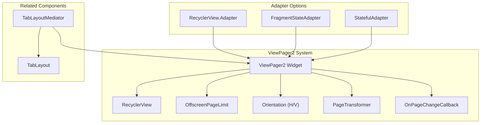
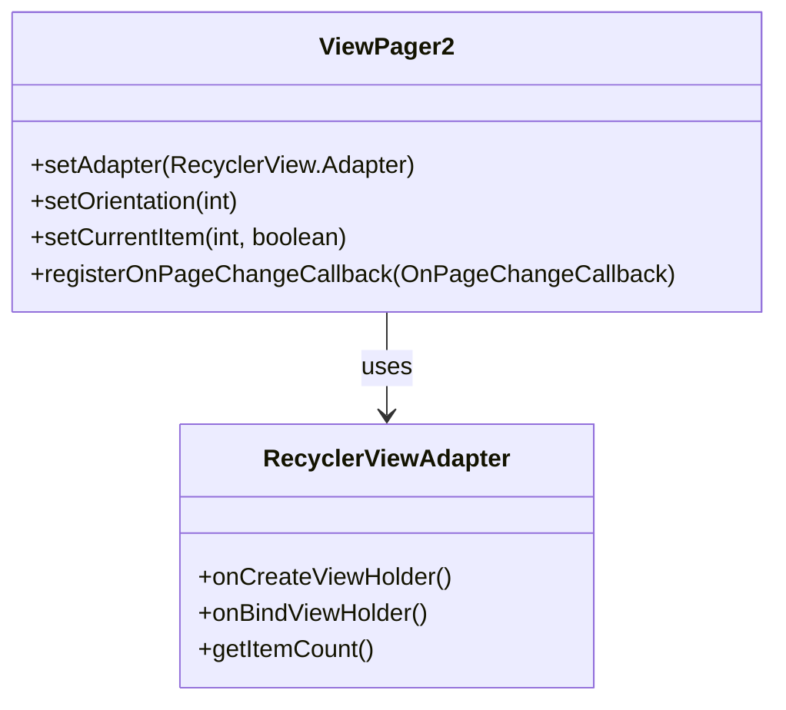
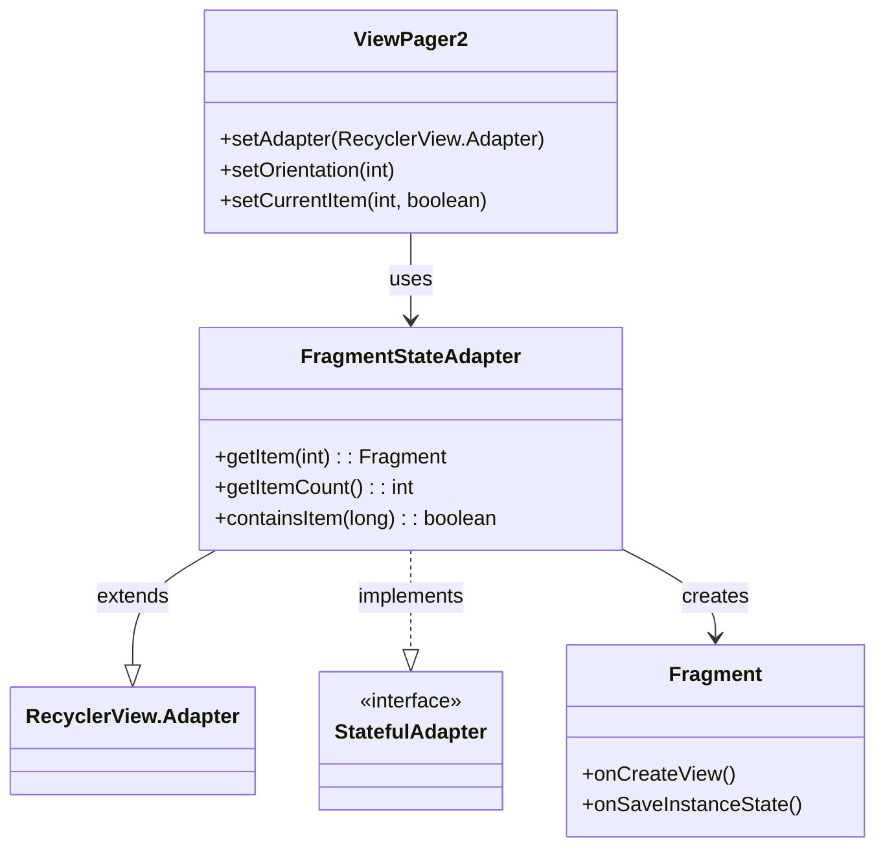
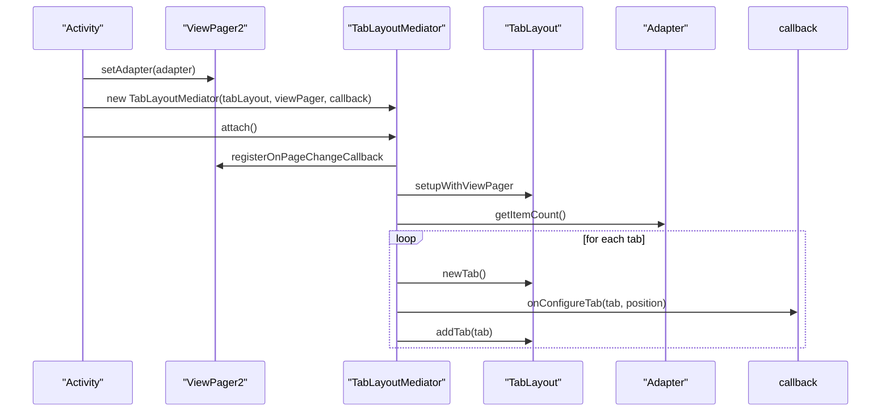
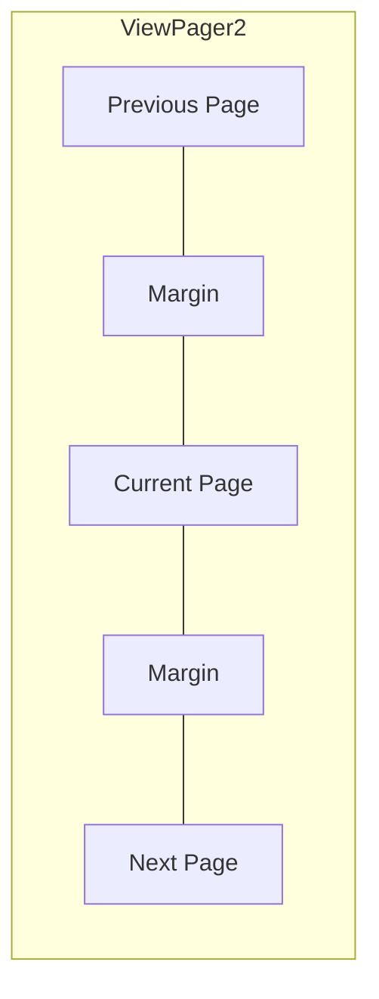
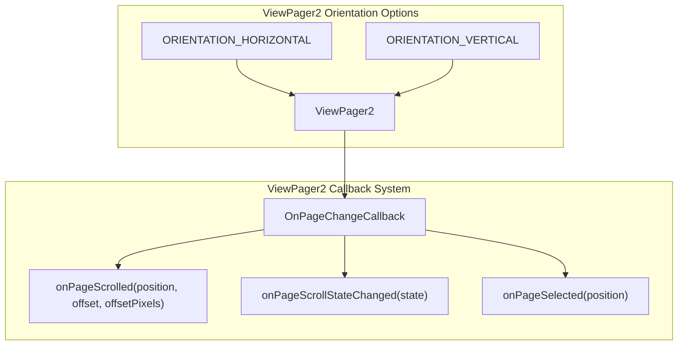

<!-- source: DeepWiki mcp.deepwiki.com · repo android/views-widgets-samples · page 5.3 ViewPager2 · fetched 2026-10-23 -->

# ViewPager2

Relevant source files

The following files were used as context for generating this wiki page:

- [ViewPager2/.gitignore](ViewPager2/.gitignore)
- [ViewPager2/.google/packaging.yaml](ViewPager2/.google/packaging.yaml)
- [ViewPager2/README.md](ViewPager2/README.md)
- [ViewPager2/app/.gitignore](ViewPager2/app/.gitignore)
- [ViewPager2/app/proguard-rules.pro](ViewPager2/app/proguard-rules.pro)
- [ViewPager2/app/src/androidTest/java/androidx/viewpager2/integration/testapp/test/MarginPageTransformerTest.kt](ViewPager2/app/src/androidTest/java/androidx/viewpager2/integration/testapp/test/MarginPageTransformerTest.kt)
- [ViewPager2/app/src/androidTest/java/androidx/viewpager2/integration/testapp/test/MutableCollectionBaseTest.kt](ViewPager2/app/src/androidTest/java/androidx/viewpager2/integration/testapp/test/MutableCollectionBaseTest.kt)
- [ViewPager2/app/src/androidTest/java/androidx/viewpager2/integration/testapp/test/MutableCollectionFragmentTest.kt](ViewPager2/app/src/androidTest/java/androidx/viewpager2/integration/testapp/test/MutableCollectionFragmentTest.kt)

## Overview

ViewPager2 is a UI component that allows users to swipe left and right (or up and down) through pages of content. It serves as the replacement for the original ViewPager, addressing several limitations and adding new features. This document explains how to use ViewPager2 in the Android Views and Widgets Samples repository, covering implementation patterns for both View-based and Fragment-based paging, collection modifications, and integration with other UI components like TabLayout.

Sources: [ViewPager2/README.md:1-9]()

## ViewPager2 vs Original ViewPager

ViewPager2 addresses several pain points from the original ViewPager component:

- Support for right-to-left (RTL) layouts
- Vertical orientation capabilities
- Modifiable collections with proper state management
- Built on RecyclerView for improved performance and features

### Architecture Diagram

Sources: [ViewPager2/README.md:7-9](), [ViewPager2/.google/packaging.yaml:13-17]()

## Implementation Approaches

ViewPager2 supports two main implementation approaches: using Views as pages or using Fragments as pages. Each has its own use cases and setup requirements.

### ViewPager2 with Views

For simple page content without complex lifecycle needs:

1. Create a RecyclerView.Adapter implementation
2. Inflate layouts with `match_parent` for both width and height
3. Bind data to your views in the adapter's onBindViewHolder method

Sources: [ViewPager2/README.md:23-36]()

### ViewPager2 with Fragments

For pages requiring lifecycle management and/or complex state:

1. Create a FragmentStateAdapter implementation
2. Override getItem() to return appropriate Fragment instances
3. Implement fragment lifecycle methods as needed

Sources: [ViewPager2/README.md:39-53](), [ViewPager2/.google/packaging.yaml:14-16]()

## Working with Mutable Collections

ViewPager2 provides improved support for adapters with changing data. The samples demonstrate how to:

1. Add items to the collection
2. Remove items from the collection
3. Update existing items
4. Keep state across collection changes

The implementation demonstrates proper state handling when:
- New pages are inserted
- Existing pages are removed
- The current page is modified

Sources: [ViewPager2/README.md:15-16](), [ViewPager2/app/src/androidTest/java/androidx/viewpager2/integration/testapp/test/MutableCollectionBaseTest.kt:32-97]()

## Integration with TabLayout

TabLayout integration is implemented differently in ViewPager2 compared to the original ViewPager:

1. Create a TabLayoutMediator instance
2. Provide an implementation of OnConfigureTabCallback
3. Call attach() method after setting the ViewPager2's adapter

Sources: [ViewPager2/README.md:58-68]()

## Page Transformations

ViewPager2 supports page transformations to create visual effects during page transitions:

### MarginPageTransformer

Adds margins between pages, creating a preview of adjacent pages:

Sources: [ViewPager2/app/src/androidTest/java/androidx/viewpager2/integration/testapp/test/MarginPageTransformerTest.kt:44-177]()

## Testing ViewPager2

The sample project demonstrates several approaches to testing ViewPager2:

1. UI testing by performing swipes on the ViewPager element
2. Programmatic testing by calling setCurrentItem directly
3. Waiting for transitions using:
   - IdlingResource for idle scroll state
   - CountDownLatch to track transition completion

Key test utilities include:
- ViewPagerIdleWatcher
- ViewInteractions
- ViewPagerActions

Sources: [ViewPager2/README.md:73-92]()

## Configuring ViewPager2 Properties

ViewPager2 exposes several properties that control its behavior:

| Property | Description | Default |
|----------|-------------|---------|
| orientation | Controls swipe direction (horizontal/vertical) | ORIENTATION_HORIZONTAL |
| offscreenPageLimit | Number of pages to keep in memory on each side | 1 |
| userInputEnabled | Whether user can swipe between pages | true |
| clipToPadding | Whether page content is clipped to padding | true |
| clipChildren | Whether children are clipped to view bounds | true |

Sources: [ViewPager2/app/src/androidTest/java/androidx/viewpager2/integration/testapp/test/MarginPageTransformerTest.kt:31-32](), [ViewPager2/app/src/androidTest/java/androidx/viewpager2/integration/testapp/test/MarginPageTransformerTest.kt:95-126]()

## Sample Applications

The ViewPager2 sample demonstrates five main use cases:

1. **ViewPager2 with Views**: Simple implementation using Views as pages
2. **ViewPager2 with Fragments**: Implementation using Fragments for better lifecycle management
3. **ViewPager2 with Mutable Collection (Views)**: Demonstrates adapter mutations with View-based pages
4. **ViewPager2 with Mutable Collection (Fragments)**: Demonstrates adapter mutations with Fragment-based pages
5. **ViewPager2 with TabLayout**: Shows integration with TabLayout for paginated navigation

Sources: [ViewPager2/README.md:11-18]()

---

