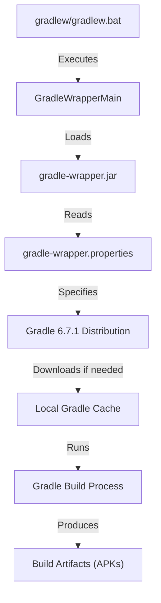
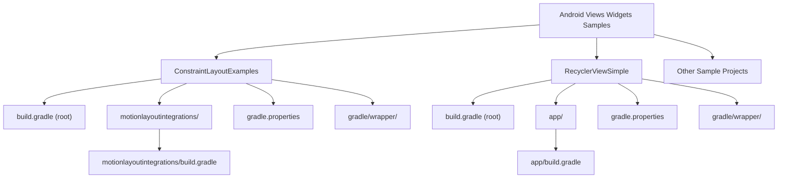
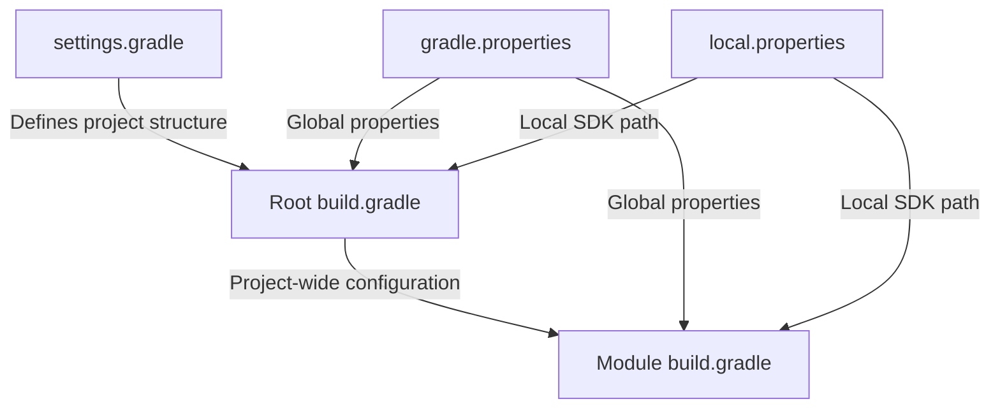
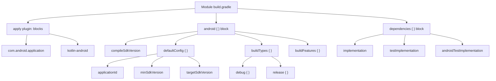
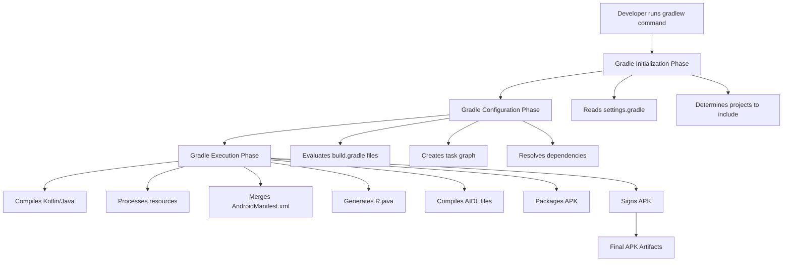
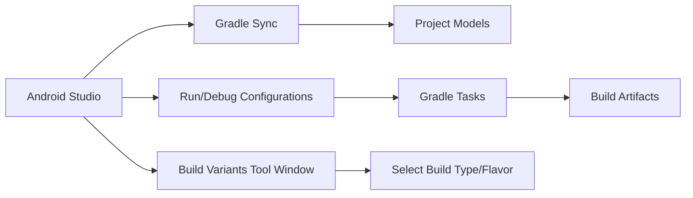

<!-- source: DeepWiki mcp.deepwiki.com · repo android/views-widgets-samples · page 6 Build Configuration and Infrastructure · fetched 2026-10-23 -->

# Build Configuration and Infrastructure

<details>
<summary>Relevant source files</summary>

The following files were used as context for generating this wiki page:

- [ConstraintLayoutExamples/gradle/wrapper/gradle-wrapper.jar](ConstraintLayoutExamples/gradle/wrapper/gradle-wrapper.jar)
- [ConstraintLayoutExamples/gradle/wrapper/gradle-wrapper.properties](ConstraintLayoutExamples/gradle/wrapper/gradle-wrapper.properties)
- [ConstraintLayoutExamples/gradlew](ConstraintLayoutExamples/gradlew)
- [ConstraintLayoutExamples/gradlew.bat](ConstraintLayoutExamples/gradlew.bat)
- [ConstraintLayoutExamples/motionlayoutintegrations/build.gradle](ConstraintLayoutExamples/motionlayoutintegrations/build.gradle)
- [ConstraintLayoutExamples/motionlayoutintegrations/src/main/res/drawable/circle_glow.png](ConstraintLayoutExamples/motionlayoutintegrations/src/main/res/drawable/circle_glow.png)
- [ConstraintLayoutExamples/motionlayoutintegrations/src/main/res/drawable/inner_glow.png](ConstraintLayoutExamples/motionlayoutintegrations/src/main/res/drawable/inner_glow.png)
- [ConstraintLayoutExamples/motionlayoutintegrations/src/main/res/layout/lots_of_cards.xml](ConstraintLayoutExamples/motionlayoutintegrations/src/main/res/layout/lots_of_cards.xml)
- [ConstraintLayoutExamples/motionlayoutintegrations/src/main/res/values/attrs.xml](ConstraintLayoutExamples/motionlayoutintegrations/src/main/res/values/attrs.xml)
- [RecyclerViewSimple/.gitignore](RecyclerViewSimple/.gitignore)
- [RecyclerViewSimple/app/.gitignore](RecyclerViewSimple/app/.gitignore)
- [RecyclerViewSimple/app/build.gradle](RecyclerViewSimple/app/build.gradle)
- [RecyclerViewSimple/build.gradle](RecyclerViewSimple/build.gradle)
- [RecyclerViewSimple/gradle.properties](RecyclerViewSimple/gradle.properties)

</details>


This document explains the build system configuration and infrastructure used throughout the Android Views and Widgets Samples repository. It covers the Gradle build system, project structure, and configuration patterns that ensure consistent builds across all sample projects in the repository.

For information about specific UI component implementations, refer to their respective pages such as [WebView System](#2) or [RecyclerView System](#4).

## Gradle Wrapper System

The repository uses the Gradle Wrapper to ensure consistent builds across different development environments by packaging a specific version of Gradle with the project.



Diagram: Gradle Wrapper Execution Flow

Sources:
- [ConstraintLayoutExamples/gradle/wrapper/gradle-wrapper.properties:17-22]()
- [ConstraintLayoutExamples/gradle/wrapper/gradle-wrapper.jar]()
- [ConstraintLayoutExamples/gradlew:1-172]()
- [ConstraintLayoutExamples/gradlew.bat:1-84]()

The Gradle Wrapper consists of:

1. **Shell Scripts**:
   - `gradlew` - Unix/Linux/macOS shell script
   - `gradlew.bat` - Windows batch script

2. **Wrapper JAR**:
   - `gradle/wrapper/gradle-wrapper.jar` - Contains wrapper implementation code

3. **Properties Configuration**:
   - `gradle/wrapper/gradle-wrapper.properties` - Defines Gradle version and download settings

Key configuration in `gradle-wrapper.properties`:

```
distributionBase=GRADLE_USER_HOME
distributionPath=wrapper/dists
zipStoreBase=GRADLE_USER_HOME
zipStorePath=wrapper/dists
distributionUrl=https\://services.gradle.org/distributions/gradle-6.7.1-all.zip
```

## Project Build Structure

The repository contains multiple sample projects, each demonstrating a specific UI component or pattern. All samples follow a similar build architecture pattern.



Diagram: Project File Structure

Sources:
- [ConstraintLayoutExamples/motionlayoutintegrations/build.gradle:1-60]()
- [RecyclerViewSimple/build.gradle:1-38]()
- [RecyclerViewSimple/app/build.gradle:1-53]()
- [RecyclerViewSimple/gradle.properties:1-17]()

## Build Configuration Components

### Build Script Hierarchy

The build configuration follows a hierarchical structure with well-defined responsibilities at each level.



Diagram: Build Script Hierarchy

Sources:
- [RecyclerViewSimple/build.gradle:17-37]()
- [RecyclerViewSimple/app/build.gradle:17-52]()
- [RecyclerViewSimple/gradle.properties:1-17]()

### Root Build Script

The root `build.gradle` file defines configuration shared across all modules in a sample project:

1. **Dependency Versions**: Defines version constants for libraries
2. **Repository Configuration**: Configures Maven repositories
3. **Gradle Plugin Versions**: Declares versions of build plugins 

Example structure:

```
buildscript {
    ext.kotlin_version = '1.4.0'
    repositories {
        google()
        jcenter()
    }
    dependencies {
        classpath 'com.android.tools.build:gradle:4.0.1'
        classpath "org.jetbrains.kotlin:kotlin-gradle-plugin:$kotlin_version"
    }
}

allprojects {
    repositories {
        google()
        jcenter()
    }
}
```

Sources:
- [RecyclerViewSimple/build.gradle:17-37]()
- [ConstraintLayoutExamples/motionlayoutintegrations/build.gradle:17-59]()

### Module Build Scripts

Module `build.gradle` files contain:

1. **Plugin Applications**: Android, Kotlin plugins
2. **Android Configuration**: SDK versions, application ID, etc.
3. **Dependencies**: Libraries and frameworks
4. **Build Types**: Debug/release configuration



Diagram: Module Build Script Structure

Sources:
- [RecyclerViewSimple/app/build.gradle:17-52]()
- [ConstraintLayoutExamples/motionlayoutintegrations/build.gradle:17-59]()

## Common Build Configurations

### Android Block Configuration

The `android` block contains the core Android-specific build configuration:

```
android {
    compileSdkVersion 30
    
    defaultConfig {
        applicationId "com.example.recyclersample"
        minSdkVersion 21
        targetSdkVersion 30
        versionCode 1
        versionName "1.0"
        testInstrumentationRunner "androidx.test.runner.AndroidJUnitRunner"
    }
    
    buildTypes {
        release {
            minifyEnabled false
            proguardFiles getDefaultProguardFile('proguard-android-optimize.txt'), 'proguard-rules.pro'
        }
    }
    
    buildFeatures {
        viewBinding = true
    }
}
```

Sources:
- [RecyclerViewSimple/app/build.gradle:21-39]()
- [ConstraintLayoutExamples/motionlayoutintegrations/build.gradle:21-45]()

### Dependency Management

Dependencies are declared in the `dependencies` block, using different configurations based on their scope:

| Configuration | Purpose | Example |
|---------------|---------|---------|
| `implementation` | Runtime and compile-time | `implementation 'androidx.appcompat:appcompat:1.1.0'` |
| `testImplementation` | Unit tests only | `testImplementation 'junit:junit:4.12'` |
| `androidTestImplementation` | Instrumentation tests only | `androidTestImplementation 'androidx.test.espresso:espresso-core:3.2.0'` |

Example:

```
dependencies {
    implementation "org.jetbrains.kotlin:kotlin-stdlib-jdk7:$kotlin_version"
    implementation 'androidx.appcompat:appcompat:1.1.0'
    implementation 'androidx.core:core-ktx:1.3.0'
    implementation 'androidx.constraintlayout:constraintlayout:2.0.1'
    implementation 'androidx.recyclerview:recyclerview:1.1.0'
    
    testImplementation 'junit:junit:4.12'
    androidTestImplementation 'androidx.test.ext:junit:1.1.1'
    androidTestImplementation 'androidx.test.espresso:espresso-core:3.2.0'
}
```

Sources:
- [RecyclerViewSimple/app/build.gradle:42-52]()
- [ConstraintLayoutExamples/motionlayoutintegrations/build.gradle:48-59]()

### Global Properties

The `gradle.properties` file defines properties that affect the entire build:

```
# JVM memory settings for Gradle daemon
org.gradle.jvmargs=-Xmx1536m

# AndroidX settings
android.useAndroidX=true
android.enableJetifier=false

# Kotlin code style
kotlin.code.style=official
```

Sources:
- [RecyclerViewSimple/gradle.properties:1-17]()

## Build Process Flow

The build process follows a defined flow from configuration to final artifacts:



Diagram: Gradle Build Process

Sources:
- [ConstraintLayoutExamples/gradlew:1-172]()
- [RecyclerViewSimple/app/build.gradle:17-52]()

## Common Build Tasks

The repository uses standard Gradle tasks for building and testing:

| Task | Description |
|------|-------------|
| `./gradlew assemble` | Assembles all variants of the app |
| `./gradlew assembleDebug` | Assembles the debug variant |
| `./gradlew installDebug` | Installs the debug variant on a connected device |
| `./gradlew test` | Runs unit tests |
| `./gradlew connectedAndroidTest` | Runs instrumentation tests on a connected device |
| `./gradlew clean` | Deletes build directories |

Sources:
- [ConstraintLayoutExamples/gradlew:1-172]()
- [ConstraintLayoutExamples/gradlew.bat:1-84]()

## Feature-Specific Configuration

### ViewBinding

Some samples enable ViewBinding for type-safe view access:

```
android {
    buildFeatures {
        viewBinding = true
    }
}
```

Sources:
- [ConstraintLayoutExamples/motionlayoutintegrations/build.gradle:42-44]()

### ProGuard Configuration

ProGuard rules can be configured for code shrinking in release builds:

```
android {
    buildTypes {
        release {
            minifyEnabled true
            proguardFiles getDefaultProguardFile('proguard-android-optimize.txt'), 'proguard-rules.pro'
        }
    }
}
```

Sources:
- [ConstraintLayoutExamples/motionlayoutintegrations/build.gradle:35-39]()

## Build System Integration with Android Studio

The build system is fully integrated with Android Studio's UI, allowing developers to:

1. Run configurations through the Run menu
2. View Gradle tasks in the Gradle tool window
3. Modify build.gradle files with code completion support
4. Sync project with Gradle files to apply changes



Diagram: Android Studio Build Integration

Sources:
- [RecyclerViewSimple/app/build.gradle:1-53]()
- [RecyclerViewSimple/build.gradle:1-38]()

## Version Management

The repository manages versions in several ways:

1. **Gradle Version**: Controlled by gradle-wrapper.properties
2. **Plugin Versions**: Defined in root build.gradle
3. **Library Versions**: Either with explicit versions or with variables 
4. **SDK Versions**: Defined in module build.gradle files

Example of variable-based version management:

```
buildscript {
    ext.kotlin_version = '1.4.0'
    ext.appCompatVersion = '1.1.0'
    // Other version definitions
    
    dependencies {
        classpath "org.jetbrains.kotlin:kotlin-gradle-plugin:$kotlin_version"
        // Other classpath dependencies
    }
}
```

Sources:
- [RecyclerViewSimple/build.gradle:18]()
- [ConstraintLayoutExamples/gradle/wrapper/gradle-wrapper.properties:17-22]()