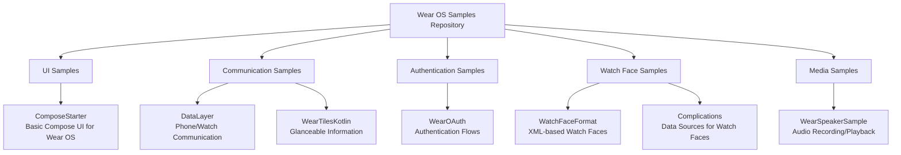
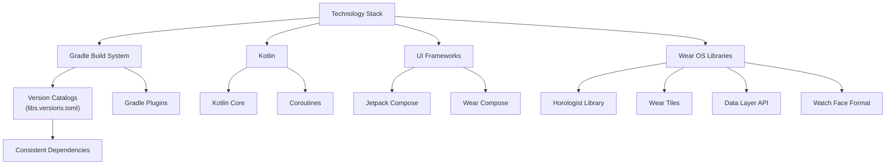
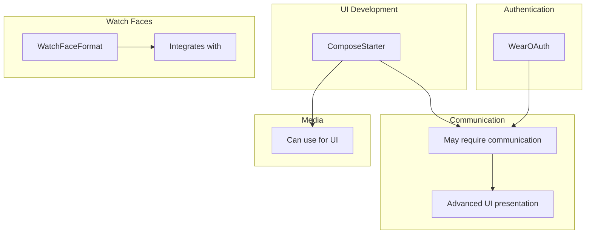

<!-- source: DeepWiki mcp.deepwiki.com · repo android/wear-os-samples · page 1 Overview · fetched 2026-10-23 -->

# Overview

Relevant source files

The following files were used as context for generating this wiki page:

- [ComposeStarter/gradle/libs.versions.toml](ComposeStarter/gradle/libs.versions.toml)
- [DataLayer/README.md](DataLayer/README.md)
- [DataLayer/gradle/libs.versions.toml](DataLayer/gradle/libs.versions.toml)
- [README.md](README.md)
- [WearOAuth/gradle/libs.versions.toml](WearOAuth/gradle/libs.versions.toml)
- [WearSpeakerSample/README.md](WearSpeakerSample/README.md)
- [WearSpeakerSample/gradle/libs.versions.toml](WearSpeakerSample/gradle/libs.versions.toml)
- [WearTilesKotlin/gradle/libs.versions.toml](WearTilesKotlin/gradle/libs.versions.toml)

This document provides a comprehensive introduction to the Wear OS Samples repository, which contains a collection of sample applications demonstrating various development patterns and APIs for Wear OS. The repository serves as a valuable resource for developers looking to create applications for wearable devices running Wear OS.

## Purpose and Scope

The Wear OS Samples repository is designed to:

- Demonstrate best practices for Wear OS application development
- Provide working examples of common use cases and patterns
- Showcase integration with key Wear OS APIs and libraries
- Serve as starting points for developers building their own Wear OS applications

For detailed information about the repository structure and organization, see [Project Structure](#1.1).

## Repository Overview

The repository contains multiple standalone sample projects, each focusing on specific aspects of Wear OS development.

Sources: [README.md:1-26]()

## Key Sample Applications

The repository includes the following sample applications:

| Sample | Category | Purpose |
|--------|----------|---------|
| ComposeStarter | UI | Simple starting point for Compose on Wear OS |
| DataLayer | Communication | Demonstrates watch-phone data exchange |
| WearTilesKotlin | Communication | Shows implementation of Tiles for glanceable information |
| WearOAuth | Authentication | Demonstrates authentication via OAuth |
| WatchFaceFormat | Watch Faces | Shows XML-based watch face development |
| Complications | Watch Faces | Provides test data sources for watch face complications |
| WearSpeakerSample | Media | Demonstrates audio recording and playback |

Sources: [README.md:9-25](), [DataLayer/README.md:1-67](), [WearSpeakerSample/README.md:1-9]()

## Technology Stack

All samples in the repository share a common technology foundation while demonstrating various Wear OS capabilities.

Sources: [WearOAuth/gradle/libs.versions.toml:1-59](), [WearTilesKotlin/gradle/libs.versions.toml:1-35](), [DataLayer/gradle/libs.versions.toml:1-59](), [ComposeStarter/gradle/libs.versions.toml:1-49](), [WearSpeakerSample/gradle/libs.versions.toml:1-59]()

## Dependency Management

All samples use Gradle Version Catalogs for dependency management, ensuring consistent versions across projects. The key dependencies include:

### Common Dependencies

- **Android Gradle Plugin**: Build tool for Android applications
- **Kotlin**: Programming language used across all samples
- **Jetpack Compose**: UI toolkit for building native interfaces
- **Wear Compose**: Wear OS-specific Compose components
- **Horologist**: Google's library for Wear OS development that simplifies common tasks

### Sample-Specific Dependencies

- **WearSpeakerSample**: Additional Media3 libraries for audio playback
- **WearTilesKotlin**: Tiles libraries for creating glanceable information
- **DataLayer**: Wearable services for communication
- **WearOAuth**: Authentication-related libraries

The version catalog system ensures that all samples follow consistent dependency versions while allowing each sample to include specialized libraries as needed.

Sources: [WearOAuth/gradle/libs.versions.toml:1-59](), [WearTilesKotlin/gradle/libs.versions.toml:1-35](), [DataLayer/gradle/libs.versions.toml:1-59](), [ComposeStarter/gradle/libs.versions.toml:1-49](), [WearSpeakerSample/gradle/libs.versions.toml:1-59]()

## Getting Started

To use these samples:

1. Clone the repository
2. Open the desired sample in Android Studio
3. Build and run on a Wear OS device or emulator

Each sample is a standalone project with its own `build.gradle` file and can be run independently. The samples require Android SDK 30 or higher and are designed to work with the latest Wear OS versions.

Sources: [WearSpeakerSample/README.md:15-25](), [DataLayer/README.md:92-106]()

## Relationship Between Samples

While each sample can be used independently, together they provide a comprehensive reference for Wear OS development:

Sources: [README.md:9-25]()

## Conclusion

The Wear OS Samples repository serves as a comprehensive resource for developers building applications for Wear OS. By providing practical examples of various Wear OS development patterns, the repository helps developers understand best practices and implement common functionality more efficiently.

The following pages provide more detailed information about specific aspects of the repository and individual sample applications.

---

