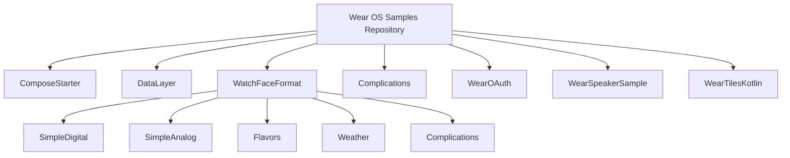
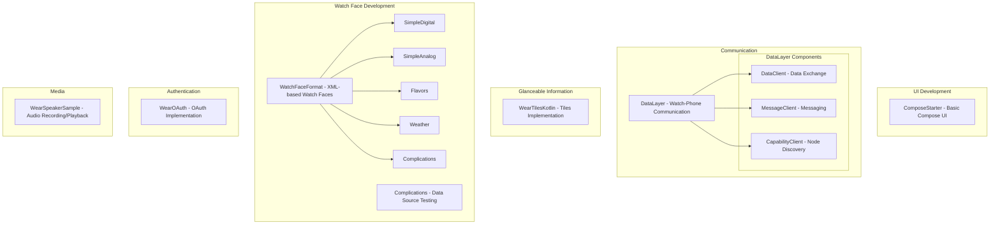
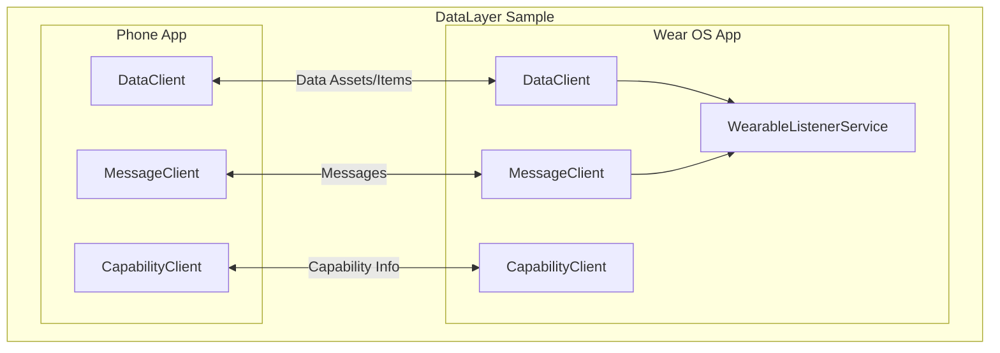
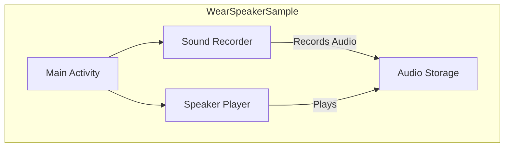
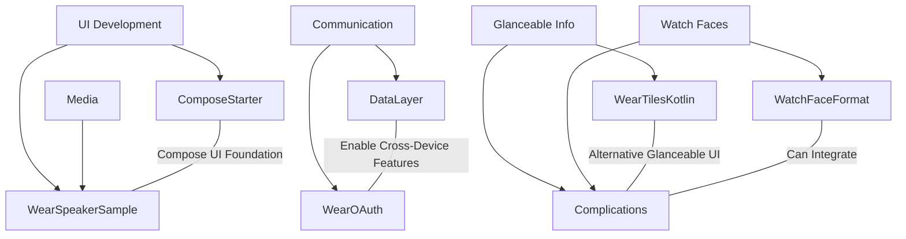

<!-- source: DeepWiki mcp.deepwiki.com · repo android/wear-os-samples · page 1.1 Project Structure · fetched 2026-10-23 -->

# Project Structure

<details>
<summary>Relevant source files</summary>

The following files were used as context for generating this wiki page:

- [Complications/gradle/wrapper/gradle-wrapper.properties](Complications/gradle/wrapper/gradle-wrapper.properties)
- [ComposeStarter/gradle/wrapper/gradle-wrapper.properties](ComposeStarter/gradle/wrapper/gradle-wrapper.properties)
- [DataLayer/README.md](DataLayer/README.md)
- [DataLayer/gradle/wrapper/gradle-wrapper.properties](DataLayer/gradle/wrapper/gradle-wrapper.properties)
- [README.md](README.md)
- [WatchFaceFormat/Complications/gradle/wrapper/gradle-wrapper.properties](WatchFaceFormat/Complications/gradle/wrapper/gradle-wrapper.properties)
- [WatchFaceFormat/Flavors/gradle/wrapper/gradle-wrapper.properties](WatchFaceFormat/Flavors/gradle/wrapper/gradle-wrapper.properties)
- [WatchFaceFormat/SimpleAnalog/gradle/wrapper/gradle-wrapper.properties](WatchFaceFormat/SimpleAnalog/gradle/wrapper/gradle-wrapper.properties)
- [WatchFaceFormat/SimpleDigital/gradle/wrapper/gradle-wrapper.properties](WatchFaceFormat/SimpleDigital/gradle/wrapper/gradle-wrapper.properties)
- [WatchFaceFormat/Weather/gradle/wrapper/gradle-wrapper.properties](WatchFaceFormat/Weather/gradle/wrapper/gradle-wrapper.properties)
- [WearOAuth/gradle/wrapper/gradle-wrapper.properties](WearOAuth/gradle/wrapper/gradle-wrapper.properties)
- [WearSpeakerSample/README.md](WearSpeakerSample/README.md)
- [WearSpeakerSample/gradle/wrapper/gradle-wrapper.properties](WearSpeakerSample/gradle/wrapper/gradle-wrapper.properties)
- [WearTilesKotlin/gradle/wrapper/gradle-wrapper.properties](WearTilesKotlin/gradle/wrapper/gradle-wrapper.properties)

</details>


## Purpose and Scope

This document provides a comprehensive overview of how the Wear OS Samples repository is organized. It explains the structure of the repository, the different sample applications it contains, and how these samples relate to each other. For information about specific dependency management details across projects, see [Dependency Management](#2).

## Repository Organization

The Wear OS Samples repository is structured as a collection of independent Android Studio projects, each demonstrating specific Wear OS development patterns and APIs. Each sample can be built and run independently, making it easy to focus on specific aspects of Wear OS development.



Sources: [README.md:1-25](). Each sample is referenced in the root README, showing the high-level organization of the repository.

## Common Build Configuration

All sample projects in the repository share a consistent build configuration, using the same Gradle version and similar project structures. This consistency makes it easier to understand and navigate between different samples.

| Component | Configuration |
|-----------|---------------|
| Gradle Version | 8.14 |
| Distribution Type | bin or all |
| Project Structure | Standard Android module structure |

Sources: [DataLayer/gradle/wrapper/gradle-wrapper.properties:1-8](), [WearOAuth/gradle/wrapper/gradle-wrapper.properties:1-8](), [WearSpeakerSample/gradle/wrapper/gradle-wrapper.properties:1-8](), [WearTilesKotlin/gradle/wrapper/gradle-wrapper.properties:1-8](), [ComposeStarter/gradle/wrapper/gradle-wrapper.properties:1-8](), [WatchFaceFormat/SimpleDigital/gradle/wrapper/gradle-wrapper.properties:1-8](), [Complications/gradle/wrapper/gradle-wrapper.properties:1-8]()

## Sample Applications Overview

### Sample Categories and Purposes



Sources: [README.md:4-25]()

## Individual Sample Details

### ComposeStarter

A simple starter project demonstrating basic Compose UI implementation for Wear OS. This sample serves as a foundation for developers beginning with Compose on wearable devices.

### DataLayer

Demonstrates three key communication patterns between Wear OS and mobile devices:

1. **Data Exchange**: Sending data assets (like photos) from phone to watch using `DataClient`
2. **Messaging**: Sending acknowledgments and commands via `MessageClient`
3. **Capability Discovery**: Finding connected nodes with specific capabilities via `CapabilityClient`



Sources: [DataLayer/README.md:1-116]()

### WatchFaceFormat

Demonstrates the Watch Face Format (WFF) which allows quick development of watch faces using XML. The sample is further divided into sub-projects:

- **SimpleDigital**: Basic digital watch face
- **SimpleAnalog**: Basic analog watch face
- **Flavors**: Watch face with different style variations
- **Weather**: Watch face with weather information
- **Complications**: Watch face with complications support

Sources: [README.md:16-17](), [WatchFaceFormat/SimpleDigital/gradle/wrapper/gradle-wrapper.properties:1-8](), [WatchFaceFormat/SimpleAnalog/gradle/wrapper/gradle-wrapper.properties:1-8](), [WatchFaceFormat/Flavors/gradle/wrapper/gradle-wrapper.properties:1-8](), [WatchFaceFormat/Weather/gradle/wrapper/gradle-wrapper.properties:1-8](), [WatchFaceFormat/Complications/gradle/wrapper/gradle-wrapper.properties:1-8]()

### Complications

Provides a full suite of data sources to test against watch face implementations with complications. This helps developers ensure their watch faces properly display different types of complication data.

Sources: [README.md:19](), [Complications/gradle/wrapper/gradle-wrapper.properties:1-8]()

### WearOAuth

Demonstrates how to authenticate users on Wear OS via OAuth without requiring a companion mobile app. The Wear OS companion app handles authentication requests on the mobile side.

Sources: [README.md:21](), [WearOAuth/gradle/wrapper/gradle-wrapper.properties:1-8]()

### WearSpeakerSample

Demonstrates audio recording using the microphone and playback through speakers (built-in or Bluetooth) on Wear OS devices. The sample also shows proper handling of permissions for audio recording.



Sources: [README.md:23](), [WearSpeakerSample/README.md:1-36](), [WearSpeakerSample/gradle/wrapper/gradle-wrapper.properties:1-8]()

### WearTilesKotlin

Demonstrates creating tiles for Wear OS using the AndroidX Tiles library. Tiles provide glanceable information to users and can be accessed by swiping from the watch face.

Sources: [README.md:25](), [WearTilesKotlin/gradle/wrapper/gradle-wrapper.properties:1-8]()

## Project Interrelationships

While each sample is designed to stand alone, many demonstrate complementary aspects of Wear OS development:



Sources: [README.md:4-25](), [WearSpeakerSample/README.md:10]()

## Development Approach

The samples in this repository demonstrate a modular approach to Wear OS development, with each focusing on specific capabilities while maintaining consistency in build configuration and development patterns. This allows developers to:

1. Study individual capabilities in isolation
2. Understand how different components can be integrated
3. Follow consistent patterns across different aspects of Wear OS development

The repository structure follows a pattern where each top-level directory is a self-contained sample project with standard Android project organization:

```
SampleName/
├── app/                # Application module
│   ├── src/            # Source code
│   ├── build.gradle    # Module build configuration
├── gradle/             # Gradle configuration
├── build.gradle        # Project build configuration
├── settings.gradle     # Project settings
├── README.md           # Sample documentation
```

Some samples may have additional modules beyond the standard `app` module, particularly those demonstrating communication between watch and phone.

Sources: [DataLayer/README.md:91-116](), [WearSpeakerSample/README.md:15-24]()

---

