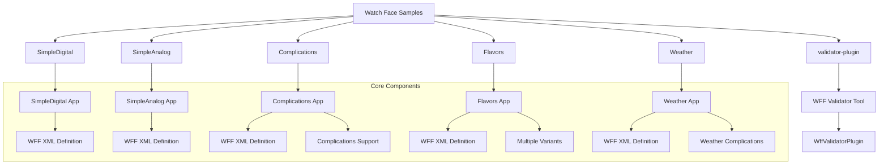
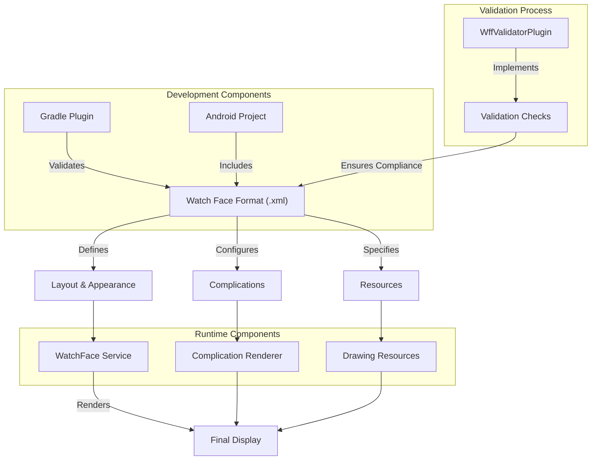

<!-- source: DeepWiki mcp.deepwiki.com · repo android/wear-os-samples · page 10 Watch Faces · fetched 2026-10-23 -->

# Watch Faces

<details>
<summary>Relevant source files</summary>

The following files were used as context for generating this wiki page:

- [Complications/gradle/libs.versions.toml](Complications/gradle/libs.versions.toml)
- [WatchFaceFormat/Complications/build.gradle.kts](WatchFaceFormat/Complications/build.gradle.kts)
- [WatchFaceFormat/Complications/gradle/libs.versions.toml](WatchFaceFormat/Complications/gradle/libs.versions.toml)
- [WatchFaceFormat/Flavors/build.gradle.kts](WatchFaceFormat/Flavors/build.gradle.kts)
- [WatchFaceFormat/Flavors/gradle/libs.versions.toml](WatchFaceFormat/Flavors/gradle/libs.versions.toml)
- [WatchFaceFormat/SimpleAnalog/build.gradle.kts](WatchFaceFormat/SimpleAnalog/build.gradle.kts)
- [WatchFaceFormat/SimpleAnalog/gradle/libs.versions.toml](WatchFaceFormat/SimpleAnalog/gradle/libs.versions.toml)
- [WatchFaceFormat/SimpleDigital/build.gradle.kts](WatchFaceFormat/SimpleDigital/build.gradle.kts)
- [WatchFaceFormat/SimpleDigital/gradle/libs.versions.toml](WatchFaceFormat/SimpleDigital/gradle/libs.versions.toml)
- [WatchFaceFormat/Weather/build.gradle.kts](WatchFaceFormat/Weather/build.gradle.kts)
- [WatchFaceFormat/Weather/gradle/libs.versions.toml](WatchFaceFormat/Weather/gradle/libs.versions.toml)
- [WatchFaceFormat/validator-plugin/gradle/libs.versions.toml](WatchFaceFormat/validator-plugin/gradle/libs.versions.toml)
- [WatchFaceFormat/validator-plugin/plugins/build.gradle.kts](WatchFaceFormat/validator-plugin/plugins/build.gradle.kts)

</details>


This document provides an overview of the Watch Faces samples included in the Wear OS Samples repository. These samples demonstrate how to create, customize, and distribute watch faces for Wear OS using the Watch Face Format (WFF).

For detailed information about specific watch face topics, see the following sections:
- [Watch Face Format](#10.1)
- [Complications](#10.2)
- [Weather Watch Face](#10.3)
- [Watch Face Validation](#10.4)
- [Watch Face Distribution](#10.5)

## Overview of Watch Face Samples

The Wear OS Samples repository includes several watch face examples that showcase different implementation approaches and features. Each sample demonstrates specific aspects of watch face development, from basic implementations to more complex designs with complications and customization options.

### Sample Projects Structure



Sources: [WatchFaceFormat/SimpleDigital/build.gradle.kts](), [WatchFaceFormat/SimpleAnalog/build.gradle.kts](), [WatchFaceFormat/Complications/build.gradle.kts](), [WatchFaceFormat/Flavors/build.gradle.kts](), [WatchFaceFormat/Weather/build.gradle.kts](), [WatchFaceFormat/validator-plugin/plugins/build.gradle.kts]()

## Key Watch Face Samples

The repository includes the following watch face sample projects:

1. **SimpleDigital**: A basic digital watch face implementation that demonstrates the fundamental structure of a WFF-based watch face.

2. **SimpleAnalog**: A basic analog watch face showing how to implement traditional clock hands using the Watch Face Format.

3. **Complications**: A sample demonstrating how to add and configure complications to display additional information on a watch face.

4. **Flavors**: Shows how to create multiple variants of a watch face using build variants and product flavors.

5. **Weather**: A more complex example that integrates weather information through complications.

6. **Validator Plugin**: A Gradle plugin that helps validate Watch Face Format files to ensure they meet platform requirements.

## Watch Face Development Architecture

The Watch Face Format (WFF) is an XML-based format that allows developers to create watch faces without writing complex rendering code. This approach simplifies development while providing extensive customization capabilities.

### Watch Face Format Technical Architecture



Sources: [WatchFaceFormat/validator-plugin/plugins/build.gradle.kts:38-45]()

## Dependency Management

Watch Face samples rely on specific dependencies to support the Watch Face Format and complications functionality. The key dependencies include:

```
androidx-wear-watchface = "1.2.1"
androidx-wear-watchface-complications-data-source-ktx
```

These dependencies provide the foundation for creating watch faces and integrating complications.

Sources: [Complications/gradle/libs.versions.toml:2-13]()

## Build System Configuration

All Watch Face samples use a consistent Gradle build configuration. The projects use Android Gradle Plugin version 8.10.0 for build automation. The validator plugin is implemented as a Gradle plugin to seamlessly integrate with the build process.

### Validator Plugin Structure

The validator plugin is a custom Gradle plugin that helps ensure watch faces meet platform requirements. It's defined in the `validator-plugin` module and published as `com.google.wff.validatorplugin`.

Sources: [WatchFaceFormat/validator-plugin/plugins/build.gradle.kts:38-45]()

## Common Watch Face Components

### Complications

Complications are small UI elements on a watch face that display information from other apps. The Complications sample demonstrates how to:

1. Define complication slots in the watch face layout
2. Set up data providers for complications
3. Render complications with different styles
4. Handle user interactions with complications

### Customization Options

Watch faces typically support user customization. The samples demonstrate various customization approaches:

1. **Color customization**: Allowing users to select colors for watch face elements
2. **Layout options**: Toggling visibility of elements or changing layouts
3. **Style variants**: Supporting different visual styles for the same watch face

## Technical Implementation Details

### Project Structure

Each watch face sample follows a similar structure:

- **Root build files**: Contains the main build configuration
- **App module**: Contains the watch face implementation including WFF XML files
- **Resources**: Images, icons, and other assets used by the watch face

### Build Configuration

The Watch Face samples use standard Android application plugins with specific configuration for Wear OS:

```
plugins {
    alias(libs.plugins.android.application)
}
```

Sources: [WatchFaceFormat/SimpleDigital/build.gradle.kts:17-19](), [WatchFaceFormat/SimpleAnalog/build.gradle.kts:17-19](), [WatchFaceFormat/Complications/build.gradle.kts:17-19](), [WatchFaceFormat/Flavors/build.gradle.kts:17-19](), [WatchFaceFormat/Weather/build.gradle.kts:17-19]()

## Development Process

The typical development process for creating a watch face involves:

1. **Creating XML definition**: Define the watch face layout and appearance using the Watch Face Format
2. **Adding complications**: Configure complication slots and renderers if needed
3. **Adding customization**: Implement user-configurable options
4. **Validation**: Use the validator plugin to ensure compliance with platform requirements
5. **Testing**: Test the watch face on real devices and emulators
6. **Distribution**: Package and distribute the watch face

For implementation details of each step, refer to the specific sample projects and the corresponding wiki pages.

## Summary

The Watch Face samples in the Wear OS Samples repository provide comprehensive examples for developing watch faces using the Watch Face Format. They demonstrate various aspects of watch face development, from basic implementations to complex designs with complications and customization options. 

The samples use a consistent build configuration and dependency management approach, with specialized tools like the validator plugin to ensure watch faces meet platform requirements. By exploring these samples, developers can learn how to create compelling watch faces for Wear OS devices.

---

