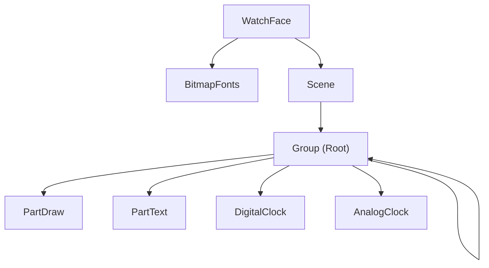
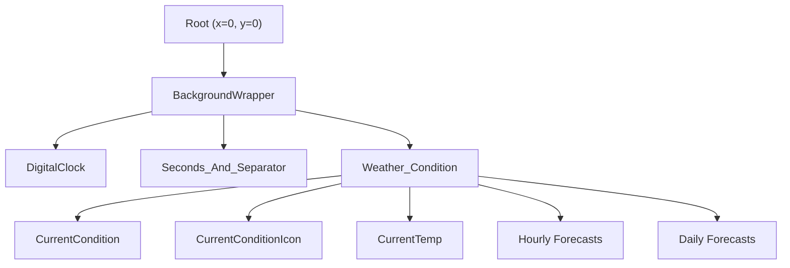
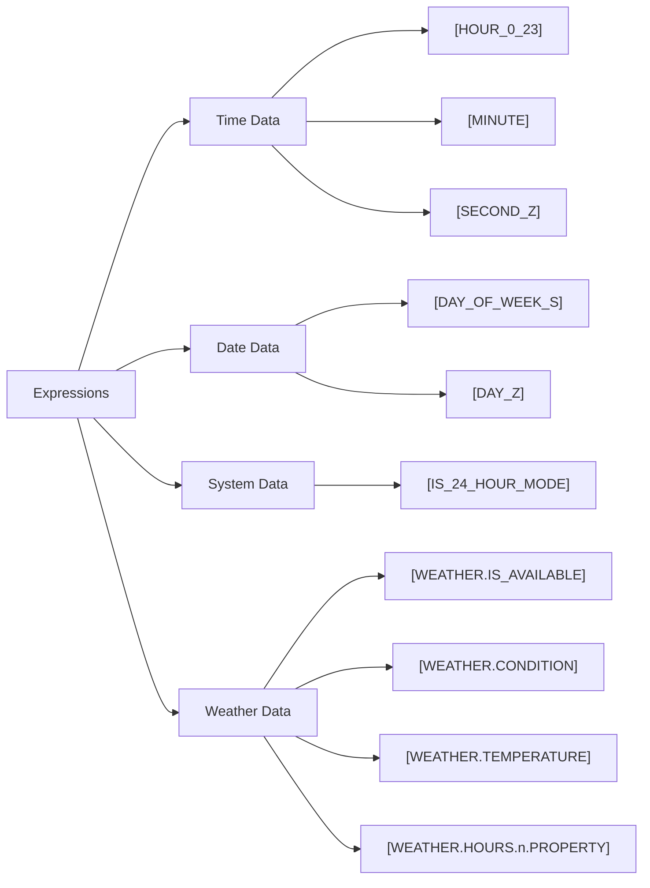
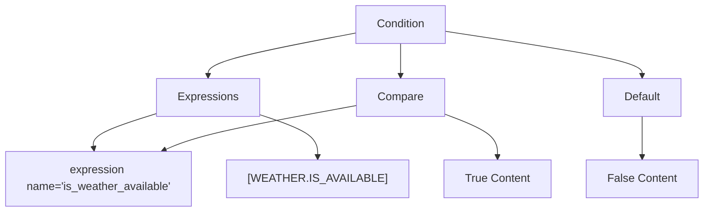
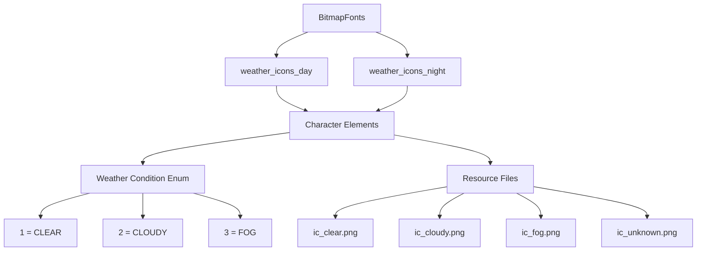
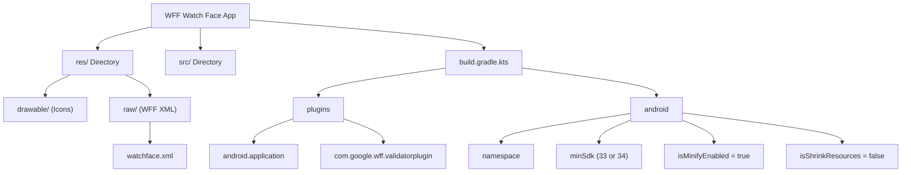

<!-- source: DeepWiki mcp.deepwiki.com · repo android/wear-os-samples · page 10.1 Watch Face Format · fetched 2026-10-23 -->

# Watch Face Format

<details>
<summary>Relevant source files</summary>

The following files were used as context for generating this wiki page:

- [WatchFaceFormat/Complications/build.gradle.kts](WatchFaceFormat/Complications/build.gradle.kts)
- [WatchFaceFormat/Complications/settings.gradle.kts](WatchFaceFormat/Complications/settings.gradle.kts)
- [WatchFaceFormat/Complications/watchface/build.gradle.kts](WatchFaceFormat/Complications/watchface/build.gradle.kts)
- [WatchFaceFormat/Flavors/build.gradle.kts](WatchFaceFormat/Flavors/build.gradle.kts)
- [WatchFaceFormat/Flavors/settings.gradle.kts](WatchFaceFormat/Flavors/settings.gradle.kts)
- [WatchFaceFormat/Flavors/watchface/build.gradle.kts](WatchFaceFormat/Flavors/watchface/build.gradle.kts)
- [WatchFaceFormat/SimpleAnalog/build.gradle.kts](WatchFaceFormat/SimpleAnalog/build.gradle.kts)
- [WatchFaceFormat/SimpleAnalog/settings.gradle.kts](WatchFaceFormat/SimpleAnalog/settings.gradle.kts)
- [WatchFaceFormat/SimpleAnalog/watchface/build.gradle.kts](WatchFaceFormat/SimpleAnalog/watchface/build.gradle.kts)
- [WatchFaceFormat/SimpleDigital/build.gradle.kts](WatchFaceFormat/SimpleDigital/build.gradle.kts)
- [WatchFaceFormat/SimpleDigital/watchface/build.gradle.kts](WatchFaceFormat/SimpleDigital/watchface/build.gradle.kts)
- [WatchFaceFormat/Weather/build.gradle.kts](WatchFaceFormat/Weather/build.gradle.kts)
- [WatchFaceFormat/Weather/settings.gradle.kts](WatchFaceFormat/Weather/settings.gradle.kts)
- [WatchFaceFormat/Weather/watchface/build.gradle.kts](WatchFaceFormat/Weather/watchface/build.gradle.kts)
- [WatchFaceFormat/Weather/watchface/src/main/res/drawable/ic_fog.png](WatchFaceFormat/Weather/watchface/src/main/res/drawable/ic_fog.png)
- [WatchFaceFormat/Weather/watchface/src/main/res/drawable/ic_unknown.png](WatchFaceFormat/Weather/watchface/src/main/res/drawable/ic_unknown.png)
- [WatchFaceFormat/Weather/watchface/src/main/res/raw/watchface.xml](WatchFaceFormat/Weather/watchface/src/main/res/raw/watchface.xml)

</details>


Watch Face Format (WFF) is an XML-based declarative framework for creating Wear OS watch faces. This document explains the structure, components, and usage of WFF within the Wear OS samples repository, providing technical details on how to implement watch faces using this approach.

For information about integrating complications with watch faces, see [Complications](#10.2). For weather data implementation details, see [Weather Watch Face](#10.3). For information about validating watch faces, see [Watch Face Validation](#10.4).

## Watch Face Format Overview

The Watch Face Format uses XML to define the visual appearance and behavior of watch faces, eliminating the need to write complex Canvas rendering code. The system translates these XML definitions into optimized runtime representations.

### Watch Face XML Structure

**Title: Core Components of a Watch Face Format File**


Sources:
- [WatchFaceFormat/Weather/watchface/src/main/res/raw/watchface.xml:1-3]()
- [WatchFaceFormat/Weather/watchface/src/main/res/raw/watchface.xml:3-55]()
- [WatchFaceFormat/Weather/watchface/src/main/res/raw/watchface.xml:56-574]()

## Core Components

### Layout and Hierarchy

WFF uses a hierarchical structure with groups containing visual elements. Each element has coordinates and dimensions defining its position and size.

**Title: Example Layout Hierarchy in Weather Watch Face**


Sources:
- [WatchFaceFormat/Weather/watchface/src/main/res/raw/watchface.xml:57-64]()
- [WatchFaceFormat/Weather/watchface/src/main/res/raw/watchface.xml:64-105]()
- [WatchFaceFormat/Weather/watchface/src/main/res/raw/watchface.xml:105-571]()

### Drawing Elements

WFF provides several primitive elements for drawing:

| Element | Purpose | Key Attributes |
|---------|---------|----------------|
| `<PartDraw>` | Container for vector graphics | height, width, x, y |
| `<Rectangle>` | Rectangular shape | height, width, x, y |
| `<RoundRectangle>` | Rectangle with rounded corners | cornerRadiusX, cornerRadiusY |
| `<Ellipse>` | Circular or oval shape | height, width, x, y |
| `<Fill>` | Fill properties for shapes | color |
| `<Stroke>` | Outline properties for shapes | color, thickness |

Sources:
- [WatchFaceFormat/Weather/watchface/src/main/res/raw/watchface.xml:58-63]()
- [WatchFaceFormat/Weather/watchface/src/main/res/raw/watchface.xml:112-116]()
- [WatchFaceFormat/Weather/watchface/src/main/res/raw/watchface.xml:114-115]()

### Text and Time Display

WFF includes specialized elements for displaying text and time:

| Element | Purpose | Example Usage |
|---------|---------|---------------|
| `<PartText>` | General text display | Day/date, temperature, labels |
| `<DigitalClock>` | Container for time components | Main time display |
| `<TimeText>` | Specific time component | Hours, minutes |
| `<Font>` | Text styling | Family, size definitions |
| `<Template>` | Dynamic text with parameters | Formatted data values |

Sources:
- [WatchFaceFormat/Weather/watchface/src/main/res/raw/watchface.xml:66-76]()
- [WatchFaceFormat/Weather/watchface/src/main/res/raw/watchface.xml:78-86]()
- [WatchFaceFormat/Weather/watchface/src/main/res/raw/watchface.xml:94-103]()

## Dynamic Data and Expressions

WFF uses bracketed expressions to access system data and values. These expressions can be used in templates to create dynamic content.

**Title: Expression System in Watch Face Format**


Sources:
- [WatchFaceFormat/Weather/watchface/src/main/res/raw/watchface.xml:70-73]()
- [WatchFaceFormat/Weather/watchface/src/main/res/raw/watchface.xml:98-100]()
- [WatchFaceFormat/Weather/watchface/src/main/res/raw/watchface.xml:108-109]()
- [WatchFaceFormat/Weather/watchface/src/main/res/raw/watchface.xml:138-139]()
- [WatchFaceFormat/Weather/watchface/src/main/res/raw/watchface.xml:166-168]()

### Conditional Rendering

The `<Condition>` element enables dynamic behavior based on the evaluation of expressions:

```xml
<Condition>
  <Expressions>
    <Expression name="is_24_mode">[IS_24_HOUR_MODE]</Expression>
  </Expressions>
  <Compare expression="is_24_mode">
    <!-- Content when true -->
  </Compare>
  <Default>
    <!-- Content when false -->
  </Default>
</Condition>
```

**Title: Conditional Rendering Flow**


Sources:
- [WatchFaceFormat/Weather/watchface/src/main/res/raw/watchface.xml:106-570]()
- [WatchFaceFormat/Weather/watchface/src/main/res/raw/watchface.xml:129-155]()
- [WatchFaceFormat/Weather/watchface/src/main/res/raw/watchface.xml:217-243]()

### Variants

The `<Variant>` element allows different states for the same element, typically used for ambient mode:

```xml
<Group height="140" name="Seconds_And_Separator" width="270" x="90" y="45">
  <Variant mode="AMBIENT" target="alpha" value="0"/>
  <!-- Content here -->
</Group>
```

Sources:
- [WatchFaceFormat/Weather/watchface/src/main/res/raw/watchface.xml:87-104]()

## Custom Icon Sets with BitmapFonts

WFF supports custom icon sets through the `<BitmapFonts>` element, which maps character codes to bitmap resources.

**Title: BitmapFont Weather Icon System**


This system enables displaying condition-specific icons by using a weather condition enum value as an index into the bitmap font.

Sources:
- [WatchFaceFormat/Weather/watchface/src/main/res/raw/watchface.xml:3-55]()
- [WatchFaceFormat/Weather/watchface/src/main/res/raw/watchface.xml:18-35]()
- [WatchFaceFormat/Weather/watchface/src/main/res/raw/watchface.xml:37-54]()
- [WatchFaceFormat/Weather/watchface/src/main/res/drawable/ic_unknown.png:1-11]()
- [WatchFaceFormat/Weather/watchface/src/main/res/drawable/ic_fog.png:1-15]()

## Project Structure and Building

Watch Face Format applications follow a standard Android project structure with specific configurations.

**Title: Project Structure and Build Configuration**


The build configuration includes:
- Android application plugin
- WFF validator plugin for validation during build
- Minimum SDK requirements (33 for basic features, 34 for weather/flavors)
- Minification enabled but resource shrinking disabled to preserve resources

Sources:
- [WatchFaceFormat/SimpleDigital/watchface/build.gradle.kts:16-48]()
- [WatchFaceFormat/Weather/watchface/build.gradle.kts:16-50]()
- [WatchFaceFormat/SimpleAnalog/watchface/build.gradle.kts:16-48]()
- [WatchFaceFormat/Complications/watchface/build.gradle.kts:16-48]()
- [WatchFaceFormat/Flavors/watchface/build.gradle.kts:16-50]()

### Version Compatibility

WFF has two major versions with different requirements:

| Version | Minimum SDK | Features |
|---------|------------|----------|
| Version 1 | 33 (Wear OS 4+) | Basic watch face features, time/date display |
| Version 2 | 34 (Wear OS 5+) | Weather integration, flavors, enhanced expressions |

Sources:
- [WatchFaceFormat/SimpleDigital/watchface/build.gradle.kts:26-32]()
- [WatchFaceFormat/Weather/watchface/build.gradle.kts:26-34]()
- [WatchFaceFormat/Flavors/watchface/build.gradle.kts:26-34]()

## Sample Implementations

The repository includes several WFF examples:

1. **SimpleDigital**: Basic digital time display
2. **SimpleAnalog**: Basic analog clock face
3. **Complications**: Integration with system complications
4. **Weather**: Advanced weather data integration
5. **Flavors**: Multiple watch face variants in one package

Sources:
- [WatchFaceFormat/SimpleDigital/build.gradle.kts:17-19]()
- [WatchFaceFormat/SimpleAnalog/build.gradle.kts:17-19]()
- [WatchFaceFormat/Complications/build.gradle.kts:17-19]()
- [WatchFaceFormat/Weather/build.gradle.kts:17-19]()
- [WatchFaceFormat/Flavors/build.gradle.kts:17-19]()

## Validator Plugin

The Watch Face Format samples use a validator plugin to ensure watch faces meet requirements. This plugin is applied during build and checks for syntax errors, invalid expressions, and performance issues.

Sources:
- [WatchFaceFormat/SimpleDigital/watchface/build.gradle.kts:19-20]()
- [WatchFaceFormat/Weather/settings.gradle.kts:17]()

## Summary

Watch Face Format provides an XML-based approach to watch face development that significantly simplifies implementation compared to traditional Canvas-based rendering. Its declarative nature separates design from code, enabling more efficient development and maintenance of watch faces for Wear OS.

For more information about complications integration, see [Complications](#10.2). For detailed implementation of weather data in watch faces, see [Weather Watch Face](#10.3). For validation tools and requirements, see [Watch Face Validation](#10.4).

---

