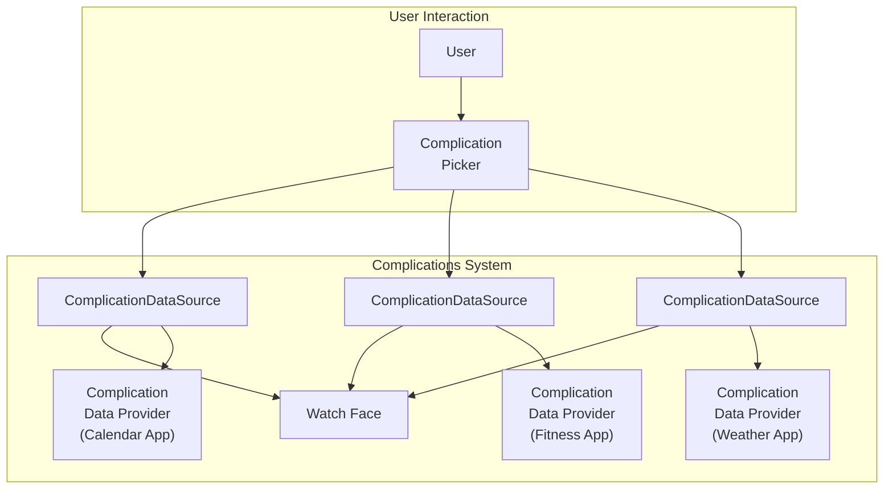
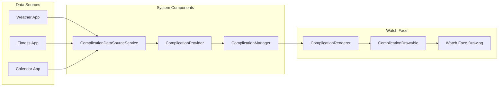
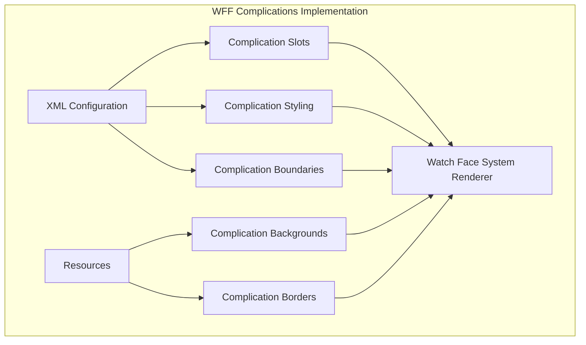
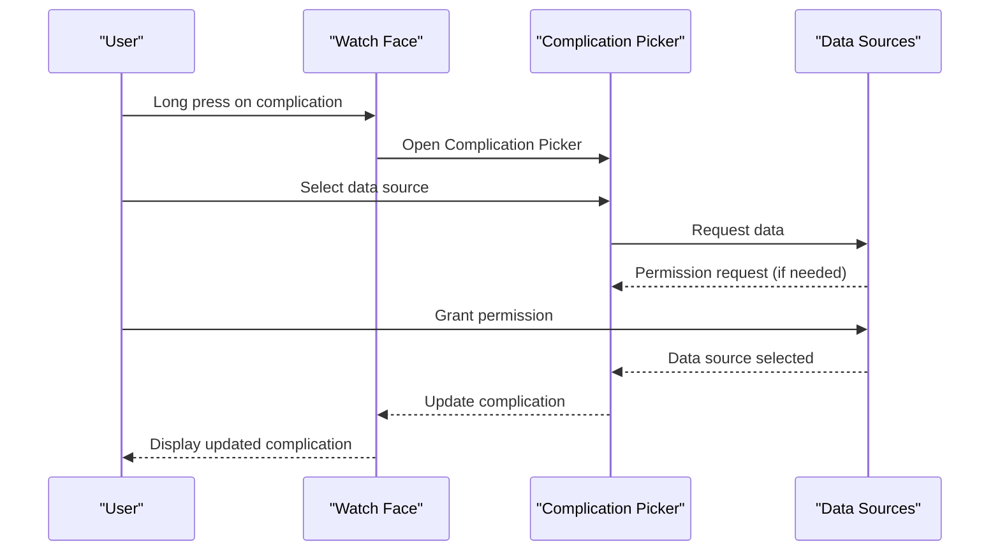

<!-- source: DeepWiki mcp.deepwiki.com · repo android/wear-os-samples · page 10.2 Complications · fetched 2026-10-23 -->

# Complications

Relevant source files

The following files were used as context for generating this wiki page:

- [Complications/gradle/libs.versions.toml](Complications/gradle/libs.versions.toml)
- [WatchFaceFormat/Complications/gradle/libs.versions.toml](WatchFaceFormat/Complications/gradle/libs.versions.toml)
- [WatchFaceFormat/Complications/settings.gradle.kts](WatchFaceFormat/Complications/settings.gradle.kts)
- [WatchFaceFormat/Complications/watchface/build.gradle.kts](WatchFaceFormat/Complications/watchface/build.gradle.kts)
- [WatchFaceFormat/Flavors/gradle/libs.versions.toml](WatchFaceFormat/Flavors/gradle/libs.versions.toml)
- [WatchFaceFormat/Flavors/settings.gradle.kts](WatchFaceFormat/Flavors/settings.gradle.kts)
- [WatchFaceFormat/Flavors/watchface/build.gradle.kts](WatchFaceFormat/Flavors/watchface/build.gradle.kts)
- [WatchFaceFormat/SimpleAnalog/gradle/libs.versions.toml](WatchFaceFormat/SimpleAnalog/gradle/libs.versions.toml)
- [WatchFaceFormat/SimpleAnalog/settings.gradle.kts](WatchFaceFormat/SimpleAnalog/settings.gradle.kts)
- [WatchFaceFormat/SimpleAnalog/watchface/build.gradle.kts](WatchFaceFormat/SimpleAnalog/watchface/build.gradle.kts)
- [WatchFaceFormat/SimpleDigital/gradle/libs.versions.toml](WatchFaceFormat/SimpleDigital/gradle/libs.versions.toml)
- [WatchFaceFormat/SimpleDigital/watchface/build.gradle.kts](WatchFaceFormat/SimpleDigital/watchface/build.gradle.kts)
- [WatchFaceFormat/Weather/gradle/libs.versions.toml](WatchFaceFormat/Weather/gradle/libs.versions.toml)
- [WatchFaceFormat/Weather/settings.gradle.kts](WatchFaceFormat/Weather/settings.gradle.kts)
- [WatchFaceFormat/Weather/watchface/build.gradle.kts](WatchFaceFormat/Weather/watchface/build.gradle.kts)
- [WatchFaceFormat/validator-plugin/gradle/libs.versions.toml](WatchFaceFormat/validator-plugin/gradle/libs.versions.toml)
- [WatchFaceFormat/validator-plugin/plugins/build.gradle.kts](WatchFaceFormat/validator-plugin/plugins/build.gradle.kts)

## Purpose and Scope

This document provides a technical overview of complications in the context of Wear OS watch face development. Complications are small, glanceable information displays that can be integrated into watch faces. They allow watch faces to display data from other applications, such as step count, weather information, calendar events, and battery level.

This guide focuses specifically on implementing complications within watch faces using the Watch Face Format (WFF). For information about creating watch faces with the Watch Face Format in general, see [Watch Face Format](#10.1). For implementing a complete weather watch face with complications, see [Weather Watch Face](#10.3).

## What are Complications?

Complications are modular, data-driven UI components that appear on watch faces. They serve as conduits for information from various apps to be displayed directly on the watch face. On Wear OS, complications follow standardized formats to ensure consistency across different watch faces.

Sources: WatchFaceFormat/Complications/watchface/build.gradle.kts

## Complication Types

Wear OS supports several standard complication types, each designed to display specific kinds of information in an appropriate format.

| Complication Type | Description | Example Use Cases |
|-------------------|-------------|-------------------|
| SHORT_TEXT | Brief text with optional icon | Step count, heart rate |
| LONG_TEXT | Extended text information | Upcoming calendar event |
| RANGED_VALUE | Value within a range | Battery percentage, progress toward fitness goal |
| ICON | Simple icon | Weather condition, notification indicator |
| SMALL_IMAGE | Small photo or illustration | Contact photo |
| MONOCHROMATIC_IMAGE | Single-color image | Status icon |
| LIST | Scrollable list of items | Multiple appointments |
| GOAL_PROGRESS | Progress toward a goal | Exercise goal achievement |

Sources: Complications/gradle/libs.versions.toml

## Complications Architecture

Complications in Wear OS follow a provider-consumer architecture, where apps provide data and watch faces consume and display that data.

Sources: Complications/gradle/libs.versions.toml

### Key Components

1. **ComplicationDataSourceService**: Apps that want to provide complication data implement this service.
2. **ComplicationData**: Object containing the data to be displayed in a complication.
3. **ComplicationManager**: System service that manages complications and their data flow.
4. **ComplicationRenderer**: Component in the watch face that handles drawing complications.

The AndroidX Wear WatchFace library provides extensive support for complications through the `androidx.wear.watchface:watchface-complications-data-source-ktx` package.

Sources: Complications/gradle/libs.versions.toml

## Implementing Complications in Watch Face Format (WFF)

Watch Face Format (WFF) simplifies the implementation of complications by allowing declarative XML configuration.

### Configuration in WFF

In the Watch Face Format, complications are defined in XML within the watchface package. A typical configuration includes:

1. **Complication slots**: Define the position, size, and default type for each complication
2. **Complication boundaries**: Define where complications appear on the watch face
3. **Complication styling**: Configure appearance aspects like text color, background, etc.

Sources: WatchFaceFormat/Complications/watchface/build.gradle.kts

### Validation

The WFF validator plugin helps ensure that complications are properly configured in your watch face. The validator checks for issues like:

1. Properly defined complication slots
2. Correctly referenced resources
3. Valid complication types

This validation happens during the build process, as configured in the build.gradle.kts file.

Sources: WatchFaceFormat/Complications/watchface/build.gradle.kts, WatchFaceFormat/validator-plugin/plugins/build.gradle.kts

## Complication User Interactions

Wear OS provides standard system UI for users to select and configure complications on watch faces. This includes:

1. **Complication Picker**: System UI that allows users to select which data source to use for each complication slot
2. **Long-press gesture**: Standard way for users to access the complication configuration
3. **Permission handling**: System manages permissions for complications to access user data

Sources: WatchFaceFormat/Complications/settings.gradle.kts

## Best Practices

### Design Considerations

1. **Layout**: Ensure complications don't obscure essential watch face elements
2. **Readability**: Maintain good contrast for complication text and icons
3. **Consistency**: Maintain visual consistency between complications and the watch face design
4. **Ambient mode**: Ensure complications are visible but power-efficient in ambient mode

### Implementation Tips

1. **Default complications**: Provide sensible default complications for your watch face
2. **Support multiple sizes**: Design your watch face to accommodate different complication sizes
3. **Handle empty data**: Gracefully handle cases where complication data isn't available
4. **Optimize rendering**: Ensure complication rendering is efficient to preserve battery life

Sources: WatchFaceFormat/validator-plugin/plugins/build.gradle.kts

## Debugging and Testing

When developing watch faces with complications, several tools can help test and debug:

1. **Complication Test Suite**: Test your watch face with various complication data types
2. **WFF Validator**: Validates complication configuration in your watch face package
3. **System UI Test**: Test user interaction with the complication picker

The WFF validator plugin, included in the sample, helps identify issues in your complication configuration during development.

Sources: WatchFaceFormat/validator-plugin/plugins/build.gradle.kts

## Integration with Other Watch Face Features

Complications can be integrated with other watch face features, such as:

1. **Watch face flavors**: Different variants of a watch face can include different complication configurations
2. **Weather integration**: Weather complications can be part of a weather-focused watch face
3. **Simple analog/digital faces**: Basic watch faces can be enhanced with complications

Sources: WatchFaceFormat/SimpleAnalog/settings.gradle.kts, WatchFaceFormat/Weather/settings.gradle.kts, WatchFaceFormat/SimpleDigital/settings.gradle.kts

## Conclusion

Complications provide a powerful way to enhance watch faces with dynamic, user-selected information. The Watch Face Format makes it relatively straightforward to implement complications by using declarative XML configuration rather than complex rendering code.

By following the patterns demonstrated in the Complications sample and adhering to best practices, you can create watch faces that showcase useful information while maintaining a cohesive design.

---

