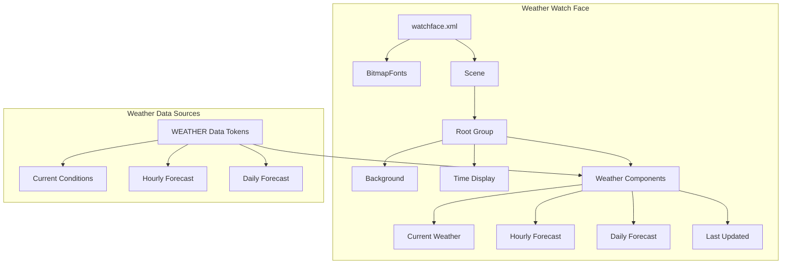
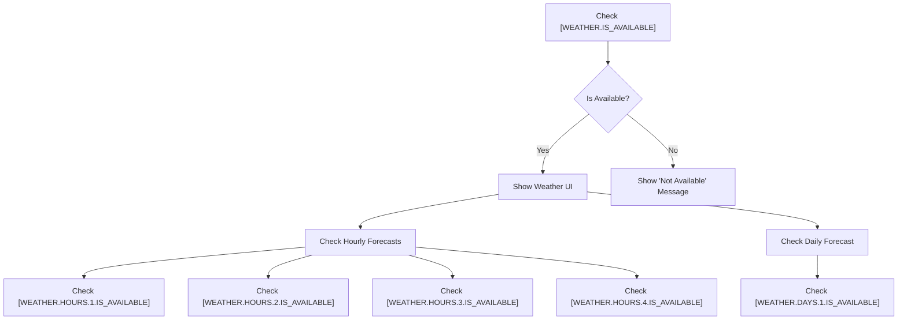
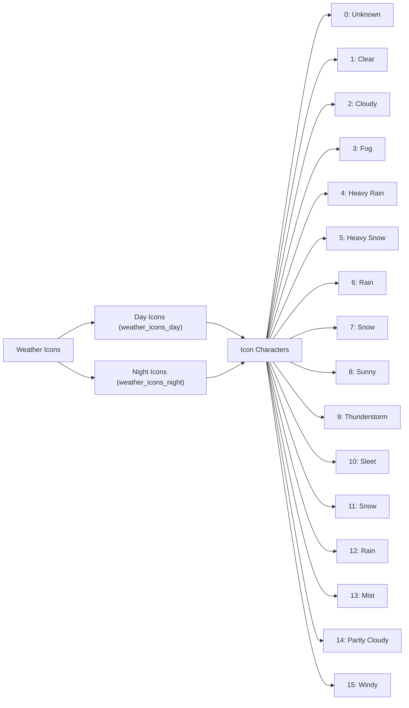
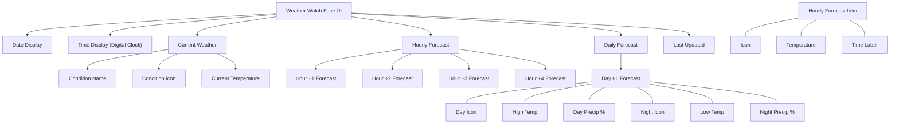

<!-- source: DeepWiki mcp.deepwiki.com · repo android/wear-os-samples · page 10.3 Weather Watch Face · fetched 2026-10-23 -->

# Weather Watch Face

<details>
<summary>Relevant source files</summary>

The following files were used as context for generating this wiki page:

- [WatchFaceFormat/Weather/watchface/src/main/res/drawable/ic_fog.png](WatchFaceFormat/Weather/watchface/src/main/res/drawable/ic_fog.png)
- [WatchFaceFormat/Weather/watchface/src/main/res/drawable/ic_unknown.png](WatchFaceFormat/Weather/watchface/src/main/res/drawable/ic_unknown.png)
- [WatchFaceFormat/Weather/watchface/src/main/res/raw/watchface.xml](WatchFaceFormat/Weather/watchface/src/main/res/raw/watchface.xml)

</details>


## Overview

The Weather Watch Face is a sample implementation that demonstrates how to create a watch face that displays weather information using the Watch Face Format (WFF). This sample showcases how to integrate weather data into a watch face, including current conditions, hourly forecasts, and daily forecasts, while maintaining a clean, user-friendly interface.

This page focuses specifically on the weather integration aspects of watch face development. For general information about WFF, see [Watch Face Format](#10.1), and for information about complications, see [Complications](#10.2).

Sources: [WatchFaceFormat/Weather/watchface/src/main/res/raw/watchface.xml:1-575]()

## Architecture Overview

The Weather Watch Face is built using declarative XML with the Watch Face Format (WFF). The architecture consists of several key components that work together to display time and weather information.



Sources: [WatchFaceFormat/Weather/watchface/src/main/res/raw/watchface.xml:1-575]()

## Weather Data Integration

The watch face uses the system-provided weather data through Wear OS's Weather API. This is accessed via data tokens in the WFF syntax.

### Data Tokens

The watch face accesses weather data through the following key tokens:

| Token Category | Example Tokens | Description |
|----------------|---------------|-------------|
| Current Weather | `[WEATHER.IS_AVAILABLE]` | Whether weather data is available |
| | `[WEATHER.CONDITION]` | Current weather condition code |
| | `[WEATHER.CONDITION_NAME]` | Human-readable condition description |
| | `[WEATHER.TEMPERATURE]` | Current temperature |
| | `[WEATHER.TEMPERATURE_UNIT]` | Temperature unit (C or F) |
| | `[WEATHER.IS_DAY]` | Whether it's daytime (1) or nighttime (0) |
| | `[WEATHER.LAST_UPDATED]` | Timestamp of last weather update |
| Hourly Forecast | `[WEATHER.HOURS.n.IS_AVAILABLE]` | Whether data for hour n is available |
| | `[WEATHER.HOURS.n.CONDITION]` | Weather condition code for hour n |
| | `[WEATHER.HOURS.n.TEMPERATURE]` | Temperature forecast for hour n |
| | `[WEATHER.HOURS.n.IS_DAY]` | Whether hour n is daytime or nighttime |
| Daily Forecast | `[WEATHER.DAYS.n.IS_AVAILABLE]` | Whether data for day n is available |
| | `[WEATHER.DAYS.n.CONDITION_DAY]` | Day weather condition for day n |
| | `[WEATHER.DAYS.n.CONDITION_NIGHT]` | Night weather condition for day n |
| | `[WEATHER.DAYS.n.TEMPERATURE_HIGH]` | High temperature for day n |
| | `[WEATHER.DAYS.n.TEMPERATURE_LOW]` | Low temperature for day n |
| | `[WEATHER.DAYS.n.CHANCE_OF_PRECIPITATION]` | Precipitation chance for day n (daytime) |
| | `[WEATHER.DAYS.n.CHANCE_OF_PRECIPITATION_NIGHT]` | Precipitation chance for day n (nighttime) |

Sources: [WatchFaceFormat/Weather/watchface/src/main/res/raw/watchface.xml:105-570]()

### Data Availability Handling

The watch face checks the availability of weather data before rendering, using conditional expressions:



Sources: [WatchFaceFormat/Weather/watchface/src/main/res/raw/watchface.xml:105-115](), [WatchFaceFormat/Weather/watchface/src/main/res/raw/watchface.xml:561-570]()

## Weather Icons Implementation

The watch face uses bitmap fonts to represent weather conditions, with different icon sets for day and night.

### Icon Sets Structure



Sources: [WatchFaceFormat/Weather/watchface/src/main/res/raw/watchface.xml:3-54]()

### Day/Night Switching

The watch face automatically switches between day and night icon sets based on the `[WEATHER.IS_DAY]` token:

```xml
<Condition>
  <Expressions>
    <Expression name="is_day">[WEATHER.IS_DAY]</Expression>
  </Expressions>
  <Compare expression="is_day">
    <!-- Day icons used here -->
  </Compare>
  <Default>
    <!-- Night icons used here -->
  </Default>
</Condition>
```

Sources: [WatchFaceFormat/Weather/watchface/src/main/res/raw/watchface.xml:128-155]()

## UI Components

The Weather Watch Face UI is organized into several key components:



Sources: [WatchFaceFormat/Weather/watchface/src/main/res/raw/watchface.xml:56-573]()

### Time Display

The watch face uses a digital clock display with separate text elements for hours and minutes. In active mode, it also displays seconds, which are automatically hidden in ambient mode using a `Variant` tag.

Sources: [WatchFaceFormat/Weather/watchface/src/main/res/raw/watchface.xml:78-103]()

### Current Weather Display

Current weather is displayed in three pill-shaped containers:
1. Weather condition name (e.g., "Partly Cloudy")
2. Weather condition icon (dynamically selected based on condition code and day/night state)
3. Current temperature with unit

Sources: [WatchFaceFormat/Weather/watchface/src/main/res/raw/watchface.xml:111-173]()

### Hourly Forecast

The hourly forecast displays up to 4 hours of forecasted weather, with each hour showing:
1. Weather condition icon
2. Temperature
3. Time (automatically formatted based on 12h/24h device setting)

Sources: [WatchFaceFormat/Weather/watchface/src/main/res/raw/watchface.xml:174-464]()

### Daily Forecast

The daily forecast displays information for the next day, including:
1. Date
2. Daytime weather condition icon
3. High temperature
4. Precipitation chance (day)
5. Nighttime weather condition icon
6. Low temperature
7. Precipitation chance (night)

Sources: [WatchFaceFormat/Weather/watchface/src/main/res/raw/watchface.xml:467-528]()

### Last Updated Timestamp

A "Last updated" timestamp shows when the weather data was last refreshed, formatted according to the device's 12h/24h setting.

Sources: [WatchFaceFormat/Weather/watchface/src/main/res/raw/watchface.xml:530-558]()

## Time Format Adaptation

The watch face automatically adapts to the device's time format setting (12-hour or 24-hour) using the `[IS_24_HOUR_MODE]` token. This affects:

1. Hour display in hourly forecasts
2. Last updated timestamp format

Example for hourly forecasts:
```xml
<Condition>
  <Expressions>
    <Expression name="is_24_mode">[IS_24_HOUR_MODE]</Expression>
  </Expressions>
  <Compare expression="is_24_mode">
    <!-- 24-hour format -->
    <PartText height="20" width="60" x="0" y="80">
      <Text>
        <Font family="SYNC_TO_DEVICE" size="17">
          <Template><![CDATA[%s:00]]>
            <Parameter expression="([HOUR_0_23] + 1) % 24"/>
          </Template>
        </Font>
      </Text>
    </PartText>
  </Compare>
  <Default>
    <!-- 12-hour format -->
    <PartText height="20" width="60" x="0" y="80">
      <Text>
        <Font family="SYNC_TO_DEVICE" size="17">
          <Template><![CDATA[%s%s]]>
            <Parameter expression="([HOUR_0_23] + 1) % 24 <= 12 ? ([HOUR_0_23] + 1) % 24 : ([HOUR_0_23] + 1) % 24 - 12"/>
            <Parameter expression="([HOUR_0_23] + 1) % 24 < 12 ? &quot;AM&quot; : &quot;PM&quot;"/>
          </Template>
        </Font>
      </Text>
    </PartText>
  </Default>
</Condition>
```

Sources: [WatchFaceFormat/Weather/watchface/src/main/res/raw/watchface.xml:217-243](), [WatchFaceFormat/Weather/watchface/src/main/res/raw/watchface.xml:530-558]()

## Fallback Behavior

The watch face gracefully handles cases where weather data is unavailable:

```xml
<Default>
  <Group height="255" name="Not_Available_Wrapper" width="410" x="0" y="0">
    <PartText height="255" width="410" x="0" y="0">
      <Text>
        <Font family="SYNC_TO_DEVICE" size="30">Weather data is not available</Font>
      </Text>
    </PartText>
  </Group>
</Default>
```

Sources: [WatchFaceFormat/Weather/watchface/src/main/res/raw/watchface.xml:561-569]()

## Implementation Notes

1. The watch face design uses a 450×450 pixel canvas with circular layout
2. Weather icons use 96×96 pixel dimensions in resource files but are scaled appropriately in the UI
3. The watch face handles unknown weather conditions (code > 15) by defaulting to the "unknown" icon (index 0)
4. The UI includes responsive design elements that adapt to different device settings

Sources: [WatchFaceFormat/Weather/watchface/src/main/res/raw/watchface.xml:2](), [WatchFaceFormat/Weather/watchface/src/main/res/raw/watchface.xml:138-139]()

---

