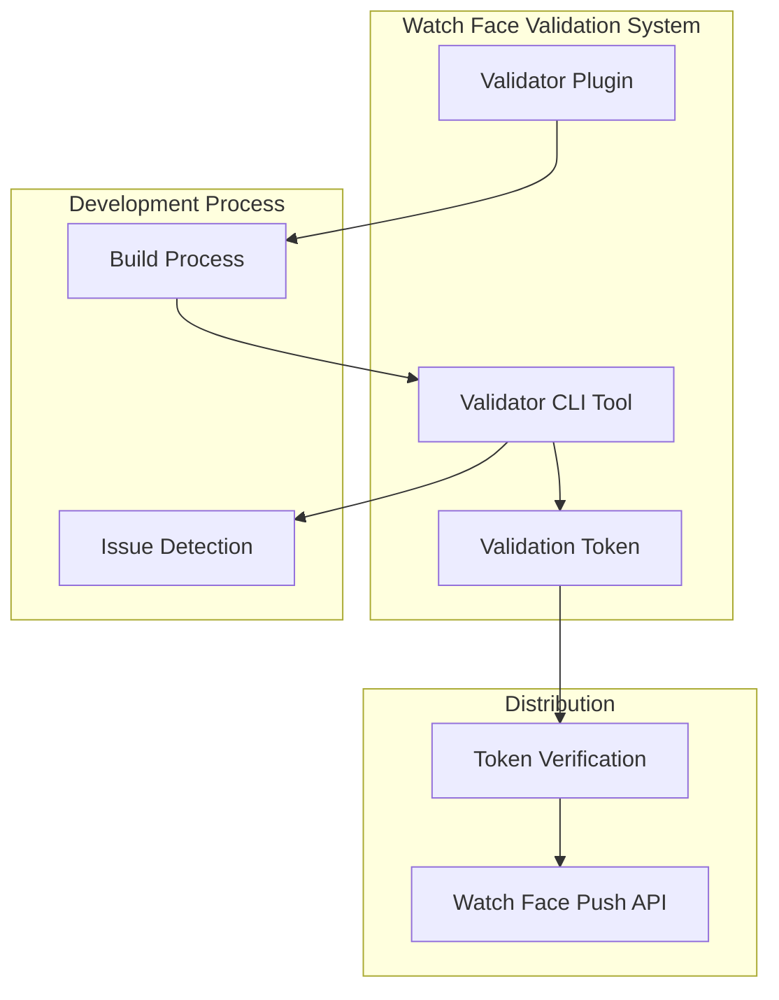
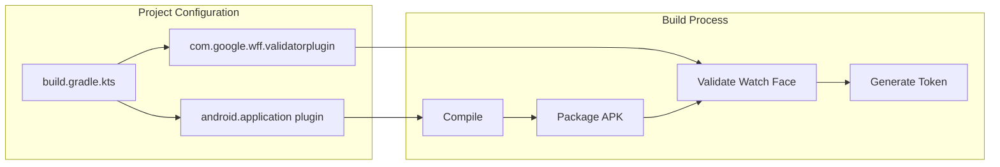
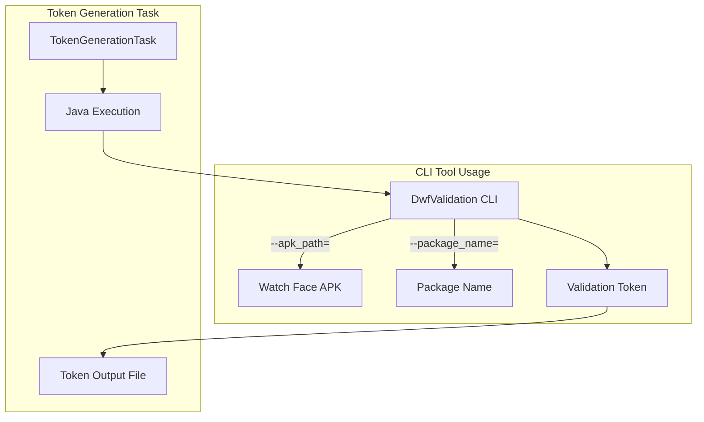
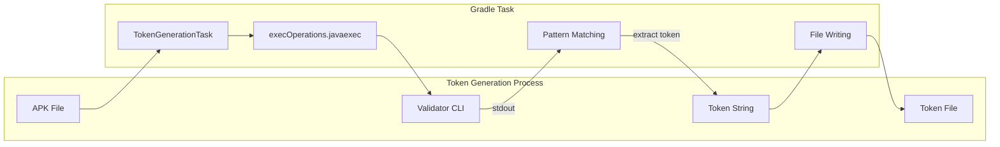
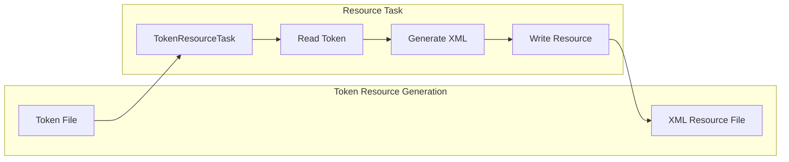
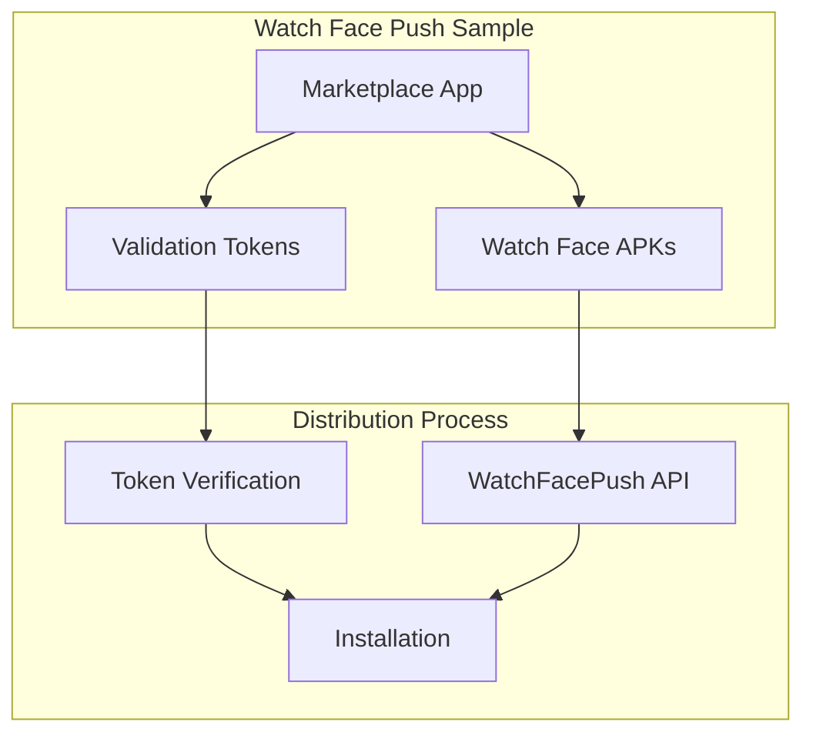

<!-- source: DeepWiki mcp.deepwiki.com · repo android/wear-os-samples · page 10.4 Watch Face Validation · fetched 2026-10-23 -->

# Watch Face Validation

<details>
<summary>Relevant source files</summary>

The following files were used as context for generating this wiki page:

- [WatchFaceFormat/Complications/settings.gradle.kts](WatchFaceFormat/Complications/settings.gradle.kts)
- [WatchFaceFormat/Complications/watchface/build.gradle.kts](WatchFaceFormat/Complications/watchface/build.gradle.kts)
- [WatchFaceFormat/Flavors/settings.gradle.kts](WatchFaceFormat/Flavors/settings.gradle.kts)
- [WatchFaceFormat/Flavors/watchface/build.gradle.kts](WatchFaceFormat/Flavors/watchface/build.gradle.kts)
- [WatchFaceFormat/SimpleAnalog/settings.gradle.kts](WatchFaceFormat/SimpleAnalog/settings.gradle.kts)
- [WatchFaceFormat/SimpleAnalog/watchface/build.gradle.kts](WatchFaceFormat/SimpleAnalog/watchface/build.gradle.kts)
- [WatchFaceFormat/SimpleDigital/watchface/build.gradle.kts](WatchFaceFormat/SimpleDigital/watchface/build.gradle.kts)
- [WatchFaceFormat/Weather/settings.gradle.kts](WatchFaceFormat/Weather/settings.gradle.kts)
- [WatchFaceFormat/Weather/watchface/build.gradle.kts](WatchFaceFormat/Weather/watchface/build.gradle.kts)
- [WatchFacePush/.gitignore](WatchFacePush/.gitignore)
- [WatchFacePush/README.md](WatchFacePush/README.md)
- [WatchFacePush/app/.gitignore](WatchFacePush/app/.gitignore)
- [WatchFacePush/app/build.gradle.kts](WatchFacePush/app/build.gradle.kts)
- [WatchFacePush/app/proguard-rules.pro](WatchFacePush/app/proguard-rules.pro)
- [WatchFacePush/app/src/main/java/com/google/samples/marketplace/ui/WatchFaceButton.kt](WatchFacePush/app/src/main/java/com/google/samples/marketplace/ui/WatchFaceButton.kt)
- [WatchFacePush/build.gradle.kts](WatchFacePush/build.gradle.kts)
- [WatchFacePush/buildSrc/build.gradle.kts](WatchFacePush/buildSrc/build.gradle.kts)
- [WatchFacePush/buildSrc/src/main/kotlin/TokenGenerationTask.gradle.kts](WatchFacePush/buildSrc/src/main/kotlin/TokenGenerationTask.gradle.kts)
- [WatchFacePush/buildSrc/src/main/kotlin/TokenResourceTask.gradle.kts](WatchFacePush/buildSrc/src/main/kotlin/TokenResourceTask.gradle.kts)
- [WatchFacePush/gradle/libs.versions.toml](WatchFacePush/gradle/libs.versions.toml)
- [WatchFacePush/gradle/wrapper/gradle-wrapper.properties](WatchFacePush/gradle/wrapper/gradle-wrapper.properties)
- [WatchFacePush/screenshots/wfp.png](WatchFacePush/screenshots/wfp.png)

</details>


This page documents the watch face validation system used in the Wear OS samples repository. The validator ensures that watch faces meet the requirements for distribution through the Watch Face Format (WFF) and Watch Face Push API. For information about distributing watch faces, see [Watch Face Distribution](#10.5).

## Purpose and Overview

The watch face validator is a Gradle plugin that automatically checks watch face APKs during the build process to ensure they meet all requirements for distribution. It validates the structure, resources, and manifest entries of watch faces built with the Watch Face Format.

The validator serves two key purposes:
1. Identifying issues early in the development process
2. Generating validation tokens required for watch face distribution



Sources: [WatchFaceFormat/SimpleDigital/watchface/build.gradle.kts:17-20](), [WatchFacePush/gradle/libs.versions.toml:2-3](), [WatchFacePush/gradle/libs.versions.toml:20]()

## Validator Plugin Integration

The validator plugin is integrated into the build process of watch face projects. It runs automatically during the build phase to validate the watch face APK.

### Adding the Validator Plugin

The validator plugin is included in the watch face sample projects through the `build.gradle.kts` file:



Example plugin application in a watch face project:

```kotlin
plugins {
    alias(libs.plugins.android.application)
    // Use the locally-defined validator to demonstrate validation on-build.
    id("com.google.wff.validatorplugin")
}
```

Sources: [WatchFaceFormat/SimpleDigital/watchface/build.gradle.kts:16-20](), [WatchFaceFormat/Complications/watchface/build.gradle.kts:16-20](), [WatchFaceFormat/SimpleAnalog/watchface/build.gradle.kts:16-20](), [WatchFaceFormat/Weather/watchface/build.gradle.kts:16-20](), [WatchFaceFormat/Flavors/watchface/build.gradle.kts:16-20]()

### Plugin Configuration in Settings

The validator plugin is included as a build dependency in the project settings:

```kotlin
pluginManagement {
    includeBuild("../validator-plugin")
    repositories {
        google()
        mavenCentral()
        gradlePluginPortal()
    }
}
```

Sources: [WatchFaceFormat/Weather/settings.gradle.kts:16-23](), [WatchFaceFormat/Flavors/settings.gradle.kts:16-23](), [WatchFaceFormat/Complications/settings.gradle.kts:16-23](), [WatchFaceFormat/SimpleAnalog/settings.gradle.kts:16-23]()

## Validator CLI Tool

The validator is also available as a command-line interface (CLI) tool that can be used independently of the Gradle plugin. This is particularly useful for integration into custom build systems or CI/CD pipelines.

### CLI Tool Configuration

The CLI tool is defined as a dependency in the version catalog:

```kotlin
[versions]
validatorPushCli = "1.0.0-alpha01"

[libraries]
validator-push-cli = { module = "com.google.android.wearable.watchface.validator:validator-push-cli", version.ref = "validatorPushCli" }
```

Sources: [WatchFacePush/gradle/libs.versions.toml:2-3](), [WatchFacePush/gradle/libs.versions.toml:20]()

### Using the CLI Tool

The CLI tool is used in the Watch Face Push sample to generate validation tokens for watch faces:



The CLI tool is executed with the following parameters:
- `--apk_path`: Path to the watch face APK
- `--package_name`: Package name of the watch face

Sources: [WatchFacePush/buildSrc/src/main/kotlin/TokenGenerationTask.gradle.kts:66-70]()

## Validation Token Generation

A critical function of the validator is generating validation tokens that are required for distributing watch faces through the Watch Face Push API.

### Token Generation Process

The token generation process is implemented in the `TokenGenerationTask` class:



The token generation task:
1. Locates the APK file
2. Executes the validator CLI tool
3. Extracts the validation token from the output
4. Writes the token to a file

Sources: [WatchFacePush/buildSrc/src/main/kotlin/TokenGenerationTask.gradle.kts:32-88]()

### Token Resource Generation

For the Watch Face Push sample, the validation token is also converted into an Android resource that can be used by the app:



The token resource task:
1. Reads the token from the token file
2. Generates an XML resource file containing the token
3. Places the resource file in the app's resources directory

Sources: [WatchFacePush/buildSrc/src/main/kotlin/TokenResourceTask.gradle.kts:27-47]()

## Integration with Watch Face Push

The validation tokens are used by the Watch Face Push API to verify that watch faces meet all requirements before installation.

### Token Usage in Watch Face Push

The Watch Face Push sample demonstrates how validation tokens are used in the distribution process:



The Watch Face Push sample app:
1. Includes watch face APKs as assets
2. Includes validation tokens for each watch face
3. Uses the Watch Face Push API to install watch faces
4. Provides the validation token during installation

Sources: [WatchFacePush/app/build.gradle.kts:61-69](), [WatchFacePush/app/build.gradle.kts:126](), [WatchFacePush/build.gradle.kts:60-82]()

## Validation Requirements

The validator checks watch faces against a set of requirements that must be met for successful distribution.

### Key Validation Checks

The validator performs the following key checks:

| Category | Requirements |
|----------|--------------|
| Manifest | - Proper permissions<br>- Required components<br>- Correct intent filters |
| Resources | - Required drawables<br>- Proper resource naming<br>- Resource constraints |
| Structure | - Correct package structure<br>- Required files<br>- File size limits |
| Functionality | - Proper watch face implementation<br>- Complication support (if used)<br>- Performance requirements |

### Build Configuration Requirements

Watch face projects must also follow specific build configuration requirements:

```kotlin
buildTypes {
    debug {
        isMinifyEnabled = true
    }
    release {
        isMinifyEnabled = true
        // Ensure shrink resources is false, to avoid potential for them
        // being removed.
        isShrinkResources = false
    }
}
```

Note that `isShrinkResources` must be set to `false` to prevent required resources from being removed during the build process.

Sources: [WatchFaceFormat/SimpleDigital/watchface/build.gradle.kts:34-48](), [WatchFaceFormat/Complications/watchface/build.gradle.kts:34-48](), [WatchFaceFormat/SimpleAnalog/watchface/build.gradle.kts:34-48](), [WatchFaceFormat/Weather/watchface/build.gradle.kts:36-50](), [WatchFaceFormat/Flavors/watchface/build.gradle.kts:36-50]()

## Troubleshooting Validation Issues

When validation fails, the validator provides error messages to help identify and fix the issues.

### Common Validation Issues

| Issue | Description | Solution |
|-------|-------------|----------|
| Missing resources | Required resources are not included in the APK | Add the missing resources to the project |
| Incorrect manifest | Manifest entries are missing or incorrect | Update the manifest with the required entries |
| Resource shrinking | Resources are being removed by the build process | Set `isShrinkResources = false` in the build configuration |
| Incorrect structure | Watch face files are not organized correctly | Follow the Watch Face Format structure guidelines |
| Performance issues | Watch face does not meet performance requirements | Optimize the watch face implementation |

### Validation Error Output

Validation errors are output to the build log and can be used to identify and fix issues with the watch face.

## Conclusion

The watch face validator is an essential tool for developing watch faces that can be distributed through the Watch Face Push API. By integrating validation into the build process, developers can identify and fix issues early in the development cycle, ensuring a smooth distribution process.

For information on how to distribute validated watch faces, see [Watch Face Distribution](#10.5).

---

