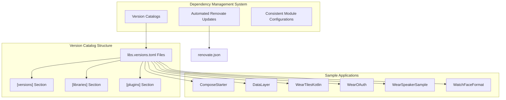
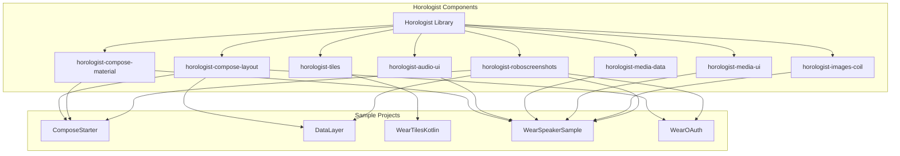
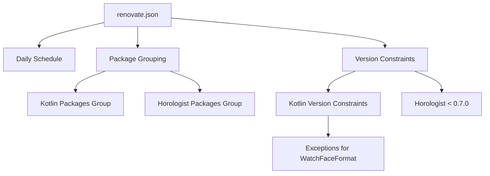
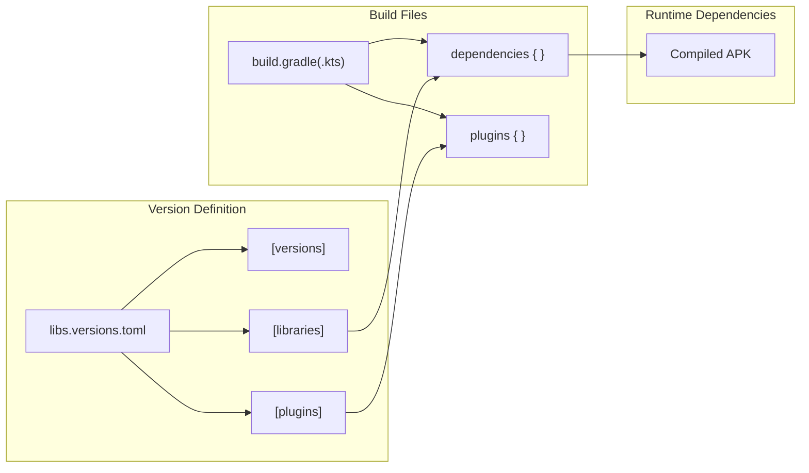

<!-- source: DeepWiki mcp.deepwiki.com · repo android/wear-os-samples · page 2 Dependency Management · fetched 2026-10-23 -->

# Dependency Management

<details>
<summary>Relevant source files</summary>

The following files were used as context for generating this wiki page:

- [Complications/gradle/libs.versions.toml](Complications/gradle/libs.versions.toml)
- [ComposeStarter/gradle/libs.versions.toml](ComposeStarter/gradle/libs.versions.toml)
- [DataLayer/gradle/libs.versions.toml](DataLayer/gradle/libs.versions.toml)
- [WatchFaceFormat/Complications/gradle/libs.versions.toml](WatchFaceFormat/Complications/gradle/libs.versions.toml)
- [WatchFaceFormat/Flavors/gradle/libs.versions.toml](WatchFaceFormat/Flavors/gradle/libs.versions.toml)
- [WatchFaceFormat/SimpleAnalog/gradle/libs.versions.toml](WatchFaceFormat/SimpleAnalog/gradle/libs.versions.toml)
- [WatchFaceFormat/SimpleDigital/gradle/libs.versions.toml](WatchFaceFormat/SimpleDigital/gradle/libs.versions.toml)
- [WatchFaceFormat/Weather/gradle/libs.versions.toml](WatchFaceFormat/Weather/gradle/libs.versions.toml)
- [WatchFaceFormat/validator-plugin/gradle/libs.versions.toml](WatchFaceFormat/validator-plugin/gradle/libs.versions.toml)
- [WatchFaceFormat/validator-plugin/plugins/build.gradle.kts](WatchFaceFormat/validator-plugin/plugins/build.gradle.kts)
- [WearOAuth/gradle/libs.versions.toml](WearOAuth/gradle/libs.versions.toml)
- [WearSpeakerSample/gradle/libs.versions.toml](WearSpeakerSample/gradle/libs.versions.toml)
- [WearTilesKotlin/gradle/libs.versions.toml](WearTilesKotlin/gradle/libs.versions.toml)
- [renovate.json](renovate.json)

</details>


This document describes how dependencies are managed across the Wear OS samples repository. It details the Gradle Version Catalog system used throughout the codebase to maintain consistent dependency versions and organize library references across multiple sample projects.

## Overview

The Wear OS samples repository implements a structured dependency management approach using Gradle Version Catalogs. Each sample project contains its own version catalog file that follows a consistent pattern while accommodating project-specific dependencies.



Sources: [WearOAuth/gradle/libs.versions.toml:1-59](), [DataLayer/gradle/libs.versions.toml:1-59](), [WearTilesKotlin/gradle/libs.versions.toml:1-35](), [renovate.json:1-46]()

## Gradle Version Catalogs

Gradle Version Catalogs provide a centralized way to declare and maintain dependencies across projects. Each sample in the repository has its own `libs.versions.toml` file, allowing for consistent versioning while accommodating project-specific needs.

### Version Catalog Structure

The version catalogs follow a standard TOML format with three main sections:

1. **Versions** - Defines the versions of libraries and plugins used in the project
2. **Libraries** - Declares the library dependencies, often referencing versions defined above
3. **Plugins** - Declares Gradle plugins with their versions

```mermaid
classDiagram
    class "libs.versions.toml" {
        [versions]
        [libraries]
        [plugins]
    }
    
    class "Versions Section" {
        android-gradle-plugin
        androidx-compose-bom
        compose-compiler
        kotlin
        horologist
        other project-specific versions
    }
    
    class "Libraries Section" {
        androidx-* libraries
        compose-* libraries
        kotlin-* libraries
        horologist-* modules
        testing libraries
        project-specific libraries
    }
    
    class "Plugins Section" {
        com-android-application
        com-diffplug-spotless
        compose-compiler
        roborazzi
    }
    
    "libs.versions.toml" --> "Versions Section"
    "libs.versions.toml" --> "Libraries Section"
    "libs.versions.toml" --> "Plugins Section"
```

Sources: [WearOAuth/gradle/libs.versions.toml:1-59](), [DataLayer/gradle/libs.versions.toml:1-59](), [ComposeStarter/gradle/libs.versions.toml:1-49]()

### Example Version Catalog

Below is an example of key sections from a typical version catalog in the repository:

```
[versions]
android-gradle-plugin = "8.10.0"
androidx-compose-bom = "2025.05.01"
compose-compiler = "1.5.15"
kotlin = "2.0.21"
horologist = "0.7.5-alpha"

[libraries]
androidx-activity-compose = { module = "androidx.activity:activity-compose", version.ref = "androidx-activity" }
androidx-compose-bom = { group = "androidx.compose", name = "compose-bom", version.ref = "androidx-compose-bom" }
horologist-compose-layout = { module = "com.google.android.horologist:horologist-compose-layout", version.ref = "horologist" }

[plugins]
com-android-application = { id = "com.android.application", version.ref = "android-gradle-plugin" }
compose-compiler = { id = "org.jetbrains.kotlin.plugin.compose", version.ref = "kotlin" }
```

Sources: [WearOAuth/gradle/libs.versions.toml:1-59]()

## Core Dependencies

The samples share a set of core dependencies that are essential for Wear OS application development:

### Android Foundation Libraries

* Android Gradle Plugin (`com.android.tools.build:gradle`)
* AndroidX Core KTX
* AndroidX Activity
* AndroidX Lifecycle components

### Compose for Wear OS

* Compose BOM (Bill of Materials)
* Wear Compose Foundation
* Wear Compose Material
* Wear Compose Navigation

### Kotlin and Coroutines

* Kotlin Gradle Plugin
* Kotlin Standard Library
* Kotlinx Coroutines (Core, Android, Play Services)

### Testing Libraries

* JUnit
* Robolectric
* Roborazzi (for screenshot testing)
* Espresso

Sources: [WearOAuth/gradle/libs.versions.toml:1-59](), [DataLayer/gradle/libs.versions.toml:1-59](), [ComposeStarter/gradle/libs.versions.toml:1-49]()

## Horologist Library Integration

Google's Horologist library is extensively used across samples. It provides specialized components for Wear OS development.



Sources: [WearSpeakerSample/gradle/libs.versions.toml:29-37](), [ComposeStarter/gradle/libs.versions.toml:29-31](), [WearTilesKotlin/gradle/libs.versions.toml:24-25]()

## Project-Specific Dependencies

While core dependencies are shared, each sample includes project-specific dependencies tailored to its functionality:

| Sample Project | Unique Dependencies | Purpose |
|----------------|---------------------|---------|
| WearTilesKotlin | `androidx.wear.tiles:tiles-material` | Tiles UI components |
|                 | `androidx.wear.tooling-preview` | Tiles preview support |
| WearSpeakerSample | `androidx.media3:media3-exoplayer` | Audio playback |
|                   | `androidx.media:media` | Media session support |
| Complications | `androidx.wear.watchface:watchface-complications-data-source-ktx` | Watch face complications |
| DataLayer | `kotlinx-coroutines-play-services` | Wearable data layer API integration |
|           | `playservices-wearable` | Google Play Services for wearables |

Sources: [WearTilesKotlin/gradle/libs.versions.toml:17-20](), [WearSpeakerSample/gradle/libs.versions.toml:24-52](), [Complications/gradle/libs.versions.toml:11-15]()

## Automated Dependency Management

The repository uses Renovate Bot to automate dependency updates, configured in the `renovate.json` file. This ensures all samples stay up-to-date with the latest library versions while respecting version constraints.

### Renovate Configuration

The Renovate configuration includes:

* Package grouping strategies
* Version constraints for specific libraries
* Update schedules
* Path-specific exclusions



Sources: [renovate.json:1-46]()

## Best Practices

When creating new Wear OS projects or adding to the existing samples, follow these dependency management practices:

1. **Use Version Catalogs**: Create a `libs.versions.toml` file for centralized dependency management
2. **Follow the Established Pattern**: Maintain the three-section structure (versions, libraries, plugins)
3. **Reference Versions**: Use `version.ref` to reference versions defined in the versions section
4. **Stay Current with Wear OS Libraries**: Include the latest Wear Compose and Horologist libraries
5. **Consider Test Dependencies**: Include appropriate test libraries for unit and UI testing

### Adding New Dependencies

To add a new dependency:

1. Add the version to the `[versions]` section (if not already present)
2. Declare the library in the `[libraries]` section using the established format
3. Reference the library in your module's `build.gradle` file using the `libs` accessor

Sources: [WearOAuth/gradle/libs.versions.toml:1-59](), [DataLayer/gradle/libs.versions.toml:1-59]()

## Simplified Dependency Model

To visualize how dependencies flow through the repository, here's a simplified model:



Sources: [WearOAuth/gradle/libs.versions.toml:1-59](), [DataLayer/gradle/libs.versions.toml:1-59](), [WatchFaceFormat/validator-plugin/plugins/build.gradle.kts:1-46]()

---

