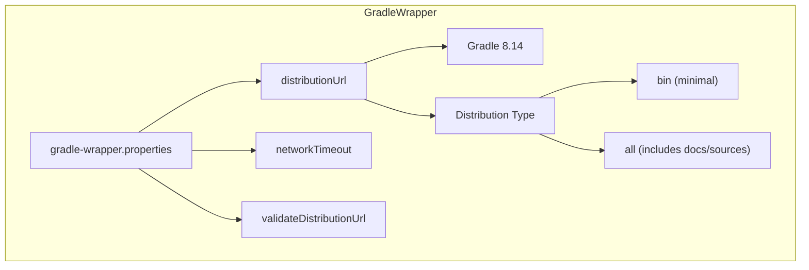
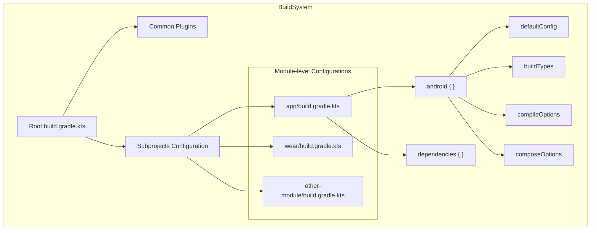
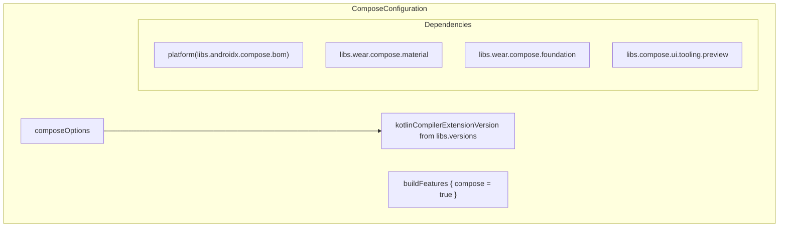
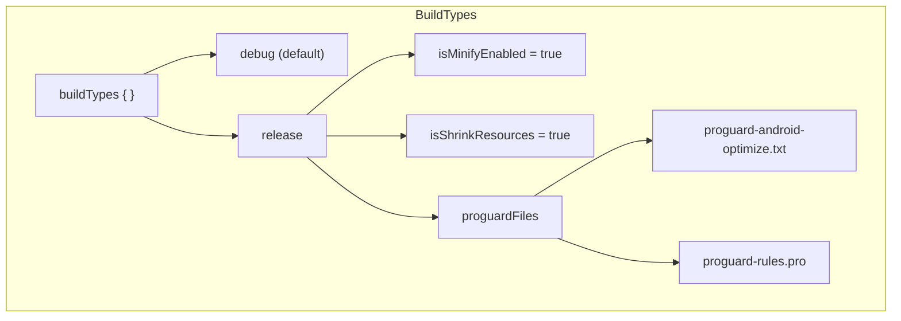
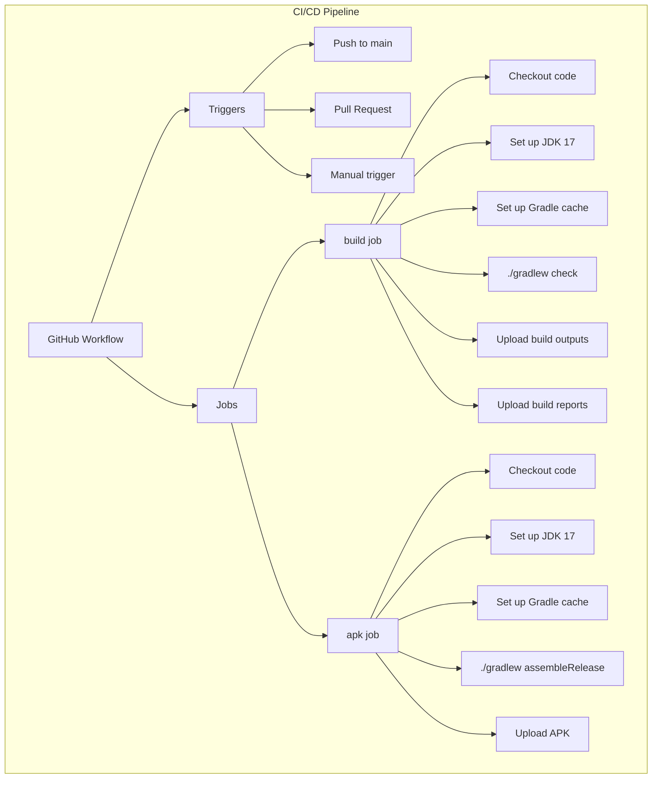
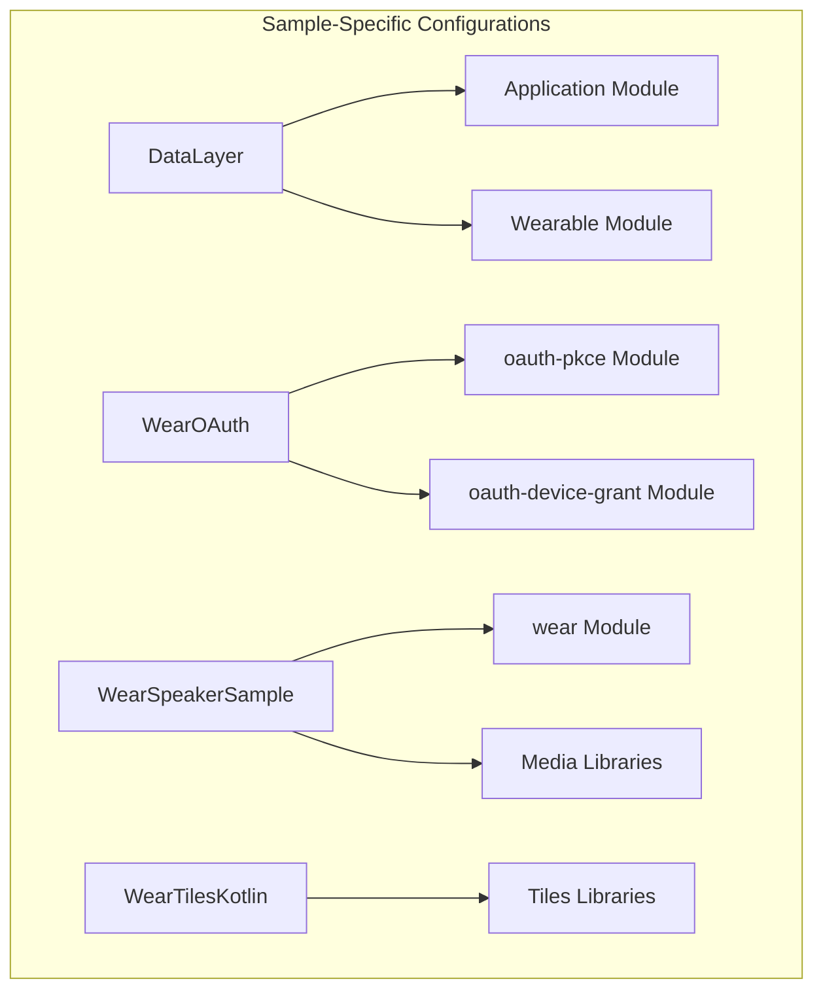

<!-- source: DeepWiki mcp.deepwiki.com · repo android/wear-os-samples · page 3 Build System · fetched 2026-10-23 -->

# Build System

<details>
<summary>Relevant source files</summary>

The following files were used as context for generating this wiki page:

- [.github/workflows/Complications.yml](.github/workflows/Complications.yml)
- [.github/workflows/ComposeStarter.yml](.github/workflows/ComposeStarter.yml)
- [.github/workflows/DataLayer.yml](.github/workflows/DataLayer.yml)
- [.github/workflows/WearOAuth.yml](.github/workflows/WearOAuth.yml)
- [.github/workflows/WearSpeakerSample.yml](.github/workflows/WearSpeakerSample.yml)
- [.github/workflows/WearTilesKotlin.yml](.github/workflows/WearTilesKotlin.yml)
- [.github/workflows/copy-branch.yml](.github/workflows/copy-branch.yml)
- [Complications/gradle/wrapper/gradle-wrapper.properties](Complications/gradle/wrapper/gradle-wrapper.properties)
- [ComposeStarter/app/build.gradle.kts](ComposeStarter/app/build.gradle.kts)
- [ComposeStarter/gradle/wrapper/gradle-wrapper.properties](ComposeStarter/gradle/wrapper/gradle-wrapper.properties)
- [DataLayer/Application/build.gradle.kts](DataLayer/Application/build.gradle.kts)
- [DataLayer/Wearable/build.gradle.kts](DataLayer/Wearable/build.gradle.kts)
- [DataLayer/Wearable/proguard-rules.pro](DataLayer/Wearable/proguard-rules.pro)
- [DataLayer/Wearable/src/main/java/com/example/android/wearable/datalayer/NodesViewModel.kt](DataLayer/Wearable/src/main/java/com/example/android/wearable/datalayer/NodesViewModel.kt)
- [DataLayer/build.gradle.kts](DataLayer/build.gradle.kts)
- [DataLayer/gradle/wrapper/gradle-wrapper.properties](DataLayer/gradle/wrapper/gradle-wrapper.properties)
- [WatchFaceFormat/Complications/gradle/wrapper/gradle-wrapper.properties](WatchFaceFormat/Complications/gradle/wrapper/gradle-wrapper.properties)
- [WatchFaceFormat/Flavors/gradle/wrapper/gradle-wrapper.properties](WatchFaceFormat/Flavors/gradle/wrapper/gradle-wrapper.properties)
- [WatchFaceFormat/SimpleAnalog/gradle/wrapper/gradle-wrapper.properties](WatchFaceFormat/SimpleAnalog/gradle/wrapper/gradle-wrapper.properties)
- [WatchFaceFormat/SimpleDigital/gradle/wrapper/gradle-wrapper.properties](WatchFaceFormat/SimpleDigital/gradle/wrapper/gradle-wrapper.properties)
- [WatchFaceFormat/Weather/gradle/wrapper/gradle-wrapper.properties](WatchFaceFormat/Weather/gradle/wrapper/gradle-wrapper.properties)
- [WearOAuth/gradle/wrapper/gradle-wrapper.properties](WearOAuth/gradle/wrapper/gradle-wrapper.properties)
- [WearSpeakerSample/gradle/wrapper/gradle-wrapper.properties](WearSpeakerSample/gradle/wrapper/gradle-wrapper.properties)
- [WearSpeakerSample/wear/build.gradle.kts](WearSpeakerSample/wear/build.gradle.kts)
- [WearTilesKotlin/gradle/wrapper/gradle-wrapper.properties](WearTilesKotlin/gradle/wrapper/gradle-wrapper.properties)

</details>


## Purpose and Scope

This document describes the Gradle build system used across all Wear OS sample projects. It covers the Gradle wrapper configuration, build settings, project structure, and continuous integration setup. For information about dependency management through version catalogs, see [Dependency Management](#2).

## Gradle Wrapper Configuration

All sample projects use the Gradle Wrapper to ensure consistent build behavior across different development environments. This standardization guarantees that all developers and CI systems use the same Gradle version.



The Gradle wrapper properties are consistent across all projects with only minor variations:

| Property | Value | Purpose |
|----------|-------|---------|
| distributionUrl | https://services.gradle.org/distributions/gradle-8.14-bin.zip or gradle-8.14-all.zip | Specifies Gradle version and distribution type |
| networkTimeout | 10000 | Network timeout in milliseconds |
| validateDistributionUrl | true | Validates wrapper distribution URL for security |

Most sample apps use the `-bin` distribution for faster downloads, while more complex samples like WearTilesKotlin and WearSpeakerSample use the `-all` distribution which includes documentation and source code.

Sources: [DataLayer/gradle/wrapper/gradle-wrapper.properties:1-8](), [WearOAuth/gradle/wrapper/gradle-wrapper.properties:1-8](), [WearSpeakerSample/gradle/wrapper/gradle-wrapper.properties:1-8](), [WearTilesKotlin/gradle/wrapper/gradle-wrapper.properties:1-8](), [ComposeStarter/gradle/wrapper/gradle-wrapper.properties:1-8]()

## Build Configuration Structure

The build system follows a consistent structure across all sample projects, with project-specific configurations defined in the respective build.gradle.kts files.



Sources: [DataLayer/build.gradle.kts:1-50](), [DataLayer/Application/build.gradle.kts:1-78](), [DataLayer/Wearable/build.gradle.kts:1-142](), [ComposeStarter/app/build.gradle.kts:1-130](), [WearSpeakerSample/wear/build.gradle.kts:1-144]()

## Common Build Settings

### Android Configuration

All sample projects share similar Android configuration settings:

| Setting | Value | Purpose |
|---------|-------|---------|
| compileSdk | 35 | Android SDK version used for compilation |
| minSdk | 26 (for Wear OS) | Minimum supported Android version |
| targetSdk | 34 | Target Android SDK version |
| compileOptions.sourceCompatibility | JavaVersion.VERSION_17 | Java source compatibility |
| compileOptions.targetCompatibility | JavaVersion.VERSION_17 | Java bytecode compatibility |
| kotlinOptions.jvmTarget | JavaVersion.VERSION_17.majorVersion | Kotlin JVM target version |

Sources: [DataLayer/Wearable/build.gradle.kts:25-57](), [ComposeStarter/app/build.gradle.kts:23-59](), [WearSpeakerSample/wear/build.gradle.kts:24-55]()

### Jetpack Compose Configuration

All Wear OS samples use Jetpack Compose for the UI, with consistent configuration:



Sources: [ComposeStarter/app/build.gradle.kts:60-67](), [DataLayer/Wearable/build.gradle.kts:66-74](), [WearSpeakerSample/wear/build.gradle.kts:63-71]()

### Build Types

All projects define both debug and release build configurations, with release builds having optimizations enabled:



The release build configuration includes:
- Minification (code shrinking)
- Resource shrinking
- ProGuard rules for optimization

Sources: [DataLayer/Wearable/build.gradle.kts:37-47](), [ComposeStarter/app/build.gradle.kts:35-44](), [WearSpeakerSample/wear/build.gradle.kts:36-45](), [DataLayer/Wearable/proguard-rules.pro:1-18]()

## Continuous Integration Pipeline

The repository uses GitHub Actions for continuous integration and delivery. Each sample has a dedicated workflow file.



The CI pipeline for each sample has a standardized structure:
1. The `build` job runs unit tests and lint checks using `./gradlew check`
2. The `apk` job builds the release APK using `./gradlew assembleRelease`
3. Both jobs cache Gradle dependencies for faster builds
4. Build outputs and reports are uploaded as GitHub Actions artifacts

Sources: [.github/workflows/ComposeStarter.yml:1-94](), [.github/workflows/WearTilesKotlin.yml:1-54](), [.github/workflows/WearSpeakerSample.yml:1-92](), [.github/workflows/DataLayer.yml:1-95](), [.github/workflows/WearOAuth.yml:1-62]()

## Sample-Specific Build Configurations

While the basic build structure is consistent, each sample has specific configurations based on its functionality:



### Module Structure Variations

| Sample | Structure | Purpose |
|--------|-----------|---------|
| DataLayer | Application & Wearable modules | Shows communication between phone and watch |
| WearOAuth | oauth-pkce & oauth-device-grant modules | Demonstrates different authentication flows |
| ComposeStarter | Single app module | Basic Compose UI for Wear OS |
| WearSpeakerSample | Single wear module | Audio functionality on Wear OS |
| WearTilesKotlin | Single app module | Tiles implementation for Wear OS |

Sources: [DataLayer/Application/build.gradle.kts:1-78](), [DataLayer/Wearable/build.gradle.kts:1-142](), [ComposeStarter/app/build.gradle.kts:1-130](), [WearSpeakerSample/wear/build.gradle.kts:1-144](), [.github/workflows/WearOAuth.yml:47-62]()

## Common Gradle Tasks

### Essential Commands

| Command | Purpose |
|---------|---------|
| `./gradlew check` | Runs all verification tasks (tests, lint) |
| `./gradlew app:assembleDebug` | Builds debug APK for the app module |
| `./gradlew app:assembleRelease` | Builds release APK for the app module |
| `./gradlew wear:assembleRelease` | Builds release APK for the wear module |
| `./gradlew clean` | Cleans the build directory |

Sources: [.github/workflows/ComposeStarter.yml:44-45](), [.github/workflows/ComposeStarter.yml:87-88](), [.github/workflows/WearSpeakerSample.yml:45](), [.github/workflows/WearSpeakerSample.yml:86](), [.github/workflows/DataLayer.yml:45]()

## Packaging Configuration

All sample applications include specific packaging configurations to exclude unnecessary files and optimize the APK size:

```
packaging {
    resources {
        excludes += "/META-INF/{AL2.0,LGPL2.1}"
    }
}
```

This configuration excludes license files from META-INF to reduce APK size.

Sources: [DataLayer/Wearable/build.gradle.kts:76-80](), [ComposeStarter/app/build.gradle.kts:68-72](), [WearSpeakerSample/wear/build.gradle.kts:73-77]()

## Java Desugaring

All projects enable core library desugaring to support newer Java APIs on older Android versions:

```
compileOptions {
    isCoreLibraryDesugaringEnabled = true
}

dependencies {
    coreLibraryDesugaring(libs.desugar.jdk.libs)
}
```

This allows using newer Java APIs like java.time while maintaining compatibility with older Android versions.

Sources: [DataLayer/Wearable/build.gradle.kts:49-53](), [ComposeStarter/app/build.gradle.kts:47-51](), [WearSpeakerSample/wear/build.gradle.kts:46-50](), [DataLayer/Wearable/build.gradle.kts:117](), [ComposeStarter/app/build.gradle.kts:110](), [WearSpeakerSample/wear/build.gradle.kts:99]()

---

