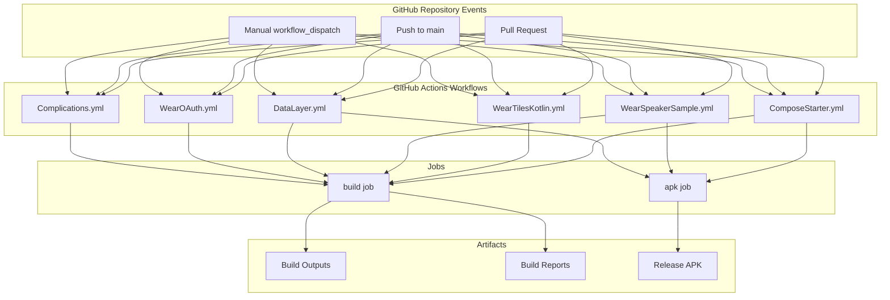
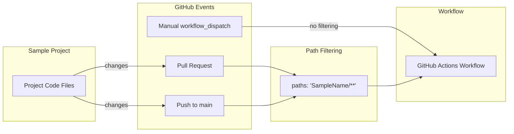
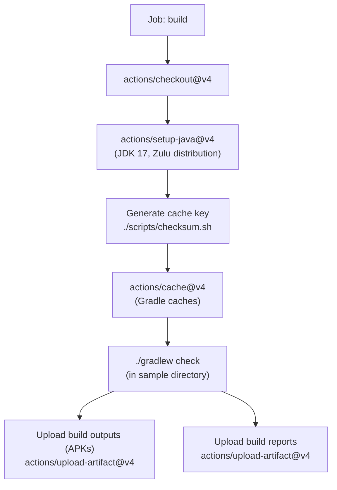
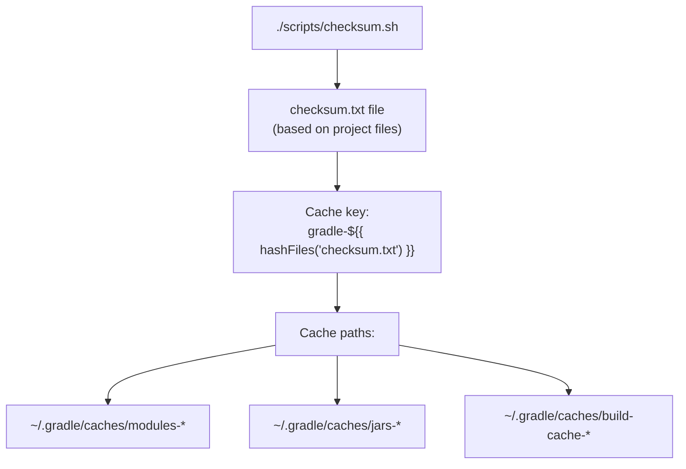
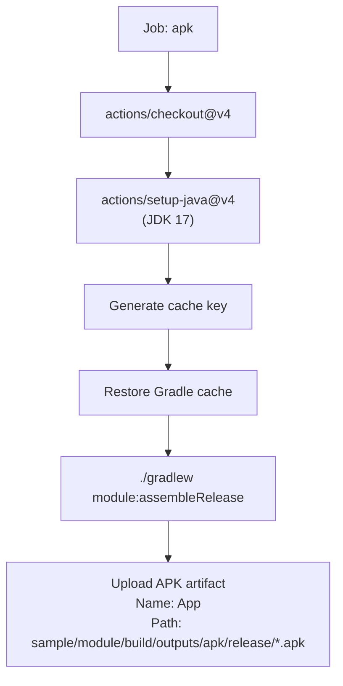
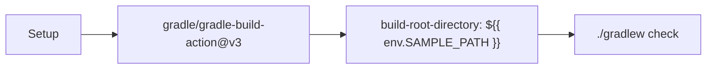
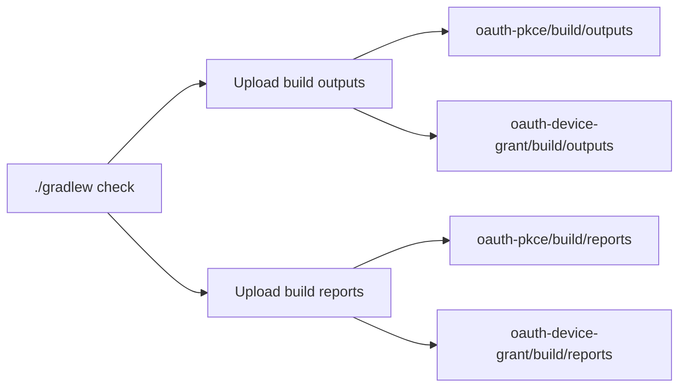
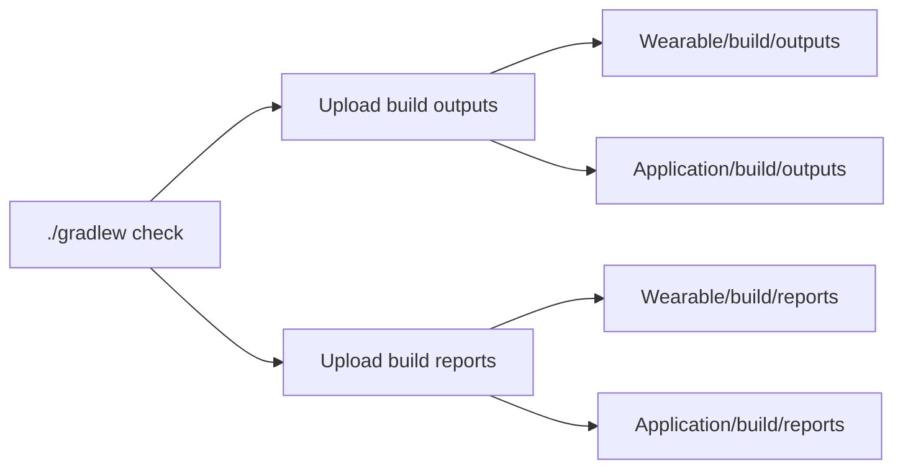
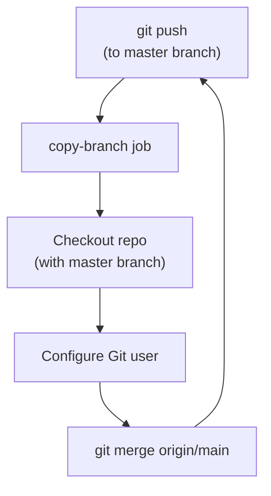

<!-- source: DeepWiki mcp.deepwiki.com · repo android/wear-os-samples · page 4 CI/CD Pipeline · fetched 2026-10-23 -->

# CI/CD Pipeline

<details>
<summary>Relevant source files</summary>

The following files were used as context for generating this wiki page:

- [.github/workflows/Complications.yml](.github/workflows/Complications.yml)
- [.github/workflows/ComposeStarter.yml](.github/workflows/ComposeStarter.yml)
- [.github/workflows/DataLayer.yml](.github/workflows/DataLayer.yml)
- [.github/workflows/WearOAuth.yml](.github/workflows/WearOAuth.yml)
- [.github/workflows/WearSpeakerSample.yml](.github/workflows/WearSpeakerSample.yml)
- [.github/workflows/WearTilesKotlin.yml](.github/workflows/WearTilesKotlin.yml)
- [.github/workflows/copy-branch.yml](.github/workflows/copy-branch.yml)

</details>


This document describes the Continuous Integration and Continuous Delivery (CI/CD) pipeline implemented for the Wear OS Samples repository. The pipeline ensures that all sample applications build correctly, pass tests, and generate usable artifacts. For information about the build system configuration itself, see [Build System](#3).

## Pipeline Overview

The Wear OS Samples repository uses GitHub Actions to implement CI/CD workflows for each sample project. These workflows automatically build and test sample applications whenever relevant code changes are made.



Sources:
- `.github/workflows/ComposeStarter.yml`
- `.github/workflows/WearTilesKotlin.yml`
- `.github/workflows/WearSpeakerSample.yml`
- `.github/workflows/DataLayer.yml`
- `.github/workflows/WearOAuth.yml`
- `.github/workflows/Complications.yml`

## Workflow Files and Structure

Each sample project has a dedicated workflow file in the `.github/workflows` directory. These files define when and how the CI/CD pipeline runs for each sample.

### Workflow Triggers

Each workflow is triggered by:

1. **Push to main branch** - Only when files in the corresponding sample directory are modified
2. **Pull request** - Only when files in the corresponding sample directory are modified
3. **Manual dispatch** - Can be manually triggered through the GitHub Actions interface



Sources:
- `.github/workflows/ComposeStarter.yml:3-12`
- `.github/workflows/WearTilesKotlin.yml:3-14`
- `.github/workflows/WearSpeakerSample.yml:3-12`
- `.github/workflows/DataLayer.yml:3-12`

## Build Job

The primary job in each workflow is the `build` job, which builds and tests the sample application.



Sources:
- `.github/workflows/ComposeStarter.yml:18-60`
- `.github/workflows/WearSpeakerSample.yml:18-58`
- `.github/workflows/DataLayer.yml:18-62`

### Environment Setup

Each workflow sets an environment variable `SAMPLE_PATH` to specify the sample project directory:

```
env:
  SAMPLE_PATH: SampleName
```

This variable is used throughout the workflow to reference the correct project directory.

Sources:
- `.github/workflows/ComposeStarter.yml:14-15`
- `.github/workflows/WearTilesKotlin.yml:16-17`
- `.github/workflows/WearSpeakerSample.yml:14-15`
- `.github/workflows/DataLayer.yml:14-15`

### Gradle Caching

To optimize build performance, the workflows implement a caching strategy for Gradle dependencies:



Sources:
- `.github/workflows/ComposeStarter.yml:32-41`
- `.github/workflows/WearSpeakerSample.yml:32-41`
- `.github/workflows/DataLayer.yml:32-41`

## APK Job

Many workflows include a dedicated `apk` job that specifically builds release APKs:



Sources:
- `.github/workflows/ComposeStarter.yml:62-94`
- `.github/workflows/WearSpeakerSample.yml:60-92`
- `.github/workflows/DataLayer.yml:63-95`

The exact command varies by project:
- ComposeStarter: `./gradlew app:assembleRelease`
- WearSpeakerSample: `./gradlew wear:assembleRelease`
- DataLayer: `./gradlew app:assembleRelease`

## Project-Specific Workflow Variations

While the workflows follow a common structure, there are variations for specific projects:

### WearTilesKotlin

The WearTilesKotlin workflow uses `gradle/gradle-build-action@v3` instead of the manual caching approach:



Sources:
- `.github/workflows/WearTilesKotlin.yml:34-41`

### WearOAuth

The WearOAuth workflow handles multiple modules and uploads artifacts from both:



Sources:
- `.github/workflows/WearOAuth.yml:47-62`

### DataLayer

The DataLayer workflow uploads artifacts from both the wearable and mobile application modules:



Sources:
- `.github/workflows/DataLayer.yml:47-61`

## Branch Management Workflow

A special workflow exists to duplicate the `main` branch to the legacy `master` branch:



Sources:
- `.github/workflows/copy-branch.yml`

This ensures backward compatibility for scripts or documentation that might still reference the `master` branch.

## Artifact Management

The workflows upload two types of artifacts:

1. **Build outputs (APKs)** - Debug APKs and related build outputs
2. **Build reports** - Test results, lint reports, and other build diagnostics

In addition, the `apk` job uploads a release APK with the artifact name "App".

Sources:
- `.github/workflows/ComposeStarter.yml:47-60`
- `.github/workflows/ComposeStarter.yml:90-94`
- `.github/workflows/WearSpeakerSample.yml:47-58`
- `.github/workflows/WearSpeakerSample.yml:88-92`

## Summary of Workflow Jobs and Artifacts

| Sample Project | Workflow File | Build Job | APK Job | Artifacts |
|----------------|---------------|-----------|---------|-----------|
| ComposeStarter | ComposeStarter.yml | ✓ | ✓ | - app/build/outputs<br>- app/build/reports<br>- App (release APK) |
| WearTilesKotlin | WearTilesKotlin.yml | ✓ | ✗ | - app/build/outputs<br>- app/build/reports |
| WearSpeakerSample | WearSpeakerSample.yml | ✓ | ✓ | - wear/build/outputs<br>- wear/build/reports<br>- App (release APK) |
| DataLayer | DataLayer.yml | ✓ | ✓ | - Wearable/build/outputs<br>- Application/build/outputs<br>- build reports<br>- App (release APK) |
| WearOAuth | WearOAuth.yml | ✓ | ✗ | - oauth-pkce/build/outputs<br>- oauth-device-grant/build/outputs<br>- build reports |
| Complications | Complications.yml | ✓ | ✗ | - Wearable/build/outputs<br>- Wearable/build/reports |

Sources:
- `.github/workflows/ComposeStarter.yml`
- `.github/workflows/WearTilesKotlin.yml`
- `.github/workflows/WearSpeakerSample.yml`
- `.github/workflows/DataLayer.yml`
- `.github/workflows/WearOAuth.yml`
- `.github/workflows/Complications.yml`

---

