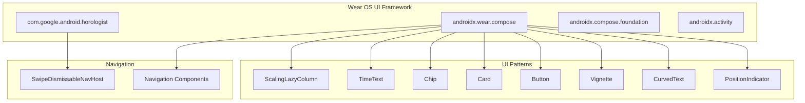
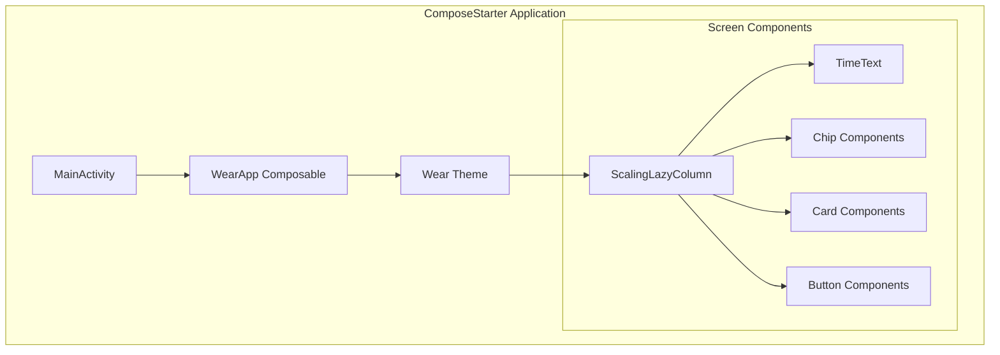
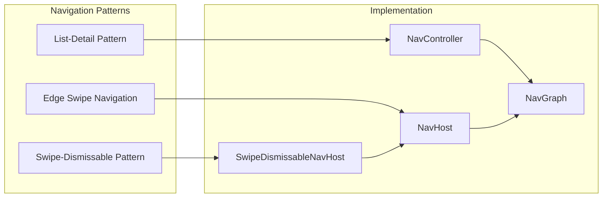
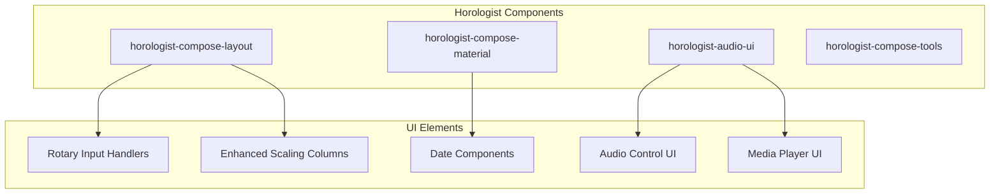
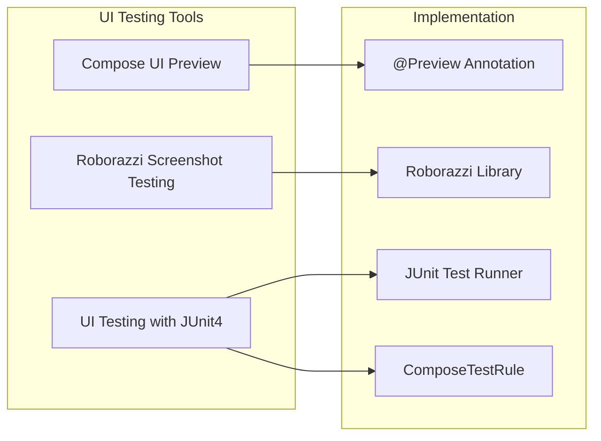

<!-- source: DeepWiki mcp.deepwiki.com · repo android/wear-os-samples · page 5 UI Development · fetched 2026-10-23 -->

# UI Development

<details>
<summary>Relevant source files</summary>

The following files were used as context for generating this wiki page:

- [ComposeStarter/gradle/libs.versions.toml](ComposeStarter/gradle/libs.versions.toml)
- [DataLayer/README.md](DataLayer/README.md)
- [DataLayer/gradle/libs.versions.toml](DataLayer/gradle/libs.versions.toml)
- [README.md](README.md)
- [WearOAuth/gradle/libs.versions.toml](WearOAuth/gradle/libs.versions.toml)
- [WearSpeakerSample/README.md](WearSpeakerSample/README.md)
- [WearSpeakerSample/gradle/libs.versions.toml](WearSpeakerSample/gradle/libs.versions.toml)
- [WearTilesKotlin/gradle/libs.versions.toml](WearTilesKotlin/gradle/libs.versions.toml)

</details>


This document provides a comprehensive overview of UI development patterns and practices for Wear OS applications using the samples in this repository. It covers the fundamental building blocks, architecture, and Jetpack Compose components specially designed for wearable devices.

For information about communication between watch and phone apps, see [Data Layer Communication](#6).

## Overview of Wear OS UI Development

Wear OS UI development requires specific considerations for the small form factor, round displays, and unique interaction patterns of wearable devices. The samples in this repository demonstrate modern UI development approaches using Jetpack Compose, Google's recommended toolkit for building native UIs on Wear OS.



Sources: 
- [ComposeStarter/gradle/libs.versions.toml:1-48]()
- [WearSpeakerSample/gradle/libs.versions.toml:1-58]()
- [README.md:1-26]()

## Key Wear OS UI Libraries

The samples utilize several key libraries for Wear OS UI development:

| Library | Purpose | Version* |
|---------|---------|----------|
| `androidx.wear.compose:compose-foundation` | Core Wear OS Compose components | 1.4.1 |
| `androidx.wear.compose:compose-material` | Material Design components for Wear | 1.4.1 |
| `androidx.wear.compose:compose-navigation` | Navigation components for Wear | 1.4.1 |
| `com.google.android.horologist:horologist-compose-layout` | Extended layout components | 0.7.5-alpha |
| `com.google.android.horologist:horologist-compose-material` | Additional material components | 0.7.5-alpha |
| `androidx.activity:activity-compose` | Integration with Activity | 1.10.1 |

*_Version numbers reflect those used in the latest samples as of documentation writing_

Sources:
- [ComposeStarter/gradle/libs.versions.toml:1-48]()
- [DataLayer/gradle/libs.versions.toml:1-58]()
- [WearOAuth/gradle/libs.versions.toml:1-59]()

## Wear OS Compose Architecture

Wear OS Compose builds upon standard Jetpack Compose with specialized components and patterns for wearable devices.

```mermaid
classDiagram
    class "Activity" {
        onCreate()
        setContent()
    }
    
    class "ComposeApp" {
        WearApp()
        AppTheme()
    }
    
    class "WearMaterialTheme" {
        colors
        typography
        shapes
    }
    
    class "Scaffold" {
        timeText
        vignette
        positionIndicator
    }
    
    class "ScalingLazyColumn" {
        Items
        item()
        items()
    }
    
    class "WearComponents" {
        Chip()
        Card()
        Button()
        ToggleChip()
    }
    
    "Activity" --> "ComposeApp" : hosts
    "ComposeApp" --> "WearMaterialTheme" : applies
    "ComposeApp" --> "Scaffold" : uses
    "Scaffold" --> "ScalingLazyColumn" : contains
    "ScalingLazyColumn" --> "WearComponents" : displays
```

Sources:
- [ComposeStarter/gradle/libs.versions.toml:1-48]()
- [WearSpeakerSample/gradle/libs.versions.toml:1-58]()

## Getting Started with ComposeStarter

The ComposeStarter sample provides a minimal starting point for developing Compose-based Wear OS applications. It demonstrates the fundamental components and patterns for Wear OS UI development.

Key components of the ComposeStarter sample:

1. **Wear Material Theme**: Customized for the dark background of watch faces
2. **ScalingLazyColumn**: The primary scrolling container for watch UIs
3. **Wear-specific Components**: Including Chips, Cards, and specialized Button styles
4. **Time Text**: Shows the current time at the top of the screen



Sources:
- [ComposeStarter/gradle/libs.versions.toml:1-48]()
- [README.md:12]()

## UI Patterns for Wear OS

Wear OS UI patterns are designed to accommodate the unique constraints and capabilities of wearable devices. The samples demonstrate the following key patterns:

### Layout Patterns

1. **Curved Layout**: Text and elements that follow the curve of a round display
2. **Center Focus**: Critical information and controls in the center of the display
3. **Minimal Content**: Reducing information density for small screens
4. **Progressive Disclosure**: Revealing additional information through scrolling or navigation

### Navigation Patterns

1. **Swipe-Dismissable**: Navigation components that can be dismissed with edge swipes
2. **Edge-to-Edge**: UI components that extend to the full screen edges
3. **List-Detail**: Primary lists that navigate to detail screens



Sources:
- [ComposeStarter/gradle/libs.versions.toml:39-42]()
- [WearSpeakerSample/gradle/libs.versions.toml:45-48]()

## Horologist Library Integration

The [Horologist](https://github.com/google/horologist) library provides additional components and utilities specifically designed for Wear OS development. The samples in this repository extensively use Horologist for enhanced UI development.

Key Horologist UI components used in the samples:

1. **Layout Components**: Additional layout options beyond the standard Wear Compose components
2. **Material Extensions**: Enhanced material components optimized for watches
3. **Audio UI Components**: Specialized controls for audio applications (used in WearSpeakerSample)
4. **Testing Utilities**: Tools for testing and validating Wear OS UI



Sources:
- [WearSpeakerSample/gradle/libs.versions.toml:29-37]()
- [ComposeStarter/gradle/libs.versions.toml:29-30]()
- [DataLayer/gradle/libs.versions.toml:41-42]()

## Testing and Previewing Wear OS UI

The samples demonstrate approaches for testing and validating Wear OS UI components:

1. **Compose Previews**: Using tooling preview annotations to visualize UI components
2. **Roborazzi**: Screenshot testing for UI validation
3. **UI Tests**: JUnit4-based UI testing specific to Wear OS



Sources:
- [ComposeStarter/gradle/libs.versions.toml:25-27]()
- [ComposeStarter/gradle/libs.versions.toml:35-37]()
- [DataLayer/gradle/libs.versions.toml:47-50]()

## Additional Resources

For more specialized UI patterns, refer to the following sample applications in the repository:

1. **WearSpeakerSample**: Advanced UI patterns for audio recording and playback
2. **DataLayer**: UI components that interact with data from a paired phone
3. **WearTilesKotlin**: Examples of building Tiles, which are glanceable UI components

For specialized tile development, see [Tiles](#7).

Sources:
- [README.md:12-25]()
- [WearSpeakerSample/README.md:1-36]()
- [DataLayer/README.md:1-117]()

---

