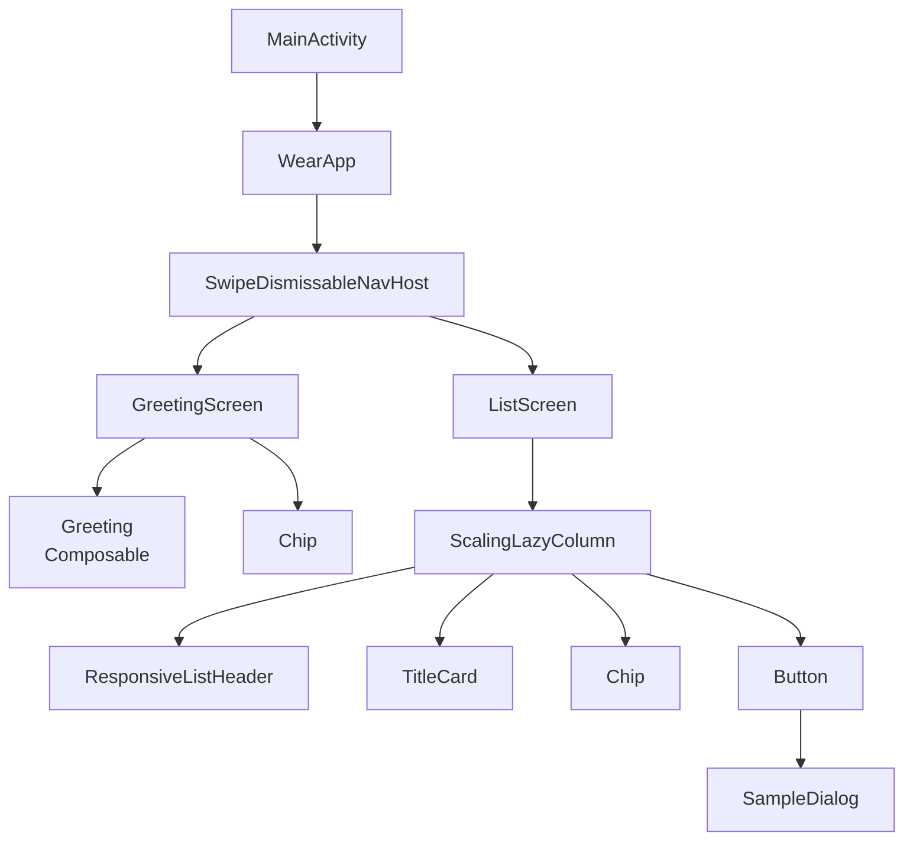
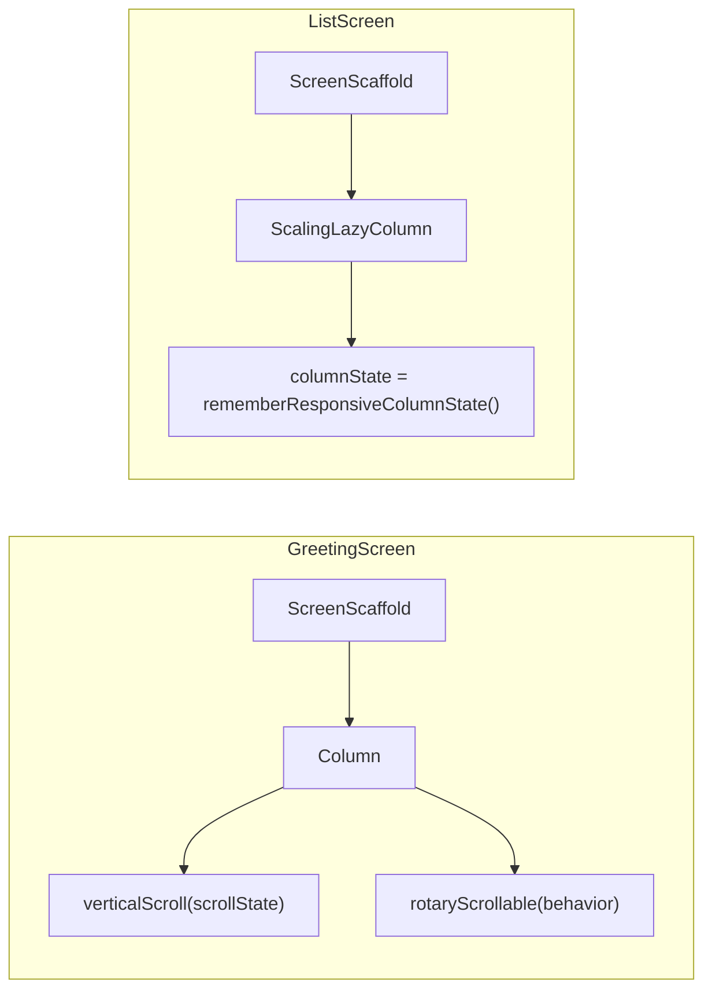

<!-- source: DeepWiki mcp.deepwiki.com · repo android/wear-os-samples · page 5.1 ComposeStarter · fetched 2026-10-23 -->

# ComposeStarter

<details>
<summary>Relevant source files</summary>

The following files were used as context for generating this wiki page:

- [ComposeStarter/.google/packaging.yaml](ComposeStarter/.google/packaging.yaml)
- [ComposeStarter/README.md](ComposeStarter/README.md)
- [ComposeStarter/app/src/main/java/com/example/android/wearable/composestarter/presentation/MainActivity.kt](ComposeStarter/app/src/main/java/com/example/android/wearable/composestarter/presentation/MainActivity.kt)
- [ComposeStarter/gradle/libs.versions.toml](ComposeStarter/gradle/libs.versions.toml)
- [DataLayer/gradle/libs.versions.toml](DataLayer/gradle/libs.versions.toml)
- [WearOAuth/gradle/libs.versions.toml](WearOAuth/gradle/libs.versions.toml)
- [WearSpeakerSample/gradle/libs.versions.toml](WearSpeakerSample/gradle/libs.versions.toml)
- [WearTilesKotlin/gradle/libs.versions.toml](WearTilesKotlin/gradle/libs.versions.toml)

</details>


## Purpose and Scope

The ComposeStarter sample demonstrates a minimalist "Hello, World" application that serves as a starting point for developing Wear OS applications using Jetpack Compose. This document covers the structure, components, and techniques used in the ComposeStarter sample, focusing on the basic implementation patterns for Wear OS UI development with Compose.

For more comprehensive UI patterns and advanced components, see the ComposeAdvanced sample documentation.

Sources: [ComposeStarter/README.md:1-14](), [ComposeStarter/app/src/main/java/com/example/android/wearable/composestarter/presentation/MainActivity.kt:68-78]()

## Architecture Overview

ComposeStarter implements a simple two-screen application with navigation between screens using Wear's SwipeDismissableNavHost component. The app demonstrates essential Wear OS UI patterns while keeping the implementation straightforward.

### Application Structure



Sources: [ComposeStarter/app/src/main/java/com/example/android/wearable/composestarter/presentation/MainActivity.kt:89-107]()

### Navigation Flow

```mermaid
stateDiagram-v2
    [*] --> "Menu\n(GreetingScreen)"
    "Menu\n(GreetingScreen)" --> "List\n(ListScreen)": "Show List Chip"
    "List\n(ListScreen)" --> "Dialog": "Button Click"
    "List\n(ListScreen)" --> "Menu\n(GreetingScreen)": "Swipe to dismiss"
    "Dialog" --> "List\n(ListScreen)": "OK or Cancel"
```

Sources: [ComposeStarter/app/src/main/java/com/example/android/wearable/composestarter/presentation/MainActivity.kt:95-105](), [ComposeStarter/app/src/main/java/com/example/android/wearable/composestarter/presentation/MainActivity.kt:187-193]()

## Key Components

### MainActivity

The entry point of the application. It sets up the WearApp composable as the root content.

```kotlin
class MainActivity : ComponentActivity() {
    override fun onCreate(savedInstanceState: Bundle?) {
        super.onCreate(savedInstanceState)
        setContent {
            WearApp()
        }
    }
}
```

Sources: [ComposeStarter/app/src/main/java/com/example/android/wearable/composestarter/presentation/MainActivity.kt:79-87]()

### WearApp

The root composable that sets up the app theme and navigation structure. It uses:

- `WearAppTheme`: Theme adapted for Wear OS
- `AppScaffold`: From Horologist, provides a container for the app
- `SwipeDismissableNavHost`: Handles navigation with swipe-to-dismiss gesture support

Sources: [ComposeStarter/app/src/main/java/com/example/android/wearable/composestarter/presentation/MainActivity.kt:89-108]()

### GreetingScreen

The main screen that displays a greeting message and a button to navigate to the list screen. Key features include:

- Vertical scrolling with rotary input support
- Centered layout with proper Wear OS padding
- Use of `Chip` component for navigation

Sources: [ComposeStarter/app/src/main/java/com/example/android/wearable/composestarter/presentation/MainActivity.kt:110-138]()

### ListScreen

Demonstrates a scrollable list using Horologist's `ScalingLazyColumn`, which is optimized for Wear OS. Contains:

- `ResponsiveListHeader`: Properly styled list header
- `TitleCard`: Card component with title and content
- `Chip`: Interactive button with text
- `Button`: Icon button that opens a dialog
- Dialog handling

Sources: [ComposeStarter/app/src/main/java/com/example/android/wearable/composestarter/presentation/MainActivity.kt:140-193]()

## UI Implementation Details

### Scroll State Management

ComposeStarter demonstrates two approaches to scroll state management:

1. Basic scroll state with `rememberScrollState()` and `verticalScroll` modifier (GreetingScreen)
2. Horologist's `ScalingLazyColumn` with `rememberResponsiveColumnState()` (ListScreen)

Both approaches properly implement rotary input support, which is essential for Wear OS devices with hardware dials.



Sources: [ComposeStarter/app/src/main/java/com/example/android/wearable/composestarter/presentation/MainActivity.kt:112-137](), [ComposeStarter/app/src/main/java/com/example/android/wearable/composestarter/presentation/MainActivity.kt:147-184]()

### Padding and Spacing

The sample demonstrates proper padding practices for Wear OS:

- Using `ScalingLazyColumnDefaults.padding()` to apply appropriate spacing
- Specifying the first and last item types to ensure correct padding
- Using `firstItemPadding()` for the first list header

These techniques ensure that content is properly spaced on the small screen of a wearable device.

Sources: [ComposeStarter/app/src/main/java/com/example/android/wearable/composestarter/presentation/MainActivity.kt:119-122](), [ComposeStarter/app/src/main/java/com/example/android/wearable/composestarter/presentation/MainActivity.kt:148-153]()

### Dialog Implementation

The dialog implementation demonstrates a pattern for displaying alerts on Wear OS:

- Uses Wear's `Dialog` composable
- Implements cancellation and confirmation actions
- Properly handles state management for showing/hiding

Sources: [ComposeStarter/app/src/main/java/com/example/android/wearable/composestarter/presentation/MainActivity.kt:207-247]()

## Preview and Testing Support

### Preview Annotations

The sample uses specialized preview annotations for Wear OS:

- `@WearPreviewDevices`: Generates previews for multiple watch shapes and sizes
- `@WearPreviewFontScales`: Shows previews with different font scale settings

These annotations help developers visualize how their UI will look across different devices and accessibility settings.

Sources: [ComposeStarter/app/src/main/java/com/example/android/wearable/composestarter/presentation/MainActivity.kt:249-261](), [ComposeStarter/README.md:30-34]()

### Screenshot Testing

The sample includes screenshot testing capabilities using Roborazzi:

- Generate reference images with `./gradlew recordRoborazziDebug`
- Verify UI against reference images with `./gradlew verifyRoborazziDebug`
- Tests for multiple device configurations

This testing approach helps ensure UI consistency across different devices and during refactoring.

Sources: [ComposeStarter/README.md:35-41]()

## Key Dependencies

The ComposeStarter sample relies on several important libraries:

| Library | Purpose | Version |
|---------|---------|---------|
| androidx.wear.compose | Core Wear OS Compose components | 1.4.1 |
| androidx.activity-compose | Compose integration with Activity | 1.10.1 |
| horologist-compose-layout | Specialized layouts for Wear OS | 0.7.5-alpha |
| wear-compose-navigation | Navigation for Wear OS | 1.4.1 |
| wear-compose-foundation | Foundation components for Wear OS | 1.4.1 |
| wear-compose-material | Material Design components for Wear OS | 1.4.1 |

The dependencies are managed through Gradle Version Catalog in `libs.versions.toml`.

Sources: [ComposeStarter/gradle/libs.versions.toml:1-49]()

## Best Practices Demonstrated

1. **Proper Navigation**: Uses SwipeDismissableNavHost for navigation with swipe-to-dismiss support
2. **Rotary Input Support**: Implements proper rotary input scrolling support
3. **Responsive Layout**: Adapts to different screen sizes and shapes
4. **Optimized Components**: Uses Wear OS optimized composables like ScalingLazyColumn
5. **Proper Padding**: Applies appropriate spacing for the small screen context
6. **Testing for Different Devices**: Includes previews and tests for multiple device configurations

Sources: [ComposeStarter/app/src/main/java/com/example/android/wearable/composestarter/presentation/MainActivity.kt:16-262](), [ComposeStarter/README.md:28-41]()

---

