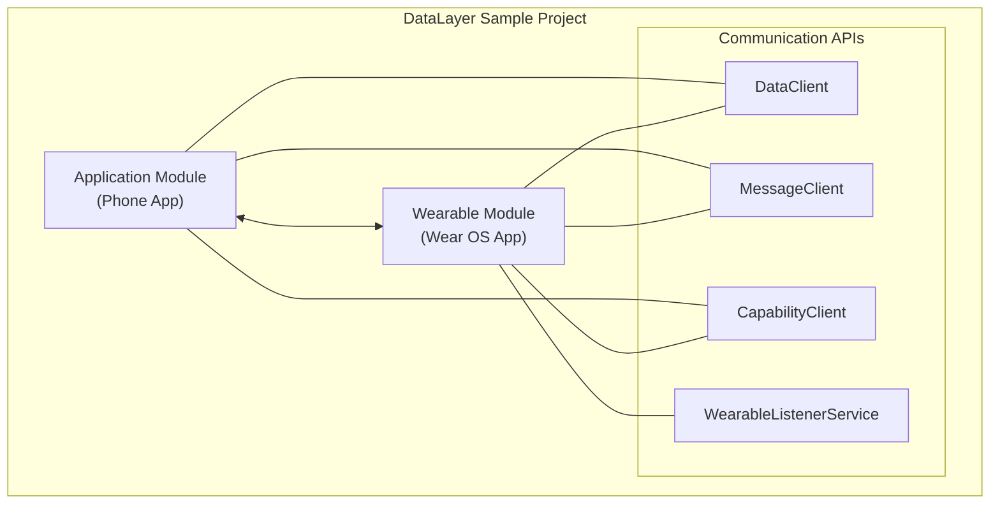
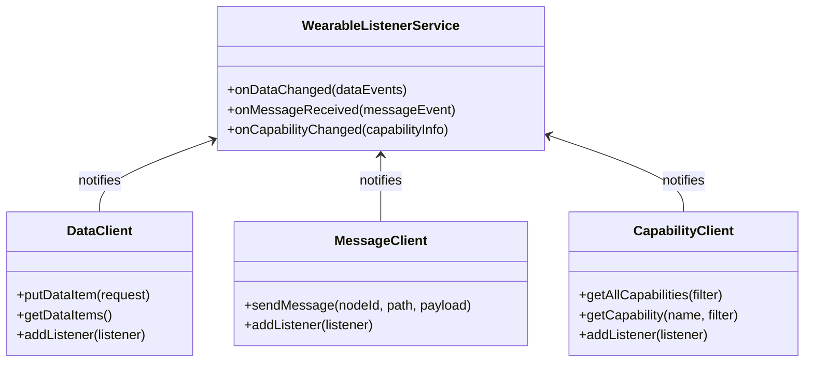
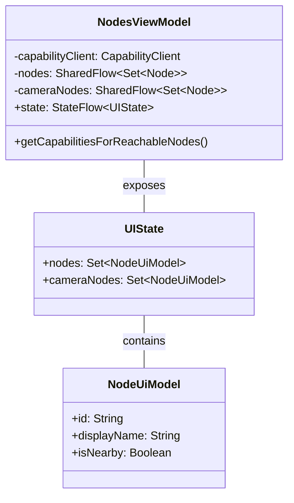
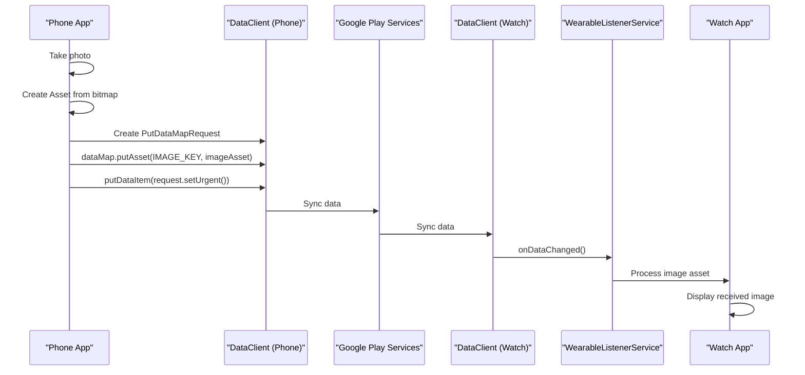
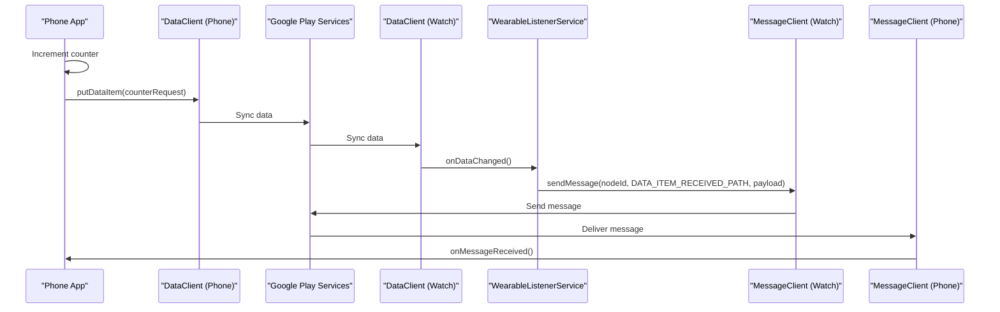
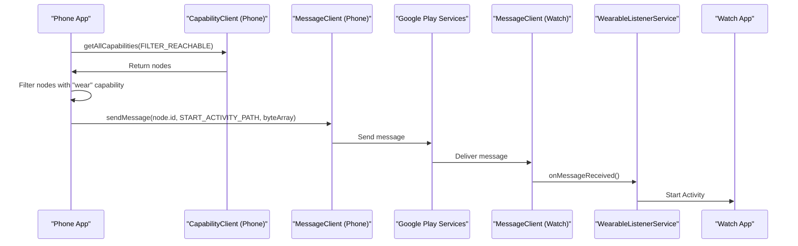

<!-- source: DeepWiki mcp.deepwiki.com · repo android/wear-os-samples · page 6 Data Layer Communication · fetched 2026-10-23 -->

# Data Layer Communication

<details>
<summary>Relevant source files</summary>

The following files were used as context for generating this wiki page:

- [ComposeStarter/app/build.gradle.kts](ComposeStarter/app/build.gradle.kts)
- [DataLayer/Application/build.gradle.kts](DataLayer/Application/build.gradle.kts)
- [DataLayer/README.md](DataLayer/README.md)
- [DataLayer/Wearable/build.gradle.kts](DataLayer/Wearable/build.gradle.kts)
- [DataLayer/Wearable/proguard-rules.pro](DataLayer/Wearable/proguard-rules.pro)
- [DataLayer/Wearable/src/main/java/com/example/android/wearable/datalayer/NodesViewModel.kt](DataLayer/Wearable/src/main/java/com/example/android/wearable/datalayer/NodesViewModel.kt)
- [DataLayer/build.gradle.kts](DataLayer/build.gradle.kts)
- [README.md](README.md)
- [WearSpeakerSample/README.md](WearSpeakerSample/README.md)
- [WearSpeakerSample/wear/build.gradle.kts](WearSpeakerSample/wear/build.gradle.kts)

</details>


## Purpose and Scope

This document details the implementation of communication between a Wear OS device and a paired phone using the Wearable Data Layer API in the DataLayer sample. It demonstrates how to establish bi-directional communication channels that allow data, messages, and capabilities to be exchanged between devices. For information about UI development with Compose in Wear OS, see [UI Development](#5).

## Overview

The DataLayer sample showcases three key communication patterns:

1. Sending data assets (images) from the phone to the watch
2. Exchanging data items with acknowledgment messages
3. Launching the Wear app remotely from the phone

Sources:
- [README.md:12-14]()
- [DataLayer/README.md:5-9]()

## Architecture

The DataLayer sample is structured with two primary modules:



Both modules share a common applicationId to ensure they can discover each other through the capabilities API. The communication happens through Google Play Services' Wearable APIs.

Sources:
- [DataLayer/Application/build.gradle.kts:28-31]()
- [DataLayer/Wearable/build.gradle.kts:28-31]()
- [DataLayer/README.md:1-9]()

## Key Components

### Wearable API Clients

The sample uses three main clients from the Wearable API:



These clients handle different aspects of wearable communication:
- **DataClient**: Syncs data between devices (persisted)
- **MessageClient**: Sends transient messages between devices
- **CapabilityClient**: Discovers capabilities of connected devices

Sources:
- [DataLayer/README.md:2-9]()
- [DataLayer/README.md:77-84]()

### NodesViewModel

The `NodesViewModel` manages discovery of connected devices and their capabilities:



The ViewModel queries the CapabilityClient to discover reachable nodes and their capabilities, filtering them based on whether they have the "mobile" or "wear" capability.

Sources:
- [DataLayer/Wearable/src/main/java/com/example/android/wearable/datalayer/NodesViewModel.kt:37-132]()

## Communication Patterns

### 1. Sending Data Assets

This pattern demonstrates sending an image from the phone to the watch:



The image is converted to a `DataAsset` and placed in a `PutDataMapRequest`, then sent through the DataClient.

Sources:
- [DataLayer/README.md:18-29]()

### 2. Data Items with Acknowledgments

This pattern shows a counter being incremented on the phone and acknowledged by the watch:



The watch sends an acknowledgment message back to the phone after receiving the data item.

Sources:
- [DataLayer/README.md:33-44]()

### 3. Remote App Launch

This pattern demonstrates launching the Wear app from the phone:



The phone app checks for connected nodes with specific capabilities before sending a message to launch the Wear app.

Sources:
- [DataLayer/README.md:46-64]()

## Implementation Considerations

### Required Dependencies

Both the phone and wear modules require the Google Play Services Wearable dependency:

```
implementation(libs.playservices.wearable)
```

For working with coroutines when interfacing with the Wearable APIs:

```
implementation(libs.kotlinx.coroutines.play.services)
```

Sources:
- [DataLayer/Application/build.gradle.kts:76]()
- [DataLayer/Wearable/build.gradle.kts:109]()
- [DataLayer/Application/build.gradle.kts:68]()
- [DataLayer/Wearable/build.gradle.kts:90]()

### Application ID

Both the phone and wear modules must use the same application ID for the capabilities API to work properly:

```
applicationId = "com.example.android.wearable.datalayer"
```

Sources:
- [DataLayer/Application/build.gradle.kts:30]()
- [DataLayer/Wearable/build.gradle.kts:30]()

### Alternative Approaches

The Horologist library provides higher-level abstractions for common Wear OS communication tasks:

| Functionality | Horologist API |
|---------------|---------------|
| Installing Wear apps | `com.google.android.horologist.datalayer.phone.ui.InstallAppPrompt` |
| Starting Wear apps | `com.google.android.horologist.datalayer.phone.ui.ReEngageAppPrompt` |
| Completing sign-in flows | `com.google.android.horologist.datalayer.phone.ui.SignInPrompt` |
| Installing Wear Tiles | `com.google.android.horologist.datalayer.phone.ui.InstallTilePrompt` |
| Persisting synced data | `com.google.android.horologist.datalayer` package |
| API availability checking | `com.google.android.horologist.datalayer.helpers` package |
| Node connection status | `com.google.android.horologist.datalayer.helpers` package |

Sources:
- [DataLayer/README.md:66-76]()
- [DataLayer/README.md:84-90]()

## Summary

The DataLayer sample demonstrates how to implement robust communication between a Wear OS device and a paired phone. By leveraging the three core Wearable API clients—DataClient, MessageClient, and CapabilityClient—developers can create seamless experiences that span multiple devices.

These communication patterns enable various multi-device scenarios like:
- Synchronizing data across devices
- Sending notifications or commands
- Launching companion apps
- Transferring assets like images

For more complex or higher-level implementations, the Horologist library provides additional utilities that build upon these core communication APIs.

Sources:
- [DataLayer/README.md]()
- [README.md:12-14]()

---

