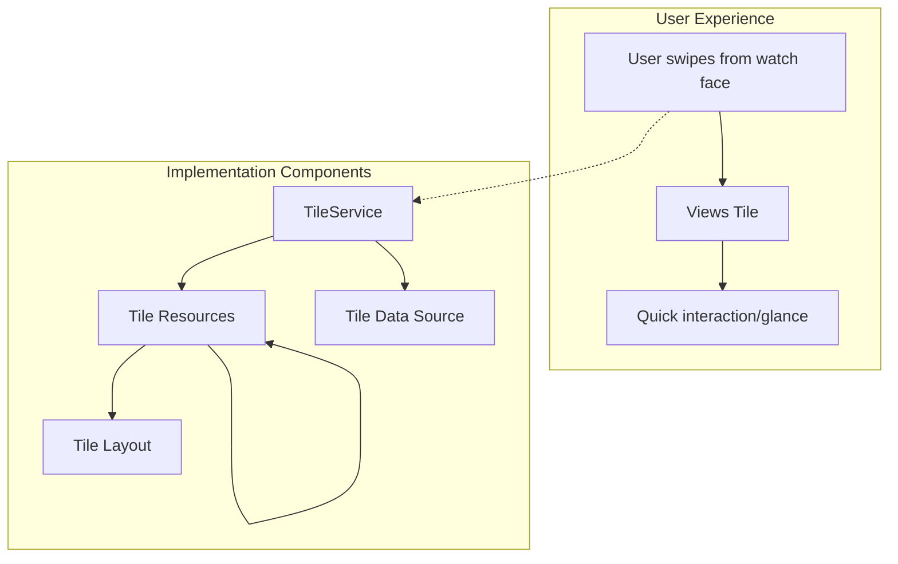
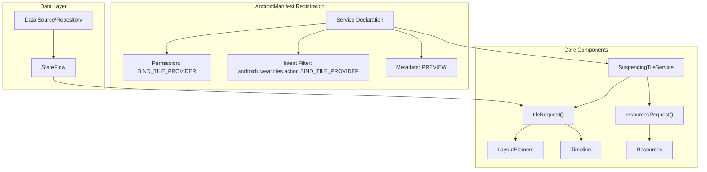
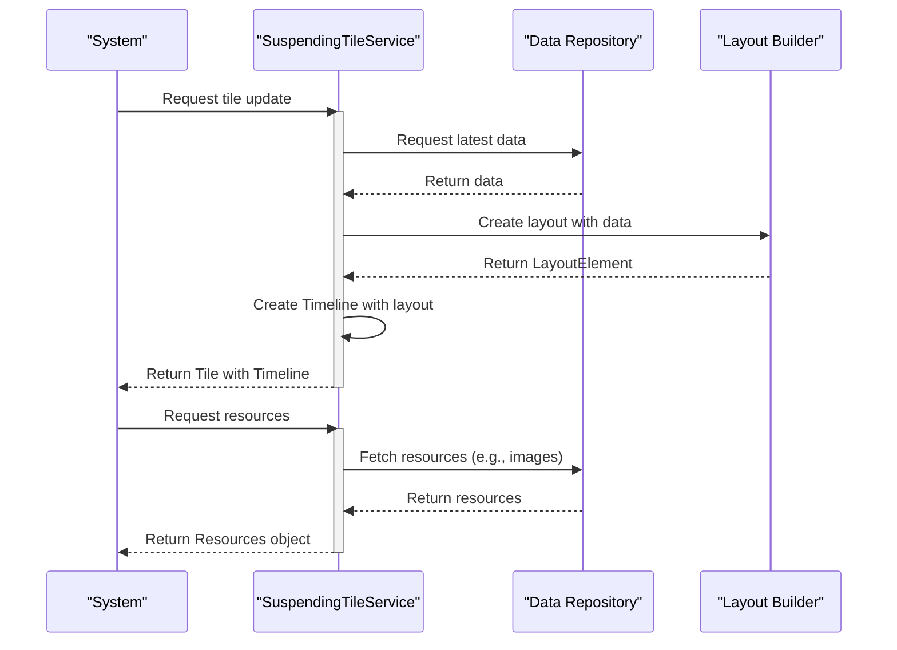
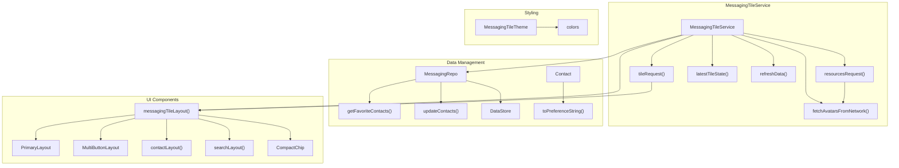
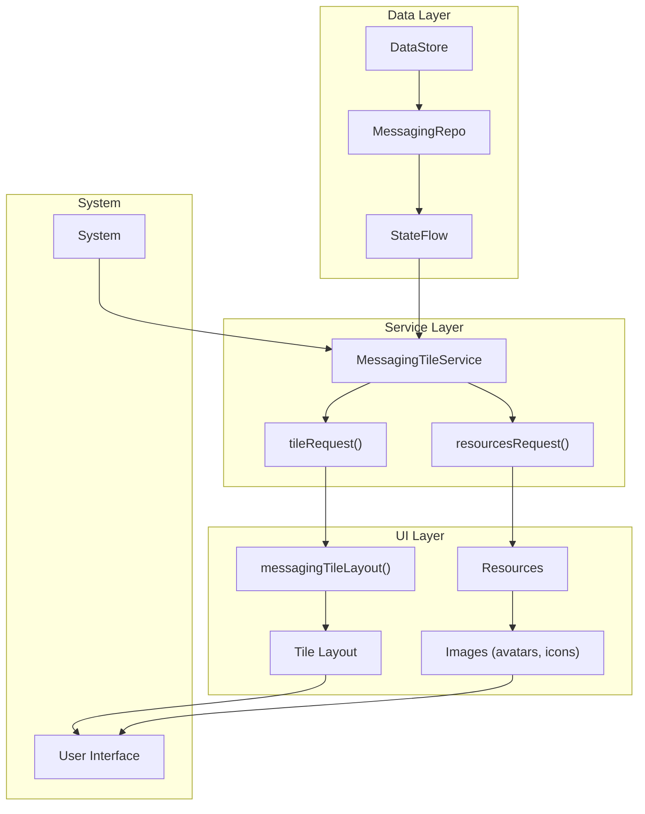
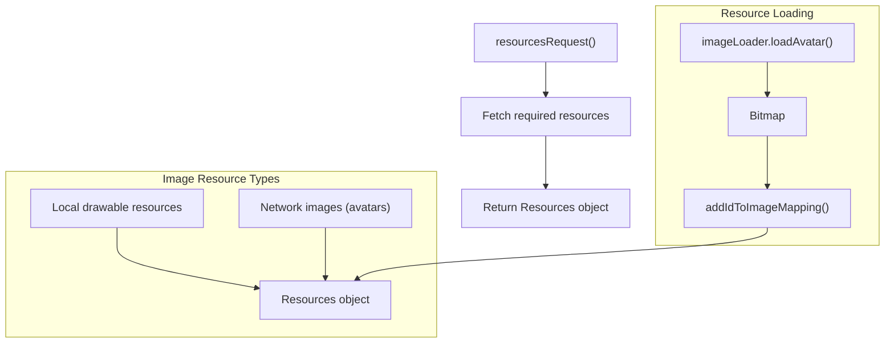

<!-- source: DeepWiki mcp.deepwiki.com · repo android/wear-os-samples · page 7 Tiles · fetched 2026-10-23 -->

# Tiles

<details>
<summary>Relevant source files</summary>

The following files were used as context for generating this wiki page:

- [WearTilesKotlin/app/src/debug/AndroidManifest.xml](WearTilesKotlin/app/src/debug/AndroidManifest.xml)
- [WearTilesKotlin/app/src/main/AndroidManifest.xml](WearTilesKotlin/app/src/main/AndroidManifest.xml)
- [WearTilesKotlin/app/src/main/java/com/example/wear/tiles/messaging/Contact.kt](WearTilesKotlin/app/src/main/java/com/example/wear/tiles/messaging/Contact.kt)
- [WearTilesKotlin/app/src/main/java/com/example/wear/tiles/messaging/MessagingRepo.kt](WearTilesKotlin/app/src/main/java/com/example/wear/tiles/messaging/MessagingRepo.kt)
- [WearTilesKotlin/app/src/main/java/com/example/wear/tiles/messaging/MessagingTileLayout.kt](WearTilesKotlin/app/src/main/java/com/example/wear/tiles/messaging/MessagingTileLayout.kt)
- [WearTilesKotlin/app/src/main/java/com/example/wear/tiles/messaging/MessagingTileService.kt](WearTilesKotlin/app/src/main/java/com/example/wear/tiles/messaging/MessagingTileService.kt)
- [WearTilesKotlin/app/src/main/java/com/example/wear/tiles/messaging/MessagingTileTheme.kt](WearTilesKotlin/app/src/main/java/com/example/wear/tiles/messaging/MessagingTileTheme.kt)
- [WearTilesKotlin/app/src/main/res/values-et/strings.xml](WearTilesKotlin/app/src/main/res/values-et/strings.xml)
- [WearTilesKotlin/app/src/main/res/values/strings.xml](WearTilesKotlin/app/src/main/res/values/strings.xml)

</details>


Tiles are glanceable, scannable UI elements that users can add to their Wear OS device to quickly access information or actions without opening a full app. This document covers the implementation of Tiles for Wear OS using the AndroidX Tiles library as demonstrated in the Wear OS Samples repository.

## Overview

Wear OS Tiles provide a way for users to quickly access information or perform actions with a simple swipe from the watch face. Tiles are designed to be lightweight, fast-loading, and focused on specific tasks or information.



Sources: [WearTilesKotlin/app/src/main/java/com/example/wear/tiles/messaging/MessagingTileService.kt:40-48]()

## Tile Architecture

The Tile architecture consists of several key components working together to create a responsive and efficient UI element:



Sources: 
- [WearTilesKotlin/app/src/main/AndroidManifest.xml:30-44]()
- [WearTilesKotlin/app/src/main/java/com/example/wear/tiles/messaging/MessagingTileService.kt:49-68]()
- [WearTilesKotlin/app/src/main/java/com/example/wear/tiles/messaging/MessagingTileService.kt:72-78]()

### Key Concepts

1. **TileService**: The foundation of a Tile implementation, responsible for providing layout and resources.
2. **Timeline**: Represents what content should be shown in the Tile at different points in time.
3. **LayoutElement**: The UI structure for the Tile.
4. **Resources**: Images and other resources used by the Tile.

## Creating a Tile Service

To implement a Tile, you need to create a service that extends `SuspendingTileService`. This class provides a coroutine-friendly wrapper around the standard `TileService`.

### Service Declaration

The Tile service must be declared in the AndroidManifest.xml with the appropriate permission and intent filter:

```xml
<service
    android:name="com.example.wear.tiles.messaging.MessagingTileService"
    android:exported="true"
    android:label="@string/tile_messaging_label"
    android:description="@string/tile_messaging_description"
    android:icon="@drawable/ic_message_24"
    android:permission="com.google.android.wearable.permission.BIND_TILE_PROVIDER">
    <intent-filter>
        <action android:name="androidx.wear.tiles.action.BIND_TILE_PROVIDER" />
    </intent-filter>

    <meta-data
        android:name="androidx.wear.tiles.PREVIEW"
        android:resource="@drawable/tile_messaging" />
</service>
```

Sources: [WearTilesKotlin/app/src/main/AndroidManifest.xml:30-44]()

### Implementing Core Methods

A Tile service needs to implement two main methods:

1. **tileRequest()**: Provides the layout for the Tile.
2. **resourcesRequest()**: Provides resources (like images) needed by the Tile.



Sources: 
- [WearTilesKotlin/app/src/main/java/com/example/wear/tiles/messaging/MessagingTileService.kt:72-78]()
- [WearTilesKotlin/app/src/main/java/com/example/wear/tiles/messaging/MessagingTileService.kt:111-138]()

## Implementation Example: Messaging Tile

The samples repository includes a Messaging Tile example that demonstrates how to create a functional Tile service.

### Architecture Overview



Sources: 
- [WearTilesKotlin/app/src/main/java/com/example/wear/tiles/messaging/MessagingTileService.kt:49-172]()
- [WearTilesKotlin/app/src/main/java/com/example/wear/tiles/messaging/MessagingTileLayout.kt:43-73]()
- [WearTilesKotlin/app/src/main/java/com/example/wear/tiles/messaging/MessagingRepo.kt:31-49]()

### Data Flow

1. The system requests an update from `MessagingTileService`.
2. The service retrieves contact data from `MessagingRepo`.
3. Contact data is used to build a layout with the `messagingTileLayout()` function.
4. The layout contains buttons for each contact, a search button, and a "New" action chip.
5. When resources are requested, the service fetches avatar images for contacts.



Sources: 
- [WearTilesKotlin/app/src/main/java/com/example/wear/tiles/messaging/MessagingTileService.kt:54-66]()
- [WearTilesKotlin/app/src/main/java/com/example/wear/tiles/messaging/MessagingTileService.kt:72-78]()
- [WearTilesKotlin/app/src/main/java/com/example/wear/tiles/messaging/MessagingTileService.kt:83-90]()

### Key Components

#### MessagingTileService

This is the main class that implements the Tile functionality:

- Extends `SuspendingTileService`
- Manages a `StateFlow` of `MessagingTileState` to track contacts data
- Implements `tileRequest()` to provide the Tile layout
- Implements `resourcesRequest()` to provide images (avatars and icons)

Sources: [WearTilesKotlin/app/src/main/java/com/example/wear/tiles/messaging/MessagingTileService.kt:49-172]()

#### MessagingTileLayout

Defines the UI structure for the Messaging Tile:

- Uses `PrimaryLayout` as the root component
- Contains a `MultiButtonLayout` for contact buttons and search button
- Includes a `CompactChip` for the "New" action
- Adapts to different screen sizes using responsive design

Sources: [WearTilesKotlin/app/src/main/java/com/example/wear/tiles/messaging/MessagingTileLayout.kt:43-73]()

#### MessagingRepo

Manages the data for the Tile:

- Uses DataStore to persist contact information
- Provides a `Flow` of contact data
- Includes methods to update contacts

Sources: [WearTilesKotlin/app/src/main/java/com/example/wear/tiles/messaging/MessagingRepo.kt:31-49]()

### Tile UI Architecture

The Messaging Tile demonstrates a common pattern for Tile UIs:

| Component | Purpose | Implementation |
|-----------|---------|----------------|
| PrimaryLayout | Root container | Provides content area and chip area |
| MultiButtonLayout | Contact grid | Displays contact buttons in a grid |
| Button | Contact entry | Shows contact avatar or initials |
| CompactChip | Primary action | Provides a "New" action |

Sources: 
- [WearTilesKotlin/app/src/main/java/com/example/wear/tiles/messaging/MessagingTileLayout.kt:43-73]()
- [WearTilesKotlin/app/src/main/java/com/example/wear/tiles/messaging/MessagingTileLayout.kt:74-90]()
- [WearTilesKotlin/app/src/main/java/com/example/wear/tiles/messaging/MessagingTileLayout.kt:92-99]()

## Resource Management

Tiles need to manage resources efficiently, especially images that may be loaded from the network.

### Resource Handling

The `resourcesRequest()` method is responsible for providing resources to the Tile:



Sources: 
- [WearTilesKotlin/app/src/main/java/com/example/wear/tiles/messaging/MessagingTileService.kt:111-138]()
- [WearTilesKotlin/app/src/main/java/com/example/wear/tiles/messaging/MessagingTileService.kt:144-166]()

### Resource Versioning

The sample includes a debug flag `DEBUG_RESOURCES` that forces the Tile to reload resources on each update by changing the resources version. In a production environment, you would want to use a stable versioning strategy.

Sources: [WearTilesKotlin/app/src/main/java/com/example/wear/tiles/messaging/MessagingTileService.kt:72-78]()

## Best Practices

Based on the sample implementation, here are some best practices for Tile development:

1. **Use Coroutines**: The `SuspendingTileService` makes it easier to work with asynchronous operations.

2. **Responsive Design**: Adapt to different screen sizes, as shown in the Messaging Tile layout:
   ```kotlin
   // A PrimaryLayout with a compact chip can fit 5 buttons (including search)
   // on "small" displays, 6 on "large" displays.
   val isLarge = deviceParameters.screenHeightDp >= 225
   state.contacts.take(if (isLarge) 5 else 4).forEach { contact ->
       addButtonContent(contactLayout(context, contact, emptyClickable))
   }
   ```

3. **Efficient Resource Management**: Load and cache resources efficiently to minimize memory usage.

4. **State Management**: Use Kotlin Flow for reactive state updates.

5. **Preview Support**: Provide preview images and implement preview functions to make your Tile visible in the Wear OS tile picker.

Sources: 
- [WearTilesKotlin/app/src/main/java/com/example/wear/tiles/messaging/MessagingTileLayout.kt:52-57]()
- [WearTilesKotlin/app/src/main/java/com/example/wear/tiles/messaging/MessagingTileService.kt:54-66]()
- [WearTilesKotlin/app/src/main/AndroidManifest.xml:41-43]()

## Conclusion

Tiles provide a powerful way to extend your Wear OS app's functionality with glanceable, accessible information. The Wear OS Samples repository demonstrates how to implement Tiles using modern Android development patterns, including coroutines, Flow, and responsive design.

To create your own Tile:

1. Create a service that extends `SuspendingTileService`
2. Implement `tileRequest()` and `resourcesRequest()`
3. Define a UI layout using the Proto Layout DSL
4. Register your service in the AndroidManifest.xml
5. Provide a preview image for the Tile picker

For more detailed information about implementing specific Tile types, see [Messaging Tile Implementation](#7.1).

Sources: 
- [WearTilesKotlin/app/src/main/java/com/example/wear/tiles/messaging/MessagingTileService.kt:40-48]()
- [WearTilesKotlin/app/src/main/java/com/example/wear/tiles/messaging/MessagingTileService.kt:72-78]()
- [WearTilesKotlin/app/src/main/java/com/example/wear/tiles/messaging/MessagingTileService.kt:111-138]()
- [WearTilesKotlin/app/src/main/AndroidManifest.xml:30-44]()

---

