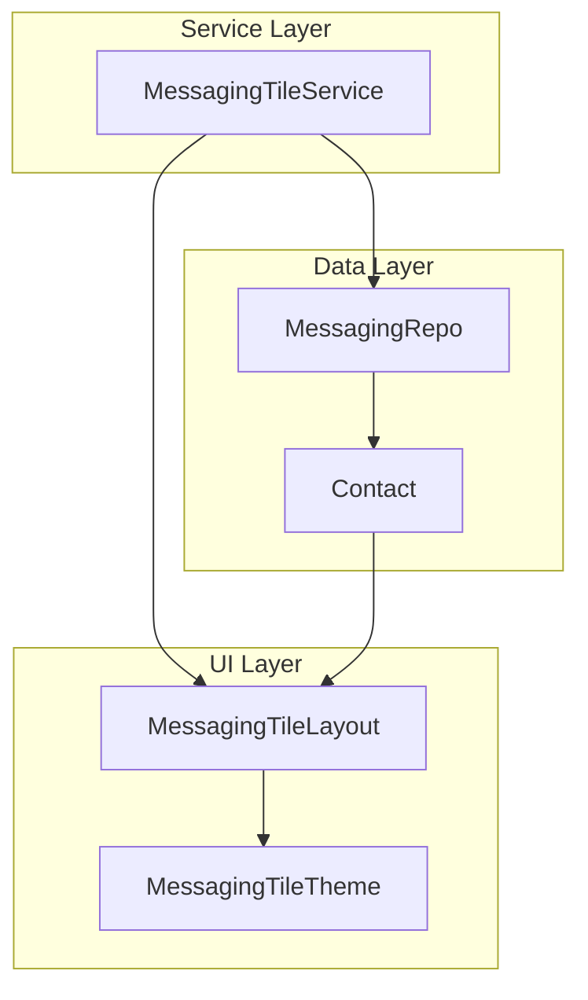
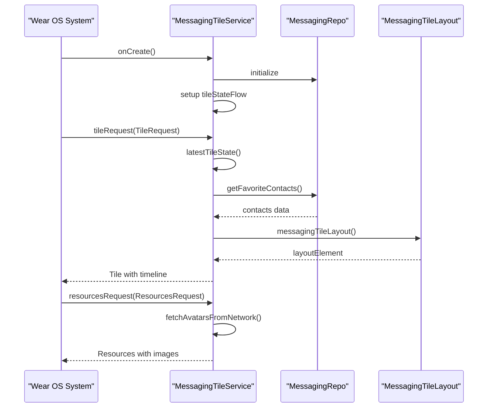
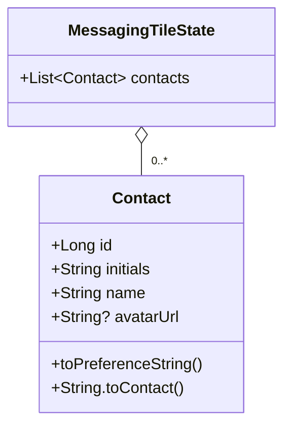
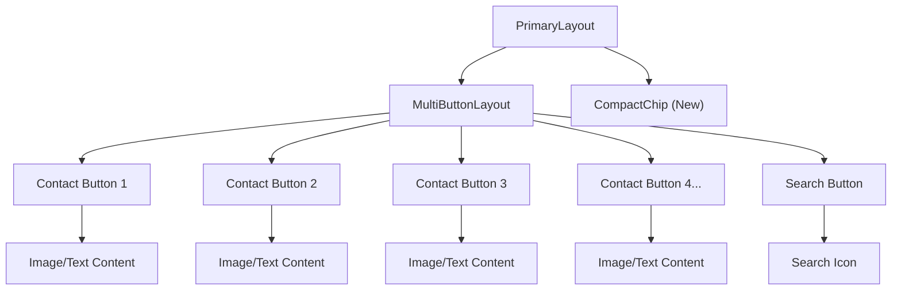
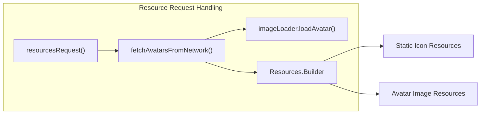
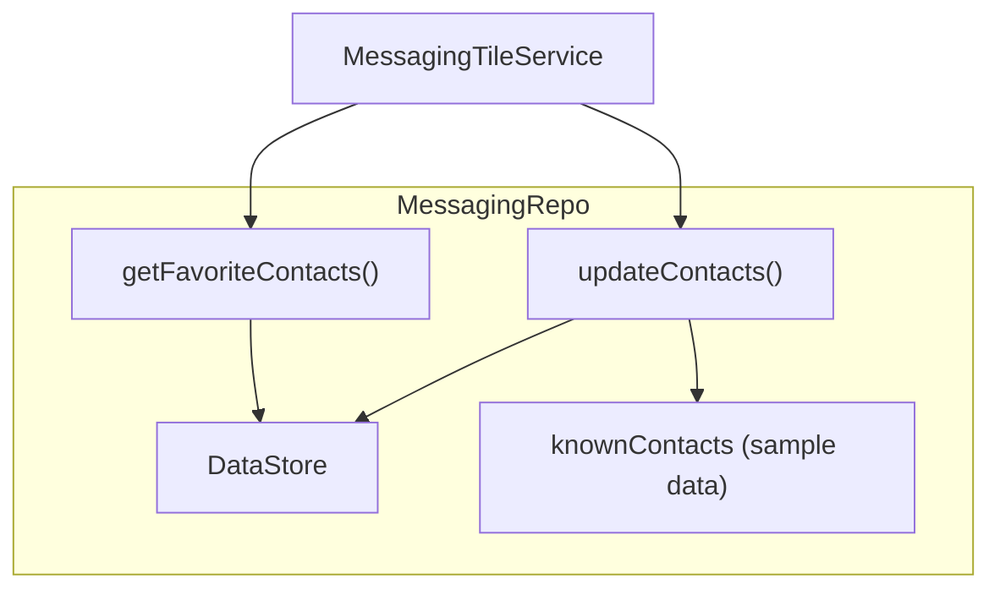
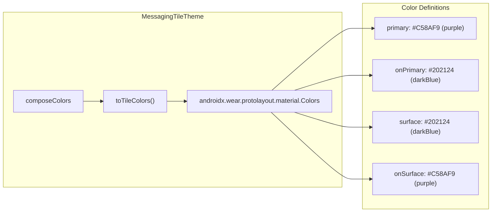

<!-- source: DeepWiki mcp.deepwiki.com · repo android/wear-os-samples · page 7.1 Messaging Tile Implementation · fetched 2026-10-23 -->

# Messaging Tile Implementation

<details>
<summary>Relevant source files</summary>

The following files were used as context for generating this wiki page:

- [WearTilesKotlin/app/src/debug/AndroidManifest.xml](WearTilesKotlin/app/src/debug/AndroidManifest.xml)
- [WearTilesKotlin/app/src/main/AndroidManifest.xml](WearTilesKotlin/app/src/main/AndroidManifest.xml)
- [WearTilesKotlin/app/src/main/java/com/example/wear/tiles/messaging/Contact.kt](WearTilesKotlin/app/src/main/java/com/example/wear/tiles/messaging/Contact.kt)
- [WearTilesKotlin/app/src/main/java/com/example/wear/tiles/messaging/MessagingRepo.kt](WearTilesKotlin/app/src/main/java/com/example/wear/tiles/messaging/MessagingRepo.kt)
- [WearTilesKotlin/app/src/main/java/com/example/wear/tiles/messaging/MessagingTileLayout.kt](WearTilesKotlin/app/src/main/java/com/example/wear/tiles/messaging/MessagingTileLayout.kt)
- [WearTilesKotlin/app/src/main/java/com/example/wear/tiles/messaging/MessagingTileService.kt](WearTilesKotlin/app/src/main/java/com/example/wear/tiles/messaging/MessagingTileService.kt)
- [WearTilesKotlin/app/src/main/java/com/example/wear/tiles/messaging/MessagingTileTheme.kt](WearTilesKotlin/app/src/main/java/com/example/wear/tiles/messaging/MessagingTileTheme.kt)
- [WearTilesKotlin/app/src/main/res/values-et/strings.xml](WearTilesKotlin/app/src/main/res/values-et/strings.xml)
- [WearTilesKotlin/app/src/main/res/values/strings.xml](WearTilesKotlin/app/src/main/res/values/strings.xml)

</details>


This document details the implementation of a Messaging Tile for Wear OS, which displays contacts with avatars, a search button, and a "New" action chip. This reference implementation demonstrates best practices for creating tiles with dynamic content, loading remote resources, and responsive layout adaptation.

For general information about Tiles in Wear OS, see [Tiles](#7).

## Architecture Overview

The Messaging Tile implementation follows a structured architecture that combines several components to create a functional and visually appealing tile experience.



Sources: [WearTilesKotlin/app/src/main/java/com/example/wear/tiles/messaging/MessagingTileService.kt](), [WearTilesKotlin/app/src/main/java/com/example/wear/tiles/messaging/MessagingTileLayout.kt](), [WearTilesKotlin/app/src/main/java/com/example/wear/tiles/messaging/MessagingRepo.kt](), [WearTilesKotlin/app/src/main/java/com/example/wear/tiles/messaging/MessagingTileTheme.kt](), [WearTilesKotlin/app/src/main/java/com/example/wear/tiles/messaging/Contact.kt]()

## Component Responsibilities

### MessagingTileService

This is the entry point for the tile implementation, extending `SuspendingTileService` to provide a coroutine-friendly wrapper around the AndroidX `TileService`.



Sources: [WearTilesKotlin/app/src/main/java/com/example/wear/tiles/messaging/MessagingTileService.kt:49-173]()

Key responsibilities:
- Manages the lifecycle of the tile
- Retrieves contact data from `MessagingRepo`
- Handles tile layout creation through `messagingTileLayout()`
- Loads and provides avatar images as resources

### Data Model

The data structure consists of the `Contact` data class and the messaging tile state:



Sources: [WearTilesKotlin/app/src/main/java/com/example/wear/tiles/messaging/Contact.kt:18-34]()

## Tile Layout Implementation

The `MessagingTileLayout.kt` file defines the layout structure of the messaging tile using the Wear Protolayout library.

### Layout Hierarchy



Sources: [WearTilesKotlin/app/src/main/java/com/example/wear/tiles/messaging/MessagingTileLayout.kt:43-72]()

The tile layout uses a `PrimaryLayout` as the root container, with:
- A `MultiButtonLayout` containing up to 5 contact buttons and 1 search button
- A primary `CompactChip` with "New" text for creating a new message

The layout intelligently adapts to different screen sizes by showing more contacts on larger displays:
- Small displays: 4 contacts + search button
- Large displays (≥225dp height): 5 contacts + search button

```kotlin
val isLarge = deviceParameters.screenHeightDp >= 225
state.contacts.take(if (isLarge) 5 else 4).forEach { contact ->
    addButtonContent(contactLayout(context, contact, emptyClickable))
}
```

Sources: [WearTilesKotlin/app/src/main/java/com/example/wear/tiles/messaging/MessagingTileLayout.kt:54-57]()

## Resource Management

The tile handles two types of resources:
1. **Static resources** - Icons like the search button
2. **Dynamic resources** - Contact avatars fetched from the network

### Resource Loading Process



Sources: [WearTilesKotlin/app/src/main/java/com/example/wear/tiles/messaging/MessagingTileService.kt:111-166]()

### Avatar Handling

Avatars are loaded asynchronously from network URLs and mapped to resource IDs with a prefix convention:

```kotlin
// Resource ID format for contact avatars
"$ID_CONTACT_PREFIX${contact.id}"  // e.g. "contact:1"
```

Sources: [WearTilesKotlin/app/src/main/java/com/example/wear/tiles/messaging/MessagingTileService.kt:169-170](), [WearTilesKotlin/app/src/main/java/com/example/wear/tiles/messaging/MessagingTileLayout.kt:90]()

## Data Management

The `MessagingRepo` class handles data persistence using Android's Preferences DataStore.



Sources: [WearTilesKotlin/app/src/main/java/com/example/wear/tiles/messaging/MessagingRepo.kt:31-98]()

The repo serves two primary functions:
1. Providing a `Flow` of contact data via `getFavoriteContacts()`
2. Updating stored contacts via `updateContacts()`

For sample purposes, it includes predefined contacts in `knownContacts`, with some having avatar URLs pointing to sample images in the repository.

## Theming

The `MessagingTileTheme` provides consistent styling for the tile using a custom color palette:



Sources: [WearTilesKotlin/app/src/main/java/com/example/wear/tiles/messaging/MessagingTileTheme.kt:22-53]()

The theme converts Compose UI colors to Protolayout colors, allowing for a consistent look between the app and its tiles.

## Tile Registration

The tile is registered in the AndroidManifest.xml with specific metadata:

| Attribute | Value | Purpose |
|-----------|-------|---------|
| android:name | com.example.wear.tiles.messaging.MessagingTileService | Service class |
| android:exported | true | Makes tile available to the system |
| android:label | @string/tile_messaging_label | Display name ("Messaging") |
| android:description | @string/tile_messaging_description | Description shown in tile picker |
| android:icon | @drawable/ic_message_24 | Icon in tile picker |
| android:permission | com.google.android.wearable.permission.BIND_TILE_PROVIDER | Required permission |

Sources: [WearTilesKotlin/app/src/main/AndroidManifest.xml:30-44]()

The manifest also includes:
- An intent filter with `androidx.wear.tiles.action.BIND_TILE_PROVIDER` action
- A preview image metadata entry pointing to `@drawable/tile_messaging`

## Key Implementation Details

### SuspendingTileService Extension

The `MessagingTileService` extends `SuspendingTileService` from the Horologist library, which provides a coroutine-friendly wrapper around the standard TileService:

```kotlin
class MessagingTileService : SuspendingTileService() {
    // Implementation
}
```

Sources: [WearTilesKotlin/app/src/main/java/com/example/wear/tiles/messaging/MessagingTileService.kt:49]()

### State Management with Kotlin Flow

The tile uses Kotlin Flow for reactive state management:

```kotlin
tileStateFlow = repo.getFavoriteContacts()
    .map { contacts -> MessagingTileState(contacts) }
    .stateIn(
        lifecycleScope,
        started = SharingStarted.WhileSubscribed(5000),
        initialValue = null
    )
```

Sources: [WearTilesKotlin/app/src/main/java/com/example/wear/tiles/messaging/MessagingTileService.kt:60-66]()

### Responsive Layout

The layout adapts to different screen sizes:

```kotlin
val isLarge = deviceParameters.screenHeightDp >= 225
state.contacts.take(if (isLarge) 5 else 4).forEach { contact ->
    addButtonContent(contactLayout(context, contact, emptyClickable))
}
```

Sources: [WearTilesKotlin/app/src/main/java/com/example/wear/tiles/messaging/MessagingTileLayout.kt:54-57]()

## Summary

The Messaging Tile implementation demonstrates a complete, production-ready tile application for Wear OS with:

1. Structured architecture separating data, UI, and service layers
2. Efficient resource loading for both static and dynamic images
3. Reactive state management with Kotlin Flow
4. Responsive layouts adapting to different screen sizes
5. Persistent data storage with DataStore
6. Consistent theming using a custom color palette

This implementation serves as a reference for developers creating similar tiles for Wear OS applications.

---

