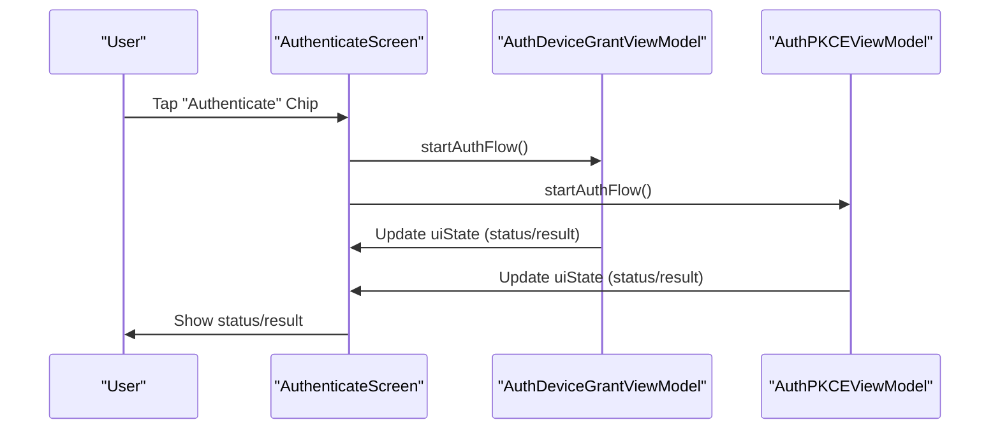

<!-- source: DeepWiki mcp.deepwiki.com · repo android/wear-os-samples · page 8 Authentication · fetched 2026-10-23 -->

# Authentication

<details>
<summary>Relevant source files</summary>

The following files were used as context for generating this wiki page:

- [WearOAuth/README.md](WearOAuth/README.md)
- [WearOAuth/build.gradle](WearOAuth/build.gradle)
- [WearOAuth/oauth-device-grant/build.gradle](WearOAuth/oauth-device-grant/build.gradle)
- [WearOAuth/oauth-device-grant/src/main/java/com/example/android/wearable/oauth/devicegrant/AuthDeviceGrantActivity.kt](WearOAuth/oauth-device-grant/src/main/java/com/example/android/wearable/oauth/devicegrant/AuthDeviceGrantActivity.kt)
- [WearOAuth/oauth-device-grant/src/main/java/com/example/android/wearable/oauth/devicegrant/AuthDeviceGrantViewModel.kt](WearOAuth/oauth-device-grant/src/main/java/com/example/android/wearable/oauth/devicegrant/AuthDeviceGrantViewModel.kt)
- [WearOAuth/oauth-device-grant/src/main/res/values/strings.xml](WearOAuth/oauth-device-grant/src/main/res/values/strings.xml)
- [WearOAuth/oauth-pkce/build.gradle](WearOAuth/oauth-pkce/build.gradle)
- [WearOAuth/oauth-pkce/src/main/java/com/example/android/wearable/oauth/pkce/AuthPKCEActivity.kt](WearOAuth/oauth-pkce/src/main/java/com/example/android/wearable/oauth/pkce/AuthPKCEActivity.kt)
- [WearOAuth/oauth-pkce/src/main/java/com/example/android/wearable/oauth/pkce/AuthPKCEViewModel.kt](WearOAuth/oauth-pkce/src/main/java/com/example/android/wearable/oauth/pkce/AuthPKCEViewModel.kt)
- [WearOAuth/oauth-pkce/src/main/res/values/strings.xml](WearOAuth/oauth-pkce/src/main/res/values/strings.xml)
- [WearOAuth/util/src/main/java/com/example/android/wearable/oauth/util/Requests.kt](WearOAuth/util/src/main/java/com/example/android/wearable/oauth/util/Requests.kt)

</details>


This document describes the authentication systems implemented in the Wear OS Samples repository, focusing on OAuth 2.0 flows for Wear OS applications. It covers the structure, code, and flow of authentication in the sample projects, specifically the Device Authorization Grant and PKCE (Proof Key for Code Exchange) flows. 

For details on the specific implementation of each OAuth flow, see [OAuth Flows](#8.1). For information about communication between devices, see [Data Layer Communication](#6).

---

## Purpose and Scope

This page documents:

- The architecture and code structure for OAuth-based authentication in Wear OS samples.
- The two main OAuth 2.0 flows demonstrated: Device Authorization Grant and PKCE.
- The main classes, files, and UI patterns used for authentication.
- How authentication integrates with the Wear OS app lifecycle.

This page does **not** cover general UI development (see [UI Development](#5)), data synchronization (see [Data Layer Communication](#6)), or audio/watch face features.

---

## Overview of Authentication Samples

The authentication samples are located in the `WearOAuth` directory and are divided into two main modules:

| Module Name         | OAuth Flow                | Main Activity/Class                | Purpose                                      |
|---------------------|--------------------------|------------------------------------|----------------------------------------------|
| `oauth-device-grant`| Device Authorization     | `AuthDeviceGrantActivity`          | Demonstrates OAuth 2.0 Device Grant flow     |
| `oauth-pkce`        | Authorization Code (PKCE)| `AuthPKCEActivity`                 | Demonstrates OAuth 2.0 PKCE flow             |

Both modules use Google OAuth 2.0 APIs but can be adapted for other providers.

**Sources:**  
[WearOAuth/README.md:4-76]()  
[WearOAuth/oauth-device-grant/build.gradle:1-110]()  
[WearOAuth/oauth-pkce/build.gradle:1-112]()  

---

### Diagram: Authentication Modules and Main Classes

```mermaid
flowchart TD
    "WearOAuth" --> "oauth-device-grant"
    "WearOAuth" --> "oauth-pkce"
    "oauth-device-grant" --> "AuthDeviceGrantActivity[AuthDeviceGrantActivity.kt]"
    "oauth-device-grant" --> "AuthDeviceGrantViewModel[AuthDeviceGrantViewModel.kt]"
    "oauth-pkce" --> "AuthPKCEActivity[AuthPKCEActivity.kt]"
    "oauth-pkce" --> "AuthPKCEViewModel[AuthPKCEViewModel.kt]"
```
**Sources:**  
[WearOAuth/oauth-device-grant/src/main/java/com/example/android/wearable/oauth/devicegrant/AuthDeviceGrantActivity.kt:1-58]()  
[WearOAuth/oauth-device-grant/src/main/java/com/example/android/wearable/oauth/devicegrant/AuthDeviceGrantViewModel.kt:1-207]()  
[WearOAuth/oauth-pkce/src/main/java/com/example/android/wearable/oauth/pkce/AuthPKCEActivity.kt:1-131]()  
[WearOAuth/oauth-pkce/src/main/java/com/example/android/wearable/oauth/pkce/AuthPKCEViewModel.kt:1-219]()  

---

## OAuth 2.0 Flows Implemented

The samples implement two standard OAuth 2.0 flows suitable for Wear OS devices:

| Flow Name                    | Standard / RFC | Use Case                                      | Main ViewModel/Class         |
|------------------------------|---------------|-----------------------------------------------|-----------------------------|
| Device Authorization Grant   | RFC 8628      | Devices with limited input (e.g., watches)    | `AuthDeviceGrantViewModel`  |
| Authorization Code Grant (PKCE) | RFC 7636  | Secure code exchange with companion device    | `AuthPKCEViewModel`         |

### Device Authorization Grant

- The watch requests a verification URL and user code from the OAuth server.
- The URL is opened on the paired phone for user authentication.
- The watch polls the server for the access token.
- After authentication, the watch uses the token to access user data.

### PKCE (Proof Key for Code Exchange)

- The watch generates a code verifier and challenge.
- The user authenticates on the phone via a consent screen.
- The watch receives an authorization code and exchanges it for an access token.
- The token is used to access user data.

**Sources:**  
[WearOAuth/README.md:13-26]()  
[WearOAuth/oauth-device-grant/src/main/java/com/example/android/wearable/oauth/devicegrant/AuthDeviceGrantViewModel.kt:47-206]()  
[WearOAuth/oauth-pkce/src/main/java/com/example/android/wearable/oauth/pkce/AuthPKCEViewModel.kt:54-219]()  

---

### Diagram: OAuth Flow to Code Mapping

```mermaid
flowchart TD
    "User" --> "Wear OS App"
    "Wear OS App" -->|"startAuthFlow()"| "AuthDeviceGrantViewModel"
    "Wear OS App" -->|"startAuthFlow()"| "AuthPKCEViewModel"
    "AuthDeviceGrantViewModel" -->|"retrieveVerificationInfo()"| "OAuth Server"
    "AuthDeviceGrantViewModel" -->|"fireRemoteIntent()"| "Paired Phone"
    "AuthDeviceGrantViewModel" -->|"retrieveToken()"| "OAuth Server"
    "AuthDeviceGrantViewModel" -->|"retrieveUserProfile()"| "OAuth Server"
    "AuthPKCEViewModel" -->|"retrieveOAuthCode()"| "RemoteAuthClient"
    "RemoteAuthClient" -->|"sendAuthorizationRequest()"| "Paired Phone"
    "AuthPKCEViewModel" -->|"retrieveToken()"| "OAuth Server"
    "AuthPKCEViewModel" -->|"retrieveUserProfile()"| "OAuth Server"
```
**Sources:**  
[WearOAuth/oauth-device-grant/src/main/java/com/example/android/wearable/oauth/devicegrant/AuthDeviceGrantViewModel.kt:65-206]()  
[WearOAuth/oauth-pkce/src/main/java/com/example/android/wearable/oauth/pkce/AuthPKCEViewModel.kt:79-219]()  

---

## Main Code Entities

### Activities

| Activity Class                | File Path                                                                 | Description                                      |
|-------------------------------|--------------------------------------------------------------------------|--------------------------------------------------|
| `AuthDeviceGrantActivity`     | `oauth-device-grant/src/main/java/com/example/android/wearable/oauth/devicegrant/AuthDeviceGrantActivity.kt` | Entry point for Device Grant flow UI             |
| `AuthPKCEActivity`            | `oauth-pkce/src/main/java/com/example/android/wearable/oauth/pkce/AuthPKCEActivity.kt`                       | Entry point for PKCE flow UI                     |

**Sources:**  
[WearOAuth/oauth-device-grant/src/main/java/com/example/android/wearable/oauth/devicegrant/AuthDeviceGrantActivity.kt:1-58]()  
[WearOAuth/oauth-pkce/src/main/java/com/example/android/wearable/oauth/pkce/AuthPKCEActivity.kt:1-56]()  

### ViewModels

| ViewModel Class               | File Path                                                                 | Description                                      |
|-------------------------------|--------------------------------------------------------------------------|--------------------------------------------------|
| `AuthDeviceGrantViewModel`    | `oauth-device-grant/src/main/java/com/example/android/wearable/oauth/devicegrant/AuthDeviceGrantViewModel.kt` | Handles Device Grant flow logic                  |
| `AuthPKCEViewModel`           | `oauth-pkce/src/main/java/com/example/android/wearable/oauth/pkce/AuthPKCEViewModel.kt`                       | Handles PKCE flow logic                          |

**Sources:**  
[WearOAuth/oauth-device-grant/src/main/java/com/example/android/wearable/oauth/devicegrant/AuthDeviceGrantViewModel.kt:1-207]()  
[WearOAuth/oauth-pkce/src/main/java/com/example/android/wearable/oauth/pkce/AuthPKCEViewModel.kt:1-219]()  

### Utility Functions

- `doPostRequest` and `doGetRequest` are used for HTTP communication with the OAuth server.
- Located in `util/src/main/java/com/example/android/wearable/oauth/util/Requests.kt`.

**Sources:**  
[WearOAuth/util/src/main/java/com/example/android/wearable/oauth/util/Requests.kt:34-87]()  

---

## UI Patterns

Both authentication flows use a similar Compose-based UI pattern:

- A main activity sets up the Compose content.
- The UI observes a `StateFlow` from the ViewModel for status and result messages.
- The user initiates authentication by tapping a `Chip` component.
- Status and results are displayed as text.

**Example UI Flow:**

| Step                | UI Element         | Code Reference                                                                 |
|---------------------|-------------------|-------------------------------------------------------------------------------|
| Start Authentication| `Chip`            | `AuthenticateScreen` composable in both flows                                 |
| Show Status         | `Text`            | `AuthenticateScreen` composable, observes `uiState` from ViewModel            |
| Show Result         | `Text`            | `AuthenticateScreen` composable, observes `uiState` from ViewModel            |

**Sources:**  
[WearOAuth/oauth-device-grant/src/main/java/com/example/android/wearable/oauth/devicegrant/AuthDeviceGrantActivity.kt:60-131]()  
[WearOAuth/oauth-pkce/src/main/java/com/example/android/wearable/oauth/pkce/AuthPKCEActivity.kt:58-130]()  

---

### Diagram: UI and ViewModel Interaction


**Sources:**  
[WearOAuth/oauth-device-grant/src/main/java/com/example/android/wearable/oauth/devicegrant/AuthDeviceGrantActivity.kt:60-131]()  
[WearOAuth/oauth-pkce/src/main/java/com/example/android/wearable/oauth/pkce/AuthPKCEActivity.kt:58-130]()  

---

## Security and Best Practices

- **Client Secrets:** In these samples, client IDs and secrets are stored in the app for demonstration purposes. This is **not recommended** for production. Use an intermediary server to keep secrets secure.
- **Direct HTTP Calls:** The samples use simple HTTP utility functions for clarity. In production, use a robust HTTP client and handle errors and retries appropriately.
- **OAuth Providers:** The code is written for Google OAuth 2.0 APIs but can be adapted for other providers by changing endpoints and parameters.

**Sources:**  
[WearOAuth/README.md:68-76]()  
[WearOAuth/oauth-device-grant/src/main/java/com/example/android/wearable/oauth/devicegrant/AuthDeviceGrantViewModel.kt:38-40]()  
[WearOAuth/oauth-pkce/src/main/java/com/example/android/wearable/oauth/pkce/AuthPKCEViewModel.kt:42-45]()  

---

## String Resources

Each module defines its own string resources for status and UI messages. These are located in the `res/values/strings.xml` files of each module.

| Module                | File Path                                                      |
|-----------------------|---------------------------------------------------------------|
| Device Grant          | `oauth-device-grant/src/main/res/values/strings.xml`           |
| PKCE                  | `oauth-pkce/src/main/res/values/strings.xml`                  |

**Sources:**  
[WearOAuth/oauth-device-grant/src/main/res/values/strings.xml:1-28]()  
[WearOAuth/oauth-pkce/src/main/res/values/strings.xml:1-29]()  

---

## Build and Dependencies

Both authentication modules use:

- AndroidX Compose for UI.
- Horologist libraries for Wear Compose layouts.
- AndroidX Navigation for navigation support.
- AndroidX Lifecycle for ViewModel support.
- Wear OS specific libraries for remote interactions and authentication.

Dependencies are managed via Gradle and the shared version catalog.

**Sources:**  
[WearOAuth/oauth-device-grant/build.gradle:16-109]()  
[WearOAuth/oauth-pkce/build.gradle:16-111]()  

---

## Summary Table: Key Classes and Files

| Component                | File Path                                                                 | Description                                      |
|--------------------------|--------------------------------------------------------------------------|--------------------------------------------------|
| Device Grant Activity    | `oauth-device-grant/src/main/java/com/example/android/wearable/oauth/devicegrant/AuthDeviceGrantActivity.kt` | UI entry point for Device Grant flow             |
| Device Grant ViewModel   | `oauth-device-grant/src/main/java/com/example/android/wearable/oauth/devicegrant/AuthDeviceGrantViewModel.kt` | Logic for Device Grant flow                      |
| PKCE Activity            | `oauth-pkce/src/main/java/com/example/android/wearable/oauth/pkce/AuthPKCEActivity.kt`                       | UI entry point for PKCE flow                     |
| PKCE ViewModel           | `oauth-pkce/src/main/java/com/example/android/wearable/oauth/pkce/AuthPKCEViewModel.kt`                       | Logic for PKCE flow                              |
| HTTP Utilities           | `util/src/main/java/com/example/android/wearable/oauth/util/Requests.kt`                                      | Simple HTTP GET/POST functions                   |
| String Resources         | `oauth-device-grant/src/main/res/values/strings.xml`, `oauth-pkce/src/main/res/values/strings.xml`           | UI and status messages                           |

**Sources:**  
All files cited above.

---

## Further Reading

- For a detailed breakdown of each OAuth flow, see [OAuth Flows](#8.1).
- For information on communication between watch and phone, see [Data Layer Communication](#6).
- For UI development patterns, see [UI Development](#5).

---

---

