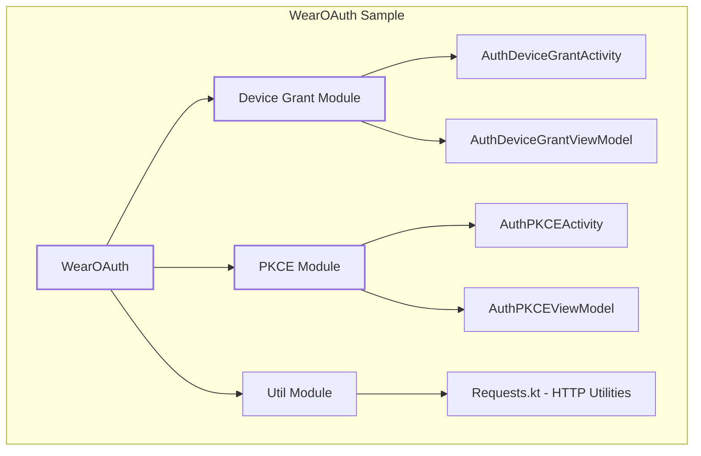
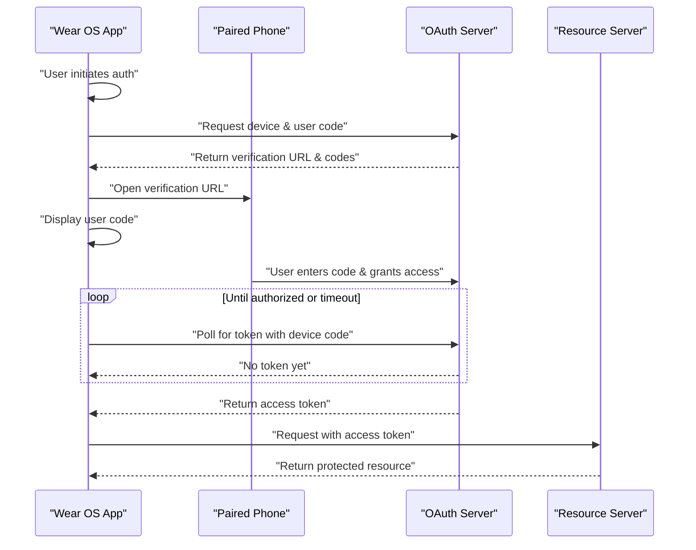
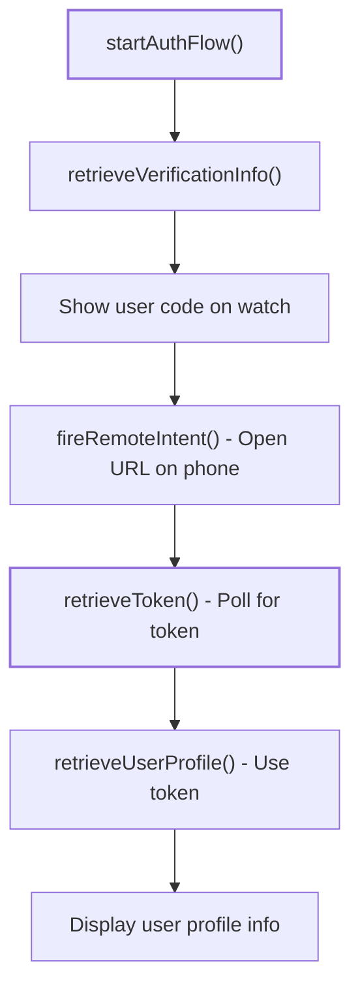
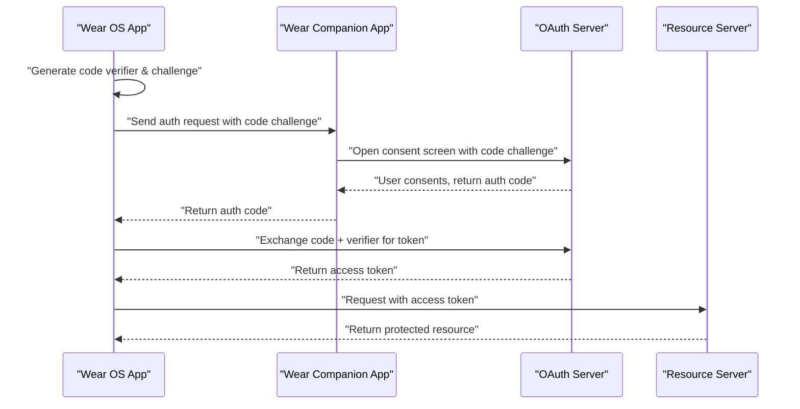
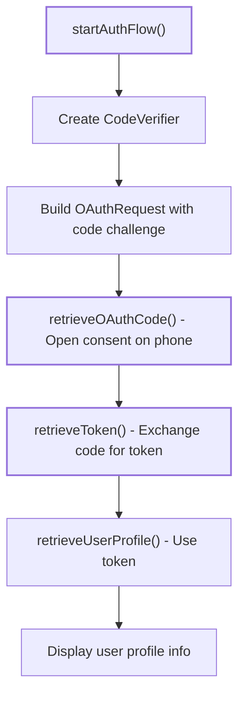

<!-- source: DeepWiki mcp.deepwiki.com · repo android/wear-os-samples · page 8.1 OAuth Flows · fetched 2026-10-23 -->

# OAuth Flows

<details>
<summary>Relevant source files</summary>

The following files were used as context for generating this wiki page:

- [WearOAuth/README.md](WearOAuth/README.md)
- [WearOAuth/build.gradle](WearOAuth/build.gradle)
- [WearOAuth/oauth-device-grant/build.gradle](WearOAuth/oauth-device-grant/build.gradle)
- [WearOAuth/oauth-device-grant/src/main/java/com/example/android/wearable/oauth/devicegrant/AuthDeviceGrantActivity.kt](WearOAuth/oauth-device-grant/src/main/java/com/example/android/wearable/oauth/devicegrant/AuthDeviceGrantActivity.kt)
- [WearOAuth/oauth-device-grant/src/main/java/com/example/android/wearable/oauth/devicegrant/AuthDeviceGrantViewModel.kt](WearOAuth/oauth-device-grant/src/main/java/com/example/android/wearable/oauth/devicegrant/AuthDeviceGrantViewModel.kt)
- [WearOAuth/oauth-device-grant/src/main/res/values/strings.xml](WearOAuth/oauth-device-grant/src/main/res/values/strings.xml)
- [WearOAuth/oauth-pkce/build.gradle](WearOAuth/oauth-pkce/build.gradle)
- [WearOAuth/oauth-pkce/src/main/java/com/example/android/wearable/oauth/pkce/AuthPKCEActivity.kt](WearOAuth/oauth-pkce/src/main/java/com/example/android/wearable/oauth/pkce/AuthPKCEActivity.kt)
- [WearOAuth/oauth-pkce/src/main/java/com/example/android/wearable/oauth/pkce/AuthPKCEViewModel.kt](WearOAuth/oauth-pkce/src/main/java/com/example/android/wearable/oauth/pkce/AuthPKCEViewModel.kt)
- [WearOAuth/oauth-pkce/src/main/res/values/strings.xml](WearOAuth/oauth-pkce/src/main/res/values/strings.xml)
- [WearOAuth/util/src/main/java/com/example/android/wearable/oauth/util/Requests.kt](WearOAuth/util/src/main/java/com/example/android/wearable/oauth/util/Requests.kt)

</details>


This page documents the OAuth authentication flows implemented in the Wear OS samples repository, specifically within the WearOAuth sample application. It covers two different OAuth 2.0 authentication approaches for Wear OS: Device Authorization Grant (RFC 8628) and Authorization Code Grant with PKCE (Proof Key for Code Exchange, RFC 7636).

## Introduction

Authentication on wearable devices presents unique challenges due to limited input capabilities and small screen size. The WearOAuth sample demonstrates two approaches to implement OAuth 2.0 authentication flows that address these constraints by delegating parts of the authentication process to a paired phone device.

Both implementations use the Google OAuth 2.0 server as an example, but the same patterns can be applied to any OAuth 2.0 provider.

Sources: [WearOAuth/README.md:6-11]()

## OAuth Flow Comparison

The table below summarizes the key differences between the two OAuth flows implemented in the sample:

| Feature | Device Authorization Grant | Authorization Code with PKCE |
|---------|---------------------------|----------------------------|
| RFC Standard | [RFC 8628](https://datatracker.ietf.org/doc/html/rfc8628) | [RFC 7636](https://datatracker.ietf.org/doc/html/rfc7636) |
| Designed for | Limited input devices (TV, IoT) | Native/mobile applications |
| User verification | User code displayed on watch | Web consent in Wear companion app |
| Phone interaction | Opens verification URL | Shows consent screen in companion app |
| Key advantages | Simpler flow, works across platforms | More secure, integrated with Wear companion |

Sources: [WearOAuth/README.md:13-25]()

## Implementation Overview



Both implementations follow the Model-View-ViewModel (MVVM) architecture pattern and use Jetpack Compose for UI. They share common HTTP utilities in the `util` module for making OAuth-related requests.

Sources: 
- [WearOAuth/build.gradle:16-42]()
- [WearOAuth/oauth-device-grant/build.gradle:16-109]()
- [WearOAuth/oauth-pkce/build.gradle:16-111]()

## Device Authorization Grant Flow

The Device Authorization Grant flow (also known as "Device Flow") is designed for devices with limited input capabilities, such as TVs or IoT devices, which makes it well-suited for Wear OS.



### Implementation Details

The Device Authorization Grant flow is implemented through the following main components:

1. **UI Layer**: `AuthDeviceGrantActivity` displays the authentication status and a button to start the flow.

2. **ViewModel**: `AuthDeviceGrantViewModel` handles the authentication logic:
   - `startAuthFlow()`: Orchestrates the entire flow 
   - `retrieveVerificationInfo()`: Requests a device code, user code and verification URL
   - `fireRemoteIntent()`: Opens the verification URL on the paired phone
   - `retrieveToken()`: Polls for the access token using a recursive approach
   - `retrieveUserProfile()`: Makes an authenticated request to get user information

Key implementation flow:



The implementation uses `RemoteActivityHelper` to open the verification URL on the paired phone and then polls the OAuth server until the user completes authorization.

Sources: 
- [WearOAuth/oauth-device-grant/src/main/java/com/example/android/wearable/oauth/devicegrant/AuthDeviceGrantActivity.kt:39-51]()
- [WearOAuth/oauth-device-grant/src/main/java/com/example/android/wearable/oauth/devicegrant/AuthDeviceGrantViewModel.kt:47-88]()
- [WearOAuth/oauth-device-grant/src/main/java/com/example/android/wearable/oauth/devicegrant/AuthDeviceGrantViewModel.kt:140-147]()
- [WearOAuth/oauth-device-grant/src/main/java/com/example/android/wearable/oauth/devicegrant/AuthDeviceGrantViewModel.kt:156-162]()

### Code Example - Device Grant Polling

A distinctive feature of the Device Grant flow is the polling mechanism using a tail-recursive suspend function:

```kotlin
private tailrec suspend fun retrieveToken(deviceCode: String, interval: Int): String {
    Log.d(TAG, "Polling for token...")
    return fetchToken(deviceCode).getOrElse {
        Log.d(TAG, "No token yet. Waiting...")
        delay(interval * 1000L)
        return retrieveToken(deviceCode, interval)
    }
}
```

This function continuously polls the OAuth server at the specified interval until a token is received or an exception occurs.

Sources: [WearOAuth/oauth-device-grant/src/main/java/com/example/android/wearable/oauth/devicegrant/AuthDeviceGrantViewModel.kt:156-163]()

## Authorization Code with PKCE Flow

The PKCE (Proof Key for Code Exchange) flow is an extension of the Authorization Code flow, designed to provide additional security for public clients like native and mobile apps.



### Implementation Details

The PKCE flow is implemented through the following main components:

1. **UI Layer**: `AuthPKCEActivity` displays the authentication status and a button to start the flow.

2. **ViewModel**: `AuthPKCEViewModel` handles the authentication logic:
   - `startAuthFlow()`: Orchestrates the entire flow
   - `retrieveOAuthCode()`: Uses `RemoteAuthClient` to handle authentication on the paired phone
   - `retrieveToken()`: Exchanges the authorization code for an access token
   - `retrieveUserProfile()`: Makes an authenticated request to get user information

Key implementation flow:



The implementation uses the `androidx.wear.phone.interactions.authentication` package, which provides classes like `CodeVerifier`, `CodeChallenge`, and `RemoteAuthClient` to facilitate the PKCE flow between the watch and the paired phone.

Sources:
- [WearOAuth/oauth-pkce/src/main/java/com/example/android/wearable/oauth/pkce/AuthPKCEActivity.kt:40-49]()
- [WearOAuth/oauth-pkce/src/main/java/com/example/android/wearable/oauth/pkce/AuthPKCEViewModel.kt:59-119]()
- [WearOAuth/oauth-pkce/src/main/java/com/example/android/wearable/oauth/pkce/AuthPKCEViewModel.kt:125-163]()

### Code Example - PKCE Authentication Request

The PKCE flow uses the `RemoteAuthClient` to handle the authentication flow with the paired device:

```kotlin
val codeVerifier = CodeVerifier()
val oauthRequest = OAuthRequest.Builder(context)
    .setAuthProviderUrl(uri)
    .setCodeChallenge(CodeChallenge(codeVerifier))
    .setClientId(CLIENT_ID)
    .build()

RemoteAuthClient.create(context).sendAuthorizationRequest(
    request = oauthRequest,
    executor = { command -> command?.run() },
    clientCallback = object : RemoteAuthClient.Callback() {
        override fun onAuthorizationResponse(request: OAuthRequest, response: OAuthResponse) {
            val code = responseUrl?.getQueryParameter("code")
            // Use the code to get a token
        }
    }
)
```

Sources: [WearOAuth/oauth-pkce/src/main/java/com/example/android/wearable/oauth/pkce/AuthPKCEViewModel.kt:81-95](), [WearOAuth/oauth-pkce/src/main/java/com/example/android/wearable/oauth/pkce/AuthPKCEViewModel.kt:133-162]()

## HTTP Utilities

Both implementations share common HTTP utility functions for making OAuth-related requests:

- `doPostRequest()`: For POST requests like token exchange
- `doGetRequest()`: For GET requests like retrieving user profile information

These utility functions are implemented in the shared `util` module and use basic Java networking APIs (`HttpURLConnection`).

Sources: [WearOAuth/util/src/main/java/com/example/android/wearable/oauth/util/Requests.kt:34-87]()

## Implementation Considerations

1. **Security Warning**: The sample stores client ID and client secret in the app code. In production applications, you should use an intermediary server that holds these values.

2. **Platform Compatibility**:
   - Device Grant works with both Android and iOS paired devices
   - PKCE works with the Android Wear companion app

3. **Registration Requirements**:
   - For Device Grant: Register as "TV and limited input" device
   - For PKCE: Register as "web application" with the specific redirect URI pattern: `https://wear.googleapis.com/3p_auth/<package_name>`

4. **Error Handling**: Both implementations include basic error handling but should be enhanced for production use.

Sources: [WearOAuth/README.md:52-60](), [WearOAuth/README.md:68-76]()

## Conclusion

The WearOAuth sample provides two practical approaches to implementing OAuth authentication on Wear OS devices. The Device Authorization Grant is simpler and works across platforms, while the PKCE implementation provides better security and integration with the Wear companion app. The choice between them depends on your specific requirements and the platforms you need to support.

For more information about authentication in the broader context of Wear OS development, see [Authentication](#8).

---

