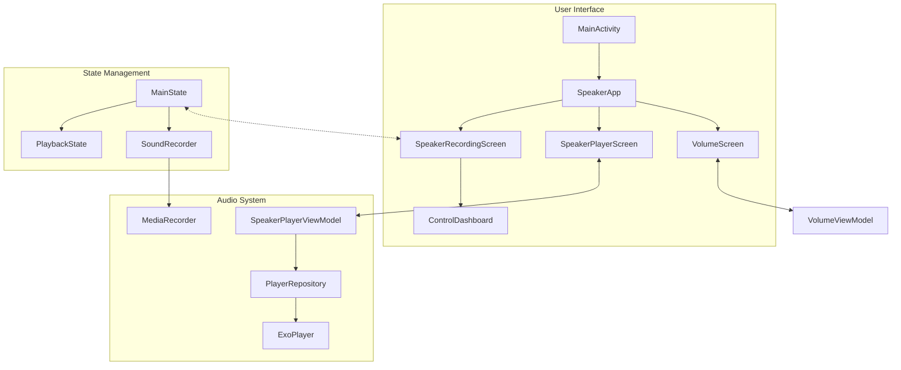
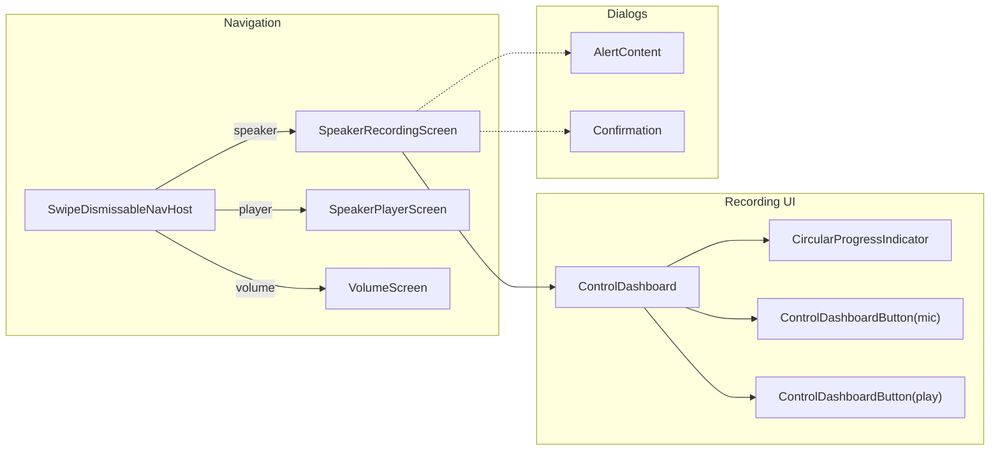
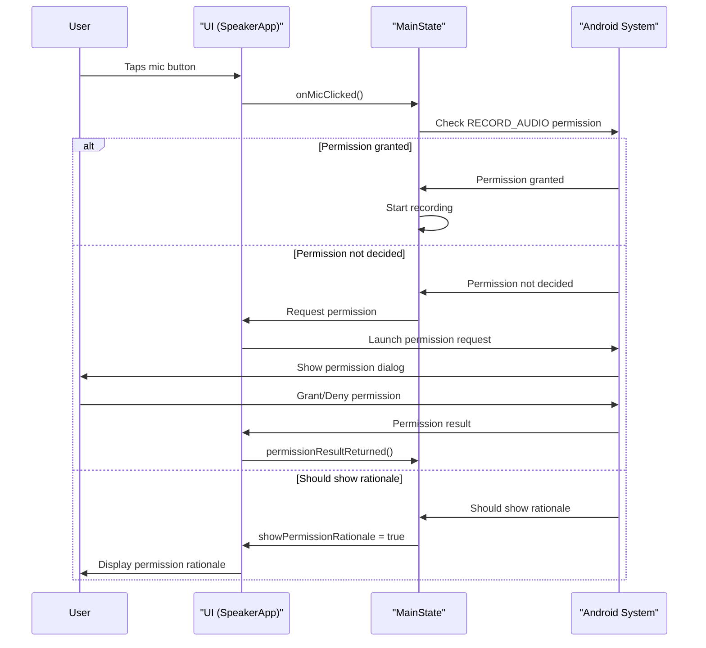

<!-- source: DeepWiki mcp.deepwiki.com · repo android/wear-os-samples · page 9 Audio Applications · fetched 2026-10-23 -->

# Audio Applications

<details>
<summary>Relevant source files</summary>

The following files were used as context for generating this wiki page:

- [WearSpeakerSample/gradle.properties](WearSpeakerSample/gradle.properties)
- [WearSpeakerSample/wear/src/main/AndroidManifest.xml](WearSpeakerSample/wear/src/main/AndroidManifest.xml)
- [WearSpeakerSample/wear/src/main/java/com/example/android/wearable/speaker/ControlDashboard.kt](WearSpeakerSample/wear/src/main/java/com/example/android/wearable/speaker/ControlDashboard.kt)
- [WearSpeakerSample/wear/src/main/java/com/example/android/wearable/speaker/MainActivity.kt](WearSpeakerSample/wear/src/main/java/com/example/android/wearable/speaker/MainActivity.kt)
- [WearSpeakerSample/wear/src/main/java/com/example/android/wearable/speaker/MainState.kt](WearSpeakerSample/wear/src/main/java/com/example/android/wearable/speaker/MainState.kt)
- [WearSpeakerSample/wear/src/main/java/com/example/android/wearable/speaker/SoundRecorder.kt](WearSpeakerSample/wear/src/main/java/com/example/android/wearable/speaker/SoundRecorder.kt)
- [WearSpeakerSample/wear/src/main/java/com/example/android/wearable/speaker/SpeakerApp.kt](WearSpeakerSample/wear/src/main/java/com/example/android/wearable/speaker/SpeakerApp.kt)
- [WearSpeakerSample/wear/src/main/java/com/example/android/wearable/speaker/SpeakerPlayerViewModel.kt](WearSpeakerSample/wear/src/main/java/com/example/android/wearable/speaker/SpeakerPlayerViewModel.kt)
- [WearSpeakerSample/wear/src/main/res/values/strings.xml](WearSpeakerSample/wear/src/main/res/values/strings.xml)

</details>


## Purpose and Scope

This document covers the implementation of audio recording and playback capabilities on Wear OS devices. It focuses on the WearSpeakerSample project, which demonstrates how to create applications that can record audio from the device microphone and play it back using Wear OS speakers or connected Bluetooth audio devices. This sample showcases permission handling, audio recording, and playback using modern Android audio APIs and Jetpack Compose for UI.

## System Architecture Overview

The WearSpeakerSample demonstrates a complete audio application for Wear OS with recording and playback capabilities organized into several key components:



Sources: [WearSpeakerSample/wear/src/main/java/com/example/android/wearable/speaker/MainActivity.kt](), [WearSpeakerSample/wear/src/main/java/com/example/android/wearable/speaker/SpeakerApp.kt](), [WearSpeakerSample/wear/src/main/java/com/example/android/wearable/speaker/MainState.kt](), [WearSpeakerSample/wear/src/main/java/com/example/android/wearable/speaker/SoundRecorder.kt](), [WearSpeakerSample/wear/src/main/java/com/example/android/wearable/speaker/SpeakerPlayerViewModel.kt]()

## Core Components

### Audio Recording System

The audio recording system is built around the `SoundRecorder` class which handles microphone access and audio file creation:

```mermaid
classDiagram
    class "SoundRecorder" {
        -File audioFile
        -State state
        +record() suspend
    }
    
    class "MediaRecorder" {
        +setAudioSource()
        +setOutputFormat()
        +setAudioEncoder()
        +setOutputFile()
        +prepare()
        +start()
        +stop()
    }
    
    class "MainState" {
        -MutatorMutex playbackStateMutatorMutex
        -SoundRecorder soundRecorder
        +PlaybackState playbackState
        +float recordingProgress
        +boolean isPermissionDenied
        +onMicClicked() suspend
        +permissionResultReturned() suspend
    }
    
    class "PlaybackState" {
        +Ready
        +PlayingVoice
        +Recording
    }
    
    "SoundRecorder" ..> "MediaRecorder" : uses
    "MainState" --> "SoundRecorder" : owns
    "MainState" --> "PlaybackState" : tracks
```

The recording flow:
1. User taps the microphone button, triggering `onMicClicked()` in `MainState`
2. Permission check occurs (RECORD_AUDIO)
3. If granted, recording starts via `SoundRecorder.record()`
4. Audio is captured using Android's `MediaRecorder` API with OGG format and OPUS encoding
5. Recording continues for up to 10 seconds or until the user stops it
6. Progress is tracked and displayed to the user

Sources: [WearSpeakerSample/wear/src/main/java/com/example/android/wearable/speaker/SoundRecorder.kt](), [WearSpeakerSample/wear/src/main/java/com/example/android/wearable/speaker/MainState.kt:42-236]()

### Audio Playback System

The playback system leverages AndroidX Media3 and the Horologist library for Wear OS media playback:

```mermaid
classDiagram
    class "SpeakerPlayerViewModel" {
        -PlayerRepositoryImpl playerRepository
        -Player player
        -File audioFile
        -String audioFileUri
        +playerState
    }
    
    class "PlayerRepositoryImpl" {
        +connect(Player)
        +setMedia(Media)
        +player
    }
    
    class "ExoPlayer" {
        +setSeekForwardIncrementMs()
        +setSeekBackIncrementMs()
    }
    
    class "SpeakerPlayerScreen" {
        +onVolumeClick()
    }
    
    "SpeakerPlayerViewModel" --> "PlayerRepositoryImpl" : uses
    "SpeakerPlayerViewModel" --> "ExoPlayer" : configures
    "SpeakerPlayerScreen" ..> "SpeakerPlayerViewModel" : observes
```

The playback flow:
1. `SpeakerPlayerViewModel` initializes ExoPlayer and PlayerRepository
2. When navigating to the player screen, it checks if the recorded audio file exists
3. If the file exists, it creates a Media object with the URI to the file
4. The player screen UI provides controls for playback
5. Volume control is available through a dedicated screen using Horologist's VolumeScreen component

Sources: [WearSpeakerSample/wear/src/main/java/com/example/android/wearable/speaker/SpeakerPlayerViewModel.kt](), [WearSpeakerSample/wear/src/main/java/com/example/android/wearable/speaker/SpeakerApp.kt:140-150]()

## State Management

The application uses a state-based architecture centered around the `MainState` class which manages:

1. Playback state transitions
2. Recording progress tracking
3. Permission handling
4. Error states

The application has three primary states defined in the `PlaybackState` sealed class:
- `Ready`: Initial state, ready to record or play
- `Recording`: Currently recording audio
- `PlayingVoice`: Playing back recorded audio

A `MutatorMutex` ensures that only one audio operation runs at a time, automatically handling cleanup of any ongoing asynchronous work.

Sources: [WearSpeakerSample/wear/src/main/java/com/example/android/wearable/speaker/MainState.kt:42-177]()

## User Interface Components

The UI is built with Jetpack Compose for Wear OS and organized into a navigation structure:



The `ControlDashboard` is a key UI component that displays:
- Microphone button for starting/stopping recording
- Play button for navigating to the playback screen
- Circular progress indicator showing recording progress

The UI reactively updates based on changes to the `MainState` properties:
- `playbackState`: Controls button visibility and enabled state
- `recordingProgress`: Updates the circular progress indicator
- `isPermissionDenied`: Shows appropriate UI when permission is denied
- `showPermissionRationale`: Triggers permission rationale dialog

Sources: [WearSpeakerSample/wear/src/main/java/com/example/android/wearable/speaker/SpeakerApp.kt:49-154](), [WearSpeakerSample/wear/src/main/java/com/example/android/wearable/speaker/ControlDashboard.kt]()

## Permissions and Device Compatibility

### Permission Handling

The application requires the `RECORD_AUDIO` permission to access the device microphone:



The permission request flow is handled by:
1. Checking current permission state
2. Showing rationale dialog if needed
3. Requesting permission through the system
4. Handling the result in `permissionResultReturned()`

Sources: [WearSpeakerSample/wear/src/main/AndroidManifest.xml:24](), [WearSpeakerSample/wear/src/main/java/com/example/android/wearable/speaker/MainState.kt:102-167]()

### Speaker Support Detection

The application verifies that the device can output audio by checking for:
1. The `FEATURE_AUDIO_OUTPUT` system feature
2. Built-in speaker availability
3. Connected Bluetooth audio devices

This logic is implemented in the `speakerIsSupported()` function which checks both built-in speakers and various Bluetooth audio device types supported by Wear OS.

Sources: [WearSpeakerSample/wear/src/main/java/com/example/android/wearable/speaker/MainState.kt:184-205]()

## Implementation Details

### Audio Recording Configuration

The `SoundRecorder` class configures the `MediaRecorder` with:
- Audio source: Microphone (`MediaRecorder.AudioSource.MIC`)
- Output format: OGG (`MediaRecorder.OutputFormat.OGG`)
- Audio encoder: OPUS (`MediaRecorder.AudioEncoder.OPUS`)
- Output file: A file named "audiorecord.opus" in the app's private files directory

Recording is implemented using a coroutine-based approach with `suspendCancellableCoroutine`, allowing for clean cancellation and resource release.

Sources: [WearSpeakerSample/wear/src/main/java/com/example/android/wearable/speaker/SoundRecorder.kt:29-83]()

### Audio Playback Configuration

Playback is handled by the `SpeakerPlayerViewModel` class which:
1. Creates an ExoPlayer instance with 5-second seek increments
2. Connects it to a `PlayerRepositoryImpl` from the Horologist library
3. Loads the recorded audio file from the same location it was saved to
4. Exposes player state to the UI via the `playerState` property

The playback UI uses Horologist's media UI components for a consistent Wear OS media experience.

Sources: [WearSpeakerSample/wear/src/main/java/com/example/android/wearable/speaker/SpeakerPlayerViewModel.kt:35-84]()

## Best Practices

When implementing audio applications for Wear OS, consider these patterns demonstrated in the sample:

1. **Permission Handling**: Always check permissions at runtime and provide clear rationale
2. **Resource Efficiency**: Use coroutines for asynchronous operations and ensure proper cleanup
3. **State Management**: Use a well-defined state model to manage audio application states
4. **Device Compatibility**: Check for audio output support before attempting playback
5. **Coroutine Cancellation**: Use `suspendCancellableCoroutine` for operations that need proper cleanup
6. **Progress Feedback**: Provide visual feedback during recording operations
7. **Library Integration**: Leverage Horologist library components designed specifically for Wear OS

Sources: [WearSpeakerSample/wear/src/main/java/com/example/android/wearable/speaker/MainState.kt](), [WearSpeakerSample/wear/src/main/java/com/example/android/wearable/speaker/SoundRecorder.kt]()

---

