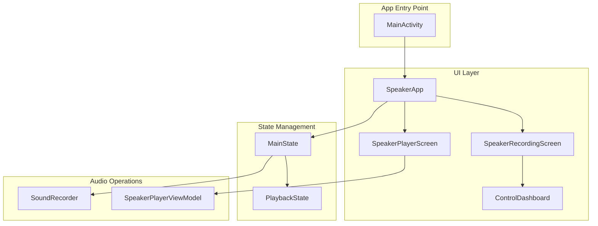
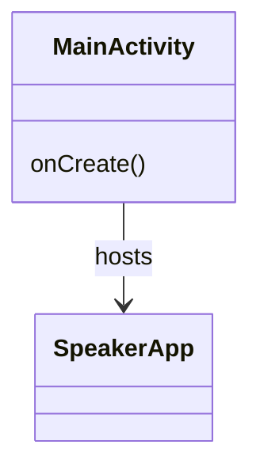
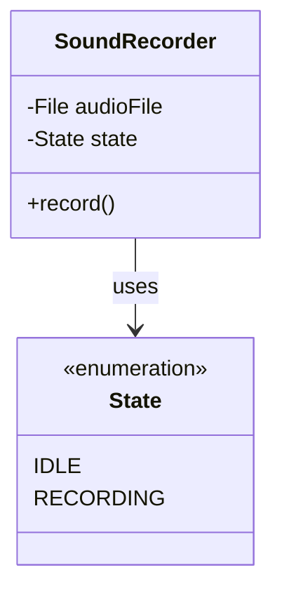
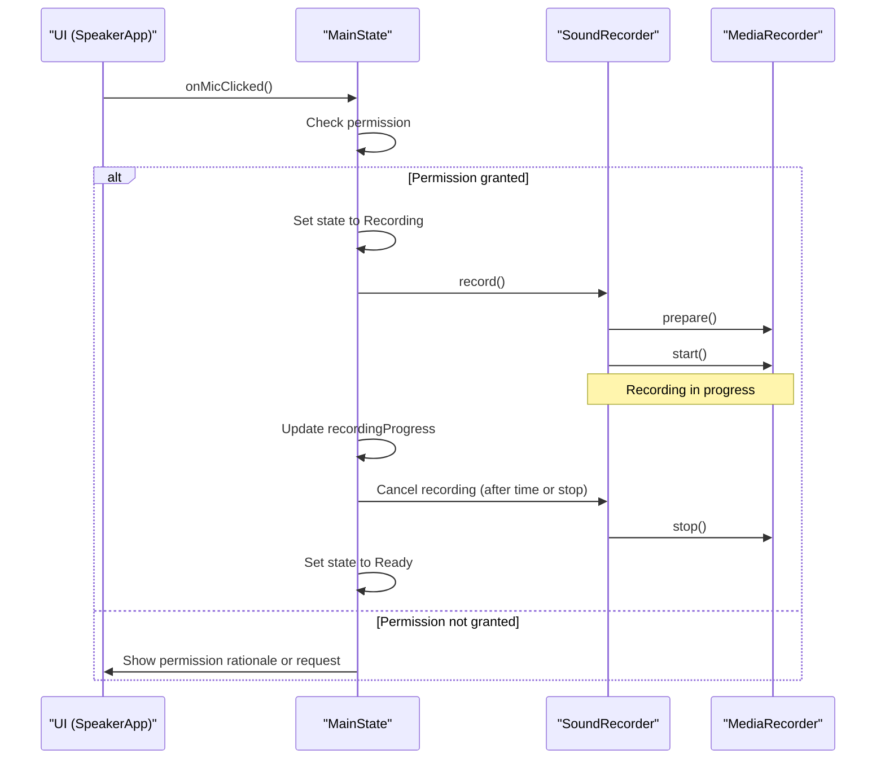
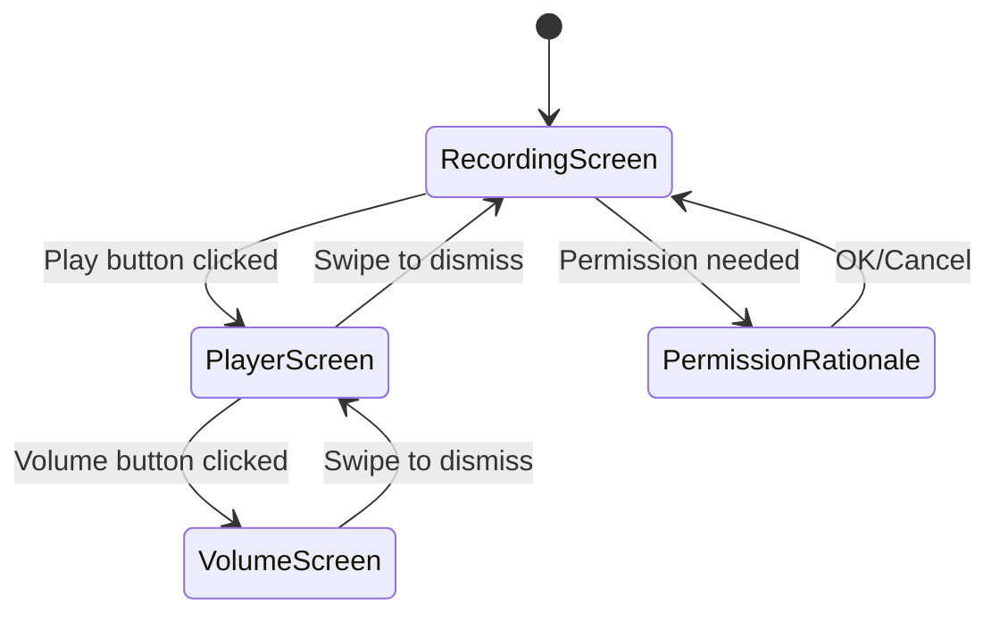
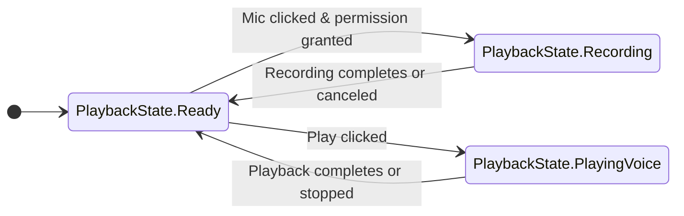
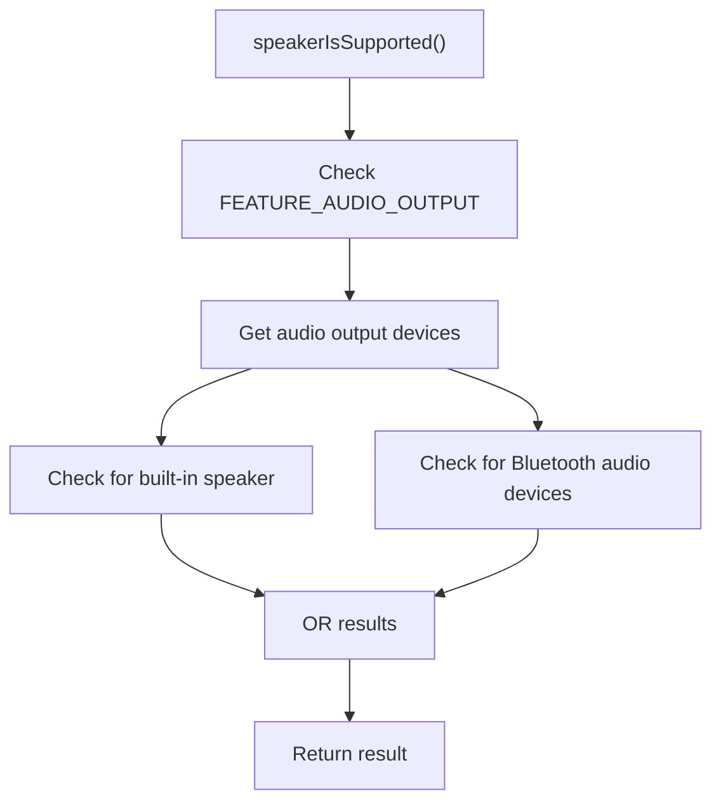

<!-- source: DeepWiki mcp.deepwiki.com · repo android/wear-os-samples · page 9.1 Speaker Sample Implementation · fetched 2026-10-23 -->

# Speaker Sample Implementation

<details>
<summary>Relevant source files</summary>

The following files were used as context for generating this wiki page:

- [WearSpeakerSample/gradle.properties](WearSpeakerSample/gradle.properties)
- [WearSpeakerSample/wear/src/main/AndroidManifest.xml](WearSpeakerSample/wear/src/main/AndroidManifest.xml)
- [WearSpeakerSample/wear/src/main/java/com/example/android/wearable/speaker/ControlDashboard.kt](WearSpeakerSample/wear/src/main/java/com/example/android/wearable/speaker/ControlDashboard.kt)
- [WearSpeakerSample/wear/src/main/java/com/example/android/wearable/speaker/MainActivity.kt](WearSpeakerSample/wear/src/main/java/com/example/android/wearable/speaker/MainActivity.kt)
- [WearSpeakerSample/wear/src/main/java/com/example/android/wearable/speaker/MainState.kt](WearSpeakerSample/wear/src/main/java/com/example/android/wearable/speaker/MainState.kt)
- [WearSpeakerSample/wear/src/main/java/com/example/android/wearable/speaker/SoundRecorder.kt](WearSpeakerSample/wear/src/main/java/com/example/android/wearable/speaker/SoundRecorder.kt)
- [WearSpeakerSample/wear/src/main/java/com/example/android/wearable/speaker/SpeakerApp.kt](WearSpeakerSample/wear/src/main/java/com/example/android/wearable/speaker/SpeakerApp.kt)
- [WearSpeakerSample/wear/src/main/java/com/example/android/wearable/speaker/SpeakerPlayerViewModel.kt](WearSpeakerSample/wear/src/main/java/com/example/android/wearable/speaker/SpeakerPlayerViewModel.kt)
- [WearSpeakerSample/wear/src/main/res/values/strings.xml](WearSpeakerSample/wear/src/main/res/values/strings.xml)

</details>


This document provides a detailed technical overview of the Speaker Sample implementation in the Wear OS Samples repository. This sample demonstrates how to implement audio recording and playback capabilities on Wear OS devices, showcasing permission handling, audio recording, file storage, and playback functionality.

## Purpose and Scope

The Speaker Sample demonstrates:
- Audio recording from the device microphone
- Audio playback through the device speaker or connected Bluetooth audio devices
- Permission handling for microphone access
- State management for recording and playback operations
- Integration with Media3 (ExoPlayer) for audio playback
- Volume control using Horologist library components

Sources: [WearSpeakerSample/wear/src/main/AndroidManifest.xml:17-50](), [WearSpeakerSample/wear/src/main/java/com/example/android/wearable/speaker/MainActivity.kt:1-36]()

## System Architecture

The Speaker Sample follows a structured architecture that separates concerns between UI components, state management, and audio operations.



Sources: [WearSpeakerSample/wear/src/main/java/com/example/android/wearable/speaker/MainActivity.kt:26-36](), [WearSpeakerSample/wear/src/main/java/com/example/android/wearable/speaker/SpeakerApp.kt:49-154](), [WearSpeakerSample/wear/src/main/java/com/example/android/wearable/speaker/MainState.kt:36-177]()

## Core Components

### 1. MainActivity

The entry point for the application, which simply hosts the `SpeakerApp` composable.



Sources: [WearSpeakerSample/wear/src/main/java/com/example/android/wearable/speaker/MainActivity.kt:24-36]()

### 2. SpeakerApp

The main composable that sets up the app's UI and navigation system. It manages:
- Navigation between recording and playback screens
- Permission handling
- State management via `MainState`
- Lifecycle handling to reset state when the app is stopped

Sources: [WearSpeakerSample/wear/src/main/java/com/example/android/wearable/speaker/SpeakerApp.kt:49-154]()

### 3. MainState

The state holder driving the application logic. It manages:
- The current playback state (Ready, Recording, PlayingVoice)
- Recording progress
- Permission state
- Sound recorder operations

Key features:
- Uses `MutatorMutex` to ensure only one audio operation occurs at a time
- Handles permission checking and requesting
- Manages recording lifecycle

Sources: [WearSpeakerSample/wear/src/main/java/com/example/android/wearable/speaker/MainState.kt:36-236]()

### 4. SoundRecorder

A helper class for recording audio from the microphone to internal storage.



Sources: [WearSpeakerSample/wear/src/main/java/com/example/android/wearable/speaker/SoundRecorder.kt:29-83]()

### 5. ControlDashboard

UI component that displays the main controls for recording and playing audio.

Sources: [WearSpeakerSample/wear/src/main/java/com/example/android/wearable/speaker/ControlDashboard.kt:44-137]()

### 6. SpeakerPlayerViewModel

Manages the playback of recorded audio using Media3 ExoPlayer and the Horologist library.

Sources: [WearSpeakerSample/wear/src/main/java/com/example/android/wearable/speaker/SpeakerPlayerViewModel.kt:35-85]()

## Recording Implementation

The recording functionality is implemented through a combination of `MainState` and `SoundRecorder`.



Key aspects of recording implementation:

1. **Permission Handling**
   - The app requires `RECORD_AUDIO` permission, declared in the manifest
   - Permission request is handled by `MainState` using the Activity's permission APIs
   - Shows a rationale dialog if the user previously denied the permission

2. **Recording Process**
   - Recording is managed by `SoundRecorder` using Android's `MediaRecorder`
   - Audio is recorded in OGG format with OPUS encoding
   - Recording is limited to 10 seconds by default
   - Progress is tracked and reported back to the UI

3. **File Storage**
   - Recorded audio is saved to the app's internal storage as "audiorecord.opus"

Sources: [WearSpeakerSample/wear/src/main/java/com/example/android/wearable/speaker/MainState.kt:102-167](), [WearSpeakerSample/wear/src/main/java/com/example/android/wearable/speaker/SoundRecorder.kt:46-78](), [WearSpeakerSample/wear/src/main/AndroidManifest.xml:24]()

## Playback Implementation

Audio playback is handled by the `SpeakerPlayerViewModel` using Media3 ExoPlayer and Horologist library components.

```mermaid
flowchart TD
    SpeakerPlayerScreen["SpeakerPlayerScreen"]
    SpeakerPlayerViewModel["SpeakerPlayerViewModel"]
    PlayerRepositoryImpl["PlayerRepositoryImpl"]
    ExoPlayer["ExoPlayer"]
    AudioFile["audiorecord.opus"]
    VolumeViewModel["VolumeViewModel"]
    
    SpeakerPlayerScreen --> SpeakerPlayerViewModel: uses
    SpeakerPlayerViewModel --> PlayerRepositoryImpl: uses
    PlayerRepositoryImpl --> ExoPlayer: controls
    ExoPlayer --> AudioFile: plays
    SpeakerPlayerScreen --> VolumeViewModel: uses for volume control
```

Key aspects of playback implementation:

1. **Media Loading**
   - The `SpeakerPlayerViewModel` loads the recorded audio file
   - Creates a `Media` object representing the recorded audio

2. **Playback Control**
   - Uses Horologist's `PlayerRepositoryImpl` to manage playback
   - Connects to an ExoPlayer instance configured with seek increments

3. **Volume Control**
   - Integrated with Horologist's volume control components
   - Accessible through the volume screen

Sources: [WearSpeakerSample/wear/src/main/java/com/example/android/wearable/speaker/SpeakerPlayerViewModel.kt:35-85](), [WearSpeakerSample/wear/src/main/java/com/example/android/wearable/speaker/SpeakerApp.kt:140-150]()

## User Interface

The app's UI is built with Jetpack Compose for Wear OS and consists of three main screens:

1. **Recording Screen**
   - Primary screen for recording audio
   - Shows recording controls and progress
   - Handles permission requests and rationales

2. **Player Screen**
   - For playing back recorded audio
   - Includes playback controls

3. **Volume Screen**
   - Provided by Horologist library
   - Allows volume adjustment for audio playback

Navigation is handled by Wear's `SwipeDismissableNavHost` to enable swipe-to-dismiss behavior, which is standard for Wear OS applications.



The UI incorporates several Wear OS-specific components:

1. **ControlDashboard**
   - Custom component displaying recording and playback buttons
   - Adapts its appearance based on the current state
   - Shows a circular progress indicator during recording

2. **Confirmation Dialogs**
   - Used for permission rationales
   - Used for displaying errors (e.g., speaker not supported)

3. **AppScaffold**
   - Horologist component providing a consistent layout

Sources: [WearSpeakerSample/wear/src/main/java/com/example/android/wearable/speaker/SpeakerApp.kt:101-151](), [WearSpeakerSample/wear/src/main/java/com/example/android/wearable/speaker/ControlDashboard.kt:44-137]()

## State Management

The application uses a state machine pattern to manage the audio recording and playback processes.



The state management is primarily handled by:

1. **PlaybackState sealed class**
   - Defines the three possible states: Ready, Recording, PlayingVoice
   - Used to drive UI changes and control logic

2. **MainState class**
   - Manages state transitions based on user interactions
   - Uses `MutatorMutex` to ensure only one audio operation at a time
   - Handles permission checking and requesting
   - Manages recording progress

3. **ControlDashboardUiState**
   - Represents the UI state of the control dashboard
   - Defines which buttons are enabled, visible, and expanded

Sources: [WearSpeakerSample/wear/src/main/java/com/example/android/wearable/speaker/MainState.kt:173-177](), [WearSpeakerSample/wear/src/main/java/com/example/android/wearable/speaker/ControlDashboard.kt:114-137]()

## Device Compatibility

The sample includes logic to check if the device has audio output capabilities:



The check examines:
1. If the device has the `FEATURE_AUDIO_OUTPUT` system feature
2. If there's a built-in speaker (only trusted if feature is present)
3. If there are connected Bluetooth audio devices (A2DP, BLE Broadcast, BLE Speaker, BLE Headset)

If no audio output is available, a confirmation dialog is shown informing the user.

Sources: [WearSpeakerSample/wear/src/main/java/com/example/android/wearable/speaker/MainState.kt:184-205](), [WearSpeakerSample/wear/src/main/java/com/example/android/wearable/speaker/SpeakerApp.kt:132-138]()

## Permissions

The sample demonstrates the recommended approach for handling runtime permissions on Wear OS:

1. **Manifest Declaration**
   - The `RECORD_AUDIO` permission is declared in the manifest

2. **Permission Request**
   - Uses Compose's `rememberLauncherForActivityResult` with `RequestPermission()`
   - Checks permission status before attempting to record
   - Shows rationale dialog if needed

3. **Permission State Tracking**
   - Tracks if permission is denied to adapt the UI accordingly
   - Provides a rationale when requesting permission

Sources: [WearSpeakerSample/wear/src/main/AndroidManifest.xml:24](), [WearSpeakerSample/wear/src/main/java/com/example/android/wearable/speaker/SpeakerApp.kt:57-82](), [WearSpeakerSample/wear/src/main/java/com/example/android/wearable/speaker/MainState.kt:102-167]()

---

