# Page: Overview

# Overview

<details>
<summary>Relevant source files</summary>

The following files were used as context for generating this wiki page:

- [ComposeStarter/gradle/libs.versions.toml](ComposeStarter/gradle/libs.versions.toml)
- [DataLayer/README.md](DataLayer/README.md)
- [DataLayer/gradle/libs.versions.toml](DataLayer/gradle/libs.versions.toml)
- [README.md](README.md)
- [WearOAuth/gradle/libs.versions.toml](WearOAuth/gradle/libs.versions.toml)
- [WearSpeakerSample/README.md](WearSpeakerSample/README.md)
- [WearSpeakerSample/gradle/libs.versions.toml](WearSpeakerSample/gradle/libs.versions.toml)
- [WearTilesKotlin/gradle/libs.versions.toml](WearTilesKotlin/gradle/libs.versions.toml)

</details>


This document provides a comprehensive introduction to the Wear OS Samples repository, which contains a collection of sample applications demonstrating various development patterns and APIs for Wear OS. The repository serves as a valuable resource for developers looking to create applications for wearable devices running Wear OS.

## Purpose and Scope

The Wear OS Samples repository is designed to:

- Demonstrate best practices for Wear OS application development
- Provide working examples of common use cases and patterns
- Showcase integration with key Wear OS APIs and libraries
- Serve as starting points for developers building their own Wear OS applications

For detailed information about the repository structure and organization, see [Project Structure](#1.1).

## Repository Overview

The repository contains multiple standalone sample projects, each focusing on specific aspects of Wear OS development.

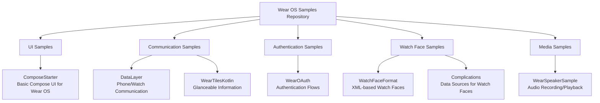

Sources: [README.md:1-26]()

## Key Sample Applications

The repository includes the following sample applications:

| Sample | Category | Purpose |
|--------|----------|---------|
| ComposeStarter | UI | Simple starting point for Compose on Wear OS |
| DataLayer | Communication | Demonstrates watch-phone data exchange |
| WearTilesKotlin | Communication | Shows implementation of Tiles for glanceable information |
| WearOAuth | Authentication | Demonstrates authentication via OAuth |
| WatchFaceFormat | Watch Faces | Shows XML-based watch face development |
| Complications | Watch Faces | Provides test data sources for watch face complications |
| WearSpeakerSample | Media | Demonstrates audio recording and playback |

Sources: [README.md:9-25](), [DataLayer/README.md:1-67](), [WearSpeakerSample/README.md:1-9]()

## Technology Stack

All samples in the repository share a common technology foundation while demonstrating various Wear OS capabilities.

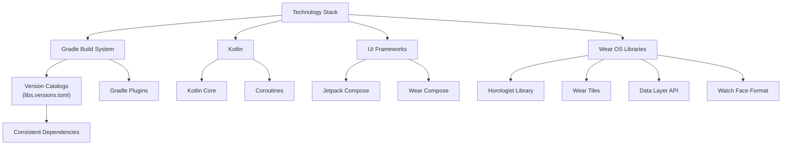

Sources: [WearOAuth/gradle/libs.versions.toml:1-59](), [WearTilesKotlin/gradle/libs.versions.toml:1-35](), [DataLayer/gradle/libs.versions.toml:1-59](), [ComposeStarter/gradle/libs.versions.toml:1-49](), [WearSpeakerSample/gradle/libs.versions.toml:1-59]()

## Dependency Management

All samples use Gradle Version Catalogs for dependency management, ensuring consistent versions across projects. The key dependencies include:

### Common Dependencies

- **Android Gradle Plugin**: Build tool for Android applications
- **Kotlin**: Programming language used across all samples
- **Jetpack Compose**: UI toolkit for building native interfaces
- **Wear Compose**: Wear OS-specific Compose components
- **Horologist**: Google's library for Wear OS development that simplifies common tasks

### Sample-Specific Dependencies

- **WearSpeakerSample**: Additional Media3 libraries for audio playback
- **WearTilesKotlin**: Tiles libraries for creating glanceable information
- **DataLayer**: Wearable services for communication
- **WearOAuth**: Authentication-related libraries

The version catalog system ensures that all samples follow consistent dependency versions while allowing each sample to include specialized libraries as needed.

Sources: [WearOAuth/gradle/libs.versions.toml:1-59](), [WearTilesKotlin/gradle/libs.versions.toml:1-35](), [DataLayer/gradle/libs.versions.toml:1-59](), [ComposeStarter/gradle/libs.versions.toml:1-49](), [WearSpeakerSample/gradle/libs.versions.toml:1-59]()

## Getting Started

To use these samples:

1. Clone the repository
2. Open the desired sample in Android Studio
3. Build and run on a Wear OS device or emulator

Each sample is a standalone project with its own `build.gradle` file and can be run independently. The samples require Android SDK 30 or higher and are designed to work with the latest Wear OS versions.

Sources: [WearSpeakerSample/README.md:15-25](), [DataLayer/README.md:92-106]()

## Relationship Between Samples

While each sample can be used independently, together they provide a comprehensive reference for Wear OS development:

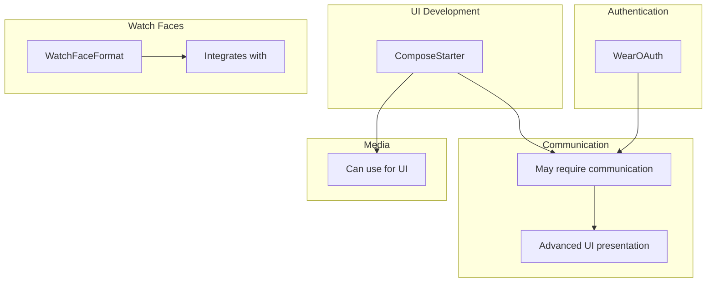

Sources: [README.md:9-25]()

## Conclusion

The Wear OS Samples repository serves as a comprehensive resource for developers building applications for Wear OS. By providing practical examples of various Wear OS development patterns, the repository helps developers understand best practices and implement common functionality more efficiently.

The following pages provide more detailed information about specific aspects of the repository and individual sample applications.

---

# Page: Project Structure

# Project Structure

<details>
<summary>Relevant source files</summary>

The following files were used as context for generating this wiki page:

- [Complications/gradle/wrapper/gradle-wrapper.properties](Complications/gradle/wrapper/gradle-wrapper.properties)
- [ComposeStarter/gradle/wrapper/gradle-wrapper.properties](ComposeStarter/gradle/wrapper/gradle-wrapper.properties)
- [DataLayer/README.md](DataLayer/README.md)
- [DataLayer/gradle/wrapper/gradle-wrapper.properties](DataLayer/gradle/wrapper/gradle-wrapper.properties)
- [README.md](README.md)
- [WatchFaceFormat/Complications/gradle/wrapper/gradle-wrapper.properties](WatchFaceFormat/Complications/gradle/wrapper/gradle-wrapper.properties)
- [WatchFaceFormat/Flavors/gradle/wrapper/gradle-wrapper.properties](WatchFaceFormat/Flavors/gradle/wrapper/gradle-wrapper.properties)
- [WatchFaceFormat/SimpleAnalog/gradle/wrapper/gradle-wrapper.properties](WatchFaceFormat/SimpleAnalog/gradle/wrapper/gradle-wrapper.properties)
- [WatchFaceFormat/SimpleDigital/gradle/wrapper/gradle-wrapper.properties](WatchFaceFormat/SimpleDigital/gradle/wrapper/gradle-wrapper.properties)
- [WatchFaceFormat/Weather/gradle/wrapper/gradle-wrapper.properties](WatchFaceFormat/Weather/gradle/wrapper/gradle-wrapper.properties)
- [WearOAuth/gradle/wrapper/gradle-wrapper.properties](WearOAuth/gradle/wrapper/gradle-wrapper.properties)
- [WearSpeakerSample/README.md](WearSpeakerSample/README.md)
- [WearSpeakerSample/gradle/wrapper/gradle-wrapper.properties](WearSpeakerSample/gradle/wrapper/gradle-wrapper.properties)
- [WearTilesKotlin/gradle/wrapper/gradle-wrapper.properties](WearTilesKotlin/gradle/wrapper/gradle-wrapper.properties)

</details>


## Purpose and Scope

This document provides a comprehensive overview of how the Wear OS Samples repository is organized. It explains the structure of the repository, the different sample applications it contains, and how these samples relate to each other. For information about specific dependency management details across projects, see [Dependency Management](#2).

## Repository Organization

The Wear OS Samples repository is structured as a collection of independent Android Studio projects, each demonstrating specific Wear OS development patterns and APIs. Each sample can be built and run independently, making it easy to focus on specific aspects of Wear OS development.

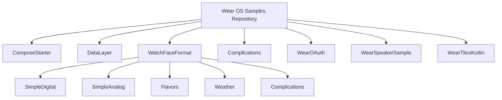

Sources: [README.md:1-25](). Each sample is referenced in the root README, showing the high-level organization of the repository.

## Common Build Configuration

All sample projects in the repository share a consistent build configuration, using the same Gradle version and similar project structures. This consistency makes it easier to understand and navigate between different samples.

| Component | Configuration |
|-----------|---------------|
| Gradle Version | 8.14 |
| Distribution Type | bin or all |
| Project Structure | Standard Android module structure |

Sources: [DataLayer/gradle/wrapper/gradle-wrapper.properties:1-8](), [WearOAuth/gradle/wrapper/gradle-wrapper.properties:1-8](), [WearSpeakerSample/gradle/wrapper/gradle-wrapper.properties:1-8](), [WearTilesKotlin/gradle/wrapper/gradle-wrapper.properties:1-8](), [ComposeStarter/gradle/wrapper/gradle-wrapper.properties:1-8](), [WatchFaceFormat/SimpleDigital/gradle/wrapper/gradle-wrapper.properties:1-8](), [Complications/gradle/wrapper/gradle-wrapper.properties:1-8]()

## Sample Applications Overview

### Sample Categories and Purposes

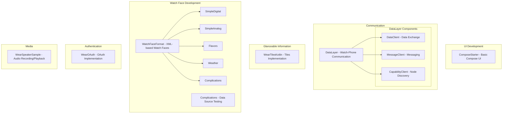

Sources: [README.md:4-25]()

## Individual Sample Details

### ComposeStarter

A simple starter project demonstrating basic Compose UI implementation for Wear OS. This sample serves as a foundation for developers beginning with Compose on wearable devices.

### DataLayer

Demonstrates three key communication patterns between Wear OS and mobile devices:

1. **Data Exchange**: Sending data assets (like photos) from phone to watch using `DataClient`
2. **Messaging**: Sending acknowledgments and commands via `MessageClient`
3. **Capability Discovery**: Finding connected nodes with specific capabilities via `CapabilityClient`

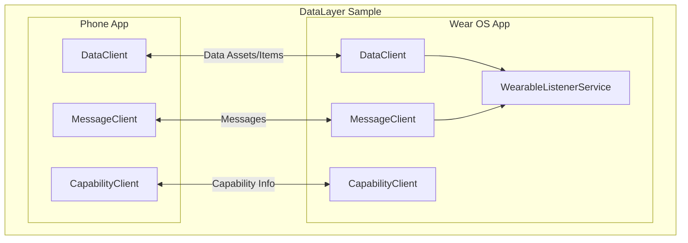

Sources: [DataLayer/README.md:1-116]()

### WatchFaceFormat

Demonstrates the Watch Face Format (WFF) which allows quick development of watch faces using XML. The sample is further divided into sub-projects:

- **SimpleDigital**: Basic digital watch face
- **SimpleAnalog**: Basic analog watch face
- **Flavors**: Watch face with different style variations
- **Weather**: Watch face with weather information
- **Complications**: Watch face with complications support

Sources: [README.md:16-17](), [WatchFaceFormat/SimpleDigital/gradle/wrapper/gradle-wrapper.properties:1-8](), [WatchFaceFormat/SimpleAnalog/gradle/wrapper/gradle-wrapper.properties:1-8](), [WatchFaceFormat/Flavors/gradle/wrapper/gradle-wrapper.properties:1-8](), [WatchFaceFormat/Weather/gradle/wrapper/gradle-wrapper.properties:1-8](), [WatchFaceFormat/Complications/gradle/wrapper/gradle-wrapper.properties:1-8]()

### Complications

Provides a full suite of data sources to test against watch face implementations with complications. This helps developers ensure their watch faces properly display different types of complication data.

Sources: [README.md:19](), [Complications/gradle/wrapper/gradle-wrapper.properties:1-8]()

### WearOAuth

Demonstrates how to authenticate users on Wear OS via OAuth without requiring a companion mobile app. The Wear OS companion app handles authentication requests on the mobile side.

Sources: [README.md:21](), [WearOAuth/gradle/wrapper/gradle-wrapper.properties:1-8]()

### WearSpeakerSample

Demonstrates audio recording using the microphone and playback through speakers (built-in or Bluetooth) on Wear OS devices. The sample also shows proper handling of permissions for audio recording.

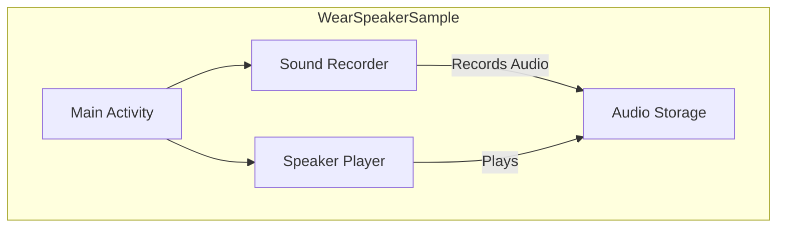

Sources: [README.md:23](), [WearSpeakerSample/README.md:1-36](), [WearSpeakerSample/gradle/wrapper/gradle-wrapper.properties:1-8]()

### WearTilesKotlin

Demonstrates creating tiles for Wear OS using the AndroidX Tiles library. Tiles provide glanceable information to users and can be accessed by swiping from the watch face.

Sources: [README.md:25](), [WearTilesKotlin/gradle/wrapper/gradle-wrapper.properties:1-8]()

## Project Interrelationships

While each sample is designed to stand alone, many demonstrate complementary aspects of Wear OS development:

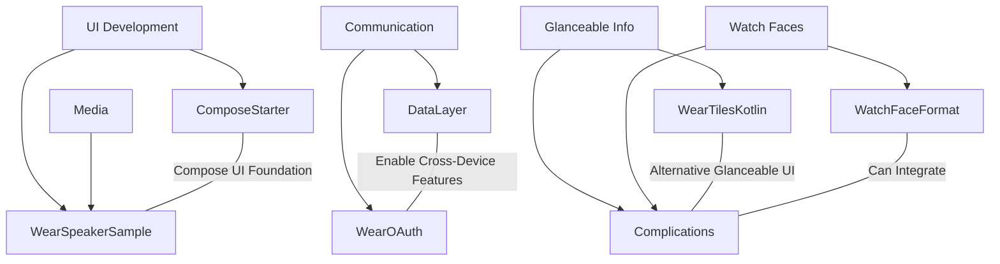

Sources: [README.md:4-25](), [WearSpeakerSample/README.md:10]()

## Development Approach

The samples in this repository demonstrate a modular approach to Wear OS development, with each focusing on specific capabilities while maintaining consistency in build configuration and development patterns. This allows developers to:

1. Study individual capabilities in isolation
2. Understand how different components can be integrated
3. Follow consistent patterns across different aspects of Wear OS development

The repository structure follows a pattern where each top-level directory is a self-contained sample project with standard Android project organization:

```
SampleName/
├── app/                # Application module
│   ├── src/            # Source code
│   ├── build.gradle    # Module build configuration
├── gradle/             # Gradle configuration
├── build.gradle        # Project build configuration
├── settings.gradle     # Project settings
├── README.md           # Sample documentation
```

Some samples may have additional modules beyond the standard `app` module, particularly those demonstrating communication between watch and phone.

Sources: [DataLayer/README.md:91-116](), [WearSpeakerSample/README.md:15-24]()

---

# Page: Dependency Management

# Dependency Management

<details>
<summary>Relevant source files</summary>

The following files were used as context for generating this wiki page:

- [Complications/gradle/libs.versions.toml](Complications/gradle/libs.versions.toml)
- [ComposeStarter/gradle/libs.versions.toml](ComposeStarter/gradle/libs.versions.toml)
- [DataLayer/gradle/libs.versions.toml](DataLayer/gradle/libs.versions.toml)
- [WatchFaceFormat/Complications/gradle/libs.versions.toml](WatchFaceFormat/Complications/gradle/libs.versions.toml)
- [WatchFaceFormat/Flavors/gradle/libs.versions.toml](WatchFaceFormat/Flavors/gradle/libs.versions.toml)
- [WatchFaceFormat/SimpleAnalog/gradle/libs.versions.toml](WatchFaceFormat/SimpleAnalog/gradle/libs.versions.toml)
- [WatchFaceFormat/SimpleDigital/gradle/libs.versions.toml](WatchFaceFormat/SimpleDigital/gradle/libs.versions.toml)
- [WatchFaceFormat/Weather/gradle/libs.versions.toml](WatchFaceFormat/Weather/gradle/libs.versions.toml)
- [WatchFaceFormat/validator-plugin/gradle/libs.versions.toml](WatchFaceFormat/validator-plugin/gradle/libs.versions.toml)
- [WatchFaceFormat/validator-plugin/plugins/build.gradle.kts](WatchFaceFormat/validator-plugin/plugins/build.gradle.kts)
- [WearOAuth/gradle/libs.versions.toml](WearOAuth/gradle/libs.versions.toml)
- [WearSpeakerSample/gradle/libs.versions.toml](WearSpeakerSample/gradle/libs.versions.toml)
- [WearTilesKotlin/gradle/libs.versions.toml](WearTilesKotlin/gradle/libs.versions.toml)
- [renovate.json](renovate.json)

</details>


This document describes how dependencies are managed across the Wear OS samples repository. It details the Gradle Version Catalog system used throughout the codebase to maintain consistent dependency versions and organize library references across multiple sample projects.

## Overview

The Wear OS samples repository implements a structured dependency management approach using Gradle Version Catalogs. Each sample project contains its own version catalog file that follows a consistent pattern while accommodating project-specific dependencies.

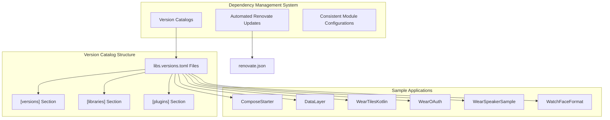

Sources: [WearOAuth/gradle/libs.versions.toml:1-59](), [DataLayer/gradle/libs.versions.toml:1-59](), [WearTilesKotlin/gradle/libs.versions.toml:1-35](), [renovate.json:1-46]()

## Gradle Version Catalogs

Gradle Version Catalogs provide a centralized way to declare and maintain dependencies across projects. Each sample in the repository has its own `libs.versions.toml` file, allowing for consistent versioning while accommodating project-specific needs.

### Version Catalog Structure

The version catalogs follow a standard TOML format with three main sections:

1. **Versions** - Defines the versions of libraries and plugins used in the project
2. **Libraries** - Declares the library dependencies, often referencing versions defined above
3. **Plugins** - Declares Gradle plugins with their versions

```mermaid
classDiagram
    class "libs.versions.toml" {
        [versions]
        [libraries]
        [plugins]
    }
    
    class "Versions Section" {
        android-gradle-plugin
        androidx-compose-bom
        compose-compiler
        kotlin
        horologist
        other project-specific versions
    }
    
    class "Libraries Section" {
        androidx-* libraries
        compose-* libraries
        kotlin-* libraries
        horologist-* modules
        testing libraries
        project-specific libraries
    }
    
    class "Plugins Section" {
        com-android-application
        com-diffplug-spotless
        compose-compiler
        roborazzi
    }
    
    "libs.versions.toml" --> "Versions Section"
    "libs.versions.toml" --> "Libraries Section"
    "libs.versions.toml" --> "Plugins Section"
```

Sources: [WearOAuth/gradle/libs.versions.toml:1-59](), [DataLayer/gradle/libs.versions.toml:1-59](), [ComposeStarter/gradle/libs.versions.toml:1-49]()

### Example Version Catalog

Below is an example of key sections from a typical version catalog in the repository:

```
[versions]
android-gradle-plugin = "8.10.0"
androidx-compose-bom = "2025.05.01"
compose-compiler = "1.5.15"
kotlin = "2.0.21"
horologist = "0.7.5-alpha"

[libraries]
androidx-activity-compose = { module = "androidx.activity:activity-compose", version.ref = "androidx-activity" }
androidx-compose-bom = { group = "androidx.compose", name = "compose-bom", version.ref = "androidx-compose-bom" }
horologist-compose-layout = { module = "com.google.android.horologist:horologist-compose-layout", version.ref = "horologist" }

[plugins]
com-android-application = { id = "com.android.application", version.ref = "android-gradle-plugin" }
compose-compiler = { id = "org.jetbrains.kotlin.plugin.compose", version.ref = "kotlin" }
```

Sources: [WearOAuth/gradle/libs.versions.toml:1-59]()

## Core Dependencies

The samples share a set of core dependencies that are essential for Wear OS application development:

### Android Foundation Libraries

* Android Gradle Plugin (`com.android.tools.build:gradle`)
* AndroidX Core KTX
* AndroidX Activity
* AndroidX Lifecycle components

### Compose for Wear OS

* Compose BOM (Bill of Materials)
* Wear Compose Foundation
* Wear Compose Material
* Wear Compose Navigation

### Kotlin and Coroutines

* Kotlin Gradle Plugin
* Kotlin Standard Library
* Kotlinx Coroutines (Core, Android, Play Services)

### Testing Libraries

* JUnit
* Robolectric
* Roborazzi (for screenshot testing)
* Espresso

Sources: [WearOAuth/gradle/libs.versions.toml:1-59](), [DataLayer/gradle/libs.versions.toml:1-59](), [ComposeStarter/gradle/libs.versions.toml:1-49]()

## Horologist Library Integration

Google's Horologist library is extensively used across samples. It provides specialized components for Wear OS development.

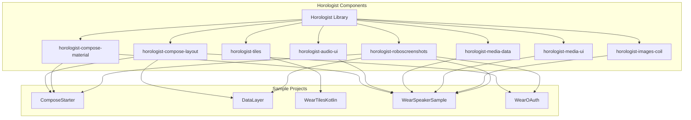

Sources: [WearSpeakerSample/gradle/libs.versions.toml:29-37](), [ComposeStarter/gradle/libs.versions.toml:29-31](), [WearTilesKotlin/gradle/libs.versions.toml:24-25]()

## Project-Specific Dependencies

While core dependencies are shared, each sample includes project-specific dependencies tailored to its functionality:

| Sample Project | Unique Dependencies | Purpose |
|----------------|---------------------|---------|
| WearTilesKotlin | `androidx.wear.tiles:tiles-material` | Tiles UI components |
|                 | `androidx.wear.tooling-preview` | Tiles preview support |
| WearSpeakerSample | `androidx.media3:media3-exoplayer` | Audio playback |
|                   | `androidx.media:media` | Media session support |
| Complications | `androidx.wear.watchface:watchface-complications-data-source-ktx` | Watch face complications |
| DataLayer | `kotlinx-coroutines-play-services` | Wearable data layer API integration |
|           | `playservices-wearable` | Google Play Services for wearables |

Sources: [WearTilesKotlin/gradle/libs.versions.toml:17-20](), [WearSpeakerSample/gradle/libs.versions.toml:24-52](), [Complications/gradle/libs.versions.toml:11-15]()

## Automated Dependency Management

The repository uses Renovate Bot to automate dependency updates, configured in the `renovate.json` file. This ensures all samples stay up-to-date with the latest library versions while respecting version constraints.

### Renovate Configuration

The Renovate configuration includes:

* Package grouping strategies
* Version constraints for specific libraries
* Update schedules
* Path-specific exclusions

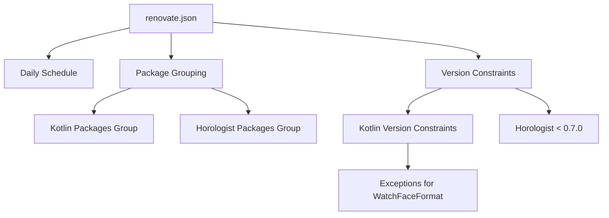

Sources: [renovate.json:1-46]()

## Best Practices

When creating new Wear OS projects or adding to the existing samples, follow these dependency management practices:

1. **Use Version Catalogs**: Create a `libs.versions.toml` file for centralized dependency management
2. **Follow the Established Pattern**: Maintain the three-section structure (versions, libraries, plugins)
3. **Reference Versions**: Use `version.ref` to reference versions defined in the versions section
4. **Stay Current with Wear OS Libraries**: Include the latest Wear Compose and Horologist libraries
5. **Consider Test Dependencies**: Include appropriate test libraries for unit and UI testing

### Adding New Dependencies

To add a new dependency:

1. Add the version to the `[versions]` section (if not already present)
2. Declare the library in the `[libraries]` section using the established format
3. Reference the library in your module's `build.gradle` file using the `libs` accessor

Sources: [WearOAuth/gradle/libs.versions.toml:1-59](), [DataLayer/gradle/libs.versions.toml:1-59]()

## Simplified Dependency Model

To visualize how dependencies flow through the repository, here's a simplified model:

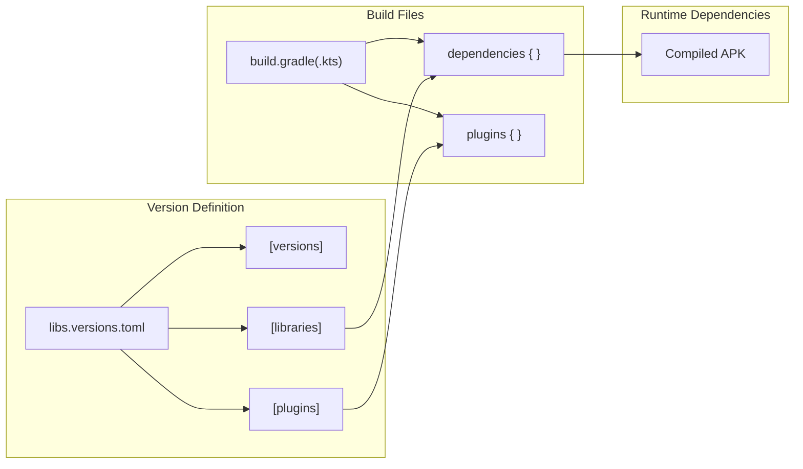

Sources: [WearOAuth/gradle/libs.versions.toml:1-59](), [DataLayer/gradle/libs.versions.toml:1-59](), [WatchFaceFormat/validator-plugin/plugins/build.gradle.kts:1-46]()

---

# Page: Build System

# Build System

<details>
<summary>Relevant source files</summary>

The following files were used as context for generating this wiki page:

- [.github/workflows/Complications.yml](.github/workflows/Complications.yml)
- [.github/workflows/ComposeStarter.yml](.github/workflows/ComposeStarter.yml)
- [.github/workflows/DataLayer.yml](.github/workflows/DataLayer.yml)
- [.github/workflows/WearOAuth.yml](.github/workflows/WearOAuth.yml)
- [.github/workflows/WearSpeakerSample.yml](.github/workflows/WearSpeakerSample.yml)
- [.github/workflows/WearTilesKotlin.yml](.github/workflows/WearTilesKotlin.yml)
- [.github/workflows/copy-branch.yml](.github/workflows/copy-branch.yml)
- [Complications/gradle/wrapper/gradle-wrapper.properties](Complications/gradle/wrapper/gradle-wrapper.properties)
- [ComposeStarter/app/build.gradle.kts](ComposeStarter/app/build.gradle.kts)
- [ComposeStarter/gradle/wrapper/gradle-wrapper.properties](ComposeStarter/gradle/wrapper/gradle-wrapper.properties)
- [DataLayer/Application/build.gradle.kts](DataLayer/Application/build.gradle.kts)
- [DataLayer/Wearable/build.gradle.kts](DataLayer/Wearable/build.gradle.kts)
- [DataLayer/Wearable/proguard-rules.pro](DataLayer/Wearable/proguard-rules.pro)
- [DataLayer/Wearable/src/main/java/com/example/android/wearable/datalayer/NodesViewModel.kt](DataLayer/Wearable/src/main/java/com/example/android/wearable/datalayer/NodesViewModel.kt)
- [DataLayer/build.gradle.kts](DataLayer/build.gradle.kts)
- [DataLayer/gradle/wrapper/gradle-wrapper.properties](DataLayer/gradle/wrapper/gradle-wrapper.properties)
- [WatchFaceFormat/Complications/gradle/wrapper/gradle-wrapper.properties](WatchFaceFormat/Complications/gradle/wrapper/gradle-wrapper.properties)
- [WatchFaceFormat/Flavors/gradle/wrapper/gradle-wrapper.properties](WatchFaceFormat/Flavors/gradle/wrapper/gradle-wrapper.properties)
- [WatchFaceFormat/SimpleAnalog/gradle/wrapper/gradle-wrapper.properties](WatchFaceFormat/SimpleAnalog/gradle/wrapper/gradle-wrapper.properties)
- [WatchFaceFormat/SimpleDigital/gradle/wrapper/gradle-wrapper.properties](WatchFaceFormat/SimpleDigital/gradle/wrapper/gradle-wrapper.properties)
- [WatchFaceFormat/Weather/gradle/wrapper/gradle-wrapper.properties](WatchFaceFormat/Weather/gradle/wrapper/gradle-wrapper.properties)
- [WearOAuth/gradle/wrapper/gradle-wrapper.properties](WearOAuth/gradle/wrapper/gradle-wrapper.properties)
- [WearSpeakerSample/gradle/wrapper/gradle-wrapper.properties](WearSpeakerSample/gradle/wrapper/gradle-wrapper.properties)
- [WearSpeakerSample/wear/build.gradle.kts](WearSpeakerSample/wear/build.gradle.kts)
- [WearTilesKotlin/gradle/wrapper/gradle-wrapper.properties](WearTilesKotlin/gradle/wrapper/gradle-wrapper.properties)

</details>


## Purpose and Scope

This document describes the Gradle build system used across all Wear OS sample projects. It covers the Gradle wrapper configuration, build settings, project structure, and continuous integration setup. For information about dependency management through version catalogs, see [Dependency Management](#2).

## Gradle Wrapper Configuration

All sample projects use the Gradle Wrapper to ensure consistent build behavior across different development environments. This standardization guarantees that all developers and CI systems use the same Gradle version.

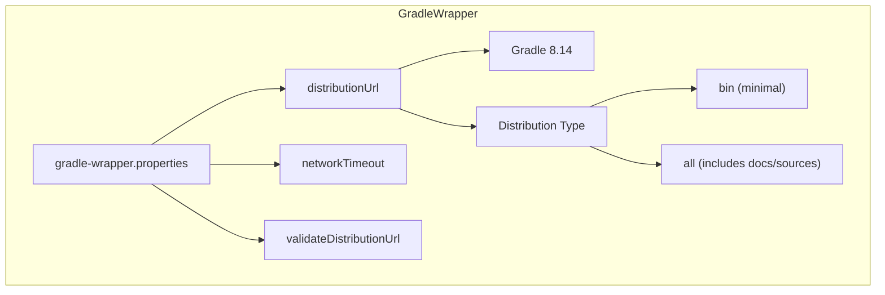

The Gradle wrapper properties are consistent across all projects with only minor variations:

| Property | Value | Purpose |
|----------|-------|---------|
| distributionUrl | https://services.gradle.org/distributions/gradle-8.14-bin.zip or gradle-8.14-all.zip | Specifies Gradle version and distribution type |
| networkTimeout | 10000 | Network timeout in milliseconds |
| validateDistributionUrl | true | Validates wrapper distribution URL for security |

Most sample apps use the `-bin` distribution for faster downloads, while more complex samples like WearTilesKotlin and WearSpeakerSample use the `-all` distribution which includes documentation and source code.

Sources: [DataLayer/gradle/wrapper/gradle-wrapper.properties:1-8](), [WearOAuth/gradle/wrapper/gradle-wrapper.properties:1-8](), [WearSpeakerSample/gradle/wrapper/gradle-wrapper.properties:1-8](), [WearTilesKotlin/gradle/wrapper/gradle-wrapper.properties:1-8](), [ComposeStarter/gradle/wrapper/gradle-wrapper.properties:1-8]()

## Build Configuration Structure

The build system follows a consistent structure across all sample projects, with project-specific configurations defined in the respective build.gradle.kts files.

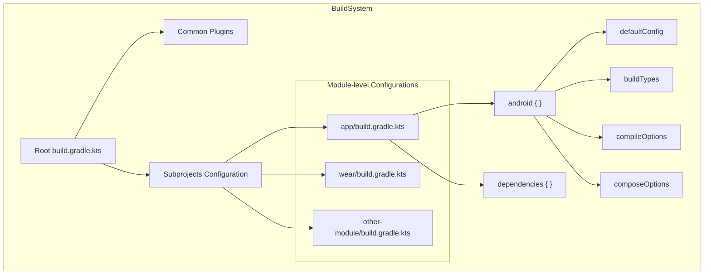

Sources: [DataLayer/build.gradle.kts:1-50](), [DataLayer/Application/build.gradle.kts:1-78](), [DataLayer/Wearable/build.gradle.kts:1-142](), [ComposeStarter/app/build.gradle.kts:1-130](), [WearSpeakerSample/wear/build.gradle.kts:1-144]()

## Common Build Settings

### Android Configuration

All sample projects share similar Android configuration settings:

| Setting | Value | Purpose |
|---------|-------|---------|
| compileSdk | 35 | Android SDK version used for compilation |
| minSdk | 26 (for Wear OS) | Minimum supported Android version |
| targetSdk | 34 | Target Android SDK version |
| compileOptions.sourceCompatibility | JavaVersion.VERSION_17 | Java source compatibility |
| compileOptions.targetCompatibility | JavaVersion.VERSION_17 | Java bytecode compatibility |
| kotlinOptions.jvmTarget | JavaVersion.VERSION_17.majorVersion | Kotlin JVM target version |

Sources: [DataLayer/Wearable/build.gradle.kts:25-57](), [ComposeStarter/app/build.gradle.kts:23-59](), [WearSpeakerSample/wear/build.gradle.kts:24-55]()

### Jetpack Compose Configuration

All Wear OS samples use Jetpack Compose for the UI, with consistent configuration:

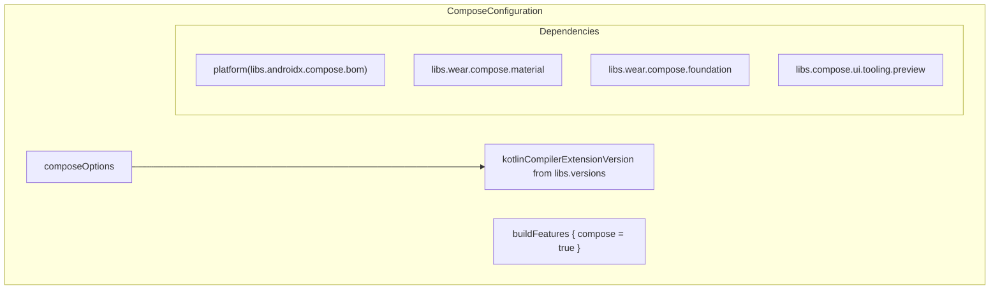

Sources: [ComposeStarter/app/build.gradle.kts:60-67](), [DataLayer/Wearable/build.gradle.kts:66-74](), [WearSpeakerSample/wear/build.gradle.kts:63-71]()

### Build Types

All projects define both debug and release build configurations, with release builds having optimizations enabled:

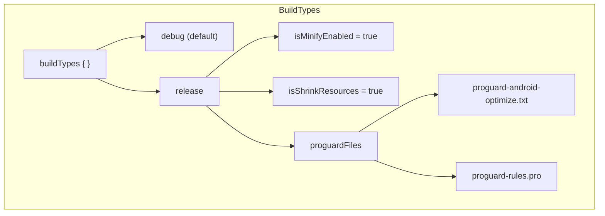

The release build configuration includes:
- Minification (code shrinking)
- Resource shrinking
- ProGuard rules for optimization

Sources: [DataLayer/Wearable/build.gradle.kts:37-47](), [ComposeStarter/app/build.gradle.kts:35-44](), [WearSpeakerSample/wear/build.gradle.kts:36-45](), [DataLayer/Wearable/proguard-rules.pro:1-18]()

## Continuous Integration Pipeline

The repository uses GitHub Actions for continuous integration and delivery. Each sample has a dedicated workflow file.

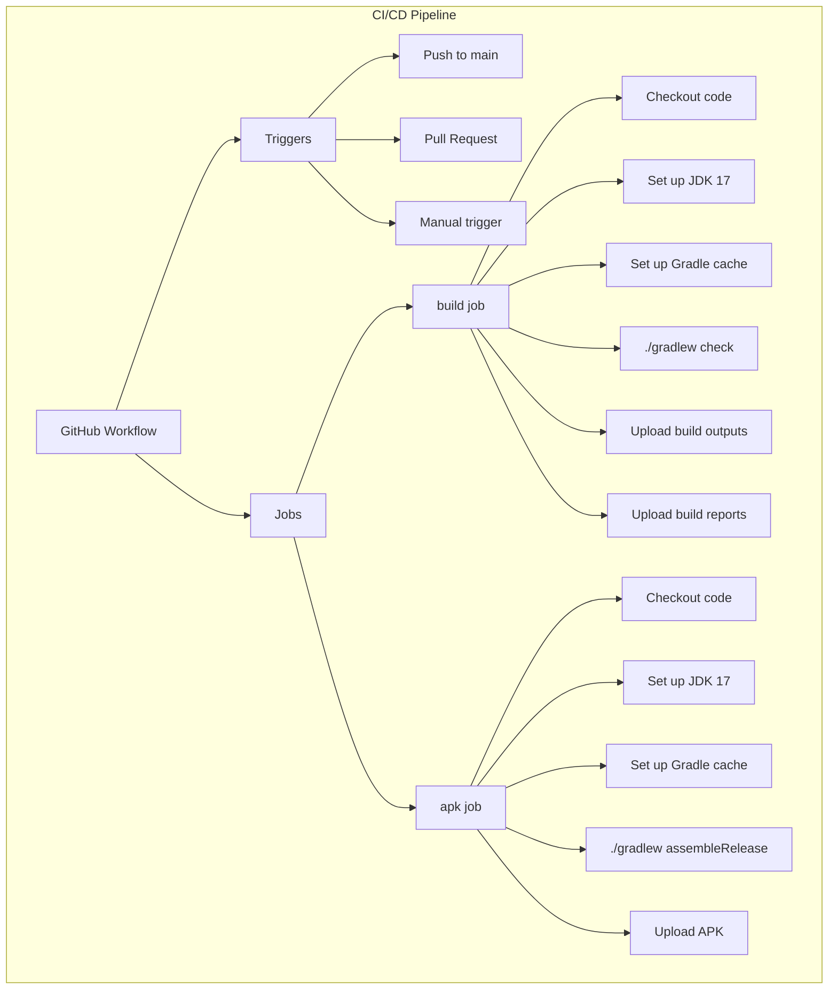

The CI pipeline for each sample has a standardized structure:
1. The `build` job runs unit tests and lint checks using `./gradlew check`
2. The `apk` job builds the release APK using `./gradlew assembleRelease`
3. Both jobs cache Gradle dependencies for faster builds
4. Build outputs and reports are uploaded as GitHub Actions artifacts

Sources: [.github/workflows/ComposeStarter.yml:1-94](), [.github/workflows/WearTilesKotlin.yml:1-54](), [.github/workflows/WearSpeakerSample.yml:1-92](), [.github/workflows/DataLayer.yml:1-95](), [.github/workflows/WearOAuth.yml:1-62]()

## Sample-Specific Build Configurations

While the basic build structure is consistent, each sample has specific configurations based on its functionality:

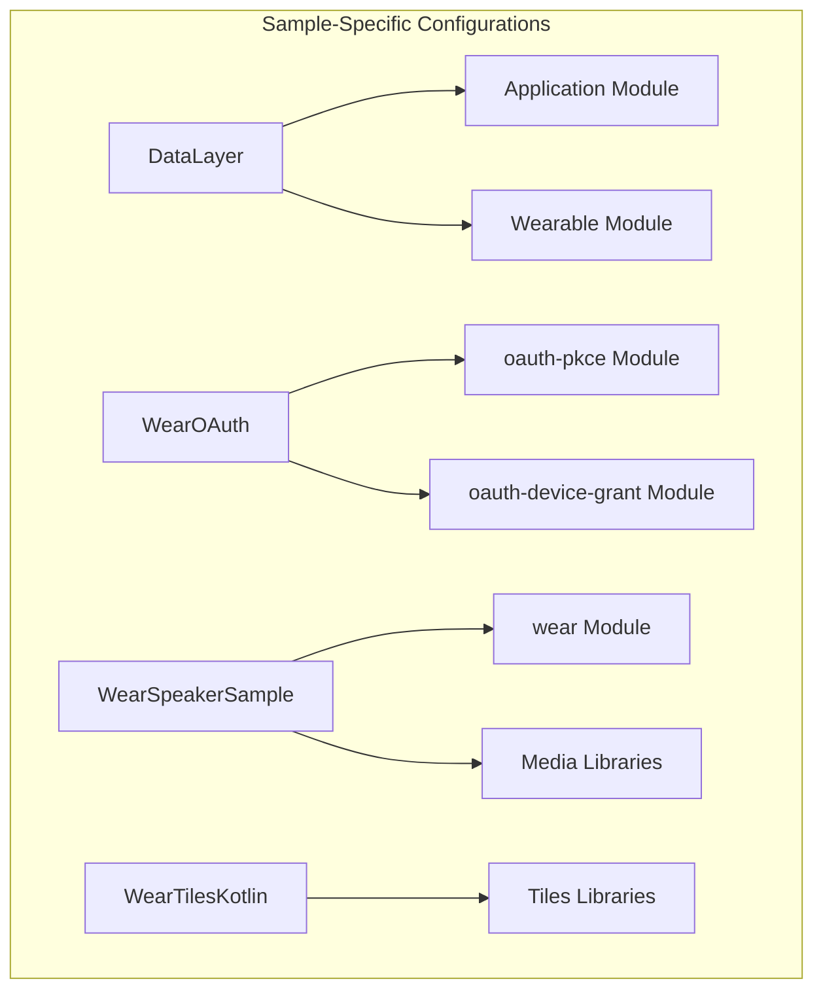

### Module Structure Variations

| Sample | Structure | Purpose |
|--------|-----------|---------|
| DataLayer | Application & Wearable modules | Shows communication between phone and watch |
| WearOAuth | oauth-pkce & oauth-device-grant modules | Demonstrates different authentication flows |
| ComposeStarter | Single app module | Basic Compose UI for Wear OS |
| WearSpeakerSample | Single wear module | Audio functionality on Wear OS |
| WearTilesKotlin | Single app module | Tiles implementation for Wear OS |

Sources: [DataLayer/Application/build.gradle.kts:1-78](), [DataLayer/Wearable/build.gradle.kts:1-142](), [ComposeStarter/app/build.gradle.kts:1-130](), [WearSpeakerSample/wear/build.gradle.kts:1-144](), [.github/workflows/WearOAuth.yml:47-62]()

## Common Gradle Tasks

### Essential Commands

| Command | Purpose |
|---------|---------|
| `./gradlew check` | Runs all verification tasks (tests, lint) |
| `./gradlew app:assembleDebug` | Builds debug APK for the app module |
| `./gradlew app:assembleRelease` | Builds release APK for the app module |
| `./gradlew wear:assembleRelease` | Builds release APK for the wear module |
| `./gradlew clean` | Cleans the build directory |

Sources: [.github/workflows/ComposeStarter.yml:44-45](), [.github/workflows/ComposeStarter.yml:87-88](), [.github/workflows/WearSpeakerSample.yml:45](), [.github/workflows/WearSpeakerSample.yml:86](), [.github/workflows/DataLayer.yml:45]()

## Packaging Configuration

All sample applications include specific packaging configurations to exclude unnecessary files and optimize the APK size:

```
packaging {
    resources {
        excludes += "/META-INF/{AL2.0,LGPL2.1}"
    }
}
```

This configuration excludes license files from META-INF to reduce APK size.

Sources: [DataLayer/Wearable/build.gradle.kts:76-80](), [ComposeStarter/app/build.gradle.kts:68-72](), [WearSpeakerSample/wear/build.gradle.kts:73-77]()

## Java Desugaring

All projects enable core library desugaring to support newer Java APIs on older Android versions:

```
compileOptions {
    isCoreLibraryDesugaringEnabled = true
}

dependencies {
    coreLibraryDesugaring(libs.desugar.jdk.libs)
}
```

This allows using newer Java APIs like java.time while maintaining compatibility with older Android versions.

Sources: [DataLayer/Wearable/build.gradle.kts:49-53](), [ComposeStarter/app/build.gradle.kts:47-51](), [WearSpeakerSample/wear/build.gradle.kts:46-50](), [DataLayer/Wearable/build.gradle.kts:117](), [ComposeStarter/app/build.gradle.kts:110](), [WearSpeakerSample/wear/build.gradle.kts:99]()

---

# Page: CI/CD Pipeline

# CI/CD Pipeline

<details>
<summary>Relevant source files</summary>

The following files were used as context for generating this wiki page:

- [.github/workflows/Complications.yml](.github/workflows/Complications.yml)
- [.github/workflows/ComposeStarter.yml](.github/workflows/ComposeStarter.yml)
- [.github/workflows/DataLayer.yml](.github/workflows/DataLayer.yml)
- [.github/workflows/WearOAuth.yml](.github/workflows/WearOAuth.yml)
- [.github/workflows/WearSpeakerSample.yml](.github/workflows/WearSpeakerSample.yml)
- [.github/workflows/WearTilesKotlin.yml](.github/workflows/WearTilesKotlin.yml)
- [.github/workflows/copy-branch.yml](.github/workflows/copy-branch.yml)

</details>


This document describes the Continuous Integration and Continuous Delivery (CI/CD) pipeline implemented for the Wear OS Samples repository. The pipeline ensures that all sample applications build correctly, pass tests, and generate usable artifacts. For information about the build system configuration itself, see [Build System](#3).

## Pipeline Overview

The Wear OS Samples repository uses GitHub Actions to implement CI/CD workflows for each sample project. These workflows automatically build and test sample applications whenever relevant code changes are made.

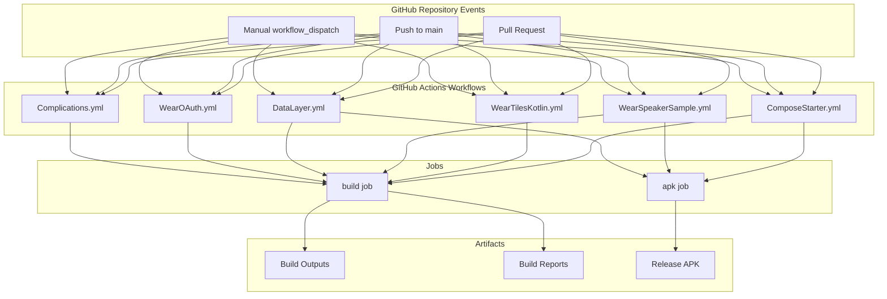

Sources:
- `.github/workflows/ComposeStarter.yml`
- `.github/workflows/WearTilesKotlin.yml`
- `.github/workflows/WearSpeakerSample.yml`
- `.github/workflows/DataLayer.yml`
- `.github/workflows/WearOAuth.yml`
- `.github/workflows/Complications.yml`

## Workflow Files and Structure

Each sample project has a dedicated workflow file in the `.github/workflows` directory. These files define when and how the CI/CD pipeline runs for each sample.

### Workflow Triggers

Each workflow is triggered by:

1. **Push to main branch** - Only when files in the corresponding sample directory are modified
2. **Pull request** - Only when files in the corresponding sample directory are modified
3. **Manual dispatch** - Can be manually triggered through the GitHub Actions interface

```mermaid
flowchart LR
    subgraph "Sample Project" 
        Code["Project Code Files"]
    end
    
    subgraph "GitHub Events"
        PR["Pull Request"]
        Push["Push to main"]
        Manual["Manual workflow_dispatch"]
    end
    
    subgraph "Path Filtering"
        Filter["paths: 'SampleName/**'"]
    end
    
    subgraph "Workflow"
        WF["GitHub Actions Workflow"]
    end
    
    Code --> |"changes"| PR
    Code --> |"changes"| Push
    
    PR --> Filter
    Push --> Filter
    Manual --> |"no filtering"| WF
    
    Filter --> WF
```

Sources:
- `.github/workflows/ComposeStarter.yml:3-12`
- `.github/workflows/WearTilesKotlin.yml:3-14`
- `.github/workflows/WearSpeakerSample.yml:3-12`
- `.github/workflows/DataLayer.yml:3-12`

## Build Job

The primary job in each workflow is the `build` job, which builds and tests the sample application.

```mermaid
flowchart TD
    Start["Job: build"] --> Checkout["actions/checkout@v4"]
    Checkout --> SetupJava["actions/setup-java@v4\n(JDK 17, Zulu distribution)"]
    SetupJava --> CacheKey["Generate cache key\n./scripts/checksum.sh"]
    CacheKey --> Cache["actions/cache@v4\n(Gradle caches)"]
    Cache --> Build["./gradlew check\n(in sample directory)"]
    Build --> UploadAPKs["Upload build outputs (APKs)\nactions/upload-artifact@v4"]
    Build --> UploadReports["Upload build reports\nactions/upload-artifact@v4"]
```

Sources:
- `.github/workflows/ComposeStarter.yml:18-60`
- `.github/workflows/WearSpeakerSample.yml:18-58`
- `.github/workflows/DataLayer.yml:18-62`

### Environment Setup

Each workflow sets an environment variable `SAMPLE_PATH` to specify the sample project directory:

```
env:
  SAMPLE_PATH: SampleName
```

This variable is used throughout the workflow to reference the correct project directory.

Sources:
- `.github/workflows/ComposeStarter.yml:14-15`
- `.github/workflows/WearTilesKotlin.yml:16-17`
- `.github/workflows/WearSpeakerSample.yml:14-15`
- `.github/workflows/DataLayer.yml:14-15`

### Gradle Caching

To optimize build performance, the workflows implement a caching strategy for Gradle dependencies:

```mermaid
flowchart TD
    Script["./scripts/checksum.sh"] --> Checksum["checksum.txt file\n(based on project files)"]
    Checksum --> CacheKey["Cache key:\ngradle-${{ hashFiles('checksum.txt') }}"]
    
    CacheKey --> CachePaths["Cache paths:"]
    CachePaths --> Modules["~/.gradle/caches/modules-*"]
    CachePaths --> Jars["~/.gradle/caches/jars-*"]
    CachePaths --> BuildCache["~/.gradle/caches/build-cache-*"]
```

Sources:
- `.github/workflows/ComposeStarter.yml:32-41`
- `.github/workflows/WearSpeakerSample.yml:32-41`
- `.github/workflows/DataLayer.yml:32-41`

## APK Job

Many workflows include a dedicated `apk` job that specifically builds release APKs:

```mermaid
flowchart TD
    Start["Job: apk"] --> Checkout["actions/checkout@v4"]
    Checkout --> SetupJava["actions/setup-java@v4\n(JDK 17)"]
    SetupJava --> CacheKey["Generate cache key"]
    CacheKey --> Cache["Restore Gradle cache"]
    Cache --> Build["./gradlew module:assembleRelease"]
    Build --> Upload["Upload APK artifact\nName: App\nPath: sample/module/build/outputs/apk/release/*.apk"]
```

Sources:
- `.github/workflows/ComposeStarter.yml:62-94`
- `.github/workflows/WearSpeakerSample.yml:60-92`
- `.github/workflows/DataLayer.yml:63-95`

The exact command varies by project:
- ComposeStarter: `./gradlew app:assembleRelease`
- WearSpeakerSample: `./gradlew wear:assembleRelease`
- DataLayer: `./gradlew app:assembleRelease`

## Project-Specific Workflow Variations

While the workflows follow a common structure, there are variations for specific projects:

### WearTilesKotlin

The WearTilesKotlin workflow uses `gradle/gradle-build-action@v3` instead of the manual caching approach:

```mermaid
flowchart LR
    Setup["Setup"] --> GradleAction["gradle/gradle-build-action@v3"]
    GradleAction --> BuildRoot["build-root-directory: ${{ env.SAMPLE_PATH }}"]
    BuildRoot --> GradleCheck["./gradlew check"]
```

Sources:
- `.github/workflows/WearTilesKotlin.yml:34-41`

### WearOAuth

The WearOAuth workflow handles multiple modules and uploads artifacts from both:

```mermaid
flowchart LR
    Build["./gradlew check"] --> Outputs["Upload build outputs"]
    Outputs --> PKCE["oauth-pkce/build/outputs"]
    Outputs --> DeviceGrant["oauth-device-grant/build/outputs"]
    
    Build --> Reports["Upload build reports"]
    Reports --> PKCEReports["oauth-pkce/build/reports"]
    Reports --> DeviceGrantReports["oauth-device-grant/build/reports"]
```

Sources:
- `.github/workflows/WearOAuth.yml:47-62`

### DataLayer

The DataLayer workflow uploads artifacts from both the wearable and mobile application modules:

```mermaid
flowchart LR
    Build["./gradlew check"] --> Outputs["Upload build outputs"]
    Outputs --> Wearable["Wearable/build/outputs"]
    Outputs --> Application["Application/build/outputs"]
    
    Build --> Reports["Upload build reports"]
    Reports --> WearableReports["Wearable/build/reports"]
    Reports --> ApplicationReports["Application/build/reports"]
```

Sources:
- `.github/workflows/DataLayer.yml:47-61`

## Branch Management Workflow

A special workflow exists to duplicate the `main` branch to the legacy `master` branch:

```mermaid
flowchart TD
    Push["Push to main"] --> CopyBranch["copy-branch job"]
    CopyBranch --> Checkout["Checkout repo\n(with master branch)"]
    Checkout --> ConfigGit["Configure Git user"]
    ConfigGit --> Merge["git merge origin/main"]
    Merge --> Push["git push\n(to master branch)"]
```

Sources:
- `.github/workflows/copy-branch.yml`

This ensures backward compatibility for scripts or documentation that might still reference the `master` branch.

## Artifact Management

The workflows upload two types of artifacts:

1. **Build outputs (APKs)** - Debug APKs and related build outputs
2. **Build reports** - Test results, lint reports, and other build diagnostics

In addition, the `apk` job uploads a release APK with the artifact name "App".

Sources:
- `.github/workflows/ComposeStarter.yml:47-60`
- `.github/workflows/ComposeStarter.yml:90-94`
- `.github/workflows/WearSpeakerSample.yml:47-58`
- `.github/workflows/WearSpeakerSample.yml:88-92`

## Summary of Workflow Jobs and Artifacts

| Sample Project | Workflow File | Build Job | APK Job | Artifacts |
|----------------|---------------|-----------|---------|-----------|
| ComposeStarter | ComposeStarter.yml | ✓ | ✓ | - app/build/outputs<br>- app/build/reports<br>- App (release APK) |
| WearTilesKotlin | WearTilesKotlin.yml | ✓ | ✗ | - app/build/outputs<br>- app/build/reports |
| WearSpeakerSample | WearSpeakerSample.yml | ✓ | ✓ | - wear/build/outputs<br>- wear/build/reports<br>- App (release APK) |
| DataLayer | DataLayer.yml | ✓ | ✓ | - Wearable/build/outputs<br>- Application/build/outputs<br>- build reports<br>- App (release APK) |
| WearOAuth | WearOAuth.yml | ✓ | ✗ | - oauth-pkce/build/outputs<br>- oauth-device-grant/build/outputs<br>- build reports |
| Complications | Complications.yml | ✓ | ✗ | - Wearable/build/outputs<br>- Wearable/build/reports |

Sources:
- `.github/workflows/ComposeStarter.yml`
- `.github/workflows/WearTilesKotlin.yml`
- `.github/workflows/WearSpeakerSample.yml`
- `.github/workflows/DataLayer.yml`
- `.github/workflows/WearOAuth.yml`
- `.github/workflows/Complications.yml`

---

# Page: UI Development

# UI Development

<details>
<summary>Relevant source files</summary>

The following files were used as context for generating this wiki page:

- [ComposeStarter/gradle/libs.versions.toml](ComposeStarter/gradle/libs.versions.toml)
- [DataLayer/README.md](DataLayer/README.md)
- [DataLayer/gradle/libs.versions.toml](DataLayer/gradle/libs.versions.toml)
- [README.md](README.md)
- [WearOAuth/gradle/libs.versions.toml](WearOAuth/gradle/libs.versions.toml)
- [WearSpeakerSample/README.md](WearSpeakerSample/README.md)
- [WearSpeakerSample/gradle/libs.versions.toml](WearSpeakerSample/gradle/libs.versions.toml)
- [WearTilesKotlin/gradle/libs.versions.toml](WearTilesKotlin/gradle/libs.versions.toml)

</details>


This document provides a comprehensive overview of UI development patterns and practices for Wear OS applications using the samples in this repository. It covers the fundamental building blocks, architecture, and Jetpack Compose components specially designed for wearable devices.

For information about communication between watch and phone apps, see [Data Layer Communication](#6).

## Overview of Wear OS UI Development

Wear OS UI development requires specific considerations for the small form factor, round displays, and unique interaction patterns of wearable devices. The samples in this repository demonstrate modern UI development approaches using Jetpack Compose, Google's recommended toolkit for building native UIs on Wear OS.

```mermaid
flowchart TD
    subgraph "Wear OS UI Framework"
        WearCompose["androidx.wear.compose"]
        Horologist["com.google.android.horologist"]
        ComposeFoundation["androidx.compose.foundation"]
        Activity["androidx.activity"]
    end

    subgraph "UI Patterns"
        ScalingLazyColumn["ScalingLazyColumn"]
        TimeText["TimeText"]
        Chip["Chip"]
        Card["Card"]
        CompactButton["Button"]
        Vignette["Vignette"]
        CurvedText["CurvedText"]
        PositionIndicator["PositionIndicator"]
    end

    subgraph "Navigation"
        SwipeDismissableNavHost["SwipeDismissableNavHost"]
        WearNavigation["Navigation Components"]
    end

    WearCompose --> ScalingLazyColumn
    WearCompose --> TimeText
    WearCompose --> Chip
    WearCompose --> Card
    WearCompose --> CompactButton
    WearCompose --> Vignette
    WearCompose --> CurvedText
    WearCompose --> PositionIndicator
    WearCompose --> WearNavigation
    Horologist --> SwipeDismissableNavHost
```

Sources: 
- [ComposeStarter/gradle/libs.versions.toml:1-48]()
- [WearSpeakerSample/gradle/libs.versions.toml:1-58]()
- [README.md:1-26]()

## Key Wear OS UI Libraries

The samples utilize several key libraries for Wear OS UI development:

| Library | Purpose | Version* |
|---------|---------|----------|
| `androidx.wear.compose:compose-foundation` | Core Wear OS Compose components | 1.4.1 |
| `androidx.wear.compose:compose-material` | Material Design components for Wear | 1.4.1 |
| `androidx.wear.compose:compose-navigation` | Navigation components for Wear | 1.4.1 |
| `com.google.android.horologist:horologist-compose-layout` | Extended layout components | 0.7.5-alpha |
| `com.google.android.horologist:horologist-compose-material` | Additional material components | 0.7.5-alpha |
| `androidx.activity:activity-compose` | Integration with Activity | 1.10.1 |

*_Version numbers reflect those used in the latest samples as of documentation writing_

Sources:
- [ComposeStarter/gradle/libs.versions.toml:1-48]()
- [DataLayer/gradle/libs.versions.toml:1-58]()
- [WearOAuth/gradle/libs.versions.toml:1-59]()

## Wear OS Compose Architecture

Wear OS Compose builds upon standard Jetpack Compose with specialized components and patterns for wearable devices.

```mermaid
classDiagram
    class "Activity" {
        onCreate()
        setContent()
    }
    
    class "ComposeApp" {
        WearApp()
        AppTheme()
    }
    
    class "WearMaterialTheme" {
        colors
        typography
        shapes
    }
    
    class "Scaffold" {
        timeText
        vignette
        positionIndicator
    }
    
    class "ScalingLazyColumn" {
        Items
        item()
        items()
    }
    
    class "WearComponents" {
        Chip()
        Card()
        Button()
        ToggleChip()
    }
    
    "Activity" --> "ComposeApp" : hosts
    "ComposeApp" --> "WearMaterialTheme" : applies
    "ComposeApp" --> "Scaffold" : uses
    "Scaffold" --> "ScalingLazyColumn" : contains
    "ScalingLazyColumn" --> "WearComponents" : displays
```

Sources:
- [ComposeStarter/gradle/libs.versions.toml:1-48]()
- [WearSpeakerSample/gradle/libs.versions.toml:1-58]()

## Getting Started with ComposeStarter

The ComposeStarter sample provides a minimal starting point for developing Compose-based Wear OS applications. It demonstrates the fundamental components and patterns for Wear OS UI development.

Key components of the ComposeStarter sample:

1. **Wear Material Theme**: Customized for the dark background of watch faces
2. **ScalingLazyColumn**: The primary scrolling container for watch UIs
3. **Wear-specific Components**: Including Chips, Cards, and specialized Button styles
4. **Time Text**: Shows the current time at the top of the screen

```mermaid
flowchart TD
    subgraph "ComposeStarter Application"
        MainActivity["MainActivity"]
        WearApp["WearApp Composable"]
        Theme["Wear Theme"]
        
        subgraph "Screen Components"
            ScalingLazyColumn["ScalingLazyColumn"]
            TimeText["TimeText"]
            Chips["Chip Components"]
            Cards["Card Components"]
            Buttons["Button Components"]
        end
    end
    
    MainActivity --> WearApp
    WearApp --> Theme
    Theme --> ScalingLazyColumn
    ScalingLazyColumn --> TimeText
    ScalingLazyColumn --> Chips
    ScalingLazyColumn --> Cards
    ScalingLazyColumn --> Buttons
```

Sources:
- [ComposeStarter/gradle/libs.versions.toml:1-48]()
- [README.md:12]()

## UI Patterns for Wear OS

Wear OS UI patterns are designed to accommodate the unique constraints and capabilities of wearable devices. The samples demonstrate the following key patterns:

### Layout Patterns

1. **Curved Layout**: Text and elements that follow the curve of a round display
2. **Center Focus**: Critical information and controls in the center of the display
3. **Minimal Content**: Reducing information density for small screens
4. **Progressive Disclosure**: Revealing additional information through scrolling or navigation

### Navigation Patterns

1. **Swipe-Dismissable**: Navigation components that can be dismissed with edge swipes
2. **Edge-to-Edge**: UI components that extend to the full screen edges
3. **List-Detail**: Primary lists that navigate to detail screens

```mermaid
flowchart LR
    subgraph "Navigation Patterns"
        ListDetail["List-Detail Pattern"]
        SwipeDismiss["Swipe-Dismissable Pattern"]
        EdgeSwipe["Edge Swipe Navigation"]
    end
    
    subgraph "Implementation"
        SwipeDismissableNavHost["SwipeDismissableNavHost"]
        NavController["NavController"]
        NavHost["NavHost"]
        NavGraph["NavGraph"]
    end
    
    ListDetail --> NavController
    SwipeDismiss --> SwipeDismissableNavHost
    EdgeSwipe --> NavHost
    
    SwipeDismissableNavHost --> NavHost
    NavController --> NavGraph
    NavHost --> NavGraph
```

Sources:
- [ComposeStarter/gradle/libs.versions.toml:39-42]()
- [WearSpeakerSample/gradle/libs.versions.toml:45-48]()

## Horologist Library Integration

The [Horologist](https://github.com/google/horologist) library provides additional components and utilities specifically designed for Wear OS development. The samples in this repository extensively use Horologist for enhanced UI development.

Key Horologist UI components used in the samples:

1. **Layout Components**: Additional layout options beyond the standard Wear Compose components
2. **Material Extensions**: Enhanced material components optimized for watches
3. **Audio UI Components**: Specialized controls for audio applications (used in WearSpeakerSample)
4. **Testing Utilities**: Tools for testing and validating Wear OS UI

```mermaid
flowchart TD
    subgraph "Horologist Components"
        HorologistLayout["horologist-compose-layout"]
        HorologistMaterial["horologist-compose-material"]
        HorologistAudio["horologist-audio-ui"]
        HorologistTools["horologist-compose-tools"]
    end
    
    subgraph "UI Elements"
        RotaryInput["Rotary Input Handlers"]
        DatePicker["Date Components"]
        ScalingColumn["Enhanced Scaling Columns"]
        AudioControls["Audio Control UI"]
        MediaPlayer["Media Player UI"]
    end
    
    HorologistLayout --> RotaryInput
    HorologistLayout --> ScalingColumn
    HorologistMaterial --> DatePicker
    HorologistAudio --> AudioControls
    HorologistAudio --> MediaPlayer
```

Sources:
- [WearSpeakerSample/gradle/libs.versions.toml:29-37]()
- [ComposeStarter/gradle/libs.versions.toml:29-30]()
- [DataLayer/gradle/libs.versions.toml:41-42]()

## Testing and Previewing Wear OS UI

The samples demonstrate approaches for testing and validating Wear OS UI components:

1. **Compose Previews**: Using tooling preview annotations to visualize UI components
2. **Roborazzi**: Screenshot testing for UI validation
3. **UI Tests**: JUnit4-based UI testing specific to Wear OS

```mermaid
flowchart LR
    subgraph "UI Testing Tools"
        ComposePreview["Compose UI Preview"]
        Roborazzi["Roborazzi Screenshot Testing"]
        UiTest["UI Testing with JUnit4"]
    end
    
    subgraph "Implementation"
        PreviewAnnotation["@Preview Annotation"]
        RoborazziTool["Roborazzi Library"]
        TestRunner["JUnit Test Runner"]
        ComposeTestRule["ComposeTestRule"]
    end
    
    ComposePreview --> PreviewAnnotation
    Roborazzi --> RoborazziTool
    UiTest --> TestRunner
    UiTest --> ComposeTestRule
```

Sources:
- [ComposeStarter/gradle/libs.versions.toml:25-27]()
- [ComposeStarter/gradle/libs.versions.toml:35-37]()
- [DataLayer/gradle/libs.versions.toml:47-50]()

## Additional Resources

For more specialized UI patterns, refer to the following sample applications in the repository:

1. **WearSpeakerSample**: Advanced UI patterns for audio recording and playback
2. **DataLayer**: UI components that interact with data from a paired phone
3. **WearTilesKotlin**: Examples of building Tiles, which are glanceable UI components

For specialized tile development, see [Tiles](#7).

Sources:
- [README.md:12-25]()
- [WearSpeakerSample/README.md:1-36]()
- [DataLayer/README.md:1-117]()

---

# Page: ComposeStarter

# ComposeStarter

<details>
<summary>Relevant source files</summary>

The following files were used as context for generating this wiki page:

- [ComposeStarter/.google/packaging.yaml](ComposeStarter/.google/packaging.yaml)
- [ComposeStarter/README.md](ComposeStarter/README.md)
- [ComposeStarter/app/src/main/java/com/example/android/wearable/composestarter/presentation/MainActivity.kt](ComposeStarter/app/src/main/java/com/example/android/wearable/composestarter/presentation/MainActivity.kt)
- [ComposeStarter/gradle/libs.versions.toml](ComposeStarter/gradle/libs.versions.toml)
- [DataLayer/gradle/libs.versions.toml](DataLayer/gradle/libs.versions.toml)
- [WearOAuth/gradle/libs.versions.toml](WearOAuth/gradle/libs.versions.toml)
- [WearSpeakerSample/gradle/libs.versions.toml](WearSpeakerSample/gradle/libs.versions.toml)
- [WearTilesKotlin/gradle/libs.versions.toml](WearTilesKotlin/gradle/libs.versions.toml)

</details>


## Purpose and Scope

The ComposeStarter sample demonstrates a minimalist "Hello, World" application that serves as a starting point for developing Wear OS applications using Jetpack Compose. This document covers the structure, components, and techniques used in the ComposeStarter sample, focusing on the basic implementation patterns for Wear OS UI development with Compose.

For more comprehensive UI patterns and advanced components, see the ComposeAdvanced sample documentation.

Sources: [ComposeStarter/README.md:1-14](), [ComposeStarter/app/src/main/java/com/example/android/wearable/composestarter/presentation/MainActivity.kt:68-78]()

## Architecture Overview

ComposeStarter implements a simple two-screen application with navigation between screens using Wear's SwipeDismissableNavHost component. The app demonstrates essential Wear OS UI patterns while keeping the implementation straightforward.

### Application Structure

```mermaid
flowchart TD
    A["MainActivity"] --> B["WearApp"]
    B --> C["SwipeDismissableNavHost"]
    C --> D["GreetingScreen"]
    C --> E["ListScreen"]
    D --> F["Greeting\nComposable"]
    D --> G["Chip"]
    E --> H["ScalingLazyColumn"]
    H --> I["ResponsiveListHeader"]
    H --> J["TitleCard"]
    H --> K["Chip"]
    H --> L["Button"]
    L --> M["SampleDialog"]
```

Sources: [ComposeStarter/app/src/main/java/com/example/android/wearable/composestarter/presentation/MainActivity.kt:89-107]()

### Navigation Flow

```mermaid
stateDiagram-v2
    [*] --> "Menu\n(GreetingScreen)"
    "Menu\n(GreetingScreen)" --> "List\n(ListScreen)": "Show List Chip"
    "List\n(ListScreen)" --> "Dialog": "Button Click"
    "List\n(ListScreen)" --> "Menu\n(GreetingScreen)": "Swipe to dismiss"
    "Dialog" --> "List\n(ListScreen)": "OK or Cancel"
```

Sources: [ComposeStarter/app/src/main/java/com/example/android/wearable/composestarter/presentation/MainActivity.kt:95-105](), [ComposeStarter/app/src/main/java/com/example/android/wearable/composestarter/presentation/MainActivity.kt:187-193]()

## Key Components

### MainActivity

The entry point of the application. It sets up the WearApp composable as the root content.

```kotlin
class MainActivity : ComponentActivity() {
    override fun onCreate(savedInstanceState: Bundle?) {
        super.onCreate(savedInstanceState)
        setContent {
            WearApp()
        }
    }
}
```

Sources: [ComposeStarter/app/src/main/java/com/example/android/wearable/composestarter/presentation/MainActivity.kt:79-87]()

### WearApp

The root composable that sets up the app theme and navigation structure. It uses:

- `WearAppTheme`: Theme adapted for Wear OS
- `AppScaffold`: From Horologist, provides a container for the app
- `SwipeDismissableNavHost`: Handles navigation with swipe-to-dismiss gesture support

Sources: [ComposeStarter/app/src/main/java/com/example/android/wearable/composestarter/presentation/MainActivity.kt:89-108]()

### GreetingScreen

The main screen that displays a greeting message and a button to navigate to the list screen. Key features include:

- Vertical scrolling with rotary input support
- Centered layout with proper Wear OS padding
- Use of `Chip` component for navigation

Sources: [ComposeStarter/app/src/main/java/com/example/android/wearable/composestarter/presentation/MainActivity.kt:110-138]()

### ListScreen

Demonstrates a scrollable list using Horologist's `ScalingLazyColumn`, which is optimized for Wear OS. Contains:

- `ResponsiveListHeader`: Properly styled list header
- `TitleCard`: Card component with title and content
- `Chip`: Interactive button with text
- `Button`: Icon button that opens a dialog
- Dialog handling

Sources: [ComposeStarter/app/src/main/java/com/example/android/wearable/composestarter/presentation/MainActivity.kt:140-193]()

## UI Implementation Details

### Scroll State Management

ComposeStarter demonstrates two approaches to scroll state management:

1. Basic scroll state with `rememberScrollState()` and `verticalScroll` modifier (GreetingScreen)
2. Horologist's `ScalingLazyColumn` with `rememberResponsiveColumnState()` (ListScreen)

Both approaches properly implement rotary input support, which is essential for Wear OS devices with hardware dials.

```mermaid
flowchart LR
    subgraph "GreetingScreen"
        GS["ScreenScaffold"] --> GS1["Column"]
        GS1 --> GS2["verticalScroll(scrollState)"]
        GS1 --> GS3["rotaryScrollable(behavior)"]
    end
    
    subgraph "ListScreen"
        LS["ScreenScaffold"] --> LS1["ScalingLazyColumn"]
        LS1 --> LS2["columnState = rememberResponsiveColumnState()"]
    end
```

Sources: [ComposeStarter/app/src/main/java/com/example/android/wearable/composestarter/presentation/MainActivity.kt:112-137](), [ComposeStarter/app/src/main/java/com/example/android/wearable/composestarter/presentation/MainActivity.kt:147-184]()

### Padding and Spacing

The sample demonstrates proper padding practices for Wear OS:

- Using `ScalingLazyColumnDefaults.padding()` to apply appropriate spacing
- Specifying the first and last item types to ensure correct padding
- Using `firstItemPadding()` for the first list header

These techniques ensure that content is properly spaced on the small screen of a wearable device.

Sources: [ComposeStarter/app/src/main/java/com/example/android/wearable/composestarter/presentation/MainActivity.kt:119-122](), [ComposeStarter/app/src/main/java/com/example/android/wearable/composestarter/presentation/MainActivity.kt:148-153]()

### Dialog Implementation

The dialog implementation demonstrates a pattern for displaying alerts on Wear OS:

- Uses Wear's `Dialog` composable
- Implements cancellation and confirmation actions
- Properly handles state management for showing/hiding

Sources: [ComposeStarter/app/src/main/java/com/example/android/wearable/composestarter/presentation/MainActivity.kt:207-247]()

## Preview and Testing Support

### Preview Annotations

The sample uses specialized preview annotations for Wear OS:

- `@WearPreviewDevices`: Generates previews for multiple watch shapes and sizes
- `@WearPreviewFontScales`: Shows previews with different font scale settings

These annotations help developers visualize how their UI will look across different devices and accessibility settings.

Sources: [ComposeStarter/app/src/main/java/com/example/android/wearable/composestarter/presentation/MainActivity.kt:249-261](), [ComposeStarter/README.md:30-34]()

### Screenshot Testing

The sample includes screenshot testing capabilities using Roborazzi:

- Generate reference images with `./gradlew recordRoborazziDebug`
- Verify UI against reference images with `./gradlew verifyRoborazziDebug`
- Tests for multiple device configurations

This testing approach helps ensure UI consistency across different devices and during refactoring.

Sources: [ComposeStarter/README.md:35-41]()

## Key Dependencies

The ComposeStarter sample relies on several important libraries:

| Library | Purpose | Version |
|---------|---------|---------|
| androidx.wear.compose | Core Wear OS Compose components | 1.4.1 |
| androidx.activity-compose | Compose integration with Activity | 1.10.1 |
| horologist-compose-layout | Specialized layouts for Wear OS | 0.7.5-alpha |
| wear-compose-navigation | Navigation for Wear OS | 1.4.1 |
| wear-compose-foundation | Foundation components for Wear OS | 1.4.1 |
| wear-compose-material | Material Design components for Wear OS | 1.4.1 |

The dependencies are managed through Gradle Version Catalog in `libs.versions.toml`.

Sources: [ComposeStarter/gradle/libs.versions.toml:1-49]()

## Best Practices Demonstrated

1. **Proper Navigation**: Uses SwipeDismissableNavHost for navigation with swipe-to-dismiss support
2. **Rotary Input Support**: Implements proper rotary input scrolling support
3. **Responsive Layout**: Adapts to different screen sizes and shapes
4. **Optimized Components**: Uses Wear OS optimized composables like ScalingLazyColumn
5. **Proper Padding**: Applies appropriate spacing for the small screen context
6. **Testing for Different Devices**: Includes previews and tests for multiple device configurations

Sources: [ComposeStarter/app/src/main/java/com/example/android/wearable/composestarter/presentation/MainActivity.kt:16-262](), [ComposeStarter/README.md:28-41]()

---

# Page: Data Layer Communication

# Data Layer Communication

<details>
<summary>Relevant source files</summary>

The following files were used as context for generating this wiki page:

- [ComposeStarter/app/build.gradle.kts](ComposeStarter/app/build.gradle.kts)
- [DataLayer/Application/build.gradle.kts](DataLayer/Application/build.gradle.kts)
- [DataLayer/README.md](DataLayer/README.md)
- [DataLayer/Wearable/build.gradle.kts](DataLayer/Wearable/build.gradle.kts)
- [DataLayer/Wearable/proguard-rules.pro](DataLayer/Wearable/proguard-rules.pro)
- [DataLayer/Wearable/src/main/java/com/example/android/wearable/datalayer/NodesViewModel.kt](DataLayer/Wearable/src/main/java/com/example/android/wearable/datalayer/NodesViewModel.kt)
- [DataLayer/build.gradle.kts](DataLayer/build.gradle.kts)
- [README.md](README.md)
- [WearSpeakerSample/README.md](WearSpeakerSample/README.md)
- [WearSpeakerSample/wear/build.gradle.kts](WearSpeakerSample/wear/build.gradle.kts)

</details>


## Purpose and Scope

This document details the implementation of communication between a Wear OS device and a paired phone using the Wearable Data Layer API in the DataLayer sample. It demonstrates how to establish bi-directional communication channels that allow data, messages, and capabilities to be exchanged between devices. For information about UI development with Compose in Wear OS, see [UI Development](#5).

## Overview

The DataLayer sample showcases three key communication patterns:

1. Sending data assets (images) from the phone to the watch
2. Exchanging data items with acknowledgment messages
3. Launching the Wear app remotely from the phone

Sources:
- [README.md:12-14]()
- [DataLayer/README.md:5-9]()

## Architecture

The DataLayer sample is structured with two primary modules:

```mermaid
graph TD
    subgraph "DataLayer Sample Project"
        A["Application Module<br>(Phone App)"]
        W["Wearable Module<br>(Wear OS App)"]
        A <---> W

        subgraph "Communication APIs"
            DC["DataClient"]
            MC["MessageClient"] 
            CC["CapabilityClient"]
            WLS["WearableListenerService"]
        end
    end

    A --- DC
    A --- MC
    A --- CC
    
    W --- DC
    W --- MC
    W --- CC
    W --- WLS
```

Both modules share a common applicationId to ensure they can discover each other through the capabilities API. The communication happens through Google Play Services' Wearable APIs.

Sources:
- [DataLayer/Application/build.gradle.kts:28-31]()
- [DataLayer/Wearable/build.gradle.kts:28-31]()
- [DataLayer/README.md:1-9]()

## Key Components

### Wearable API Clients

The sample uses three main clients from the Wearable API:

```mermaid
classDiagram
    class DataClient {
        +putDataItem(request)
        +getDataItems()
        +addListener(listener)
    }
    
    class MessageClient {
        +sendMessage(nodeId, path, payload)
        +addListener(listener)
    }
    
    class CapabilityClient {
        +getAllCapabilities(filter)
        +getCapability(name, filter)
        +addListener(listener)
    }
    
    class WearableListenerService {
        +onDataChanged(dataEvents)
        +onMessageReceived(messageEvent)
        +onCapabilityChanged(capabilityInfo)
    }
    
    WearableListenerService <-- DataClient : notifies
    WearableListenerService <-- MessageClient : notifies
    WearableListenerService <-- CapabilityClient : notifies
```

These clients handle different aspects of wearable communication:
- **DataClient**: Syncs data between devices (persisted)
- **MessageClient**: Sends transient messages between devices
- **CapabilityClient**: Discovers capabilities of connected devices

Sources:
- [DataLayer/README.md:2-9]()
- [DataLayer/README.md:77-84]()

### NodesViewModel

The `NodesViewModel` manages discovery of connected devices and their capabilities:

```mermaid
classDiagram
    class NodesViewModel {
        -capabilityClient: CapabilityClient
        -nodes: SharedFlow~Set~Node~~
        -cameraNodes: SharedFlow~Set~Node~~
        +getCapabilitiesForReachableNodes()
        +state: StateFlow~UIState~
    }
    
    class UIState {
        +nodes: Set~NodeUiModel~
        +cameraNodes: Set~NodeUiModel~
    }
    
    class NodeUiModel {
        +id: String
        +displayName: String
        +isNearby: Boolean
    }
    
    NodesViewModel -- UIState : exposes
    UIState -- NodeUiModel : contains
```

The ViewModel queries the CapabilityClient to discover reachable nodes and their capabilities, filtering them based on whether they have the "mobile" or "wear" capability.

Sources:
- [DataLayer/Wearable/src/main/java/com/example/android/wearable/datalayer/NodesViewModel.kt:37-132]()

## Communication Patterns

### 1. Sending Data Assets

This pattern demonstrates sending an image from the phone to the watch:

```mermaid
sequenceDiagram
    participant Phone as "Phone App"
    participant DataClientP as "DataClient (Phone)"
    participant GPS as "Google Play Services"
    participant DataClientW as "DataClient (Watch)"
    participant WLS as "WearableListenerService"
    participant Watch as "Watch App"
    
    Phone->>Phone: Take photo
    Phone->>Phone: Create Asset from bitmap
    Phone->>DataClientP: Create PutDataMapRequest
    Phone->>DataClientP: dataMap.putAsset(IMAGE_KEY, imageAsset)
    Phone->>DataClientP: putDataItem(request.setUrgent())
    DataClientP->>GPS: Sync data
    GPS->>DataClientW: Sync data
    DataClientW->>WLS: onDataChanged()
    WLS->>Watch: Process image asset
    Watch->>Watch: Display received image
```

The image is converted to a `DataAsset` and placed in a `PutDataMapRequest`, then sent through the DataClient.

Sources:
- [DataLayer/README.md:18-29]()

### 2. Data Items with Acknowledgments

This pattern shows a counter being incremented on the phone and acknowledged by the watch:

```mermaid
sequenceDiagram
    participant Phone as "Phone App"
    participant DataClientP as "DataClient (Phone)"
    participant GPS as "Google Play Services"
    participant DataClientW as "DataClient (Watch)"
    participant WLS as "WearableListenerService"
    participant MessageClientW as "MessageClient (Watch)"
    participant MessageClientP as "MessageClient (Phone)"
    
    Phone->>Phone: Increment counter
    Phone->>DataClientP: putDataItem(counterRequest)
    DataClientP->>GPS: Sync data
    GPS->>DataClientW: Sync data
    DataClientW->>WLS: onDataChanged()
    WLS->>MessageClientW: sendMessage(nodeId, DATA_ITEM_RECEIVED_PATH, payload)
    MessageClientW->>GPS: Send message
    GPS->>MessageClientP: Deliver message
    MessageClientP->>Phone: onMessageReceived()
```

The watch sends an acknowledgment message back to the phone after receiving the data item.

Sources:
- [DataLayer/README.md:33-44]()

### 3. Remote App Launch

This pattern demonstrates launching the Wear app from the phone:

```mermaid
sequenceDiagram
    participant Phone as "Phone App"
    participant CapClientP as "CapabilityClient (Phone)"
    participant MessageClientP as "MessageClient (Phone)"
    participant GPS as "Google Play Services"
    participant MessageClientW as "MessageClient (Watch)"
    participant WLS as "WearableListenerService"
    participant Watch as "Watch App"
    
    Phone->>CapClientP: getAllCapabilities(FILTER_REACHABLE)
    CapClientP->>Phone: Return nodes
    Phone->>Phone: Filter nodes with "wear" capability
    Phone->>MessageClientP: sendMessage(node.id, START_ACTIVITY_PATH, byteArray)
    MessageClientP->>GPS: Send message
    GPS->>MessageClientW: Deliver message
    MessageClientW->>WLS: onMessageReceived()
    WLS->>Watch: Start Activity
```

The phone app checks for connected nodes with specific capabilities before sending a message to launch the Wear app.

Sources:
- [DataLayer/README.md:46-64]()

## Implementation Considerations

### Required Dependencies

Both the phone and wear modules require the Google Play Services Wearable dependency:

```
implementation(libs.playservices.wearable)
```

For working with coroutines when interfacing with the Wearable APIs:

```
implementation(libs.kotlinx.coroutines.play.services)
```

Sources:
- [DataLayer/Application/build.gradle.kts:76]()
- [DataLayer/Wearable/build.gradle.kts:109]()
- [DataLayer/Application/build.gradle.kts:68]()
- [DataLayer/Wearable/build.gradle.kts:90]()

### Application ID

Both the phone and wear modules must use the same application ID for the capabilities API to work properly:

```
applicationId = "com.example.android.wearable.datalayer"
```

Sources:
- [DataLayer/Application/build.gradle.kts:30]()
- [DataLayer/Wearable/build.gradle.kts:30]()

### Alternative Approaches

The Horologist library provides higher-level abstractions for common Wear OS communication tasks:

| Functionality | Horologist API |
|---------------|---------------|
| Installing Wear apps | `com.google.android.horologist.datalayer.phone.ui.InstallAppPrompt` |
| Starting Wear apps | `com.google.android.horologist.datalayer.phone.ui.ReEngageAppPrompt` |
| Completing sign-in flows | `com.google.android.horologist.datalayer.phone.ui.SignInPrompt` |
| Installing Wear Tiles | `com.google.android.horologist.datalayer.phone.ui.InstallTilePrompt` |
| Persisting synced data | `com.google.android.horologist.datalayer` package |
| API availability checking | `com.google.android.horologist.datalayer.helpers` package |
| Node connection status | `com.google.android.horologist.datalayer.helpers` package |

Sources:
- [DataLayer/README.md:66-76]()
- [DataLayer/README.md:84-90]()

## Summary

The DataLayer sample demonstrates how to implement robust communication between a Wear OS device and a paired phone. By leveraging the three core Wearable API clients—DataClient, MessageClient, and CapabilityClient—developers can create seamless experiences that span multiple devices.

These communication patterns enable various multi-device scenarios like:
- Synchronizing data across devices
- Sending notifications or commands
- Launching companion apps
- Transferring assets like images

For more complex or higher-level implementations, the Horologist library provides additional utilities that build upon these core communication APIs.

Sources:
- [DataLayer/README.md]()
- [README.md:12-14]()

---

# Page: Tiles

# Tiles

<details>
<summary>Relevant source files</summary>

The following files were used as context for generating this wiki page:

- [WearTilesKotlin/app/src/debug/AndroidManifest.xml](WearTilesKotlin/app/src/debug/AndroidManifest.xml)
- [WearTilesKotlin/app/src/main/AndroidManifest.xml](WearTilesKotlin/app/src/main/AndroidManifest.xml)
- [WearTilesKotlin/app/src/main/java/com/example/wear/tiles/messaging/Contact.kt](WearTilesKotlin/app/src/main/java/com/example/wear/tiles/messaging/Contact.kt)
- [WearTilesKotlin/app/src/main/java/com/example/wear/tiles/messaging/MessagingRepo.kt](WearTilesKotlin/app/src/main/java/com/example/wear/tiles/messaging/MessagingRepo.kt)
- [WearTilesKotlin/app/src/main/java/com/example/wear/tiles/messaging/MessagingTileLayout.kt](WearTilesKotlin/app/src/main/java/com/example/wear/tiles/messaging/MessagingTileLayout.kt)
- [WearTilesKotlin/app/src/main/java/com/example/wear/tiles/messaging/MessagingTileService.kt](WearTilesKotlin/app/src/main/java/com/example/wear/tiles/messaging/MessagingTileService.kt)
- [WearTilesKotlin/app/src/main/java/com/example/wear/tiles/messaging/MessagingTileTheme.kt](WearTilesKotlin/app/src/main/java/com/example/wear/tiles/messaging/MessagingTileTheme.kt)
- [WearTilesKotlin/app/src/main/res/values-et/strings.xml](WearTilesKotlin/app/src/main/res/values-et/strings.xml)
- [WearTilesKotlin/app/src/main/res/values/strings.xml](WearTilesKotlin/app/src/main/res/values/strings.xml)

</details>


Tiles are glanceable, scannable UI elements that users can add to their Wear OS device to quickly access information or actions without opening a full app. This document covers the implementation of Tiles for Wear OS using the AndroidX Tiles library as demonstrated in the Wear OS Samples repository.

## Overview

Wear OS Tiles provide a way for users to quickly access information or perform actions with a simple swipe from the watch face. Tiles are designed to be lightweight, fast-loading, and focused on specific tasks or information.

```mermaid
graph TD
    subgraph "User Experience"
        U["User swipes from watch face"] --> T["Views Tile"]
        T --> A["Quick interaction/glance"]
    end
    
    subgraph "Implementation Components"
        TS["TileService"] --> TR["Tile Rendering"]
        TR --> TL["Tile Layout"]
        TR --> TR["Tile Resources"]
        TS --> TD["Tile Data Source"]
    end
    
    U -.-> TS
```

Sources: [WearTilesKotlin/app/src/main/java/com/example/wear/tiles/messaging/MessagingTileService.kt:40-48]()

## Tile Architecture

The Tile architecture consists of several key components working together to create a responsive and efficient UI element:

```mermaid
graph TD
    subgraph "AndroidManifest Registration"
        M["Service Declaration"] --> MP["Permission: BIND_TILE_PROVIDER"]
        M --> MI["Intent Filter: androidx.wear.tiles.action.BIND_TILE_PROVIDER"]
        M --> MM["Metadata: PREVIEW"]
    end
    
    subgraph "Core Components"
        TS["SuspendingTileService"] --> TR["tileRequest()"]
        TS --> RR["resourcesRequest()"]
        
        TR --> TL["LayoutElement"]
        TR --> TT["Timeline"]
        
        RR --> RS["Resources"]
    end
    
    subgraph "Data Layer"
        DS["Data Source/Repository"] --> SF["StateFlow"]
        SF --> TR
    end
    
    M --> TS
```

Sources: 
- [WearTilesKotlin/app/src/main/AndroidManifest.xml:30-44]()
- [WearTilesKotlin/app/src/main/java/com/example/wear/tiles/messaging/MessagingTileService.kt:49-68]()
- [WearTilesKotlin/app/src/main/java/com/example/wear/tiles/messaging/MessagingTileService.kt:72-78]()

### Key Concepts

1. **TileService**: The foundation of a Tile implementation, responsible for providing layout and resources.
2. **Timeline**: Represents what content should be shown in the Tile at different points in time.
3. **LayoutElement**: The UI structure for the Tile.
4. **Resources**: Images and other resources used by the Tile.

## Creating a Tile Service

To implement a Tile, you need to create a service that extends `SuspendingTileService`. This class provides a coroutine-friendly wrapper around the standard `TileService`.

### Service Declaration

The Tile service must be declared in the AndroidManifest.xml with the appropriate permission and intent filter:

```xml
<service
    android:name="com.example.wear.tiles.messaging.MessagingTileService"
    android:exported="true"
    android:label="@string/tile_messaging_label"
    android:description="@string/tile_messaging_description"
    android:icon="@drawable/ic_message_24"
    android:permission="com.google.android.wearable.permission.BIND_TILE_PROVIDER">
    <intent-filter>
        <action android:name="androidx.wear.tiles.action.BIND_TILE_PROVIDER" />
    </intent-filter>

    <meta-data
        android:name="androidx.wear.tiles.PREVIEW"
        android:resource="@drawable/tile_messaging" />
</service>
```

Sources: [WearTilesKotlin/app/src/main/AndroidManifest.xml:30-44]()

### Implementing Core Methods

A Tile service needs to implement two main methods:

1. **tileRequest()**: Provides the layout for the Tile.
2. **resourcesRequest()**: Provides resources (like images) needed by the Tile.

```mermaid
sequenceDiagram
    participant System as "System"
    participant TileService as "SuspendingTileService"
    participant Repository as "Data Repository"
    participant Layout as "Layout Builder"
    
    System->>TileService: Request tile update
    activate TileService
    
    TileService->>Repository: Request latest data
    Repository-->>TileService: Return data
    
    TileService->>Layout: Create layout with data
    Layout-->>TileService: Return LayoutElement
    
    TileService->>TileService: Create Timeline with layout
    TileService-->>System: Return Tile with Timeline
    deactivate TileService
    
    System->>TileService: Request resources
    activate TileService
    TileService->>Repository: Fetch resources (e.g., images)
    Repository-->>TileService: Return resources
    TileService-->>System: Return Resources object
    deactivate TileService
```

Sources: 
- [WearTilesKotlin/app/src/main/java/com/example/wear/tiles/messaging/MessagingTileService.kt:72-78]()
- [WearTilesKotlin/app/src/main/java/com/example/wear/tiles/messaging/MessagingTileService.kt:111-138]()

## Implementation Example: Messaging Tile

The samples repository includes a Messaging Tile example that demonstrates how to create a functional Tile service.

### Architecture Overview

```mermaid
graph TD
    subgraph "MessagingTileService"
        MTS["MessagingTileService"] --> TR["tileRequest()"]
        MTS --> RR["resourcesRequest()"]
        MTS --> LTS["latestTileState()"]
        MTS --> RD["refreshData()"]
        MTS --> FAN["fetchAvatarsFromNetwork()"]
    end
    
    subgraph "Data Management"
        MR["MessagingRepo"] --> GFC["getFavoriteContacts()"]
        MR --> UC["updateContacts()"]
        MR --> DS["DataStore<Preferences>"]
        C["Contact"] --> PS["toPreferenceString()"]
    end
    
    subgraph "UI Components"
        MTL["messagingTileLayout()"] --> PL["PrimaryLayout"]
        MTL --> MBL["MultiButtonLayout"]
        MTL --> CL["contactLayout()"]
        MTL --> SL["searchLayout()"]
        MTL --> CC["CompactChip"]
    end
    
    subgraph "Styling"
        MTT["MessagingTileTheme"] --> TC["colors"]
    end
    
    MTS --> MR
    MTS --> MTL
    TR --> MTL
    RR --> FAN
```

Sources: 
- [WearTilesKotlin/app/src/main/java/com/example/wear/tiles/messaging/MessagingTileService.kt:49-172]()
- [WearTilesKotlin/app/src/main/java/com/example/wear/tiles/messaging/MessagingTileLayout.kt:43-73]()
- [WearTilesKotlin/app/src/main/java/com/example/wear/tiles/messaging/MessagingRepo.kt:31-49]()

### Data Flow

1. The system requests an update from `MessagingTileService`.
2. The service retrieves contact data from `MessagingRepo`.
3. Contact data is used to build a layout with the `messagingTileLayout()` function.
4. The layout contains buttons for each contact, a search button, and a "New" action chip.
5. When resources are requested, the service fetches avatar images for contacts.

```mermaid
flowchart TD
    subgraph "Data Layer"
        DS["DataStore"] --> MR["MessagingRepo"]
        MR --> SF["StateFlow<MessagingTileState>"]
    end
    
    subgraph "Service Layer"
        SF --> MTS["MessagingTileService"]
        MTS --> TRQ["tileRequest()"]
        MTS --> RRQ["resourcesRequest()"]
    end
    
    subgraph "UI Layer"
        TRQ --> MTL["messagingTileLayout()"]
        MTL --> TL["Tile Layout"]
        
        RRQ --> R["Resources"]
        R --> I["Images (avatars, icons)"]
    end
    
    subgraph "System"
        S["System"] --> MTS
        TL --> U["User Interface"]
        I --> U
    end
```

Sources: 
- [WearTilesKotlin/app/src/main/java/com/example/wear/tiles/messaging/MessagingTileService.kt:54-66]()
- [WearTilesKotlin/app/src/main/java/com/example/wear/tiles/messaging/MessagingTileService.kt:72-78]()
- [WearTilesKotlin/app/src/main/java/com/example/wear/tiles/messaging/MessagingTileService.kt:83-90]()

### Key Components

#### MessagingTileService

This is the main class that implements the Tile functionality:

- Extends `SuspendingTileService`
- Manages a `StateFlow` of `MessagingTileState` to track contacts data
- Implements `tileRequest()` to provide the Tile layout
- Implements `resourcesRequest()` to provide images (avatars and icons)

Sources: [WearTilesKotlin/app/src/main/java/com/example/wear/tiles/messaging/MessagingTileService.kt:49-172]()

#### MessagingTileLayout

Defines the UI structure for the Messaging Tile:

- Uses `PrimaryLayout` as the root component
- Contains a `MultiButtonLayout` for contact buttons and search button
- Includes a `CompactChip` for the "New" action
- Adapts to different screen sizes using responsive design

Sources: [WearTilesKotlin/app/src/main/java/com/example/wear/tiles/messaging/MessagingTileLayout.kt:43-73]()

#### MessagingRepo

Manages the data for the Tile:

- Uses DataStore to persist contact information
- Provides a `Flow` of contact data
- Includes methods to update contacts

Sources: [WearTilesKotlin/app/src/main/java/com/example/wear/tiles/messaging/MessagingRepo.kt:31-49]()

### Tile UI Architecture

The Messaging Tile demonstrates a common pattern for Tile UIs:

| Component | Purpose | Implementation |
|-----------|---------|----------------|
| PrimaryLayout | Root container | Provides content area and chip area |
| MultiButtonLayout | Contact grid | Displays contact buttons in a grid |
| Button | Contact entry | Shows contact avatar or initials |
| CompactChip | Primary action | Provides a "New" action |

Sources: 
- [WearTilesKotlin/app/src/main/java/com/example/wear/tiles/messaging/MessagingTileLayout.kt:43-73]()
- [WearTilesKotlin/app/src/main/java/com/example/wear/tiles/messaging/MessagingTileLayout.kt:74-90]()
- [WearTilesKotlin/app/src/main/java/com/example/wear/tiles/messaging/MessagingTileLayout.kt:92-99]()

## Resource Management

Tiles need to manage resources efficiently, especially images that may be loaded from the network.

### Resource Handling

The `resourcesRequest()` method is responsible for providing resources to the Tile:

```mermaid
flowchart TD
    RR["resourcesRequest()"] --> FR["Fetch required resources"]
    FR --> RT["Return Resources object"]
    
    subgraph "Image Resource Types"
        L["Local drawable resources"] --> R["Resources object"]
        N["Network images (avatars)"] --> R
    end
    
    subgraph "Resource Loading"
        IL["imageLoader.loadAvatar()"] --> B["Bitmap"]
        B --> AM["addIdToImageMapping()"]
        AM --> R
    end
```

Sources: 
- [WearTilesKotlin/app/src/main/java/com/example/wear/tiles/messaging/MessagingTileService.kt:111-138]()
- [WearTilesKotlin/app/src/main/java/com/example/wear/tiles/messaging/MessagingTileService.kt:144-166]()

### Resource Versioning

The sample includes a debug flag `DEBUG_RESOURCES` that forces the Tile to reload resources on each update by changing the resources version. In a production environment, you would want to use a stable versioning strategy.

Sources: [WearTilesKotlin/app/src/main/java/com/example/wear/tiles/messaging/MessagingTileService.kt:72-78]()

## Best Practices

Based on the sample implementation, here are some best practices for Tile development:

1. **Use Coroutines**: The `SuspendingTileService` makes it easier to work with asynchronous operations.

2. **Responsive Design**: Adapt to different screen sizes, as shown in the Messaging Tile layout:
   ```kotlin
   // A PrimaryLayout with a compact chip can fit 5 buttons (including search)
   // on "small" displays, 6 on "large" displays.
   val isLarge = deviceParameters.screenHeightDp >= 225
   state.contacts.take(if (isLarge) 5 else 4).forEach { contact ->
       addButtonContent(contactLayout(context, contact, emptyClickable))
   }
   ```

3. **Efficient Resource Management**: Load and cache resources efficiently to minimize memory usage.

4. **State Management**: Use Kotlin Flow for reactive state updates.

5. **Preview Support**: Provide preview images and implement preview functions to make your Tile visible in the Wear OS tile picker.

Sources: 
- [WearTilesKotlin/app/src/main/java/com/example/wear/tiles/messaging/MessagingTileLayout.kt:52-57]()
- [WearTilesKotlin/app/src/main/java/com/example/wear/tiles/messaging/MessagingTileService.kt:54-66]()
- [WearTilesKotlin/app/src/main/AndroidManifest.xml:41-43]()

## Conclusion

Tiles provide a powerful way to extend your Wear OS app's functionality with glanceable, accessible information. The Wear OS Samples repository demonstrates how to implement Tiles using modern Android development patterns, including coroutines, Flow, and responsive design.

To create your own Tile:

1. Create a service that extends `SuspendingTileService`
2. Implement `tileRequest()` and `resourcesRequest()`
3. Define a UI layout using the Proto Layout DSL
4. Register your service in the AndroidManifest.xml
5. Provide a preview image for the Tile picker

For more detailed information about implementing specific Tile types, see [Messaging Tile Implementation](#7.1).

Sources: 
- [WearTilesKotlin/app/src/main/java/com/example/wear/tiles/messaging/MessagingTileService.kt:40-48]()
- [WearTilesKotlin/app/src/main/java/com/example/wear/tiles/messaging/MessagingTileService.kt:72-78]()
- [WearTilesKotlin/app/src/main/java/com/example/wear/tiles/messaging/MessagingTileService.kt:111-138]()
- [WearTilesKotlin/app/src/main/AndroidManifest.xml:30-44]()

---

# Page: Messaging Tile Implementation

# Messaging Tile Implementation

<details>
<summary>Relevant source files</summary>

The following files were used as context for generating this wiki page:

- [WearTilesKotlin/app/src/debug/AndroidManifest.xml](WearTilesKotlin/app/src/debug/AndroidManifest.xml)
- [WearTilesKotlin/app/src/main/AndroidManifest.xml](WearTilesKotlin/app/src/main/AndroidManifest.xml)
- [WearTilesKotlin/app/src/main/java/com/example/wear/tiles/messaging/Contact.kt](WearTilesKotlin/app/src/main/java/com/example/wear/tiles/messaging/Contact.kt)
- [WearTilesKotlin/app/src/main/java/com/example/wear/tiles/messaging/MessagingRepo.kt](WearTilesKotlin/app/src/main/java/com/example/wear/tiles/messaging/MessagingRepo.kt)
- [WearTilesKotlin/app/src/main/java/com/example/wear/tiles/messaging/MessagingTileLayout.kt](WearTilesKotlin/app/src/main/java/com/example/wear/tiles/messaging/MessagingTileLayout.kt)
- [WearTilesKotlin/app/src/main/java/com/example/wear/tiles/messaging/MessagingTileService.kt](WearTilesKotlin/app/src/main/java/com/example/wear/tiles/messaging/MessagingTileService.kt)
- [WearTilesKotlin/app/src/main/java/com/example/wear/tiles/messaging/MessagingTileTheme.kt](WearTilesKotlin/app/src/main/java/com/example/wear/tiles/messaging/MessagingTileTheme.kt)
- [WearTilesKotlin/app/src/main/res/values-et/strings.xml](WearTilesKotlin/app/src/main/res/values-et/strings.xml)
- [WearTilesKotlin/app/src/main/res/values/strings.xml](WearTilesKotlin/app/src/main/res/values/strings.xml)

</details>


This document details the implementation of a Messaging Tile for Wear OS, which displays contacts with avatars, a search button, and a "New" action chip. This reference implementation demonstrates best practices for creating tiles with dynamic content, loading remote resources, and responsive layout adaptation.

For general information about Tiles in Wear OS, see [Tiles](#7).

## Architecture Overview

The Messaging Tile implementation follows a structured architecture that combines several components to create a functional and visually appealing tile experience.

```mermaid
flowchart TD
    subgraph "Service Layer"
        MS["MessagingTileService"]
    end
    
    subgraph "Data Layer"
        MR["MessagingRepo"]
        C["Contact"]
    end
    
    subgraph "UI Layer"
        MTL["MessagingTileLayout"]
        MTT["MessagingTileTheme"]
    end
    
    MS --> MR
    MS --> MTL
    MR --> C
    MTL --> MTT
    C --> MTL
```

Sources: [WearTilesKotlin/app/src/main/java/com/example/wear/tiles/messaging/MessagingTileService.kt](), [WearTilesKotlin/app/src/main/java/com/example/wear/tiles/messaging/MessagingTileLayout.kt](), [WearTilesKotlin/app/src/main/java/com/example/wear/tiles/messaging/MessagingRepo.kt](), [WearTilesKotlin/app/src/main/java/com/example/wear/tiles/messaging/MessagingTileTheme.kt](), [WearTilesKotlin/app/src/main/java/com/example/wear/tiles/messaging/Contact.kt]()

## Component Responsibilities

### MessagingTileService

This is the entry point for the tile implementation, extending `SuspendingTileService` to provide a coroutine-friendly wrapper around the AndroidX `TileService`.

```mermaid
sequenceDiagram
    participant System as "Wear OS System"
    participant MTS as "MessagingTileService"
    participant Repo as "MessagingRepo"
    participant Layout as "MessagingTileLayout"
    
    System->>MTS: onCreate()
    MTS->>Repo: initialize
    MTS->>MTS: setup tileStateFlow
    
    System->>MTS: tileRequest(TileRequest)
    MTS->>MTS: latestTileState()
    MTS->>Repo: getFavoriteContacts()
    Repo-->>MTS: contacts data
    MTS->>Layout: messagingTileLayout()
    Layout-->>MTS: layoutElement
    MTS-->>System: Tile with timeline
    
    System->>MTS: resourcesRequest(ResourcesRequest)
    MTS->>MTS: fetchAvatarsFromNetwork()
    MTS-->>System: Resources with images
```

Sources: [WearTilesKotlin/app/src/main/java/com/example/wear/tiles/messaging/MessagingTileService.kt:49-173]()

Key responsibilities:
- Manages the lifecycle of the tile
- Retrieves contact data from `MessagingRepo`
- Handles tile layout creation through `messagingTileLayout()`
- Loads and provides avatar images as resources

### Data Model

The data structure consists of the `Contact` data class and the messaging tile state:

```mermaid
classDiagram
    class MessagingTileState {
        +List~Contact~ contacts
    }
    
    class Contact {
        +Long id
        +String initials
        +String name
        +String? avatarUrl
        +toPreferenceString()
        +String.toContact()
    }
    
    MessagingTileState o-- "0..*" Contact
```

Sources: [WearTilesKotlin/app/src/main/java/com/example/wear/tiles/messaging/Contact.kt:18-34]()

## Tile Layout Implementation

The `MessagingTileLayout.kt` file defines the layout structure of the messaging tile using the Wear Protolayout library.

### Layout Hierarchy

```mermaid
flowchart TD
    PL["PrimaryLayout"]
    MBL["MultiButtonLayout"]
    CC["CompactChip (New)"]
    
    PL --> MBL
    PL --> CC
    
    MBL --> CB1["Contact Button 1"]
    MBL --> CB2["Contact Button 2"]
    MBL --> CB3["Contact Button 3"]
    MBL --> CB4["Contact Button 4..."]
    MBL --> SB["Search Button"]
    
    CB1 --> IMG1["Image/Text Content"]
    CB2 --> IMG2["Image/Text Content"]
    CB3 --> IMG3["Image/Text Content"]
    CB4 --> IMG4["Image/Text Content"]
    SB --> ICON["Search Icon"]
```

Sources: [WearTilesKotlin/app/src/main/java/com/example/wear/tiles/messaging/MessagingTileLayout.kt:43-72]()

The tile layout uses a `PrimaryLayout` as the root container, with:
- A `MultiButtonLayout` containing up to 5 contact buttons and 1 search button
- A primary `CompactChip` with "New" text for creating a new message

The layout intelligently adapts to different screen sizes by showing more contacts on larger displays:
- Small displays: 4 contacts + search button
- Large displays (≥225dp height): 5 contacts + search button

```kotlin
val isLarge = deviceParameters.screenHeightDp >= 225
state.contacts.take(if (isLarge) 5 else 4).forEach { contact ->
    addButtonContent(contactLayout(context, contact, emptyClickable))
}
```

Sources: [WearTilesKotlin/app/src/main/java/com/example/wear/tiles/messaging/MessagingTileLayout.kt:54-57]()

## Resource Management

The tile handles two types of resources:
1. **Static resources** - Icons like the search button
2. **Dynamic resources** - Contact avatars fetched from the network

### Resource Loading Process

```mermaid
flowchart LR
    subgraph "Resource Request Handling"
        RR["resourcesRequest()"]
        FA["fetchAvatarsFromNetwork()"]
        IL["imageLoader.loadAvatar()"]
        RB["Resources.Builder"]
    end
    
    RR --> FA
    FA --> IL
    FA --> RB
    RB --> IS["Static Icon Resources"]
    RB --> AI["Avatar Image Resources"]
```

Sources: [WearTilesKotlin/app/src/main/java/com/example/wear/tiles/messaging/MessagingTileService.kt:111-166]()

### Avatar Handling

Avatars are loaded asynchronously from network URLs and mapped to resource IDs with a prefix convention:

```kotlin
// Resource ID format for contact avatars
"$ID_CONTACT_PREFIX${contact.id}"  // e.g. "contact:1"
```

Sources: [WearTilesKotlin/app/src/main/java/com/example/wear/tiles/messaging/MessagingTileService.kt:169-170](), [WearTilesKotlin/app/src/main/java/com/example/wear/tiles/messaging/MessagingTileLayout.kt:90]()

## Data Management

The `MessagingRepo` class handles data persistence using Android's Preferences DataStore.

```mermaid
flowchart TD
    subgraph "MessagingRepo"
        direction LR
        GFC["getFavoriteContacts()"]
        UC["updateContacts()"]
        DS["DataStore"]
        KC["knownContacts (sample data)"]
    end
    
    MTS["MessagingTileService"] --> GFC
    MTS --> UC
    GFC --> DS
    UC --> DS
    UC --> KC
```

Sources: [WearTilesKotlin/app/src/main/java/com/example/wear/tiles/messaging/MessagingRepo.kt:31-98]()

The repo serves two primary functions:
1. Providing a `Flow` of contact data via `getFavoriteContacts()`
2. Updating stored contacts via `updateContacts()`

For sample purposes, it includes predefined contacts in `knownContacts`, with some having avatar URLs pointing to sample images in the repository.

## Theming

The `MessagingTileTheme` provides consistent styling for the tile using a custom color palette:

```mermaid
flowchart LR
    subgraph "MessagingTileTheme"
        CC["composeColors"]
        TTC["toTileColors()"]
        TC["androidx.wear.protolayout.material.Colors"]
    end
    
    CC --> TTC
    TTC --> TC
    
    subgraph "Color Definitions"
        P["primary: #C58AF9 (purple)"]
        OP["onPrimary: #202124 (darkBlue)"]
        S["surface: #202124 (darkBlue)"]
        OS["onSurface: #C58AF9 (purple)"]
    end
    
    TC --> P
    TC --> OP
    TC --> S
    TC --> OS
```

Sources: [WearTilesKotlin/app/src/main/java/com/example/wear/tiles/messaging/MessagingTileTheme.kt:22-53]()

The theme converts Compose UI colors to Protolayout colors, allowing for a consistent look between the app and its tiles.

## Tile Registration

The tile is registered in the AndroidManifest.xml with specific metadata:

| Attribute | Value | Purpose |
|-----------|-------|---------|
| android:name | com.example.wear.tiles.messaging.MessagingTileService | Service class |
| android:exported | true | Makes tile available to the system |
| android:label | @string/tile_messaging_label | Display name ("Messaging") |
| android:description | @string/tile_messaging_description | Description shown in tile picker |
| android:icon | @drawable/ic_message_24 | Icon in tile picker |
| android:permission | com.google.android.wearable.permission.BIND_TILE_PROVIDER | Required permission |

Sources: [WearTilesKotlin/app/src/main/AndroidManifest.xml:30-44]()

The manifest also includes:
- An intent filter with `androidx.wear.tiles.action.BIND_TILE_PROVIDER` action
- A preview image metadata entry pointing to `@drawable/tile_messaging`

## Key Implementation Details

### SuspendingTileService Extension

The `MessagingTileService` extends `SuspendingTileService` from the Horologist library, which provides a coroutine-friendly wrapper around the standard TileService:

```kotlin
class MessagingTileService : SuspendingTileService() {
    // Implementation
}
```

Sources: [WearTilesKotlin/app/src/main/java/com/example/wear/tiles/messaging/MessagingTileService.kt:49]()

### State Management with Kotlin Flow

The tile uses Kotlin Flow for reactive state management:

```kotlin
tileStateFlow = repo.getFavoriteContacts()
    .map { contacts -> MessagingTileState(contacts) }
    .stateIn(
        lifecycleScope,
        started = SharingStarted.WhileSubscribed(5000),
        initialValue = null
    )
```

Sources: [WearTilesKotlin/app/src/main/java/com/example/wear/tiles/messaging/MessagingTileService.kt:60-66]()

### Responsive Layout

The layout adapts to different screen sizes:

```kotlin
val isLarge = deviceParameters.screenHeightDp >= 225
state.contacts.take(if (isLarge) 5 else 4).forEach { contact ->
    addButtonContent(contactLayout(context, contact, emptyClickable))
}
```

Sources: [WearTilesKotlin/app/src/main/java/com/example/wear/tiles/messaging/MessagingTileLayout.kt:54-57]()

## Summary

The Messaging Tile implementation demonstrates a complete, production-ready tile application for Wear OS with:

1. Structured architecture separating data, UI, and service layers
2. Efficient resource loading for both static and dynamic images
3. Reactive state management with Kotlin Flow
4. Responsive layouts adapting to different screen sizes
5. Persistent data storage with DataStore
6. Consistent theming using a custom color palette

This implementation serves as a reference for developers creating similar tiles for Wear OS applications.

---

# Page: Authentication

# Authentication

<details>
<summary>Relevant source files</summary>

The following files were used as context for generating this wiki page:

- [WearOAuth/README.md](WearOAuth/README.md)
- [WearOAuth/build.gradle](WearOAuth/build.gradle)
- [WearOAuth/oauth-device-grant/build.gradle](WearOAuth/oauth-device-grant/build.gradle)
- [WearOAuth/oauth-device-grant/src/main/java/com/example/android/wearable/oauth/devicegrant/AuthDeviceGrantActivity.kt](WearOAuth/oauth-device-grant/src/main/java/com/example/android/wearable/oauth/devicegrant/AuthDeviceGrantActivity.kt)
- [WearOAuth/oauth-device-grant/src/main/java/com/example/android/wearable/oauth/devicegrant/AuthDeviceGrantViewModel.kt](WearOAuth/oauth-device-grant/src/main/java/com/example/android/wearable/oauth/devicegrant/AuthDeviceGrantViewModel.kt)
- [WearOAuth/oauth-device-grant/src/main/res/values/strings.xml](WearOAuth/oauth-device-grant/src/main/res/values/strings.xml)
- [WearOAuth/oauth-pkce/build.gradle](WearOAuth/oauth-pkce/build.gradle)
- [WearOAuth/oauth-pkce/src/main/java/com/example/android/wearable/oauth/pkce/AuthPKCEActivity.kt](WearOAuth/oauth-pkce/src/main/java/com/example/android/wearable/oauth/pkce/AuthPKCEActivity.kt)
- [WearOAuth/oauth-pkce/src/main/java/com/example/android/wearable/oauth/pkce/AuthPKCEViewModel.kt](WearOAuth/oauth-pkce/src/main/java/com/example/android/wearable/oauth/pkce/AuthPKCEViewModel.kt)
- [WearOAuth/oauth-pkce/src/main/res/values/strings.xml](WearOAuth/oauth-pkce/src/main/res/values/strings.xml)
- [WearOAuth/util/src/main/java/com/example/android/wearable/oauth/util/Requests.kt](WearOAuth/util/src/main/java/com/example/android/wearable/oauth/util/Requests.kt)

</details>


This document describes the authentication systems implemented in the Wear OS Samples repository, focusing on OAuth 2.0 flows for Wear OS applications. It covers the structure, code, and flow of authentication in the sample projects, specifically the Device Authorization Grant and PKCE (Proof Key for Code Exchange) flows. 

For details on the specific implementation of each OAuth flow, see [OAuth Flows](#8.1). For information about communication between devices, see [Data Layer Communication](#6).

---

## Purpose and Scope

This page documents:

- The architecture and code structure for OAuth-based authentication in Wear OS samples.
- The two main OAuth 2.0 flows demonstrated: Device Authorization Grant and PKCE.
- The main classes, files, and UI patterns used for authentication.
- How authentication integrates with the Wear OS app lifecycle.

This page does **not** cover general UI development (see [UI Development](#5)), data synchronization (see [Data Layer Communication](#6)), or audio/watch face features.

---

## Overview of Authentication Samples

The authentication samples are located in the `WearOAuth` directory and are divided into two main modules:

| Module Name         | OAuth Flow                | Main Activity/Class                | Purpose                                      |
|---------------------|--------------------------|------------------------------------|----------------------------------------------|
| `oauth-device-grant`| Device Authorization     | `AuthDeviceGrantActivity`          | Demonstrates OAuth 2.0 Device Grant flow     |
| `oauth-pkce`        | Authorization Code (PKCE)| `AuthPKCEActivity`                 | Demonstrates OAuth 2.0 PKCE flow             |

Both modules use Google OAuth 2.0 APIs but can be adapted for other providers.

**Sources:**  
[WearOAuth/README.md:4-76]()  
[WearOAuth/oauth-device-grant/build.gradle:1-110]()  
[WearOAuth/oauth-pkce/build.gradle:1-112]()  

---

### Diagram: Authentication Modules and Main Classes

```mermaid
flowchart TD
    "WearOAuth" --> "oauth-device-grant"
    "WearOAuth" --> "oauth-pkce"
    "oauth-device-grant" --> "AuthDeviceGrantActivity[AuthDeviceGrantActivity.kt]"
    "oauth-device-grant" --> "AuthDeviceGrantViewModel[AuthDeviceGrantViewModel.kt]"
    "oauth-pkce" --> "AuthPKCEActivity[AuthPKCEActivity.kt]"
    "oauth-pkce" --> "AuthPKCEViewModel[AuthPKCEViewModel.kt]"
```
**Sources:**  
[WearOAuth/oauth-device-grant/src/main/java/com/example/android/wearable/oauth/devicegrant/AuthDeviceGrantActivity.kt:1-58]()  
[WearOAuth/oauth-device-grant/src/main/java/com/example/android/wearable/oauth/devicegrant/AuthDeviceGrantViewModel.kt:1-207]()  
[WearOAuth/oauth-pkce/src/main/java/com/example/android/wearable/oauth/pkce/AuthPKCEActivity.kt:1-131]()  
[WearOAuth/oauth-pkce/src/main/java/com/example/android/wearable/oauth/pkce/AuthPKCEViewModel.kt:1-219]()  

---

## OAuth 2.0 Flows Implemented

The samples implement two standard OAuth 2.0 flows suitable for Wear OS devices:

| Flow Name                    | Standard / RFC | Use Case                                      | Main ViewModel/Class         |
|------------------------------|---------------|-----------------------------------------------|-----------------------------|
| Device Authorization Grant   | RFC 8628      | Devices with limited input (e.g., watches)    | `AuthDeviceGrantViewModel`  |
| Authorization Code Grant (PKCE) | RFC 7636  | Secure code exchange with companion device    | `AuthPKCEViewModel`         |

### Device Authorization Grant

- The watch requests a verification URL and user code from the OAuth server.
- The URL is opened on the paired phone for user authentication.
- The watch polls the server for the access token.
- After authentication, the watch uses the token to access user data.

### PKCE (Proof Key for Code Exchange)

- The watch generates a code verifier and challenge.
- The user authenticates on the phone via a consent screen.
- The watch receives an authorization code and exchanges it for an access token.
- The token is used to access user data.

**Sources:**  
[WearOAuth/README.md:13-26]()  
[WearOAuth/oauth-device-grant/src/main/java/com/example/android/wearable/oauth/devicegrant/AuthDeviceGrantViewModel.kt:47-206]()  
[WearOAuth/oauth-pkce/src/main/java/com/example/android/wearable/oauth/pkce/AuthPKCEViewModel.kt:54-219]()  

---

### Diagram: OAuth Flow to Code Mapping

```mermaid
flowchart TD
    "User" --> "Wear OS App"
    "Wear OS App" -->|"startAuthFlow()"| "AuthDeviceGrantViewModel"
    "Wear OS App" -->|"startAuthFlow()"| "AuthPKCEViewModel"
    "AuthDeviceGrantViewModel" -->|"retrieveVerificationInfo()"| "OAuth Server"
    "AuthDeviceGrantViewModel" -->|"fireRemoteIntent()"| "Paired Phone"
    "AuthDeviceGrantViewModel" -->|"retrieveToken()"| "OAuth Server"
    "AuthDeviceGrantViewModel" -->|"retrieveUserProfile()"| "OAuth Server"
    "AuthPKCEViewModel" -->|"retrieveOAuthCode()"| "RemoteAuthClient"
    "RemoteAuthClient" -->|"sendAuthorizationRequest()"| "Paired Phone"
    "AuthPKCEViewModel" -->|"retrieveToken()"| "OAuth Server"
    "AuthPKCEViewModel" -->|"retrieveUserProfile()"| "OAuth Server"
```
**Sources:**  
[WearOAuth/oauth-device-grant/src/main/java/com/example/android/wearable/oauth/devicegrant/AuthDeviceGrantViewModel.kt:65-206]()  
[WearOAuth/oauth-pkce/src/main/java/com/example/android/wearable/oauth/pkce/AuthPKCEViewModel.kt:79-219]()  

---

## Main Code Entities

### Activities

| Activity Class                | File Path                                                                 | Description                                      |
|-------------------------------|--------------------------------------------------------------------------|--------------------------------------------------|
| `AuthDeviceGrantActivity`     | `oauth-device-grant/src/main/java/com/example/android/wearable/oauth/devicegrant/AuthDeviceGrantActivity.kt` | Entry point for Device Grant flow UI             |
| `AuthPKCEActivity`            | `oauth-pkce/src/main/java/com/example/android/wearable/oauth/pkce/AuthPKCEActivity.kt`                       | Entry point for PKCE flow UI                     |

**Sources:**  
[WearOAuth/oauth-device-grant/src/main/java/com/example/android/wearable/oauth/devicegrant/AuthDeviceGrantActivity.kt:1-58]()  
[WearOAuth/oauth-pkce/src/main/java/com/example/android/wearable/oauth/pkce/AuthPKCEActivity.kt:1-56]()  

### ViewModels

| ViewModel Class               | File Path                                                                 | Description                                      |
|-------------------------------|--------------------------------------------------------------------------|--------------------------------------------------|
| `AuthDeviceGrantViewModel`    | `oauth-device-grant/src/main/java/com/example/android/wearable/oauth/devicegrant/AuthDeviceGrantViewModel.kt` | Handles Device Grant flow logic                  |
| `AuthPKCEViewModel`           | `oauth-pkce/src/main/java/com/example/android/wearable/oauth/pkce/AuthPKCEViewModel.kt`                       | Handles PKCE flow logic                          |

**Sources:**  
[WearOAuth/oauth-device-grant/src/main/java/com/example/android/wearable/oauth/devicegrant/AuthDeviceGrantViewModel.kt:1-207]()  
[WearOAuth/oauth-pkce/src/main/java/com/example/android/wearable/oauth/pkce/AuthPKCEViewModel.kt:1-219]()  

### Utility Functions

- `doPostRequest` and `doGetRequest` are used for HTTP communication with the OAuth server.
- Located in `util/src/main/java/com/example/android/wearable/oauth/util/Requests.kt`.

**Sources:**  
[WearOAuth/util/src/main/java/com/example/android/wearable/oauth/util/Requests.kt:34-87]()  

---

## UI Patterns

Both authentication flows use a similar Compose-based UI pattern:

- A main activity sets up the Compose content.
- The UI observes a `StateFlow` from the ViewModel for status and result messages.
- The user initiates authentication by tapping a `Chip` component.
- Status and results are displayed as text.

**Example UI Flow:**

| Step                | UI Element         | Code Reference                                                                 |
|---------------------|-------------------|-------------------------------------------------------------------------------|
| Start Authentication| `Chip`            | `AuthenticateScreen` composable in both flows                                 |
| Show Status         | `Text`            | `AuthenticateScreen` composable, observes `uiState` from ViewModel            |
| Show Result         | `Text`            | `AuthenticateScreen` composable, observes `uiState` from ViewModel            |

**Sources:**  
[WearOAuth/oauth-device-grant/src/main/java/com/example/android/wearable/oauth/devicegrant/AuthDeviceGrantActivity.kt:60-131]()  
[WearOAuth/oauth-pkce/src/main/java/com/example/android/wearable/oauth/pkce/AuthPKCEActivity.kt:58-130]()  

---

### Diagram: UI and ViewModel Interaction

```mermaid
sequenceDiagram
    participant "User"
    participant "AuthenticateScreen"
    participant "AuthDeviceGrantViewModel"
    participant "AuthPKCEViewModel"
    "User"->>"AuthenticateScreen": Tap "Authenticate" Chip
    "AuthenticateScreen"->>"AuthDeviceGrantViewModel": startAuthFlow()
    "AuthenticateScreen"->>"AuthPKCEViewModel": startAuthFlow()
    "AuthDeviceGrantViewModel"->>"AuthenticateScreen": Update uiState (status/result)
    "AuthPKCEViewModel"->>"AuthenticateScreen": Update uiState (status/result)
    "AuthenticateScreen"->>"User": Show status/result
```
**Sources:**  
[WearOAuth/oauth-device-grant/src/main/java/com/example/android/wearable/oauth/devicegrant/AuthDeviceGrantActivity.kt:60-131]()  
[WearOAuth/oauth-pkce/src/main/java/com/example/android/wearable/oauth/pkce/AuthPKCEActivity.kt:58-130]()  

---

## Security and Best Practices

- **Client Secrets:** In these samples, client IDs and secrets are stored in the app for demonstration purposes. This is **not recommended** for production. Use an intermediary server to keep secrets secure.
- **Direct HTTP Calls:** The samples use simple HTTP utility functions for clarity. In production, use a robust HTTP client and handle errors and retries appropriately.
- **OAuth Providers:** The code is written for Google OAuth 2.0 APIs but can be adapted for other providers by changing endpoints and parameters.

**Sources:**  
[WearOAuth/README.md:68-76]()  
[WearOAuth/oauth-device-grant/src/main/java/com/example/android/wearable/oauth/devicegrant/AuthDeviceGrantViewModel.kt:38-40]()  
[WearOAuth/oauth-pkce/src/main/java/com/example/android/wearable/oauth/pkce/AuthPKCEViewModel.kt:42-45]()  

---

## String Resources

Each module defines its own string resources for status and UI messages. These are located in the `res/values/strings.xml` files of each module.

| Module                | File Path                                                      |
|-----------------------|---------------------------------------------------------------|
| Device Grant          | `oauth-device-grant/src/main/res/values/strings.xml`           |
| PKCE                  | `oauth-pkce/src/main/res/values/strings.xml`                  |

**Sources:**  
[WearOAuth/oauth-device-grant/src/main/res/values/strings.xml:1-28]()  
[WearOAuth/oauth-pkce/src/main/res/values/strings.xml:1-29]()  

---

## Build and Dependencies

Both authentication modules use:

- AndroidX Compose for UI.
- Horologist libraries for Wear Compose layouts.
- AndroidX Navigation for navigation support.
- AndroidX Lifecycle for ViewModel support.
- Wear OS specific libraries for remote interactions and authentication.

Dependencies are managed via Gradle and the shared version catalog.

**Sources:**  
[WearOAuth/oauth-device-grant/build.gradle:16-109]()  
[WearOAuth/oauth-pkce/build.gradle:16-111]()  

---

## Summary Table: Key Classes and Files

| Component                | File Path                                                                 | Description                                      |
|--------------------------|--------------------------------------------------------------------------|--------------------------------------------------|
| Device Grant Activity    | `oauth-device-grant/src/main/java/com/example/android/wearable/oauth/devicegrant/AuthDeviceGrantActivity.kt` | UI entry point for Device Grant flow             |
| Device Grant ViewModel   | `oauth-device-grant/src/main/java/com/example/android/wearable/oauth/devicegrant/AuthDeviceGrantViewModel.kt` | Logic for Device Grant flow                      |
| PKCE Activity            | `oauth-pkce/src/main/java/com/example/android/wearable/oauth/pkce/AuthPKCEActivity.kt`                       | UI entry point for PKCE flow                     |
| PKCE ViewModel           | `oauth-pkce/src/main/java/com/example/android/wearable/oauth/pkce/AuthPKCEViewModel.kt`                       | Logic for PKCE flow                              |
| HTTP Utilities           | `util/src/main/java/com/example/android/wearable/oauth/util/Requests.kt`                                      | Simple HTTP GET/POST functions                   |
| String Resources         | `oauth-device-grant/src/main/res/values/strings.xml`, `oauth-pkce/src/main/res/values/strings.xml`           | UI and status messages                           |

**Sources:**  
All files cited above.

---

## Further Reading

- For a detailed breakdown of each OAuth flow, see [OAuth Flows](#8.1).
- For information on communication between watch and phone, see [Data Layer Communication](#6).
- For UI development patterns, see [UI Development](#5).

---

---

# Page: OAuth Flows

# OAuth Flows

<details>
<summary>Relevant source files</summary>

The following files were used as context for generating this wiki page:

- [WearOAuth/README.md](WearOAuth/README.md)
- [WearOAuth/build.gradle](WearOAuth/build.gradle)
- [WearOAuth/oauth-device-grant/build.gradle](WearOAuth/oauth-device-grant/build.gradle)
- [WearOAuth/oauth-device-grant/src/main/java/com/example/android/wearable/oauth/devicegrant/AuthDeviceGrantActivity.kt](WearOAuth/oauth-device-grant/src/main/java/com/example/android/wearable/oauth/devicegrant/AuthDeviceGrantActivity.kt)
- [WearOAuth/oauth-device-grant/src/main/java/com/example/android/wearable/oauth/devicegrant/AuthDeviceGrantViewModel.kt](WearOAuth/oauth-device-grant/src/main/java/com/example/android/wearable/oauth/devicegrant/AuthDeviceGrantViewModel.kt)
- [WearOAuth/oauth-device-grant/src/main/res/values/strings.xml](WearOAuth/oauth-device-grant/src/main/res/values/strings.xml)
- [WearOAuth/oauth-pkce/build.gradle](WearOAuth/oauth-pkce/build.gradle)
- [WearOAuth/oauth-pkce/src/main/java/com/example/android/wearable/oauth/pkce/AuthPKCEActivity.kt](WearOAuth/oauth-pkce/src/main/java/com/example/android/wearable/oauth/pkce/AuthPKCEActivity.kt)
- [WearOAuth/oauth-pkce/src/main/java/com/example/android/wearable/oauth/pkce/AuthPKCEViewModel.kt](WearOAuth/oauth-pkce/src/main/java/com/example/android/wearable/oauth/pkce/AuthPKCEViewModel.kt)
- [WearOAuth/oauth-pkce/src/main/res/values/strings.xml](WearOAuth/oauth-pkce/src/main/res/values/strings.xml)
- [WearOAuth/util/src/main/java/com/example/android/wearable/oauth/util/Requests.kt](WearOAuth/util/src/main/java/com/example/android/wearable/oauth/util/Requests.kt)

</details>


This page documents the OAuth authentication flows implemented in the Wear OS samples repository, specifically within the WearOAuth sample application. It covers two different OAuth 2.0 authentication approaches for Wear OS: Device Authorization Grant (RFC 8628) and Authorization Code Grant with PKCE (Proof Key for Code Exchange, RFC 7636).

## Introduction

Authentication on wearable devices presents unique challenges due to limited input capabilities and small screen size. The WearOAuth sample demonstrates two approaches to implement OAuth 2.0 authentication flows that address these constraints by delegating parts of the authentication process to a paired phone device.

Both implementations use the Google OAuth 2.0 server as an example, but the same patterns can be applied to any OAuth 2.0 provider.

Sources: [WearOAuth/README.md:6-11]()

## OAuth Flow Comparison

The table below summarizes the key differences between the two OAuth flows implemented in the sample:

| Feature | Device Authorization Grant | Authorization Code with PKCE |
|---------|---------------------------|----------------------------|
| RFC Standard | [RFC 8628](https://datatracker.ietf.org/doc/html/rfc8628) | [RFC 7636](https://datatracker.ietf.org/doc/html/rfc7636) |
| Designed for | Limited input devices (TV, IoT) | Native/mobile applications |
| User verification | User code displayed on watch | Web consent in Wear companion app |
| Phone interaction | Opens verification URL | Shows consent screen in companion app |
| Key advantages | Simpler flow, works across platforms | More secure, integrated with Wear companion |

Sources: [WearOAuth/README.md:13-25]()

## Implementation Overview

```mermaid
graph TD
    subgraph "WearOAuth Sample"
        OA["WearOAuth"]
        OA --> OADevice["Device Grant Module"]
        OA --> OAPKCE["PKCE Module"]
        OA --> OAUtil["Util Module"]
        
        OADevice --> OADeviceView["AuthDeviceGrantActivity"]
        OADevice --> OADeviceViewModel["AuthDeviceGrantViewModel"]
        
        OAPKCE --> OAPKCEView["AuthPKCEActivity"]
        OAPKCE --> OAPKCEViewModel["AuthPKCEViewModel"]
        
        OAUtil --> OARequests["Requests.kt - HTTP Utilities"]
    end
    
    style OA stroke-width:2px
    style OADevice stroke-width:2px
    style OAPKCE stroke-width:2px
```

Both implementations follow the Model-View-ViewModel (MVVM) architecture pattern and use Jetpack Compose for UI. They share common HTTP utilities in the `util` module for making OAuth-related requests.

Sources: 
- [WearOAuth/build.gradle:16-42]()
- [WearOAuth/oauth-device-grant/build.gradle:16-109]()
- [WearOAuth/oauth-pkce/build.gradle:16-111]()

## Device Authorization Grant Flow

The Device Authorization Grant flow (also known as "Device Flow") is designed for devices with limited input capabilities, such as TVs or IoT devices, which makes it well-suited for Wear OS.

```mermaid
sequenceDiagram
    participant Watch as "Wear OS App"
    participant Phone as "Paired Phone"
    participant OAuth as "OAuth Server"
    participant API as "Resource Server"
    
    Watch->>Watch: "User initiates auth"
    Watch->>OAuth: "Request device & user code"
    OAuth-->>Watch: "Return verification URL & codes"
    Watch->>Phone: "Open verification URL"
    Watch->>Watch: "Display user code"
    Phone->>OAuth: "User enters code & grants access"
    
    loop Until authorized or timeout
        Watch->>OAuth: "Poll for token with device code"
        OAuth-->>Watch: "No token yet"
    end
    
    OAuth-->>Watch: "Return access token"
    Watch->>API: "Request with access token"
    API-->>Watch: "Return protected resource"
```

### Implementation Details

The Device Authorization Grant flow is implemented through the following main components:

1. **UI Layer**: `AuthDeviceGrantActivity` displays the authentication status and a button to start the flow.

2. **ViewModel**: `AuthDeviceGrantViewModel` handles the authentication logic:
   - `startAuthFlow()`: Orchestrates the entire flow 
   - `retrieveVerificationInfo()`: Requests a device code, user code and verification URL
   - `fireRemoteIntent()`: Opens the verification URL on the paired phone
   - `retrieveToken()`: Polls for the access token using a recursive approach
   - `retrieveUserProfile()`: Makes an authenticated request to get user information

Key implementation flow:

```mermaid
graph TD
    Start["startAuthFlow()"] --> RetrieveVerif["retrieveVerificationInfo()"]
    RetrieveVerif --> ShowCode["Show user code on watch"]
    ShowCode --> FireIntent["fireRemoteIntent() - Open URL on phone"]
    FireIntent --> PollToken["retrieveToken() - Poll for token"]
    PollToken --> ProfileRequest["retrieveUserProfile() - Use token"]
    ProfileRequest --> DisplayResult["Display user profile info"]
    
    style Start stroke-width:2px
    style PollToken stroke-width:2px
```

The implementation uses `RemoteActivityHelper` to open the verification URL on the paired phone and then polls the OAuth server until the user completes authorization.

Sources: 
- [WearOAuth/oauth-device-grant/src/main/java/com/example/android/wearable/oauth/devicegrant/AuthDeviceGrantActivity.kt:39-51]()
- [WearOAuth/oauth-device-grant/src/main/java/com/example/android/wearable/oauth/devicegrant/AuthDeviceGrantViewModel.kt:47-88]()
- [WearOAuth/oauth-device-grant/src/main/java/com/example/android/wearable/oauth/devicegrant/AuthDeviceGrantViewModel.kt:140-147]()
- [WearOAuth/oauth-device-grant/src/main/java/com/example/android/wearable/oauth/devicegrant/AuthDeviceGrantViewModel.kt:156-162]()

### Code Example - Device Grant Polling

A distinctive feature of the Device Grant flow is the polling mechanism using a tail-recursive suspend function:

```kotlin
private tailrec suspend fun retrieveToken(deviceCode: String, interval: Int): String {
    Log.d(TAG, "Polling for token...")
    return fetchToken(deviceCode).getOrElse {
        Log.d(TAG, "No token yet. Waiting...")
        delay(interval * 1000L)
        return retrieveToken(deviceCode, interval)
    }
}
```

This function continuously polls the OAuth server at the specified interval until a token is received or an exception occurs.

Sources: [WearOAuth/oauth-device-grant/src/main/java/com/example/android/wearable/oauth/devicegrant/AuthDeviceGrantViewModel.kt:156-163]()

## Authorization Code with PKCE Flow

The PKCE (Proof Key for Code Exchange) flow is an extension of the Authorization Code flow, designed to provide additional security for public clients like native and mobile apps.

```mermaid
sequenceDiagram
    participant Watch as "Wear OS App"
    participant Companion as "Wear Companion App"
    participant OAuth as "OAuth Server"
    participant API as "Resource Server"
    
    Watch->>Watch: "Generate code verifier & challenge"
    Watch->>Companion: "Send auth request with code challenge"
    Companion->>OAuth: "Open consent screen with code challenge"
    OAuth-->>Companion: "User consents, return auth code"
    Companion-->>Watch: "Return auth code"
    Watch->>OAuth: "Exchange code + verifier for token"
    OAuth-->>Watch: "Return access token"
    Watch->>API: "Request with access token"
    API-->>Watch: "Return protected resource"
```

### Implementation Details

The PKCE flow is implemented through the following main components:

1. **UI Layer**: `AuthPKCEActivity` displays the authentication status and a button to start the flow.

2. **ViewModel**: `AuthPKCEViewModel` handles the authentication logic:
   - `startAuthFlow()`: Orchestrates the entire flow
   - `retrieveOAuthCode()`: Uses `RemoteAuthClient` to handle authentication on the paired phone
   - `retrieveToken()`: Exchanges the authorization code for an access token
   - `retrieveUserProfile()`: Makes an authenticated request to get user information

Key implementation flow:

```mermaid
graph TD
    Start["startAuthFlow()"] --> CreateVerifier["Create CodeVerifier"]
    CreateVerifier --> BuildRequest["Build OAuthRequest with code challenge"]
    BuildRequest --> RetrieveCode["retrieveOAuthCode() - Open consent on phone"]
    RetrieveCode --> ExchangeToken["retrieveToken() - Exchange code for token"]
    ExchangeToken --> ProfileRequest["retrieveUserProfile() - Use token"]
    ProfileRequest --> DisplayResult["Display user profile info"]
    
    style Start stroke-width:2px
    style RetrieveCode stroke-width:2px
    style ExchangeToken stroke-width:2px
```

The implementation uses the `androidx.wear.phone.interactions.authentication` package, which provides classes like `CodeVerifier`, `CodeChallenge`, and `RemoteAuthClient` to facilitate the PKCE flow between the watch and the paired phone.

Sources:
- [WearOAuth/oauth-pkce/src/main/java/com/example/android/wearable/oauth/pkce/AuthPKCEActivity.kt:40-49]()
- [WearOAuth/oauth-pkce/src/main/java/com/example/android/wearable/oauth/pkce/AuthPKCEViewModel.kt:59-119]()
- [WearOAuth/oauth-pkce/src/main/java/com/example/android/wearable/oauth/pkce/AuthPKCEViewModel.kt:125-163]()

### Code Example - PKCE Authentication Request

The PKCE flow uses the `RemoteAuthClient` to handle the authentication flow with the paired device:

```kotlin
val codeVerifier = CodeVerifier()
val oauthRequest = OAuthRequest.Builder(context)
    .setAuthProviderUrl(uri)
    .setCodeChallenge(CodeChallenge(codeVerifier))
    .setClientId(CLIENT_ID)
    .build()

RemoteAuthClient.create(context).sendAuthorizationRequest(
    request = oauthRequest,
    executor = { command -> command?.run() },
    clientCallback = object : RemoteAuthClient.Callback() {
        override fun onAuthorizationResponse(request: OAuthRequest, response: OAuthResponse) {
            val code = responseUrl?.getQueryParameter("code")
            // Use the code to get a token
        }
    }
)
```

Sources: [WearOAuth/oauth-pkce/src/main/java/com/example/android/wearable/oauth/pkce/AuthPKCEViewModel.kt:81-95](), [WearOAuth/oauth-pkce/src/main/java/com/example/android/wearable/oauth/pkce/AuthPKCEViewModel.kt:133-162]()

## HTTP Utilities

Both implementations share common HTTP utility functions for making OAuth-related requests:

- `doPostRequest()`: For POST requests like token exchange
- `doGetRequest()`: For GET requests like retrieving user profile information

These utility functions are implemented in the shared `util` module and use basic Java networking APIs (`HttpURLConnection`).

Sources: [WearOAuth/util/src/main/java/com/example/android/wearable/oauth/util/Requests.kt:34-87]()

## Implementation Considerations

1. **Security Warning**: The sample stores client ID and client secret in the app code. In production applications, you should use an intermediary server that holds these values.

2. **Platform Compatibility**:
   - Device Grant works with both Android and iOS paired devices
   - PKCE works with the Android Wear companion app

3. **Registration Requirements**:
   - For Device Grant: Register as "TV and limited input" device
   - For PKCE: Register as "web application" with the specific redirect URI pattern: `https://wear.googleapis.com/3p_auth/<package_name>`

4. **Error Handling**: Both implementations include basic error handling but should be enhanced for production use.

Sources: [WearOAuth/README.md:52-60](), [WearOAuth/README.md:68-76]()

## Conclusion

The WearOAuth sample provides two practical approaches to implementing OAuth authentication on Wear OS devices. The Device Authorization Grant is simpler and works across platforms, while the PKCE implementation provides better security and integration with the Wear companion app. The choice between them depends on your specific requirements and the platforms you need to support.

For more information about authentication in the broader context of Wear OS development, see [Authentication](#8).

---

# Page: Audio Applications

# Audio Applications

<details>
<summary>Relevant source files</summary>

The following files were used as context for generating this wiki page:

- [WearSpeakerSample/gradle.properties](WearSpeakerSample/gradle.properties)
- [WearSpeakerSample/wear/src/main/AndroidManifest.xml](WearSpeakerSample/wear/src/main/AndroidManifest.xml)
- [WearSpeakerSample/wear/src/main/java/com/example/android/wearable/speaker/ControlDashboard.kt](WearSpeakerSample/wear/src/main/java/com/example/android/wearable/speaker/ControlDashboard.kt)
- [WearSpeakerSample/wear/src/main/java/com/example/android/wearable/speaker/MainActivity.kt](WearSpeakerSample/wear/src/main/java/com/example/android/wearable/speaker/MainActivity.kt)
- [WearSpeakerSample/wear/src/main/java/com/example/android/wearable/speaker/MainState.kt](WearSpeakerSample/wear/src/main/java/com/example/android/wearable/speaker/MainState.kt)
- [WearSpeakerSample/wear/src/main/java/com/example/android/wearable/speaker/SoundRecorder.kt](WearSpeakerSample/wear/src/main/java/com/example/android/wearable/speaker/SoundRecorder.kt)
- [WearSpeakerSample/wear/src/main/java/com/example/android/wearable/speaker/SpeakerApp.kt](WearSpeakerSample/wear/src/main/java/com/example/android/wearable/speaker/SpeakerApp.kt)
- [WearSpeakerSample/wear/src/main/java/com/example/android/wearable/speaker/SpeakerPlayerViewModel.kt](WearSpeakerSample/wear/src/main/java/com/example/android/wearable/speaker/SpeakerPlayerViewModel.kt)
- [WearSpeakerSample/wear/src/main/res/values/strings.xml](WearSpeakerSample/wear/src/main/res/values/strings.xml)

</details>


## Purpose and Scope

This document covers the implementation of audio recording and playback capabilities on Wear OS devices. It focuses on the WearSpeakerSample project, which demonstrates how to create applications that can record audio from the device microphone and play it back using Wear OS speakers or connected Bluetooth audio devices. This sample showcases permission handling, audio recording, and playback using modern Android audio APIs and Jetpack Compose for UI.

## System Architecture Overview

The WearSpeakerSample demonstrates a complete audio application for Wear OS with recording and playback capabilities organized into several key components:

```mermaid
flowchart TD
    subgraph "User Interface"
        A["MainActivity"] --> B["SpeakerApp"]
        B --> C1["SpeakerRecordingScreen"]
        B --> C2["SpeakerPlayerScreen"]
        B --> C3["VolumeScreen"]
        C1 --> D["ControlDashboard"]
    end
    
    subgraph "State Management"
        E["MainState"] --> F["PlaybackState"]
        E --> G["SoundRecorder"]
        E <-.-> C1
    end
    
    subgraph "Audio System"
        G --> H["MediaRecorder"]
        I["SpeakerPlayerViewModel"] --> J["PlayerRepository"]
        J --> K["ExoPlayer"]
    end
    
    C2 <--> I
    C3 <--> L["VolumeViewModel"]
```

Sources: [WearSpeakerSample/wear/src/main/java/com/example/android/wearable/speaker/MainActivity.kt](), [WearSpeakerSample/wear/src/main/java/com/example/android/wearable/speaker/SpeakerApp.kt](), [WearSpeakerSample/wear/src/main/java/com/example/android/wearable/speaker/MainState.kt](), [WearSpeakerSample/wear/src/main/java/com/example/android/wearable/speaker/SoundRecorder.kt](), [WearSpeakerSample/wear/src/main/java/com/example/android/wearable/speaker/SpeakerPlayerViewModel.kt]()

## Core Components

### Audio Recording System

The audio recording system is built around the `SoundRecorder` class which handles microphone access and audio file creation:

```mermaid
classDiagram
    class "SoundRecorder" {
        -File audioFile
        -State state
        +record() suspend
    }
    
    class "MediaRecorder" {
        +setAudioSource()
        +setOutputFormat()
        +setAudioEncoder()
        +setOutputFile()
        +prepare()
        +start()
        +stop()
    }
    
    class "MainState" {
        -MutatorMutex playbackStateMutatorMutex
        -SoundRecorder soundRecorder
        +PlaybackState playbackState
        +float recordingProgress
        +boolean isPermissionDenied
        +onMicClicked() suspend
        +permissionResultReturned() suspend
    }
    
    class "PlaybackState" {
        +Ready
        +PlayingVoice
        +Recording
    }
    
    "SoundRecorder" ..> "MediaRecorder" : uses
    "MainState" --> "SoundRecorder" : owns
    "MainState" --> "PlaybackState" : tracks
```

The recording flow:
1. User taps the microphone button, triggering `onMicClicked()` in `MainState`
2. Permission check occurs (RECORD_AUDIO)
3. If granted, recording starts via `SoundRecorder.record()`
4. Audio is captured using Android's `MediaRecorder` API with OGG format and OPUS encoding
5. Recording continues for up to 10 seconds or until the user stops it
6. Progress is tracked and displayed to the user

Sources: [WearSpeakerSample/wear/src/main/java/com/example/android/wearable/speaker/SoundRecorder.kt](), [WearSpeakerSample/wear/src/main/java/com/example/android/wearable/speaker/MainState.kt:42-236]()

### Audio Playback System

The playback system leverages AndroidX Media3 and the Horologist library for Wear OS media playback:

```mermaid
classDiagram
    class "SpeakerPlayerViewModel" {
        -PlayerRepositoryImpl playerRepository
        -Player player
        -File audioFile
        -String audioFileUri
        +playerState
    }
    
    class "PlayerRepositoryImpl" {
        +connect(Player)
        +setMedia(Media)
        +player
    }
    
    class "ExoPlayer" {
        +setSeekForwardIncrementMs()
        +setSeekBackIncrementMs()
    }
    
    class "SpeakerPlayerScreen" {
        +onVolumeClick()
    }
    
    "SpeakerPlayerViewModel" --> "PlayerRepositoryImpl" : uses
    "SpeakerPlayerViewModel" --> "ExoPlayer" : configures
    "SpeakerPlayerScreen" ..> "SpeakerPlayerViewModel" : observes
```

The playback flow:
1. `SpeakerPlayerViewModel` initializes ExoPlayer and PlayerRepository
2. When navigating to the player screen, it checks if the recorded audio file exists
3. If the file exists, it creates a Media object with the URI to the file
4. The player screen UI provides controls for playback
5. Volume control is available through a dedicated screen using Horologist's VolumeScreen component

Sources: [WearSpeakerSample/wear/src/main/java/com/example/android/wearable/speaker/SpeakerPlayerViewModel.kt](), [WearSpeakerSample/wear/src/main/java/com/example/android/wearable/speaker/SpeakerApp.kt:140-150]()

## State Management

The application uses a state-based architecture centered around the `MainState` class which manages:

1. Playback state transitions
2. Recording progress tracking
3. Permission handling
4. Error states

The application has three primary states defined in the `PlaybackState` sealed class:
- `Ready`: Initial state, ready to record or play
- `Recording`: Currently recording audio
- `PlayingVoice`: Playing back recorded audio

A `MutatorMutex` ensures that only one audio operation runs at a time, automatically handling cleanup of any ongoing asynchronous work.

Sources: [WearSpeakerSample/wear/src/main/java/com/example/android/wearable/speaker/MainState.kt:42-177]()

## User Interface Components

The UI is built with Jetpack Compose for Wear OS and organized into a navigation structure:

```mermaid
flowchart LR
    subgraph "Navigation"
        A["SwipeDismissableNavHost"]
        A -->|"speaker"| B["SpeakerRecordingScreen"]
        A -->|"player"| C["SpeakerPlayerScreen"]
        A -->|"volume"| D["VolumeScreen"]
    end
    
    subgraph "Recording UI"
        B --> E["ControlDashboard"]
        E --> F["CircularProgressIndicator"]
        E --> G["ControlDashboardButton(mic)"]
        E --> H["ControlDashboardButton(play)"]
    end
    
    subgraph "Dialogs"
        B -.-> I["AlertContent"]
        B -.-> J["Confirmation"]
    end
```

The `ControlDashboard` is a key UI component that displays:
- Microphone button for starting/stopping recording
- Play button for navigating to the playback screen
- Circular progress indicator showing recording progress

The UI reactively updates based on changes to the `MainState` properties:
- `playbackState`: Controls button visibility and enabled state
- `recordingProgress`: Updates the circular progress indicator
- `isPermissionDenied`: Shows appropriate UI when permission is denied
- `showPermissionRationale`: Triggers permission rationale dialog

Sources: [WearSpeakerSample/wear/src/main/java/com/example/android/wearable/speaker/SpeakerApp.kt:49-154](), [WearSpeakerSample/wear/src/main/java/com/example/android/wearable/speaker/ControlDashboard.kt]()

## Permissions and Device Compatibility

### Permission Handling

The application requires the `RECORD_AUDIO` permission to access the device microphone:

```mermaid
sequenceDiagram
    participant User
    participant UI as "UI (SpeakerApp)"
    participant State as "MainState"
    participant System as "Android System"
    
    User->>UI: Taps mic button
    UI->>State: onMicClicked()
    State->>System: Check RECORD_AUDIO permission
    
    alt Permission granted
        System->>State: Permission granted
        State->>State: Start recording
    else Permission not decided
        System->>State: Permission not decided
        State->>UI: Request permission
        UI->>System: Launch permission request
        System->>User: Show permission dialog
        User->>System: Grant/Deny permission
        System->>UI: Permission result
        UI->>State: permissionResultReturned()
    else Should show rationale
        System->>State: Should show rationale
        State->>UI: showPermissionRationale = true
        UI->>User: Display permission rationale
    end
```

The permission request flow is handled by:
1. Checking current permission state
2. Showing rationale dialog if needed
3. Requesting permission through the system
4. Handling the result in `permissionResultReturned()`

Sources: [WearSpeakerSample/wear/src/main/AndroidManifest.xml:24](), [WearSpeakerSample/wear/src/main/java/com/example/android/wearable/speaker/MainState.kt:102-167]()

### Speaker Support Detection

The application verifies that the device can output audio by checking for:
1. The `FEATURE_AUDIO_OUTPUT` system feature
2. Built-in speaker availability
3. Connected Bluetooth audio devices

This logic is implemented in the `speakerIsSupported()` function which checks both built-in speakers and various Bluetooth audio device types supported by Wear OS.

Sources: [WearSpeakerSample/wear/src/main/java/com/example/android/wearable/speaker/MainState.kt:184-205]()

## Implementation Details

### Audio Recording Configuration

The `SoundRecorder` class configures the `MediaRecorder` with:
- Audio source: Microphone (`MediaRecorder.AudioSource.MIC`)
- Output format: OGG (`MediaRecorder.OutputFormat.OGG`)
- Audio encoder: OPUS (`MediaRecorder.AudioEncoder.OPUS`)
- Output file: A file named "audiorecord.opus" in the app's private files directory

Recording is implemented using a coroutine-based approach with `suspendCancellableCoroutine`, allowing for clean cancellation and resource release.

Sources: [WearSpeakerSample/wear/src/main/java/com/example/android/wearable/speaker/SoundRecorder.kt:29-83]()

### Audio Playback Configuration

Playback is handled by the `SpeakerPlayerViewModel` class which:
1. Creates an ExoPlayer instance with 5-second seek increments
2. Connects it to a `PlayerRepositoryImpl` from the Horologist library
3. Loads the recorded audio file from the same location it was saved to
4. Exposes player state to the UI via the `playerState` property

The playback UI uses Horologist's media UI components for a consistent Wear OS media experience.

Sources: [WearSpeakerSample/wear/src/main/java/com/example/android/wearable/speaker/SpeakerPlayerViewModel.kt:35-84]()

## Best Practices

When implementing audio applications for Wear OS, consider these patterns demonstrated in the sample:

1. **Permission Handling**: Always check permissions at runtime and provide clear rationale
2. **Resource Efficiency**: Use coroutines for asynchronous operations and ensure proper cleanup
3. **State Management**: Use a well-defined state model to manage audio application states
4. **Device Compatibility**: Check for audio output support before attempting playback
5. **Coroutine Cancellation**: Use `suspendCancellableCoroutine` for operations that need proper cleanup
6. **Progress Feedback**: Provide visual feedback during recording operations
7. **Library Integration**: Leverage Horologist library components designed specifically for Wear OS

Sources: [WearSpeakerSample/wear/src/main/java/com/example/android/wearable/speaker/MainState.kt](), [WearSpeakerSample/wear/src/main/java/com/example/android/wearable/speaker/SoundRecorder.kt]()

---

# Page: Speaker Sample Implementation

# Speaker Sample Implementation

<details>
<summary>Relevant source files</summary>

The following files were used as context for generating this wiki page:

- [WearSpeakerSample/gradle.properties](WearSpeakerSample/gradle.properties)
- [WearSpeakerSample/wear/src/main/AndroidManifest.xml](WearSpeakerSample/wear/src/main/AndroidManifest.xml)
- [WearSpeakerSample/wear/src/main/java/com/example/android/wearable/speaker/ControlDashboard.kt](WearSpeakerSample/wear/src/main/java/com/example/android/wearable/speaker/ControlDashboard.kt)
- [WearSpeakerSample/wear/src/main/java/com/example/android/wearable/speaker/MainActivity.kt](WearSpeakerSample/wear/src/main/java/com/example/android/wearable/speaker/MainActivity.kt)
- [WearSpeakerSample/wear/src/main/java/com/example/android/wearable/speaker/MainState.kt](WearSpeakerSample/wear/src/main/java/com/example/android/wearable/speaker/MainState.kt)
- [WearSpeakerSample/wear/src/main/java/com/example/android/wearable/speaker/SoundRecorder.kt](WearSpeakerSample/wear/src/main/java/com/example/android/wearable/speaker/SoundRecorder.kt)
- [WearSpeakerSample/wear/src/main/java/com/example/android/wearable/speaker/SpeakerApp.kt](WearSpeakerSample/wear/src/main/java/com/example/android/wearable/speaker/SpeakerApp.kt)
- [WearSpeakerSample/wear/src/main/java/com/example/android/wearable/speaker/SpeakerPlayerViewModel.kt](WearSpeakerSample/wear/src/main/java/com/example/android/wearable/speaker/SpeakerPlayerViewModel.kt)
- [WearSpeakerSample/wear/src/main/res/values/strings.xml](WearSpeakerSample/wear/src/main/res/values/strings.xml)

</details>


This document provides a detailed technical overview of the Speaker Sample implementation in the Wear OS Samples repository. This sample demonstrates how to implement audio recording and playback capabilities on Wear OS devices, showcasing permission handling, audio recording, file storage, and playback functionality.

## Purpose and Scope

The Speaker Sample demonstrates:
- Audio recording from the device microphone
- Audio playback through the device speaker or connected Bluetooth audio devices
- Permission handling for microphone access
- State management for recording and playback operations
- Integration with Media3 (ExoPlayer) for audio playback
- Volume control using Horologist library components

Sources: [WearSpeakerSample/wear/src/main/AndroidManifest.xml:17-50](), [WearSpeakerSample/wear/src/main/java/com/example/android/wearable/speaker/MainActivity.kt:1-36]()

## System Architecture

The Speaker Sample follows a structured architecture that separates concerns between UI components, state management, and audio operations.

```mermaid
flowchart TD
    subgraph "App Entry Point"
        MainActivity["MainActivity"]
    end

    subgraph "UI Layer"
        SpeakerApp["SpeakerApp"]
        ControlDashboard["ControlDashboard"]
        SpeakerRecordingScreen["SpeakerRecordingScreen"]
        SpeakerPlayerScreen["SpeakerPlayerScreen"]
    end
    
    subgraph "State Management"
        MainState["MainState"]
        PlaybackState["PlaybackState"]
    end
    
    subgraph "Audio Operations"
        SoundRecorder["SoundRecorder"]
        SpeakerPlayerViewModel["SpeakerPlayerViewModel"]
    end

    MainActivity --> SpeakerApp
    SpeakerApp --> MainState
    SpeakerApp --> SpeakerRecordingScreen
    SpeakerApp --> SpeakerPlayerScreen
    SpeakerRecordingScreen --> ControlDashboard
    MainState --> PlaybackState
    MainState --> SoundRecorder
    SpeakerPlayerScreen --> SpeakerPlayerViewModel
```

Sources: [WearSpeakerSample/wear/src/main/java/com/example/android/wearable/speaker/MainActivity.kt:26-36](), [WearSpeakerSample/wear/src/main/java/com/example/android/wearable/speaker/SpeakerApp.kt:49-154](), [WearSpeakerSample/wear/src/main/java/com/example/android/wearable/speaker/MainState.kt:36-177]()

## Core Components

### 1. MainActivity

The entry point for the application, which simply hosts the `SpeakerApp` composable.

```mermaid
classDiagram
    class MainActivity {
        onCreate()
    }
    MainActivity --> SpeakerApp: hosts
```

Sources: [WearSpeakerSample/wear/src/main/java/com/example/android/wearable/speaker/MainActivity.kt:24-36]()

### 2. SpeakerApp

The main composable that sets up the app's UI and navigation system. It manages:
- Navigation between recording and playback screens
- Permission handling
- State management via `MainState`
- Lifecycle handling to reset state when the app is stopped

Sources: [WearSpeakerSample/wear/src/main/java/com/example/android/wearable/speaker/SpeakerApp.kt:49-154]()

### 3. MainState

The state holder driving the application logic. It manages:
- The current playback state (Ready, Recording, PlayingVoice)
- Recording progress
- Permission state
- Sound recorder operations

Key features:
- Uses `MutatorMutex` to ensure only one audio operation occurs at a time
- Handles permission checking and requesting
- Manages recording lifecycle

Sources: [WearSpeakerSample/wear/src/main/java/com/example/android/wearable/speaker/MainState.kt:36-236]()

### 4. SoundRecorder

A helper class for recording audio from the microphone to internal storage.

```mermaid
classDiagram
    class SoundRecorder {
        -File audioFile
        -State state
        +record()
    }
    
    class State {
        <<enumeration>>
        IDLE
        RECORDING
    }
    
    SoundRecorder --> State: uses
```

Sources: [WearSpeakerSample/wear/src/main/java/com/example/android/wearable/speaker/SoundRecorder.kt:29-83]()

### 5. ControlDashboard

UI component that displays the main controls for recording and playing audio.

Sources: [WearSpeakerSample/wear/src/main/java/com/example/android/wearable/speaker/ControlDashboard.kt:44-137]()

### 6. SpeakerPlayerViewModel

Manages the playback of recorded audio using Media3 ExoPlayer and the Horologist library.

Sources: [WearSpeakerSample/wear/src/main/java/com/example/android/wearable/speaker/SpeakerPlayerViewModel.kt:35-85]()

## Recording Implementation

The recording functionality is implemented through a combination of `MainState` and `SoundRecorder`.

```mermaid
sequenceDiagram
    participant UI as "UI (SpeakerApp)"
    participant MS as "MainState"
    participant SR as "SoundRecorder"
    participant MR as "MediaRecorder"
    
    UI->>MS: onMicClicked()
    MS->>MS: Check permission
    
    alt Permission granted
        MS->>MS: Set state to Recording
        MS->>SR: record()
        SR->>MR: prepare()
        SR->>MR: start()
        Note over SR,MR: Recording in progress
        MS->>MS: Update recordingProgress
        MS->>SR: Cancel recording (after time or stop)
        SR->>MR: stop()
        MS->>MS: Set state to Ready
    else Permission not granted
        MS->>UI: Show permission rationale or request
    end
```

Key aspects of recording implementation:

1. **Permission Handling**
   - The app requires `RECORD_AUDIO` permission, declared in the manifest
   - Permission request is handled by `MainState` using the Activity's permission APIs
   - Shows a rationale dialog if the user previously denied the permission

2. **Recording Process**
   - Recording is managed by `SoundRecorder` using Android's `MediaRecorder`
   - Audio is recorded in OGG format with OPUS encoding
   - Recording is limited to 10 seconds by default
   - Progress is tracked and reported back to the UI

3. **File Storage**
   - Recorded audio is saved to the app's internal storage as "audiorecord.opus"

Sources: [WearSpeakerSample/wear/src/main/java/com/example/android/wearable/speaker/MainState.kt:102-167](), [WearSpeakerSample/wear/src/main/java/com/example/android/wearable/speaker/SoundRecorder.kt:46-78](), [WearSpeakerSample/wear/src/main/AndroidManifest.xml:24]()

## Playback Implementation

Audio playback is handled by the `SpeakerPlayerViewModel` using Media3 ExoPlayer and Horologist library components.

```mermaid
flowchart TD
    SpeakerPlayerScreen["SpeakerPlayerScreen"]
    SpeakerPlayerViewModel["SpeakerPlayerViewModel"]
    PlayerRepositoryImpl["PlayerRepositoryImpl"]
    ExoPlayer["ExoPlayer"]
    AudioFile["audiorecord.opus"]
    VolumeViewModel["VolumeViewModel"]
    
    SpeakerPlayerScreen --> SpeakerPlayerViewModel: uses
    SpeakerPlayerViewModel --> PlayerRepositoryImpl: uses
    PlayerRepositoryImpl --> ExoPlayer: controls
    ExoPlayer --> AudioFile: plays
    SpeakerPlayerScreen --> VolumeViewModel: uses for volume control
```

Key aspects of playback implementation:

1. **Media Loading**
   - The `SpeakerPlayerViewModel` loads the recorded audio file
   - Creates a `Media` object representing the recorded audio

2. **Playback Control**
   - Uses Horologist's `PlayerRepositoryImpl` to manage playback
   - Connects to an ExoPlayer instance configured with seek increments

3. **Volume Control**
   - Integrated with Horologist's volume control components
   - Accessible through the volume screen

Sources: [WearSpeakerSample/wear/src/main/java/com/example/android/wearable/speaker/SpeakerPlayerViewModel.kt:35-85](), [WearSpeakerSample/wear/src/main/java/com/example/android/wearable/speaker/SpeakerApp.kt:140-150]()

## User Interface

The app's UI is built with Jetpack Compose for Wear OS and consists of three main screens:

1. **Recording Screen**
   - Primary screen for recording audio
   - Shows recording controls and progress
   - Handles permission requests and rationales

2. **Player Screen**
   - For playing back recorded audio
   - Includes playback controls

3. **Volume Screen**
   - Provided by Horologist library
   - Allows volume adjustment for audio playback

Navigation is handled by Wear's `SwipeDismissableNavHost` to enable swipe-to-dismiss behavior, which is standard for Wear OS applications.

```mermaid
stateDiagram-v2
    [*] --> RecordingScreen
    
    RecordingScreen --> PlayerScreen: Play button clicked
    RecordingScreen --> PermissionRationale: Permission needed
    PermissionRationale --> RecordingScreen: OK/Cancel
    
    PlayerScreen --> VolumeScreen: Volume button clicked
    PlayerScreen --> RecordingScreen: Swipe to dismiss
    
    VolumeScreen --> PlayerScreen: Swipe to dismiss
```

The UI incorporates several Wear OS-specific components:

1. **ControlDashboard**
   - Custom component displaying recording and playback buttons
   - Adapts its appearance based on the current state
   - Shows a circular progress indicator during recording

2. **Confirmation Dialogs**
   - Used for permission rationales
   - Used for displaying errors (e.g., speaker not supported)

3. **AppScaffold**
   - Horologist component providing a consistent layout

Sources: [WearSpeakerSample/wear/src/main/java/com/example/android/wearable/speaker/SpeakerApp.kt:101-151](), [WearSpeakerSample/wear/src/main/java/com/example/android/wearable/speaker/ControlDashboard.kt:44-137]()

## State Management

The application uses a state machine pattern to manage the audio recording and playback processes.

```mermaid
stateDiagram-v2
    direction LR
    
    Ready: PlaybackState.Ready
    Recording: PlaybackState.Recording
    PlayingVoice: PlaybackState.PlayingVoice
    
    [*] --> Ready
    
    Ready --> Recording: Mic clicked & permission granted
    Recording --> Ready: Recording completes or canceled
    
    Ready --> PlayingVoice: Play clicked
    PlayingVoice --> Ready: Playback completes or stopped
```

The state management is primarily handled by:

1. **PlaybackState sealed class**
   - Defines the three possible states: Ready, Recording, PlayingVoice
   - Used to drive UI changes and control logic

2. **MainState class**
   - Manages state transitions based on user interactions
   - Uses `MutatorMutex` to ensure only one audio operation at a time
   - Handles permission checking and requesting
   - Manages recording progress

3. **ControlDashboardUiState**
   - Represents the UI state of the control dashboard
   - Defines which buttons are enabled, visible, and expanded

Sources: [WearSpeakerSample/wear/src/main/java/com/example/android/wearable/speaker/MainState.kt:173-177](), [WearSpeakerSample/wear/src/main/java/com/example/android/wearable/speaker/ControlDashboard.kt:114-137]()

## Device Compatibility

The sample includes logic to check if the device has audio output capabilities:

```mermaid
flowchart TD
    Start["speakerIsSupported()"] --> HasFeature["Check FEATURE_AUDIO_OUTPUT"]
    HasFeature --> GetDevices["Get audio output devices"]
    GetDevices --> CheckBuiltIn["Check for built-in speaker"]
    GetDevices --> CheckBluetooth["Check for Bluetooth audio devices"]
    CheckBuiltIn --> Combine["OR results"]
    CheckBluetooth --> Combine
    Combine --> Return["Return result"]
```

The check examines:
1. If the device has the `FEATURE_AUDIO_OUTPUT` system feature
2. If there's a built-in speaker (only trusted if feature is present)
3. If there are connected Bluetooth audio devices (A2DP, BLE Broadcast, BLE Speaker, BLE Headset)

If no audio output is available, a confirmation dialog is shown informing the user.

Sources: [WearSpeakerSample/wear/src/main/java/com/example/android/wearable/speaker/MainState.kt:184-205](), [WearSpeakerSample/wear/src/main/java/com/example/android/wearable/speaker/SpeakerApp.kt:132-138]()

## Permissions

The sample demonstrates the recommended approach for handling runtime permissions on Wear OS:

1. **Manifest Declaration**
   - The `RECORD_AUDIO` permission is declared in the manifest

2. **Permission Request**
   - Uses Compose's `rememberLauncherForActivityResult` with `RequestPermission()`
   - Checks permission status before attempting to record
   - Shows rationale dialog if needed

3. **Permission State Tracking**
   - Tracks if permission is denied to adapt the UI accordingly
   - Provides a rationale when requesting permission

Sources: [WearSpeakerSample/wear/src/main/AndroidManifest.xml:24](), [WearSpeakerSample/wear/src/main/java/com/example/android/wearable/speaker/SpeakerApp.kt:57-82](), [WearSpeakerSample/wear/src/main/java/com/example/android/wearable/speaker/MainState.kt:102-167]()

---

# Page: Watch Faces

# Watch Faces

<details>
<summary>Relevant source files</summary>

The following files were used as context for generating this wiki page:

- [Complications/gradle/libs.versions.toml](Complications/gradle/libs.versions.toml)
- [WatchFaceFormat/Complications/build.gradle.kts](WatchFaceFormat/Complications/build.gradle.kts)
- [WatchFaceFormat/Complications/gradle/libs.versions.toml](WatchFaceFormat/Complications/gradle/libs.versions.toml)
- [WatchFaceFormat/Flavors/build.gradle.kts](WatchFaceFormat/Flavors/build.gradle.kts)
- [WatchFaceFormat/Flavors/gradle/libs.versions.toml](WatchFaceFormat/Flavors/gradle/libs.versions.toml)
- [WatchFaceFormat/SimpleAnalog/build.gradle.kts](WatchFaceFormat/SimpleAnalog/build.gradle.kts)
- [WatchFaceFormat/SimpleAnalog/gradle/libs.versions.toml](WatchFaceFormat/SimpleAnalog/gradle/libs.versions.toml)
- [WatchFaceFormat/SimpleDigital/build.gradle.kts](WatchFaceFormat/SimpleDigital/build.gradle.kts)
- [WatchFaceFormat/SimpleDigital/gradle/libs.versions.toml](WatchFaceFormat/SimpleDigital/gradle/libs.versions.toml)
- [WatchFaceFormat/Weather/build.gradle.kts](WatchFaceFormat/Weather/build.gradle.kts)
- [WatchFaceFormat/Weather/gradle/libs.versions.toml](WatchFaceFormat/Weather/gradle/libs.versions.toml)
- [WatchFaceFormat/validator-plugin/gradle/libs.versions.toml](WatchFaceFormat/validator-plugin/gradle/libs.versions.toml)
- [WatchFaceFormat/validator-plugin/plugins/build.gradle.kts](WatchFaceFormat/validator-plugin/plugins/build.gradle.kts)

</details>


This document provides an overview of the Watch Faces samples included in the Wear OS Samples repository. These samples demonstrate how to create, customize, and distribute watch faces for Wear OS using the Watch Face Format (WFF).

For detailed information about specific watch face topics, see the following sections:
- [Watch Face Format](#10.1)
- [Complications](#10.2)
- [Weather Watch Face](#10.3)
- [Watch Face Validation](#10.4)
- [Watch Face Distribution](#10.5)

## Overview of Watch Face Samples

The Wear OS Samples repository includes several watch face examples that showcase different implementation approaches and features. Each sample demonstrates specific aspects of watch face development, from basic implementations to more complex designs with complications and customization options.

### Sample Projects Structure

```mermaid
graph TD
    WF["Watch Face Samples"]
    WF --> SD["SimpleDigital"]
    WF --> SA["SimpleAnalog"]
    WF --> CO["Complications"]
    WF --> FL["Flavors"]
    WF --> WE["Weather"]
    WF --> VP["validator-plugin"]

    SD --> SDApp["SimpleDigital App"]
    SA --> SAApp["SimpleAnalog App"]
    CO --> COApp["Complications App"]
    FL --> FLApp["Flavors App"] 
    WE --> WEApp["Weather App"]
    VP --> VPTool["WFF Validator Tool"]

    subgraph "Core Components"
        SDApp --> SDXml["WFF XML Definition"]
        SAApp --> SAXml["WFF XML Definition"]
        COApp --> COXml["WFF XML Definition"]
        COApp --> COComps["Complications Support"]
        FLApp --> FLXml["WFF XML Definition"]
        FLApp --> FLVariants["Multiple Variants"]
        WEApp --> WEXml["WFF XML Definition"]
        WEApp --> WEComps["Weather Complications"]
    end

    VPTool --> ValidatorPlugin["WffValidatorPlugin"]
```

Sources: [WatchFaceFormat/SimpleDigital/build.gradle.kts](), [WatchFaceFormat/SimpleAnalog/build.gradle.kts](), [WatchFaceFormat/Complications/build.gradle.kts](), [WatchFaceFormat/Flavors/build.gradle.kts](), [WatchFaceFormat/Weather/build.gradle.kts](), [WatchFaceFormat/validator-plugin/plugins/build.gradle.kts]()

## Key Watch Face Samples

The repository includes the following watch face sample projects:

1. **SimpleDigital**: A basic digital watch face implementation that demonstrates the fundamental structure of a WFF-based watch face.

2. **SimpleAnalog**: A basic analog watch face showing how to implement traditional clock hands using the Watch Face Format.

3. **Complications**: A sample demonstrating how to add and configure complications to display additional information on a watch face.

4. **Flavors**: Shows how to create multiple variants of a watch face using build variants and product flavors.

5. **Weather**: A more complex example that integrates weather information through complications.

6. **Validator Plugin**: A Gradle plugin that helps validate Watch Face Format files to ensure they meet platform requirements.

## Watch Face Development Architecture

The Watch Face Format (WFF) is an XML-based format that allows developers to create watch faces without writing complex rendering code. This approach simplifies development while providing extensive customization capabilities.

### Watch Face Format Technical Architecture

```mermaid
graph TD
    subgraph "Development Components"
        WFF["Watch Face Format (.xml)"]
        GP["Gradle Plugin"]
        AP["Android Project"]
    end

    subgraph "Runtime Components"
        WF["WatchFace Service"]
        CR["Complication Renderer"]
        DR["Drawing Resources"]
    end

    WFF --> |"Defines"| LA["Layout & Appearance"]
    WFF --> |"Configures"| CO["Complications"]
    WFF --> |"Specifies"| RE["Resources"]
    
    GP --> |"Validates"| WFF
    AP --> |"Includes"| WFF
    
    LA --> WF
    CO --> CR
    RE --> DR
    
    WF --> |"Renders"| FD["Final Display"]
    CR --> FD
    DR --> FD
    
    subgraph "Validation Process"
        VP["WffValidatorPlugin"]
        VC["Validation Checks"]
    end
    
    VP --> |"Implements"| VC
    VC --> |"Ensures Compliance"| WFF
```

Sources: [WatchFaceFormat/validator-plugin/plugins/build.gradle.kts:38-45]()

## Dependency Management

Watch Face samples rely on specific dependencies to support the Watch Face Format and complications functionality. The key dependencies include:

```
androidx-wear-watchface = "1.2.1"
androidx-wear-watchface-complications-data-source-ktx
```

These dependencies provide the foundation for creating watch faces and integrating complications.

Sources: [Complications/gradle/libs.versions.toml:2-13]()

## Build System Configuration

All Watch Face samples use a consistent Gradle build configuration. The projects use Android Gradle Plugin version 8.10.0 for build automation. The validator plugin is implemented as a Gradle plugin to seamlessly integrate with the build process.

### Validator Plugin Structure

The validator plugin is a custom Gradle plugin that helps ensure watch faces meet platform requirements. It's defined in the `validator-plugin` module and published as `com.google.wff.validatorplugin`.

Sources: [WatchFaceFormat/validator-plugin/plugins/build.gradle.kts:38-45]()

## Common Watch Face Components

### Complications

Complications are small UI elements on a watch face that display information from other apps. The Complications sample demonstrates how to:

1. Define complication slots in the watch face layout
2. Set up data providers for complications
3. Render complications with different styles
4. Handle user interactions with complications

### Customization Options

Watch faces typically support user customization. The samples demonstrate various customization approaches:

1. **Color customization**: Allowing users to select colors for watch face elements
2. **Layout options**: Toggling visibility of elements or changing layouts
3. **Style variants**: Supporting different visual styles for the same watch face

## Technical Implementation Details

### Project Structure

Each watch face sample follows a similar structure:

- **Root build files**: Contains the main build configuration
- **App module**: Contains the watch face implementation including WFF XML files
- **Resources**: Images, icons, and other assets used by the watch face

### Build Configuration

The Watch Face samples use standard Android application plugins with specific configuration for Wear OS:

```
plugins {
    alias(libs.plugins.android.application)
}
```

Sources: [WatchFaceFormat/SimpleDigital/build.gradle.kts:17-19](), [WatchFaceFormat/SimpleAnalog/build.gradle.kts:17-19](), [WatchFaceFormat/Complications/build.gradle.kts:17-19](), [WatchFaceFormat/Flavors/build.gradle.kts:17-19](), [WatchFaceFormat/Weather/build.gradle.kts:17-19]()

## Development Process

The typical development process for creating a watch face involves:

1. **Creating XML definition**: Define the watch face layout and appearance using the Watch Face Format
2. **Adding complications**: Configure complication slots and renderers if needed
3. **Adding customization**: Implement user-configurable options
4. **Validation**: Use the validator plugin to ensure compliance with platform requirements
5. **Testing**: Test the watch face on real devices and emulators
6. **Distribution**: Package and distribute the watch face

For implementation details of each step, refer to the specific sample projects and the corresponding wiki pages.

## Summary

The Watch Face samples in the Wear OS Samples repository provide comprehensive examples for developing watch faces using the Watch Face Format. They demonstrate various aspects of watch face development, from basic implementations to complex designs with complications and customization options. 

The samples use a consistent build configuration and dependency management approach, with specialized tools like the validator plugin to ensure watch faces meet platform requirements. By exploring these samples, developers can learn how to create compelling watch faces for Wear OS devices.

---

# Page: Watch Face Format

# Watch Face Format

<details>
<summary>Relevant source files</summary>

The following files were used as context for generating this wiki page:

- [WatchFaceFormat/Complications/build.gradle.kts](WatchFaceFormat/Complications/build.gradle.kts)
- [WatchFaceFormat/Complications/settings.gradle.kts](WatchFaceFormat/Complications/settings.gradle.kts)
- [WatchFaceFormat/Complications/watchface/build.gradle.kts](WatchFaceFormat/Complications/watchface/build.gradle.kts)
- [WatchFaceFormat/Flavors/build.gradle.kts](WatchFaceFormat/Flavors/build.gradle.kts)
- [WatchFaceFormat/Flavors/settings.gradle.kts](WatchFaceFormat/Flavors/settings.gradle.kts)
- [WatchFaceFormat/Flavors/watchface/build.gradle.kts](WatchFaceFormat/Flavors/watchface/build.gradle.kts)
- [WatchFaceFormat/SimpleAnalog/build.gradle.kts](WatchFaceFormat/SimpleAnalog/build.gradle.kts)
- [WatchFaceFormat/SimpleAnalog/settings.gradle.kts](WatchFaceFormat/SimpleAnalog/settings.gradle.kts)
- [WatchFaceFormat/SimpleAnalog/watchface/build.gradle.kts](WatchFaceFormat/SimpleAnalog/watchface/build.gradle.kts)
- [WatchFaceFormat/SimpleDigital/build.gradle.kts](WatchFaceFormat/SimpleDigital/build.gradle.kts)
- [WatchFaceFormat/SimpleDigital/watchface/build.gradle.kts](WatchFaceFormat/SimpleDigital/watchface/build.gradle.kts)
- [WatchFaceFormat/Weather/build.gradle.kts](WatchFaceFormat/Weather/build.gradle.kts)
- [WatchFaceFormat/Weather/settings.gradle.kts](WatchFaceFormat/Weather/settings.gradle.kts)
- [WatchFaceFormat/Weather/watchface/build.gradle.kts](WatchFaceFormat/Weather/watchface/build.gradle.kts)
- [WatchFaceFormat/Weather/watchface/src/main/res/drawable/ic_fog.png](WatchFaceFormat/Weather/watchface/src/main/res/drawable/ic_fog.png)
- [WatchFaceFormat/Weather/watchface/src/main/res/drawable/ic_unknown.png](WatchFaceFormat/Weather/watchface/src/main/res/drawable/ic_unknown.png)
- [WatchFaceFormat/Weather/watchface/src/main/res/raw/watchface.xml](WatchFaceFormat/Weather/watchface/src/main/res/raw/watchface.xml)

</details>


Watch Face Format (WFF) is an XML-based declarative framework for creating Wear OS watch faces. This document explains the structure, components, and usage of WFF within the Wear OS samples repository, providing technical details on how to implement watch faces using this approach.

For information about integrating complications with watch faces, see [Complications](#10.2). For weather data implementation details, see [Weather Watch Face](#10.3). For information about validating watch faces, see [Watch Face Validation](#10.4).

## Watch Face Format Overview

The Watch Face Format uses XML to define the visual appearance and behavior of watch faces, eliminating the need to write complex Canvas rendering code. The system translates these XML definitions into optimized runtime representations.

### Watch Face XML Structure

**Title: Core Components of a Watch Face Format File**
```mermaid
graph TD
    WF["WatchFace"]
    BF["BitmapFonts"]
    SC["Scene"]
    RG["Group (Root)"]
    PD["PartDraw"]
    PT["PartText"]
    DC["DigitalClock"]
    AC["AnalogClock"]
    
    WF --> BF
    WF --> SC
    SC --> RG
    RG --> PD
    RG --> PT
    RG --> DC
    RG --> AC
    RG --> RG
```

Sources:
- [WatchFaceFormat/Weather/watchface/src/main/res/raw/watchface.xml:1-3]()
- [WatchFaceFormat/Weather/watchface/src/main/res/raw/watchface.xml:3-55]()
- [WatchFaceFormat/Weather/watchface/src/main/res/raw/watchface.xml:56-574]()

## Core Components

### Layout and Hierarchy

WFF uses a hierarchical structure with groups containing visual elements. Each element has coordinates and dimensions defining its position and size.

**Title: Example Layout Hierarchy in Weather Watch Face**
```mermaid
graph TD
    RG["Root (x=0, y=0)"]
    BW["BackgroundWrapper"]
    DC["DigitalClock"]
    SD["Seconds_And_Separator"]
    WC["Weather_Condition"]
    
    RG --> BW
    BW --> DC
    BW --> SD
    BW --> WC
    
    WC --> CC["CurrentCondition"]
    WC --> CI["CurrentConditionIcon"]
    WC --> CT["CurrentTemp"]
    WC --> HF["Hourly Forecasts"]
    WC --> DF["Daily Forecasts"]
```

Sources:
- [WatchFaceFormat/Weather/watchface/src/main/res/raw/watchface.xml:57-64]()
- [WatchFaceFormat/Weather/watchface/src/main/res/raw/watchface.xml:64-105]()
- [WatchFaceFormat/Weather/watchface/src/main/res/raw/watchface.xml:105-571]()

### Drawing Elements

WFF provides several primitive elements for drawing:

| Element | Purpose | Key Attributes |
|---------|---------|----------------|
| `<PartDraw>` | Container for vector graphics | height, width, x, y |
| `<Rectangle>` | Rectangular shape | height, width, x, y |
| `<RoundRectangle>` | Rectangle with rounded corners | cornerRadiusX, cornerRadiusY |
| `<Ellipse>` | Circular or oval shape | height, width, x, y |
| `<Fill>` | Fill properties for shapes | color |
| `<Stroke>` | Outline properties for shapes | color, thickness |

Sources:
- [WatchFaceFormat/Weather/watchface/src/main/res/raw/watchface.xml:58-63]()
- [WatchFaceFormat/Weather/watchface/src/main/res/raw/watchface.xml:112-116]()
- [WatchFaceFormat/Weather/watchface/src/main/res/raw/watchface.xml:114-115]()

### Text and Time Display

WFF includes specialized elements for displaying text and time:

| Element | Purpose | Example Usage |
|---------|---------|---------------|
| `<PartText>` | General text display | Day/date, temperature, labels |
| `<DigitalClock>` | Container for time components | Main time display |
| `<TimeText>` | Specific time component | Hours, minutes |
| `<Font>` | Text styling | Family, size definitions |
| `<Template>` | Dynamic text with parameters | Formatted data values |

Sources:
- [WatchFaceFormat/Weather/watchface/src/main/res/raw/watchface.xml:66-76]()
- [WatchFaceFormat/Weather/watchface/src/main/res/raw/watchface.xml:78-86]()
- [WatchFaceFormat/Weather/watchface/src/main/res/raw/watchface.xml:94-103]()

## Dynamic Data and Expressions

WFF uses bracketed expressions to access system data and values. These expressions can be used in templates to create dynamic content.

**Title: Expression System in Watch Face Format**
```mermaid
flowchart LR
    EXP["Expressions"]
    TIME["Time Data"]
    DATE["Date Data"]
    SYS["System Data"]
    WEAT["Weather Data"]
    
    EXP --> TIME
    EXP --> DATE
    EXP --> SYS
    EXP --> WEAT
    
    TIME --> HOUR["[HOUR_0_23]"]
    TIME --> MIN["[MINUTE]"]
    TIME --> SEC["[SECOND_Z]"]
    
    DATE --> DOW["[DAY_OF_WEEK_S]"]
    DATE --> DAY["[DAY_Z]"]
    
    SYS --> MODE["[IS_24_HOUR_MODE]"]
    
    WEAT --> AVAIL["[WEATHER.IS_AVAILABLE]"]
    WEAT --> COND["[WEATHER.CONDITION]"]
    WEAT --> TEMP["[WEATHER.TEMPERATURE]"]
    WEAT --> HFORE["[WEATHER.HOURS.n.PROPERTY]"]
```

Sources:
- [WatchFaceFormat/Weather/watchface/src/main/res/raw/watchface.xml:70-73]()
- [WatchFaceFormat/Weather/watchface/src/main/res/raw/watchface.xml:98-100]()
- [WatchFaceFormat/Weather/watchface/src/main/res/raw/watchface.xml:108-109]()
- [WatchFaceFormat/Weather/watchface/src/main/res/raw/watchface.xml:138-139]()
- [WatchFaceFormat/Weather/watchface/src/main/res/raw/watchface.xml:166-168]()

### Conditional Rendering

The `<Condition>` element enables dynamic behavior based on the evaluation of expressions:

```xml
<Condition>
  <Expressions>
    <Expression name="is_24_mode">[IS_24_HOUR_MODE]</Expression>
  </Expressions>
  <Compare expression="is_24_mode">
    <!-- Content when true -->
  </Compare>
  <Default>
    <!-- Content when false -->
  </Default>
</Condition>
```

**Title: Conditional Rendering Flow**
```mermaid
flowchart TD
    COND["Condition"]
    EXPR["Expressions"]
    COMP["Compare"]
    DEF["Default"]
    TRUE["True Content"]
    FALSE["False Content"]
    
    COND --> EXPR
    COND --> COMP
    COND --> DEF
    EXPR --> NAME["expression name='is_weather_available'"]
    EXPR --> VALUE["[WEATHER.IS_AVAILABLE]"]
    COMP --> NAME
    COMP --> TRUE
    DEF --> FALSE
```

Sources:
- [WatchFaceFormat/Weather/watchface/src/main/res/raw/watchface.xml:106-570]()
- [WatchFaceFormat/Weather/watchface/src/main/res/raw/watchface.xml:129-155]()
- [WatchFaceFormat/Weather/watchface/src/main/res/raw/watchface.xml:217-243]()

### Variants

The `<Variant>` element allows different states for the same element, typically used for ambient mode:

```xml
<Group height="140" name="Seconds_And_Separator" width="270" x="90" y="45">
  <Variant mode="AMBIENT" target="alpha" value="0"/>
  <!-- Content here -->
</Group>
```

Sources:
- [WatchFaceFormat/Weather/watchface/src/main/res/raw/watchface.xml:87-104]()

## Custom Icon Sets with BitmapFonts

WFF supports custom icon sets through the `<BitmapFonts>` element, which maps character codes to bitmap resources.

**Title: BitmapFont Weather Icon System**
```mermaid
flowchart TD
    BF["BitmapFonts"]
    DAY["weather_icons_day"]
    NIGHT["weather_icons_night"]
    CHAR["Character Elements"]
    COND["Weather Condition Enum"]
    ICON["Resource Files"]
    
    BF --> DAY
    BF --> NIGHT
    DAY --> CHAR
    NIGHT --> CHAR
    CHAR --> COND
    CHAR --> ICON
    
    ICON --> CLEAR["ic_clear.png"]
    ICON --> CLOUDY["ic_cloudy.png"]
    ICON --> FOG["ic_fog.png"]
    ICON --> UNKNOWN["ic_unknown.png"]
    
    COND --> CLEAR_COND["1 = CLEAR"]
    COND --> CLOUDY_COND["2 = CLOUDY"]
    COND --> FOG_COND["3 = FOG"]
```

This system enables displaying condition-specific icons by using a weather condition enum value as an index into the bitmap font.

Sources:
- [WatchFaceFormat/Weather/watchface/src/main/res/raw/watchface.xml:3-55]()
- [WatchFaceFormat/Weather/watchface/src/main/res/raw/watchface.xml:18-35]()
- [WatchFaceFormat/Weather/watchface/src/main/res/raw/watchface.xml:37-54]()
- [WatchFaceFormat/Weather/watchface/src/main/res/drawable/ic_unknown.png:1-11]()
- [WatchFaceFormat/Weather/watchface/src/main/res/drawable/ic_fog.png:1-15]()

## Project Structure and Building

Watch Face Format applications follow a standard Android project structure with specific configurations.

**Title: Project Structure and Build Configuration**
```mermaid
graph TD
    APP["WFF Watch Face App"]
    RES["res/ Directory"]
    SRC["src/ Directory"]
    BUILD["build.gradle.kts"]
    
    APP --> RES
    APP --> SRC
    APP --> BUILD
    
    RES --> DRAW["drawable/ (Icons)"]
    RES --> RAW["raw/ (WFF XML)"]
    RAW --> WFXML["watchface.xml"]
    
    BUILD --> PLUGINS["plugins"]
    BUILD --> CONFIG["android"]
    
    PLUGINS --> APLUGIN["android.application"]
    PLUGINS --> VPLUGIN["com.google.wff.validatorplugin"]
    
    CONFIG --> NS["namespace"]
    CONFIG --> MINSDK["minSdk (33 or 34)"]
    CONFIG --> MINIFY["isMinifyEnabled = true"]
    CONFIG --> SHRINK["isShrinkResources = false"]
```

The build configuration includes:
- Android application plugin
- WFF validator plugin for validation during build
- Minimum SDK requirements (33 for basic features, 34 for weather/flavors)
- Minification enabled but resource shrinking disabled to preserve resources

Sources:
- [WatchFaceFormat/SimpleDigital/watchface/build.gradle.kts:16-48]()
- [WatchFaceFormat/Weather/watchface/build.gradle.kts:16-50]()
- [WatchFaceFormat/SimpleAnalog/watchface/build.gradle.kts:16-48]()
- [WatchFaceFormat/Complications/watchface/build.gradle.kts:16-48]()
- [WatchFaceFormat/Flavors/watchface/build.gradle.kts:16-50]()

### Version Compatibility

WFF has two major versions with different requirements:

| Version | Minimum SDK | Features |
|---------|------------|----------|
| Version 1 | 33 (Wear OS 4+) | Basic watch face features, time/date display |
| Version 2 | 34 (Wear OS 5+) | Weather integration, flavors, enhanced expressions |

Sources:
- [WatchFaceFormat/SimpleDigital/watchface/build.gradle.kts:26-32]()
- [WatchFaceFormat/Weather/watchface/build.gradle.kts:26-34]()
- [WatchFaceFormat/Flavors/watchface/build.gradle.kts:26-34]()

## Sample Implementations

The repository includes several WFF examples:

1. **SimpleDigital**: Basic digital time display
2. **SimpleAnalog**: Basic analog clock face
3. **Complications**: Integration with system complications
4. **Weather**: Advanced weather data integration
5. **Flavors**: Multiple watch face variants in one package

Sources:
- [WatchFaceFormat/SimpleDigital/build.gradle.kts:17-19]()
- [WatchFaceFormat/SimpleAnalog/build.gradle.kts:17-19]()
- [WatchFaceFormat/Complications/build.gradle.kts:17-19]()
- [WatchFaceFormat/Weather/build.gradle.kts:17-19]()
- [WatchFaceFormat/Flavors/build.gradle.kts:17-19]()

## Validator Plugin

The Watch Face Format samples use a validator plugin to ensure watch faces meet requirements. This plugin is applied during build and checks for syntax errors, invalid expressions, and performance issues.

Sources:
- [WatchFaceFormat/SimpleDigital/watchface/build.gradle.kts:19-20]()
- [WatchFaceFormat/Weather/settings.gradle.kts:17]()

## Summary

Watch Face Format provides an XML-based approach to watch face development that significantly simplifies implementation compared to traditional Canvas-based rendering. Its declarative nature separates design from code, enabling more efficient development and maintenance of watch faces for Wear OS.

For more information about complications integration, see [Complications](#10.2). For detailed implementation of weather data in watch faces, see [Weather Watch Face](#10.3). For validation tools and requirements, see [Watch Face Validation](#10.4).

---

# Page: Complications

# Complications

<details>
<summary>Relevant source files</summary>

The following files were used as context for generating this wiki page:

- [Complications/gradle/libs.versions.toml](Complications/gradle/libs.versions.toml)
- [WatchFaceFormat/Complications/gradle/libs.versions.toml](WatchFaceFormat/Complications/gradle/libs.versions.toml)
- [WatchFaceFormat/Complications/settings.gradle.kts](WatchFaceFormat/Complications/settings.gradle.kts)
- [WatchFaceFormat/Complications/watchface/build.gradle.kts](WatchFaceFormat/Complications/watchface/build.gradle.kts)
- [WatchFaceFormat/Flavors/gradle/libs.versions.toml](WatchFaceFormat/Flavors/gradle/libs.versions.toml)
- [WatchFaceFormat/Flavors/settings.gradle.kts](WatchFaceFormat/Flavors/settings.gradle.kts)
- [WatchFaceFormat/Flavors/watchface/build.gradle.kts](WatchFaceFormat/Flavors/watchface/build.gradle.kts)
- [WatchFaceFormat/SimpleAnalog/gradle/libs.versions.toml](WatchFaceFormat/SimpleAnalog/gradle/libs.versions.toml)
- [WatchFaceFormat/SimpleAnalog/settings.gradle.kts](WatchFaceFormat/SimpleAnalog/settings.gradle.kts)
- [WatchFaceFormat/SimpleAnalog/watchface/build.gradle.kts](WatchFaceFormat/SimpleAnalog/watchface/build.gradle.kts)
- [WatchFaceFormat/SimpleDigital/gradle/libs.versions.toml](WatchFaceFormat/SimpleDigital/gradle/libs.versions.toml)
- [WatchFaceFormat/SimpleDigital/watchface/build.gradle.kts](WatchFaceFormat/SimpleDigital/watchface/build.gradle.kts)
- [WatchFaceFormat/Weather/gradle/libs.versions.toml](WatchFaceFormat/Weather/gradle/libs.versions.toml)
- [WatchFaceFormat/Weather/settings.gradle.kts](WatchFaceFormat/Weather/settings.gradle.kts)
- [WatchFaceFormat/Weather/watchface/build.gradle.kts](WatchFaceFormat/Weather/watchface/build.gradle.kts)
- [WatchFaceFormat/validator-plugin/gradle/libs.versions.toml](WatchFaceFormat/validator-plugin/gradle/libs.versions.toml)
- [WatchFaceFormat/validator-plugin/plugins/build.gradle.kts](WatchFaceFormat/validator-plugin/plugins/build.gradle.kts)

</details>


## Purpose and Scope

This document provides a technical overview of complications in the context of Wear OS watch face development. Complications are small, glanceable information displays that can be integrated into watch faces. They allow watch faces to display data from other applications, such as step count, weather information, calendar events, and battery level.

This guide focuses specifically on implementing complications within watch faces using the Watch Face Format (WFF). For information about creating watch faces with the Watch Face Format in general, see [Watch Face Format](#10.1). For implementing a complete weather watch face with complications, see [Weather Watch Face](#10.3).

## What are Complications?

Complications are modular, data-driven UI components that appear on watch faces. They serve as conduits for information from various apps to be displayed directly on the watch face. On Wear OS, complications follow standardized formats to ensure consistency across different watch faces.

```mermaid
graph TD
    subgraph "Complications System"
        C1["ComplicationDataSource"] --> WF["Watch Face"]
        C2["ComplicationDataSource"] --> WF
        C3["ComplicationDataSource"] --> WF
        
        C1 --> CDP1["Complication\nData Provider\n(Calendar App)"]
        C2 --> CDP2["Complication\nData Provider\n(Fitness App)"]
        C3 --> CDP3["Complication\nData Provider\n(Weather App)"]
    end
    
    subgraph "User Interaction"
        U["User"] --> CP["Complication\nPicker"]
        CP --> C1
        CP --> C2
        CP --> C3
    end
```

Sources: WatchFaceFormat/Complications/watchface/build.gradle.kts

## Complication Types

Wear OS supports several standard complication types, each designed to display specific kinds of information in an appropriate format.

| Complication Type | Description | Example Use Cases |
|-------------------|-------------|-------------------|
| SHORT_TEXT | Brief text with optional icon | Step count, heart rate |
| LONG_TEXT | Extended text information | Upcoming calendar event |
| RANGED_VALUE | Value within a range | Battery percentage, progress toward fitness goal |
| ICON | Simple icon | Weather condition, notification indicator |
| SMALL_IMAGE | Small photo or illustration | Contact photo |
| MONOCHROMATIC_IMAGE | Single-color image | Status icon |
| LIST | Scrollable list of items | Multiple appointments |
| GOAL_PROGRESS | Progress toward a goal | Exercise goal achievement |

Sources: Complications/gradle/libs.versions.toml

## Complications Architecture

Complications in Wear OS follow a provider-consumer architecture, where apps provide data and watch faces consume and display that data.

```mermaid
flowchart LR
    subgraph "Data Sources"
        Weather["Weather App"]
        Fitness["Fitness App"]
        Calendar["Calendar App"]
    end
    
    subgraph "System Components"
        CDS["ComplicationDataSourceService"]
        CP["ComplicationProvider"]
        CM["ComplicationManager"]
    end
    
    subgraph "Watch Face"
        CR["ComplicationRenderer"]
        CD["ComplicationDrawable"]
        WF["Watch Face Drawing"]
    end
    
    Weather --> CDS
    Fitness --> CDS
    Calendar --> CDS
    
    CDS --> CP
    CP --> CM
    CM --> CR
    CR --> CD
    CD --> WF
```

Sources: Complications/gradle/libs.versions.toml

### Key Components

1. **ComplicationDataSourceService**: Apps that want to provide complication data implement this service.
2. **ComplicationData**: Object containing the data to be displayed in a complication.
3. **ComplicationManager**: System service that manages complications and their data flow.
4. **ComplicationRenderer**: Component in the watch face that handles drawing complications.

The AndroidX Wear WatchFace library provides extensive support for complications through the `androidx.wear.watchface:watchface-complications-data-source-ktx` package.

Sources: Complications/gradle/libs.versions.toml

## Implementing Complications in Watch Face Format (WFF)

Watch Face Format (WFF) simplifies the implementation of complications by allowing declarative XML configuration.

### Configuration in WFF

In the Watch Face Format, complications are defined in XML within the watchface package. A typical configuration includes:

1. **Complication slots**: Define the position, size, and default type for each complication
2. **Complication boundaries**: Define where complications appear on the watch face
3. **Complication styling**: Configure appearance aspects like text color, background, etc.

```mermaid
graph TD
    subgraph "WFF Complications Implementation"
        XML["XML Configuration"]
        Resources["Resources"]
        
        XML --> Slots["Complication Slots"]
        XML --> Styling["Complication Styling"]
        XML --> Boundaries["Complication Boundaries"]
        
        Resources --> Images["Complication Backgrounds"]
        Resources --> Drawables["Complication Borders"]
        
        Slots --> WFSR["Watch Face System Renderer"]
        Styling --> WFSR
        Boundaries --> WFSR
        Images --> WFSR
        Drawables --> WFSR
    end
```

Sources: WatchFaceFormat/Complications/watchface/build.gradle.kts

### Validation

The WFF validator plugin helps ensure that complications are properly configured in your watch face. The validator checks for issues like:

1. Properly defined complication slots
2. Correctly referenced resources
3. Valid complication types

This validation happens during the build process, as configured in the build.gradle.kts file.

Sources: WatchFaceFormat/Complications/watchface/build.gradle.kts, WatchFaceFormat/validator-plugin/plugins/build.gradle.kts

## Complication User Interactions

Wear OS provides standard system UI for users to select and configure complications on watch faces. This includes:

1. **Complication Picker**: System UI that allows users to select which data source to use for each complication slot
2. **Long-press gesture**: Standard way for users to access the complication configuration
3. **Permission handling**: System manages permissions for complications to access user data

```mermaid
sequenceDiagram
    participant U as "User"
    participant WF as "Watch Face"
    participant CP as "Complication Picker"
    participant DS as "Data Sources"
    
    U->>WF: Long press on complication
    WF->>CP: Open Complication Picker
    U->>CP: Select data source
    CP->>DS: Request data
    DS-->>CP: Permission request (if needed)
    U->>DS: Grant permission
    DS-->>CP: Data source selected
    CP-->>WF: Update complication
    WF-->>U: Display updated complication
```

Sources: WatchFaceFormat/Complications/settings.gradle.kts

## Best Practices

### Design Considerations

1. **Layout**: Ensure complications don't obscure essential watch face elements
2. **Readability**: Maintain good contrast for complication text and icons
3. **Consistency**: Maintain visual consistency between complications and the watch face design
4. **Ambient mode**: Ensure complications are visible but power-efficient in ambient mode

### Implementation Tips

1. **Default complications**: Provide sensible default complications for your watch face
2. **Support multiple sizes**: Design your watch face to accommodate different complication sizes
3. **Handle empty data**: Gracefully handle cases where complication data isn't available
4. **Optimize rendering**: Ensure complication rendering is efficient to preserve battery life

Sources: WatchFaceFormat/validator-plugin/plugins/build.gradle.kts

## Debugging and Testing

When developing watch faces with complications, several tools can help test and debug:

1. **Complication Test Suite**: Test your watch face with various complication data types
2. **WFF Validator**: Validates complication configuration in your watch face package
3. **System UI Test**: Test user interaction with the complication picker

The WFF validator plugin, included in the sample, helps identify issues in your complication configuration during development.

Sources: WatchFaceFormat/validator-plugin/plugins/build.gradle.kts

## Integration with Other Watch Face Features

Complications can be integrated with other watch face features, such as:

1. **Watch face flavors**: Different variants of a watch face can include different complication configurations
2. **Weather integration**: Weather complications can be part of a weather-focused watch face
3. **Simple analog/digital faces**: Basic watch faces can be enhanced with complications

Sources: WatchFaceFormat/SimpleAnalog/settings.gradle.kts, WatchFaceFormat/Weather/settings.gradle.kts, WatchFaceFormat/SimpleDigital/settings.gradle.kts

## Conclusion

Complications provide a powerful way to enhance watch faces with dynamic, user-selected information. The Watch Face Format makes it relatively straightforward to implement complications by using declarative XML configuration rather than complex rendering code.

By following the patterns demonstrated in the Complications sample and adhering to best practices, you can create watch faces that showcase useful information while maintaining a cohesive design.

---

# Page: Weather Watch Face

# Weather Watch Face

<details>
<summary>Relevant source files</summary>

The following files were used as context for generating this wiki page:

- [WatchFaceFormat/Weather/watchface/src/main/res/drawable/ic_fog.png](WatchFaceFormat/Weather/watchface/src/main/res/drawable/ic_fog.png)
- [WatchFaceFormat/Weather/watchface/src/main/res/drawable/ic_unknown.png](WatchFaceFormat/Weather/watchface/src/main/res/drawable/ic_unknown.png)
- [WatchFaceFormat/Weather/watchface/src/main/res/raw/watchface.xml](WatchFaceFormat/Weather/watchface/src/main/res/raw/watchface.xml)

</details>


## Overview

The Weather Watch Face is a sample implementation that demonstrates how to create a watch face that displays weather information using the Watch Face Format (WFF). This sample showcases how to integrate weather data into a watch face, including current conditions, hourly forecasts, and daily forecasts, while maintaining a clean, user-friendly interface.

This page focuses specifically on the weather integration aspects of watch face development. For general information about WFF, see [Watch Face Format](#10.1), and for information about complications, see [Complications](#10.2).

Sources: [WatchFaceFormat/Weather/watchface/src/main/res/raw/watchface.xml:1-575]()

## Architecture Overview

The Weather Watch Face is built using declarative XML with the Watch Face Format (WFF). The architecture consists of several key components that work together to display time and weather information.

```mermaid
flowchart TD
    subgraph "Weather Watch Face"
        WF["watchface.xml"]
        BF["BitmapFonts"]
        SC["Scene"]
        
        WF --> BF
        WF --> SC
        
        SC --> RG["Root Group"]
        RG --> BG["Background"]
        RG --> TM["Time Display"]
        RG --> WC["Weather Components"]
        
        WC --> CW["Current Weather"]
        WC --> HF["Hourly Forecast"]
        WC --> DF["Daily Forecast"]
        WC --> LU["Last Updated"]
    end
    
    subgraph "Weather Data Sources"
        WDS["WEATHER Data Tokens"]
        WDS --> CURR["Current Conditions"]
        WDS --> HOUR["Hourly Forecast"]
        WDS --> DAYS["Daily Forecast"]
    end
    
    WDS --> WC
```

Sources: [WatchFaceFormat/Weather/watchface/src/main/res/raw/watchface.xml:1-575]()

## Weather Data Integration

The watch face uses the system-provided weather data through Wear OS's Weather API. This is accessed via data tokens in the WFF syntax.

### Data Tokens

The watch face accesses weather data through the following key tokens:

| Token Category | Example Tokens | Description |
|----------------|---------------|-------------|
| Current Weather | `[WEATHER.IS_AVAILABLE]` | Whether weather data is available |
| | `[WEATHER.CONDITION]` | Current weather condition code |
| | `[WEATHER.CONDITION_NAME]` | Human-readable condition description |
| | `[WEATHER.TEMPERATURE]` | Current temperature |
| | `[WEATHER.TEMPERATURE_UNIT]` | Temperature unit (C or F) |
| | `[WEATHER.IS_DAY]` | Whether it's daytime (1) or nighttime (0) |
| | `[WEATHER.LAST_UPDATED]` | Timestamp of last weather update |
| Hourly Forecast | `[WEATHER.HOURS.n.IS_AVAILABLE]` | Whether data for hour n is available |
| | `[WEATHER.HOURS.n.CONDITION]` | Weather condition code for hour n |
| | `[WEATHER.HOURS.n.TEMPERATURE]` | Temperature forecast for hour n |
| | `[WEATHER.HOURS.n.IS_DAY]` | Whether hour n is daytime or nighttime |
| Daily Forecast | `[WEATHER.DAYS.n.IS_AVAILABLE]` | Whether data for day n is available |
| | `[WEATHER.DAYS.n.CONDITION_DAY]` | Day weather condition for day n |
| | `[WEATHER.DAYS.n.CONDITION_NIGHT]` | Night weather condition for day n |
| | `[WEATHER.DAYS.n.TEMPERATURE_HIGH]` | High temperature for day n |
| | `[WEATHER.DAYS.n.TEMPERATURE_LOW]` | Low temperature for day n |
| | `[WEATHER.DAYS.n.CHANCE_OF_PRECIPITATION]` | Precipitation chance for day n (daytime) |
| | `[WEATHER.DAYS.n.CHANCE_OF_PRECIPITATION_NIGHT]` | Precipitation chance for day n (nighttime) |

Sources: [WatchFaceFormat/Weather/watchface/src/main/res/raw/watchface.xml:105-570]()

### Data Availability Handling

The watch face checks the availability of weather data before rendering, using conditional expressions:

```mermaid
flowchart TD
    Check["Check [WEATHER.IS_AVAILABLE]"]
    CheckH1["Check [WEATHER.HOURS.1.IS_AVAILABLE]"]
    CheckH2["Check [WEATHER.HOURS.2.IS_AVAILABLE]"]
    CheckH3["Check [WEATHER.HOURS.3.IS_AVAILABLE]"]
    CheckH4["Check [WEATHER.HOURS.4.IS_AVAILABLE]"]
    CheckD1["Check [WEATHER.DAYS.1.IS_AVAILABLE]"]
    
    Check --> Available{"Is Available?"}
    Available -->|"Yes"| ShowW["Show Weather UI"]
    Available -->|"No"| ShowNA["Show 'Not Available' Message"]
    
    ShowW --> CheckHourly["Check Hourly Forecasts"]
    CheckHourly --> CheckH1
    CheckHourly --> CheckH2
    CheckHourly --> CheckH3
    CheckHourly --> CheckH4
    
    ShowW --> CheckDaily["Check Daily Forecast"]
    CheckDaily --> CheckD1
```

Sources: [WatchFaceFormat/Weather/watchface/src/main/res/raw/watchface.xml:105-115](), [WatchFaceFormat/Weather/watchface/src/main/res/raw/watchface.xml:561-570]()

## Weather Icons Implementation

The watch face uses bitmap fonts to represent weather conditions, with different icon sets for day and night.

### Icon Sets Structure

```mermaid
flowchart LR
    WI["Weather Icons"]
    WI --> DI["Day Icons (weather_icons_day)"]
    WI --> NI["Night Icons (weather_icons_night)"]
    
    DI --> IC["Icon Characters"]
    NI --> IC
    
    IC --> IC0["0: Unknown"]
    IC --> IC1["1: Clear"]
    IC --> IC2["2: Cloudy"]
    IC --> IC3["3: Fog"]
    IC --> IC4["4: Heavy Rain"]
    IC --> IC5["5: Heavy Snow"]
    IC --> IC6["6: Rain"]
    IC --> IC7["7: Snow"]
    IC --> IC8["8: Sunny"]
    IC --> IC9["9: Thunderstorm"]
    IC --> IC10["10: Sleet"]
    IC --> IC11["11: Snow"]
    IC --> IC12["12: Rain"]
    IC --> IC13["13: Mist"]
    IC --> IC14["14: Partly Cloudy"]
    IC --> IC15["15: Windy"]
```

Sources: [WatchFaceFormat/Weather/watchface/src/main/res/raw/watchface.xml:3-54]()

### Day/Night Switching

The watch face automatically switches between day and night icon sets based on the `[WEATHER.IS_DAY]` token:

```xml
<Condition>
  <Expressions>
    <Expression name="is_day">[WEATHER.IS_DAY]</Expression>
  </Expressions>
  <Compare expression="is_day">
    <!-- Day icons used here -->
  </Compare>
  <Default>
    <!-- Night icons used here -->
  </Default>
</Condition>
```

Sources: [WatchFaceFormat/Weather/watchface/src/main/res/raw/watchface.xml:128-155]()

## UI Components

The Weather Watch Face UI is organized into several key components:

```mermaid
flowchart TD
    UI["Weather Watch Face UI"]
    
    UI --> Date["Date Display"]
    UI --> Time["Time Display (Digital Clock)"]
    UI --> CW["Current Weather"]
    UI --> HF["Hourly Forecast"]
    UI --> DF["Daily Forecast"]
    UI --> LU["Last Updated"]
    
    CW --> CN["Condition Name"]
    CW --> CI["Condition Icon"]
    CW --> CT["Current Temperature"]
    
    HF --> HF1["Hour +1 Forecast"]
    HF --> HF2["Hour +2 Forecast"]
    HF --> HF3["Hour +3 Forecast"]
    HF --> HF4["Hour +4 Forecast"]
    
    HFn["Hourly Forecast Item"] --- HFIC["Icon"]
    HFn --- HFT["Temperature"]
    HFn --- HFTM["Time Label"]
    
    DF --> DF1["Day +1 Forecast"]
    
    DF1 --- DFIC1["Day Icon"]
    DF1 --- DFH["High Temp"]
    DF1 --- DFPD["Day Precip %"]
    DF1 --- DFIC2["Night Icon"]
    DF1 --- DFL["Low Temp"]
    DF1 --- DFPN["Night Precip %"]
```

Sources: [WatchFaceFormat/Weather/watchface/src/main/res/raw/watchface.xml:56-573]()

### Time Display

The watch face uses a digital clock display with separate text elements for hours and minutes. In active mode, it also displays seconds, which are automatically hidden in ambient mode using a `Variant` tag.

Sources: [WatchFaceFormat/Weather/watchface/src/main/res/raw/watchface.xml:78-103]()

### Current Weather Display

Current weather is displayed in three pill-shaped containers:
1. Weather condition name (e.g., "Partly Cloudy")
2. Weather condition icon (dynamically selected based on condition code and day/night state)
3. Current temperature with unit

Sources: [WatchFaceFormat/Weather/watchface/src/main/res/raw/watchface.xml:111-173]()

### Hourly Forecast

The hourly forecast displays up to 4 hours of forecasted weather, with each hour showing:
1. Weather condition icon
2. Temperature
3. Time (automatically formatted based on 12h/24h device setting)

Sources: [WatchFaceFormat/Weather/watchface/src/main/res/raw/watchface.xml:174-464]()

### Daily Forecast

The daily forecast displays information for the next day, including:
1. Date
2. Daytime weather condition icon
3. High temperature
4. Precipitation chance (day)
5. Nighttime weather condition icon
6. Low temperature
7. Precipitation chance (night)

Sources: [WatchFaceFormat/Weather/watchface/src/main/res/raw/watchface.xml:467-528]()

### Last Updated Timestamp

A "Last updated" timestamp shows when the weather data was last refreshed, formatted according to the device's 12h/24h setting.

Sources: [WatchFaceFormat/Weather/watchface/src/main/res/raw/watchface.xml:530-558]()

## Time Format Adaptation

The watch face automatically adapts to the device's time format setting (12-hour or 24-hour) using the `[IS_24_HOUR_MODE]` token. This affects:

1. Hour display in hourly forecasts
2. Last updated timestamp format

Example for hourly forecasts:
```xml
<Condition>
  <Expressions>
    <Expression name="is_24_mode">[IS_24_HOUR_MODE]</Expression>
  </Expressions>
  <Compare expression="is_24_mode">
    <!-- 24-hour format -->
    <PartText height="20" width="60" x="0" y="80">
      <Text>
        <Font family="SYNC_TO_DEVICE" size="17">
          <Template><![CDATA[%s:00]]>
            <Parameter expression="([HOUR_0_23] + 1) % 24"/>
          </Template>
        </Font>
      </Text>
    </PartText>
  </Compare>
  <Default>
    <!-- 12-hour format -->
    <PartText height="20" width="60" x="0" y="80">
      <Text>
        <Font family="SYNC_TO_DEVICE" size="17">
          <Template><![CDATA[%s%s]]>
            <Parameter expression="([HOUR_0_23] + 1) % 24 <= 12 ? ([HOUR_0_23] + 1) % 24 : ([HOUR_0_23] + 1) % 24 - 12"/>
            <Parameter expression="([HOUR_0_23] + 1) % 24 < 12 ? &quot;AM&quot; : &quot;PM&quot;"/>
          </Template>
        </Font>
      </Text>
    </PartText>
  </Default>
</Condition>
```

Sources: [WatchFaceFormat/Weather/watchface/src/main/res/raw/watchface.xml:217-243](), [WatchFaceFormat/Weather/watchface/src/main/res/raw/watchface.xml:530-558]()

## Fallback Behavior

The watch face gracefully handles cases where weather data is unavailable:

```xml
<Default>
  <Group height="255" name="Not_Available_Wrapper" width="410" x="0" y="0">
    <PartText height="255" width="410" x="0" y="0">
      <Text>
        <Font family="SYNC_TO_DEVICE" size="30">Weather data is not available</Font>
      </Text>
    </PartText>
  </Group>
</Default>
```

Sources: [WatchFaceFormat/Weather/watchface/src/main/res/raw/watchface.xml:561-569]()

## Implementation Notes

1. The watch face design uses a 450×450 pixel canvas with circular layout
2. Weather icons use 96×96 pixel dimensions in resource files but are scaled appropriately in the UI
3. The watch face handles unknown weather conditions (code > 15) by defaulting to the "unknown" icon (index 0)
4. The UI includes responsive design elements that adapt to different device settings

Sources: [WatchFaceFormat/Weather/watchface/src/main/res/raw/watchface.xml:2](), [WatchFaceFormat/Weather/watchface/src/main/res/raw/watchface.xml:138-139]()

---

# Page: Watch Face Validation

# Watch Face Validation

<details>
<summary>Relevant source files</summary>

The following files were used as context for generating this wiki page:

- [WatchFaceFormat/Complications/settings.gradle.kts](WatchFaceFormat/Complications/settings.gradle.kts)
- [WatchFaceFormat/Complications/watchface/build.gradle.kts](WatchFaceFormat/Complications/watchface/build.gradle.kts)
- [WatchFaceFormat/Flavors/settings.gradle.kts](WatchFaceFormat/Flavors/settings.gradle.kts)
- [WatchFaceFormat/Flavors/watchface/build.gradle.kts](WatchFaceFormat/Flavors/watchface/build.gradle.kts)
- [WatchFaceFormat/SimpleAnalog/settings.gradle.kts](WatchFaceFormat/SimpleAnalog/settings.gradle.kts)
- [WatchFaceFormat/SimpleAnalog/watchface/build.gradle.kts](WatchFaceFormat/SimpleAnalog/watchface/build.gradle.kts)
- [WatchFaceFormat/SimpleDigital/watchface/build.gradle.kts](WatchFaceFormat/SimpleDigital/watchface/build.gradle.kts)
- [WatchFaceFormat/Weather/settings.gradle.kts](WatchFaceFormat/Weather/settings.gradle.kts)
- [WatchFaceFormat/Weather/watchface/build.gradle.kts](WatchFaceFormat/Weather/watchface/build.gradle.kts)
- [WatchFacePush/.gitignore](WatchFacePush/.gitignore)
- [WatchFacePush/README.md](WatchFacePush/README.md)
- [WatchFacePush/app/.gitignore](WatchFacePush/app/.gitignore)
- [WatchFacePush/app/build.gradle.kts](WatchFacePush/app/build.gradle.kts)
- [WatchFacePush/app/proguard-rules.pro](WatchFacePush/app/proguard-rules.pro)
- [WatchFacePush/app/src/main/java/com/google/samples/marketplace/ui/WatchFaceButton.kt](WatchFacePush/app/src/main/java/com/google/samples/marketplace/ui/WatchFaceButton.kt)
- [WatchFacePush/build.gradle.kts](WatchFacePush/build.gradle.kts)
- [WatchFacePush/buildSrc/build.gradle.kts](WatchFacePush/buildSrc/build.gradle.kts)
- [WatchFacePush/buildSrc/src/main/kotlin/TokenGenerationTask.gradle.kts](WatchFacePush/buildSrc/src/main/kotlin/TokenGenerationTask.gradle.kts)
- [WatchFacePush/buildSrc/src/main/kotlin/TokenResourceTask.gradle.kts](WatchFacePush/buildSrc/src/main/kotlin/TokenResourceTask.gradle.kts)
- [WatchFacePush/gradle/libs.versions.toml](WatchFacePush/gradle/libs.versions.toml)
- [WatchFacePush/gradle/wrapper/gradle-wrapper.properties](WatchFacePush/gradle/wrapper/gradle-wrapper.properties)
- [WatchFacePush/screenshots/wfp.png](WatchFacePush/screenshots/wfp.png)

</details>


This page documents the watch face validation system used in the Wear OS samples repository. The validator ensures that watch faces meet the requirements for distribution through the Watch Face Format (WFF) and Watch Face Push API. For information about distributing watch faces, see [Watch Face Distribution](#10.5).

## Purpose and Overview

The watch face validator is a Gradle plugin that automatically checks watch face APKs during the build process to ensure they meet all requirements for distribution. It validates the structure, resources, and manifest entries of watch faces built with the Watch Face Format.

The validator serves two key purposes:
1. Identifying issues early in the development process
2. Generating validation tokens required for watch face distribution

```mermaid
flowchart TD
    subgraph "Watch Face Validation System"
        VP["Validator Plugin"]
        VC["Validator CLI Tool"]
        VT["Validation Token"]
    end
    
    subgraph "Development Process"
        Build["Build Process"]
        Issues["Issue Detection"]
    end
    
    subgraph "Distribution"
        WFP["Watch Face Push API"]
        Token["Token Verification"]
    end
    
    VP --> Build
    Build --> VC
    VC --> VT
    VC --> Issues
    VT --> Token
    Token --> WFP
```

Sources: [WatchFaceFormat/SimpleDigital/watchface/build.gradle.kts:17-20](), [WatchFacePush/gradle/libs.versions.toml:2-3](), [WatchFacePush/gradle/libs.versions.toml:20]()

## Validator Plugin Integration

The validator plugin is integrated into the build process of watch face projects. It runs automatically during the build phase to validate the watch face APK.

### Adding the Validator Plugin

The validator plugin is included in the watch face sample projects through the `build.gradle.kts` file:

```mermaid
flowchart LR
    subgraph "Project Configuration"
        BG["build.gradle.kts"]
        VP["com.google.wff.validatorplugin"]
        AG["android.application plugin"]
    end
    
    subgraph "Build Process"
        Compile["Compile"]
        Package["Package APK"]
        Validate["Validate Watch Face"]
        Token["Generate Token"]
    end
    
    BG --> AG
    BG --> VP
    AG --> Compile
    Compile --> Package
    VP --> Validate
    Validate --> Token
    Package --> Validate
```

Example plugin application in a watch face project:

```kotlin
plugins {
    alias(libs.plugins.android.application)
    // Use the locally-defined validator to demonstrate validation on-build.
    id("com.google.wff.validatorplugin")
}
```

Sources: [WatchFaceFormat/SimpleDigital/watchface/build.gradle.kts:16-20](), [WatchFaceFormat/Complications/watchface/build.gradle.kts:16-20](), [WatchFaceFormat/SimpleAnalog/watchface/build.gradle.kts:16-20](), [WatchFaceFormat/Weather/watchface/build.gradle.kts:16-20](), [WatchFaceFormat/Flavors/watchface/build.gradle.kts:16-20]()

### Plugin Configuration in Settings

The validator plugin is included as a build dependency in the project settings:

```kotlin
pluginManagement {
    includeBuild("../validator-plugin")
    repositories {
        google()
        mavenCentral()
        gradlePluginPortal()
    }
}
```

Sources: [WatchFaceFormat/Weather/settings.gradle.kts:16-23](), [WatchFaceFormat/Flavors/settings.gradle.kts:16-23](), [WatchFaceFormat/Complications/settings.gradle.kts:16-23](), [WatchFaceFormat/SimpleAnalog/settings.gradle.kts:16-23]()

## Validator CLI Tool

The validator is also available as a command-line interface (CLI) tool that can be used independently of the Gradle plugin. This is particularly useful for integration into custom build systems or CI/CD pipelines.

### CLI Tool Configuration

The CLI tool is defined as a dependency in the version catalog:

```kotlin
[versions]
validatorPushCli = "1.0.0-alpha01"

[libraries]
validator-push-cli = { module = "com.google.android.wearable.watchface.validator:validator-push-cli", version.ref = "validatorPushCli" }
```

Sources: [WatchFacePush/gradle/libs.versions.toml:2-3](), [WatchFacePush/gradle/libs.versions.toml:20]()

### Using the CLI Tool

The CLI tool is used in the Watch Face Push sample to generate validation tokens for watch faces:

```mermaid
flowchart TD
    subgraph "CLI Tool Usage"
        CLI["DwfValidation CLI"]
        APK["Watch Face APK"]
        PKG["Package Name"]
        Token["Validation Token"]
    end
    
    subgraph "Token Generation Task"
        TGT["TokenGenerationTask"]
        Exec["Java Execution"]
        Output["Token Output File"]
    end
    
    CLI --> |"--apk_path="|APK
    CLI --> |"--package_name="|PKG
    TGT --> Exec
    Exec --> CLI
    CLI --> Token
    Token --> Output
```

The CLI tool is executed with the following parameters:
- `--apk_path`: Path to the watch face APK
- `--package_name`: Package name of the watch face

Sources: [WatchFacePush/buildSrc/src/main/kotlin/TokenGenerationTask.gradle.kts:66-70]()

## Validation Token Generation

A critical function of the validator is generating validation tokens that are required for distributing watch faces through the Watch Face Push API.

### Token Generation Process

The token generation process is implemented in the `TokenGenerationTask` class:

```mermaid
flowchart LR
    subgraph "Token Generation Process"
        APK["APK File"]
        CLI["Validator CLI"]
        Token["Token String"]
        File["Token File"]
    end
    
    subgraph "Gradle Task"
        TGT["TokenGenerationTask"]
        Exec["execOperations.javaexec"]
        Regex["Pattern Matching"]
        Write["File Writing"]
    end
    
    APK --> TGT
    TGT --> Exec
    Exec --> CLI
    CLI --> |"stdout"|Regex
    Regex --> |"extract token"|Token
    Token --> Write
    Write --> File
```

The token generation task:
1. Locates the APK file
2. Executes the validator CLI tool
3. Extracts the validation token from the output
4. Writes the token to a file

Sources: [WatchFacePush/buildSrc/src/main/kotlin/TokenGenerationTask.gradle.kts:32-88]()

### Token Resource Generation

For the Watch Face Push sample, the validation token is also converted into an Android resource that can be used by the app:

```mermaid
flowchart LR
    subgraph "Token Resource Generation"
        TokenFile["Token File"]
        ResourceFile["XML Resource File"]
    end
    
    subgraph "Resource Task"
        TRT["TokenResourceTask"]
        Read["Read Token"]
        Generate["Generate XML"]
        Write["Write Resource"]
    end
    
    TokenFile --> TRT
    TRT --> Read
    Read --> Generate
    Generate --> Write
    Write --> ResourceFile
```

The token resource task:
1. Reads the token from the token file
2. Generates an XML resource file containing the token
3. Places the resource file in the app's resources directory

Sources: [WatchFacePush/buildSrc/src/main/kotlin/TokenResourceTask.gradle.kts:27-47]()

## Integration with Watch Face Push

The validation tokens are used by the Watch Face Push API to verify that watch faces meet all requirements before installation.

### Token Usage in Watch Face Push

The Watch Face Push sample demonstrates how validation tokens are used in the distribution process:

```mermaid
flowchart TD
    subgraph "Watch Face Push Sample"
        App["Marketplace App"]
        WF["Watch Face APKs"]
        Tokens["Validation Tokens"]
    end
    
    subgraph "Distribution Process"
        Push["WatchFacePush API"]
        Install["Installation"]
        Verify["Token Verification"]
    end
    
    App --> WF
    App --> Tokens
    WF --> Push
    Tokens --> Verify
    Verify --> Install
    Push --> Install
```

The Watch Face Push sample app:
1. Includes watch face APKs as assets
2. Includes validation tokens for each watch face
3. Uses the Watch Face Push API to install watch faces
4. Provides the validation token during installation

Sources: [WatchFacePush/app/build.gradle.kts:61-69](), [WatchFacePush/app/build.gradle.kts:126](), [WatchFacePush/build.gradle.kts:60-82]()

## Validation Requirements

The validator checks watch faces against a set of requirements that must be met for successful distribution.

### Key Validation Checks

The validator performs the following key checks:

| Category | Requirements |
|----------|--------------|
| Manifest | - Proper permissions<br>- Required components<br>- Correct intent filters |
| Resources | - Required drawables<br>- Proper resource naming<br>- Resource constraints |
| Structure | - Correct package structure<br>- Required files<br>- File size limits |
| Functionality | - Proper watch face implementation<br>- Complication support (if used)<br>- Performance requirements |

### Build Configuration Requirements

Watch face projects must also follow specific build configuration requirements:

```kotlin
buildTypes {
    debug {
        isMinifyEnabled = true
    }
    release {
        isMinifyEnabled = true
        // Ensure shrink resources is false, to avoid potential for them
        // being removed.
        isShrinkResources = false
    }
}
```

Note that `isShrinkResources` must be set to `false` to prevent required resources from being removed during the build process.

Sources: [WatchFaceFormat/SimpleDigital/watchface/build.gradle.kts:34-48](), [WatchFaceFormat/Complications/watchface/build.gradle.kts:34-48](), [WatchFaceFormat/SimpleAnalog/watchface/build.gradle.kts:34-48](), [WatchFaceFormat/Weather/watchface/build.gradle.kts:36-50](), [WatchFaceFormat/Flavors/watchface/build.gradle.kts:36-50]()

## Troubleshooting Validation Issues

When validation fails, the validator provides error messages to help identify and fix the issues.

### Common Validation Issues

| Issue | Description | Solution |
|-------|-------------|----------|
| Missing resources | Required resources are not included in the APK | Add the missing resources to the project |
| Incorrect manifest | Manifest entries are missing or incorrect | Update the manifest with the required entries |
| Resource shrinking | Resources are being removed by the build process | Set `isShrinkResources = false` in the build configuration |
| Incorrect structure | Watch face files are not organized correctly | Follow the Watch Face Format structure guidelines |
| Performance issues | Watch face does not meet performance requirements | Optimize the watch face implementation |

### Validation Error Output

Validation errors are output to the build log and can be used to identify and fix issues with the watch face.

## Conclusion

The watch face validator is an essential tool for developing watch faces that can be distributed through the Watch Face Push API. By integrating validation into the build process, developers can identify and fix issues early in the development cycle, ensuring a smooth distribution process.

For information on how to distribute validated watch faces, see [Watch Face Distribution](#10.5).

---

# Page: Watch Face Distribution

# Watch Face Distribution

<details>
<summary>Relevant source files</summary>

The following files were used as context for generating this wiki page:

- [WatchFacePush/.gitignore](WatchFacePush/.gitignore)
- [WatchFacePush/README.md](WatchFacePush/README.md)
- [WatchFacePush/app/.gitignore](WatchFacePush/app/.gitignore)
- [WatchFacePush/app/build.gradle.kts](WatchFacePush/app/build.gradle.kts)
- [WatchFacePush/app/proguard-rules.pro](WatchFacePush/app/proguard-rules.pro)
- [WatchFacePush/app/src/main/java/com/google/samples/marketplace/ui/WatchFaceButton.kt](WatchFacePush/app/src/main/java/com/google/samples/marketplace/ui/WatchFaceButton.kt)
- [WatchFacePush/build.gradle.kts](WatchFacePush/build.gradle.kts)
- [WatchFacePush/buildSrc/build.gradle.kts](WatchFacePush/buildSrc/build.gradle.kts)
- [WatchFacePush/buildSrc/src/main/kotlin/TokenGenerationTask.gradle.kts](WatchFacePush/buildSrc/src/main/kotlin/TokenGenerationTask.gradle.kts)
- [WatchFacePush/buildSrc/src/main/kotlin/TokenResourceTask.gradle.kts](WatchFacePush/buildSrc/src/main/kotlin/TokenResourceTask.gradle.kts)
- [WatchFacePush/gradle/libs.versions.toml](WatchFacePush/gradle/libs.versions.toml)
- [WatchFacePush/gradle/wrapper/gradle-wrapper.properties](WatchFacePush/gradle/wrapper/gradle-wrapper.properties)
- [WatchFacePush/screenshots/wfp.png](WatchFacePush/screenshots/wfp.png)

</details>


## Purpose and Scope

This document explains how watch faces are packaged and distributed in the Wear OS Samples repository, with a focus on the Watch Face Push API and the supporting build system. It covers the process of preparing watch face APKs, generating validation tokens, and integrating these assets into a marketplace-style app for distribution to Wear OS devices.

- For an overview of watch face development, see [Watch Faces](#10).
- For details on the Watch Face Format (WFF), see [Watch Face Format](#10.1).
- For information on watch face validation, see [Watch Face Validation](#10.4).

---

## Overview of Watch Face Distribution

The Watch Face Push API enables direct installation of watch faces onto Wear OS devices from a marketplace app, bypassing the Play Store. This process requires:

- Building watch face APKs.
- Generating validation tokens for each APK.
- Packaging APKs and tokens as assets in the marketplace app.
- Using the Watch Face Push API to install watch faces on the device.

The sample implementation is located in the `WatchFacePush` project.

**Sources:**  
[WatchFacePush/README.md:1-38]()

---

## System Architecture

### Diagram: Watch Face Distribution Flow

```mermaid
flowchart TD
    "WatchFaceModule[:samples:defaultwf, :samples:river, :samples:firefly]" -->|"Build APKs"| "TokenGenerationTask_gradle.TokenGenerationTask[TokenGenerationTask_gradle.TokenGenerationTask]"
    "TokenGenerationTask_gradle.TokenGenerationTask" -->|"Generate Token"| "TokenFile[default_watchface_token.txt]"
    "TokenFile" -->|"Create Resource"| "TokenResourceTask_gradle.TokenResourceTask[TokenResourceTask_gradle.TokenResourceTask]"
    "TokenResourceTask_gradle.TokenResourceTask" -->|"Generate wf_token.xml"| "MarketplaceApp[com.google.samples.marketplace]"
    "MarketplaceApp" -->|"Distribute via Watch Face Push API"| "WearOSDevice"
```

**Sources:**  
[WatchFacePush/build.gradle.kts:29-86]()  
[WatchFacePush/buildSrc/src/main/kotlin/TokenGenerationTask.gradle.kts:29-88]()  
[WatchFacePush/buildSrc/src/main/kotlin/TokenResourceTask.gradle.kts:24-48]()  
[WatchFacePush/app/build.gradle.kts:23-164]()

---

## Build System Integration

### Watch Face Asset Packaging

The build system is configured to:

- Build each watch face module as an APK.
- Generate a validation token for each APK using a CLI tool.
- Copy APKs and tokens into the marketplace app's assets.
- Generate a string resource (`wf_token.xml`) containing the default watch face's token.

This is achieved through custom Gradle tasks and configurations.

#### Key Build Configurations

| Configuration Name         | Purpose                                      | Defined In                                   |
|---------------------------|----------------------------------------------|----------------------------------------------|
| `debugWatchfaceOutput`    | Collects debug APKs and tokens               | [WatchFacePush/app/build.gradle.kts:74-84]() |
| `releaseWatchfaceOutput`  | Collects release APKs and tokens             | [WatchFacePush/app/build.gradle.kts:85-94]() |
| `cliToolConfiguration`    | Provides CLI tool for token generation       | [WatchFacePush/app/build.gradle.kts:95-98]() |

#### Key Gradle Tasks

| Task Name Pattern                | Description                                      | Defined In                                              |
|----------------------------------|--------------------------------------------------|---------------------------------------------------------|
| `assembleToken<Variant>`         | Generates validation token for APK               | [WatchFacePush/build.gradle.kts:61-71]()                |
| `copyWatchFaceAssets<Variant>`   | Copies APKs and tokens to build intermediates    | [WatchFacePush/app/build.gradle.kts:145-149]()          |
| `tokenResTask<Variant>`          | Generates `wf_token.xml` resource                | [WatchFacePush/app/build.gradle.kts:152-156]()          |

**Sources:**  
[WatchFacePush/app/build.gradle.kts:23-164]()  
[WatchFacePush/build.gradle.kts:29-86]()  
[WatchFacePush/buildSrc/src/main/kotlin/TokenGenerationTask.gradle.kts:29-88]()  
[WatchFacePush/buildSrc/src/main/kotlin/TokenResourceTask.gradle.kts:24-48]()

---

### Diagram: Build Pipeline Code Entities

```mermaid
graph TD
    "build.gradle.kts" -->|"Defines :samples:*WatchfaceOutput"| "WatchFaceModule"
    "WatchFaceModule" -->|"APK Output"| "TokenGenerationTask_gradle.TokenGenerationTask"
    "TokenGenerationTask_gradle.TokenGenerationTask" -->|"Token File"| "copyWatchFaceAssets<Variant>"
    "copyWatchFaceAssets<Variant>" -->|"Assets Directory"| "tokenResTask<Variant>"
    "tokenResTask<Variant>" -->|"wf_token.xml"| "MarketplaceApp"
```

**Sources:**  
[WatchFacePush/build.gradle.kts:29-86]()  
[WatchFacePush/app/build.gradle.kts:141-164]()  
[WatchFacePush/buildSrc/src/main/kotlin/TokenGenerationTask.gradle.kts:29-88]()  
[WatchFacePush/buildSrc/src/main/kotlin/TokenResourceTask.gradle.kts:24-48]()

---

## Validation Token Generation

### TokenGenerationTask

The `TokenGenerationTask_gradle.TokenGenerationTask` class is a custom Gradle task that:

- Takes the built APK and package name as input.
- Runs the CLI tool (`validator-push-cli`) to generate a validation token.
- Writes the token to a file named `<apk>_token.txt`.

This token is required for the Watch Face Push API to validate and install the watch face.

**Sources:**  
[WatchFacePush/buildSrc/src/main/kotlin/TokenGenerationTask.gradle.kts:29-88]()  
[WatchFacePush/gradle/libs.versions.toml:3,20]()

---

## Resource Generation for Default Watch Face

### TokenResourceTask

The `TokenResourceTask_gradle.TokenResourceTask` class:

- Reads the token file for the default watch face.
- Generates a string resource file (`wf_token.xml`) containing the token.
- Places the resource in the generated resources directory for the app.

This allows the marketplace app to access the default watch face token at runtime.

**Sources:**  
[WatchFacePush/buildSrc/src/main/kotlin/TokenResourceTask.gradle.kts:24-48]()  
[WatchFacePush/app/build.gradle.kts:152-156]()

---

## Marketplace App Asset Integration

The marketplace app (`com.google.samples.marketplace`) is configured to:

- Include the watch face APKs and token files as assets.
- Include the generated `wf_token.xml` as a resource.
- Use the Watch Face Push API (`androidx.wear.watchface:watchface-push`) to install watch faces on the device.

The app references these assets and resources to present available watch faces and handle installation.

**Sources:**  
[WatchFacePush/app/build.gradle.kts:61-70, 113]()  
[WatchFacePush/gradle/libs.versions.toml:12,30]()  
[WatchFacePush/app/src/main/java/com/google/samples/marketplace/ui/WatchFaceButton.kt:36-87]()

---

### Diagram: Marketplace App Asset and Resource Flow

```mermaid
flowchart TD
    "intermediates/watchfaceAssets/<variant>" -->|"APK, Token"| "assets/"
    "generated/wfTokenRes/<variant>/res/" -->|"wf_token.xml"| "res/values/"
    "assets/" -->|"Read by"| "com.google.samples.marketplace"
    "res/values/wf_token.xml" -->|"Read by"| "com.google.samples.marketplace"
    "com.google.samples.marketplace" -->|"Install via"| "WatchFacePushAPI"
```

**Sources:**  
[WatchFacePush/app/build.gradle.kts:61-70, 113]()  
[WatchFacePush/app/src/main/java/com/google/samples/marketplace/ui/WatchFaceButton.kt:36-87]()

---

## Version and API Requirements

- The Watch Face Push API requires Wear OS 6+ (API level 36 or higher).
- The sample app and watch face modules are configured with `minSdk = 36`.

**Sources:**  
[WatchFacePush/app/build.gradle.kts:26,30,31]()

---

## Summary Table: Key Code Entities

| Entity/Class Name                                 | Role in Distribution Pipeline                | File Location                                               |
|---------------------------------------------------|----------------------------------------------|-------------------------------------------------------------|
| `TokenGenerationTask_gradle.TokenGenerationTask`  | Generates validation token for APK           | [WatchFacePush/buildSrc/src/main/kotlin/TokenGenerationTask.gradle.kts]() |
| `TokenResourceTask_gradle.TokenResourceTask`      | Generates `wf_token.xml` resource            | [WatchFacePush/buildSrc/src/main/kotlin/TokenResourceTask.gradle.kts]()   |
| `copyWatchFaceAssets<Variant>`                    | Copies APKs and tokens to assets             | [WatchFacePush/app/build.gradle.kts]()                      |
| `:samples:defaultwf`, `:samples:river`, `:samples:firefly` | Watch face modules/APKs                  | [WatchFacePush/app/build.gradle.kts]()                      |
| `com.google.samples.marketplace`                  | Marketplace app using Watch Face Push API    | [WatchFacePush/app/build.gradle.kts](), [WatchFacePush/app/src/main/java/com/google/samples/marketplace/ui/WatchFaceButton.kt]() |

---

## References

- [Watch Face Push API Developer Guide](https://developer.android.com/training/wearables/watch-face-push)
- [Watch Face Push API Reference](https://developer.android.com/reference/kotlin/androidx/wear/watchface/push/package-summary)

---

**End of document.**