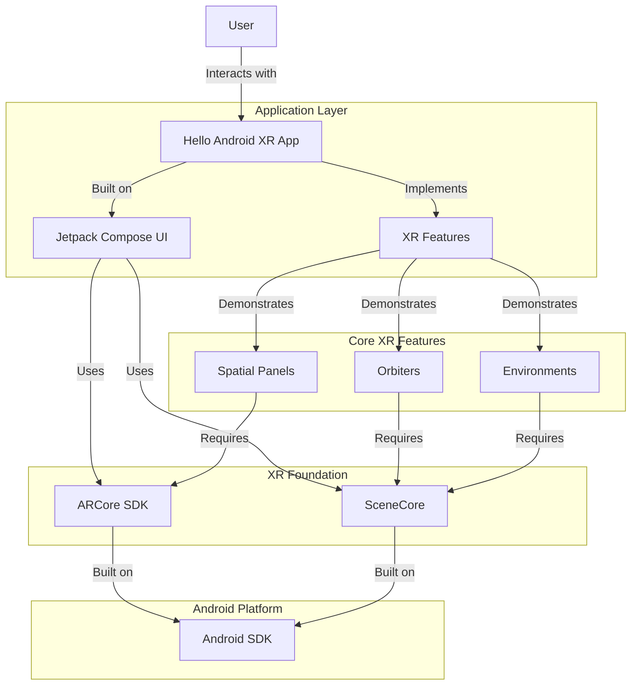
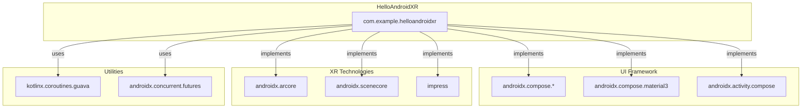

<!-- source: DeepWiki mcp.deepwiki.com · repo android/xr-samples · page 1 Overview · fetched 2026-10-23 -->

# Overview

Relevant source files

The following files were used as context for generating this wiki page:

- [README.md](README.md)
- [app/build.gradle.kts](app/build.gradle.kts)

This document provides an introduction to the Android XR Samples repository, which serves as a reference implementation demonstrating fundamental XR (Extended Reality) capabilities available to Android applications in the Android XR environment. The repository contains sample code showcasing key XR features and patterns for building immersive applications.

For information about specific XR features implementation details, see [XR Features Overview](#3.2).

## Purpose and Scope

The Hello Android XR sample repository is designed to:

1. Demonstrate practical implementations of core Android XR features
2. Provide developers with working examples of XR functionality
3. Illustrate best practices for Android XR application development
4. Serve as a starting point for building XR applications

The sample application shows how to incorporate spatial computing concepts into Android applications using official Android XR APIs and libraries.

Sources: [README.md:1-15]()

## Repository Architecture

The sample application demonstrates a typical Android XR application structure, integrating AR/XR capabilities with modern Android development practices.

### High-Level Architecture

**Android XR Application Architecture**

The application follows a layered architecture where Jetpack Compose provides the UI framework, while ARCore and SceneCore form the XR foundation. The sample demonstrates three key XR features: Spatial Panels, Orbiters, and Environments.

Sources: [README.md:8-15](), [app/build.gradle.kts:67-69]()

## Technology Stack

The Hello Android XR application leverages several key technologies and libraries to implement XR functionality.

**Technology Dependencies**

The application is built using:

- **Jetpack Compose**: Modern declarative UI toolkit for Android
- **ARCore**: Google's platform for building augmented reality experiences
- **SceneCore**: Library for 3D scene management and rendering
- **Impress**: (Likely a library related to XR interactions or rendering)
- **Material Design Components**: For consistent UI elements
- **Kotlin Coroutines**: For asynchronous programming

Sources: [app/build.gradle.kts:63-82]()

## Key XR Features

The sample application demonstrates three primary XR features:

| Feature | Description | Implementation |
|---------|-------------|----------------|
| **Spatial Panels** | UI surfaces that exist in 3D space | Implemented using ARCore and Compose |
| **Orbiters** | Objects that orbit or follow the user in XR space | Built on SceneCore functionality |
| **Environments** | XR environment configuration and manipulation | Leverages SceneCore capabilities |

These features showcase fundamental XR interaction patterns and implementation techniques that developers can adapt for their own applications.

Sources: [README.md:8-15]()

## Project Configuration

The application is configured with the following specifications:

- **Application ID**: `com.example.helloandroidxr`
- **Minimum SDK**: 23
- **Target SDK**: 35
- **Kotlin Compiler Version**: Uses Kotlin compiler extension version 1.5.4
- **Build Features**: Enables Compose and screenshot testing

The project uses the Gradle build system and can be imported directly into Android Studio.

Sources: [app/build.gradle.kts:24-61](), [README.md:17-21]()

## Development Environment

The Hello Android XR sample is designed to be used with:

- Latest stable version of Android Studio
- Gradle build system
- Android SDK with ARCore support

The repository includes screenshot testing capabilities to ensure UI consistency across different devices and screen configurations.

Sources: [README.md:17-21](), [app/build.gradle.kts:60-61]()

## Additional Resources

The Android team provides comprehensive documentation on XR development:

- Android XR platform overviews
- Development guides for XR applications
- UI design guidelines for XR interfaces
- XR Developer Bootcamp resources

For more in-depth information about building and running the sample application, see [Getting Started](#2).

Sources: [README.md:23-28]()

## License

The Hello Android XR sample is distributed under the terms of the Apache License (Version 2.0).

Sources: [README.md:30-33](), [app/build.gradle.kts:1-15]()

---

