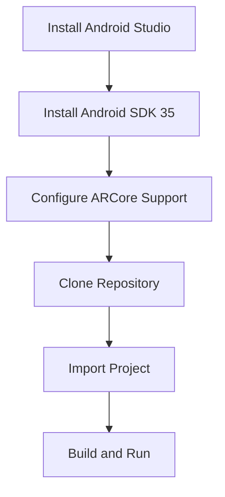
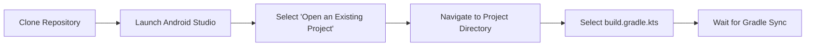
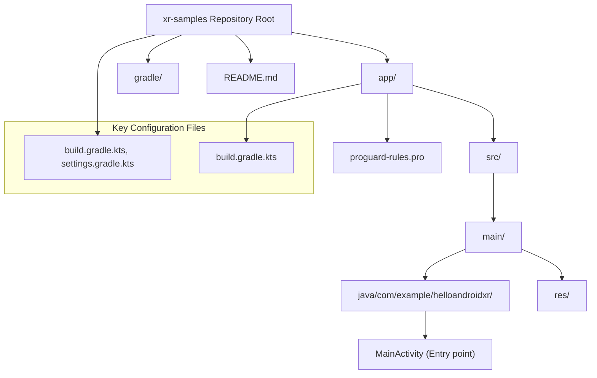
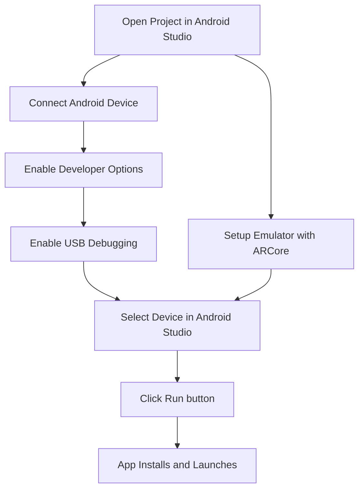

<!-- source: DeepWiki mcp.deepwiki.com · repo android/xr-samples · page 2 Getting Started · fetched 2026-10-23 -->

# Getting Started

<details>
<summary>Relevant source files</summary>

The following files were used as context for generating this wiki page:

- [README.md](README.md)
- [app/build.gradle.kts](app/build.gradle.kts)

</details>


This guide walks you through the initial setup and running of the Android XR Samples application. It covers environment setup, project import, build configuration, and running the sample. For details about the application architecture, please see [Application Architecture](#3), and for specific XR features, refer to [XR Features Overview](#3.2).

## Prerequisites

Before getting started with the Android XR Samples, ensure you have the following prerequisites:

- Android Studio (latest stable version)
- Android SDK with API level 35 installed
- A compatible Android device supporting ARCore or an emulator configured for XR development
- Basic knowledge of Android development and Kotlin

Sources: [app/build.gradle.kts:25-31](), [README.md:18-21]()

## Development Environment Setup



1. **Install Android Studio**
   - Download and install the latest stable version of Android Studio from the [official Android developer website](https://developer.android.com/studio)

2. **Configure SDK**
   - Launch Android Studio
   - Go to Tools > SDK Manager
   - Ensure Android SDK Platform 35 is installed (as specified in the build configuration)
   - Install Android SDK Build-Tools version compatible with SDK 35

3. **Enable ARCore Support**
   - In SDK Manager, go to the SDK Tools tab
   - Check "Google Play Services for AR" (ARCore)
   - Apply changes and wait for installation to complete

Sources: [app/build.gradle.kts:26](), [README.md:18-21]()

## Importing the Project



1. **Clone the Repository**
   - Clone the repository using Git:
     ```
     git clone https://github.com/android/xr-samples
     ```
   - Alternatively, download the ZIP file from GitHub and extract it

2. **Import into Android Studio**
   - Launch Android Studio
   - Select "Open an Existing Project"
   - Navigate to the cloned or extracted project directory
   - Select the root build.gradle.kts file
   - Click "OK" and wait for the Gradle sync to complete

Sources: [README.md:19-21]()

## Project Structure Overview

Below is a simplified view of the project structure showing the key files and directories relevant for getting started:



The entry point of the application is the MainActivity class, and the main configuration is defined in the `app/build.gradle.kts` file.

Sources: [app/build.gradle.kts](), [README.md]()

## Build Configuration

The sample app uses the Gradle build system with Kotlin DSL. Key aspects of the build configuration include:

| Configuration | Value | Description |
|---------------|-------|-------------|
| Namespace     | `com.example.helloandroidxr` | Application package name |
| Compile SDK   | 35    | Android SDK version to compile against |
| Min SDK       | 23    | Minimum supported Android version |
| Target SDK    | 35    | Target Android version |
| Kotlin        | JVM Target 1.8 | Kotlin compilation target |
| Compose       | Enabled | Jetpack Compose UI toolkit |

### Key Dependencies

The application depends on several important libraries:

1. **XR-specific libraries**:
   - ARCore: `androidx.arcore`
   - SceneCore: `androidx.scenecore`
   - Impress (Android XR library): `impress`

2. **UI and Compose**:
   - Jetpack Compose BOM
   - Material Design
   - Material3
   - Compose Runtime
   - Activity Compose

3. **Asynchronous Programming**:
   - Kotlin Coroutines with Guava support
   - Android Concurrent Futures

Sources: [app/build.gradle.kts:24-61](), [app/build.gradle.kts:63-82]()

## Running the Sample Application



1. **Prepare your device**:
   - If using a physical device:
     - Enable Developer Options on your Android device
     - Enable USB Debugging
     - Connect your device to your computer
     - Ensure your device supports ARCore
   - If using an emulator:
     - Create an emulator with Google Play Services
     - Ensure ARCore is supported on the emulator image

2. **Build and Run**:
   - In Android Studio, select your device from the dropdown menu in the toolbar
   - Click the "Run" button (green triangle)
   - Android Studio will build the app and install it on your device
   - The app will launch automatically

3. **Verify Installation**:
   - Once launched, the Hello Android XR app should display the initial XR environment
   - Follow the on-screen instructions to interact with the XR features

Sources: [app/build.gradle.kts:28-35](), [README.md:9-15]()

## Troubleshooting Common Issues

| Issue | Solution |
|-------|----------|
| Gradle sync fails | Check if you have the latest Android Studio version and update Gradle plugin if needed |
| Missing SDK components | Open SDK Manager and install any missing components, particularly Android SDK 35 |
| ARCore not working | Ensure your device supports ARCore and Google Play Services for AR is installed |
| Build errors | Check that you have all required dependencies and correct SDK versions configured |
| App crashes at startup | Check logcat for specific error messages and ensure device supports the minimum required API level (23) |

## Next Steps

After successfully setting up and running the Android XR Samples application, you might want to explore:

1. The implementation of specific XR features (see [XR Features Overview](#3.2))
2. The application architecture (see [Application Architecture](#3))
3. UI components used in the sample (see [UI Components](#4))
4. How to contribute to the project (see [Contributing](#6))

For more information on Android XR development, refer to the official documentation referenced in the [README.md:23-28]().

Sources: [README.md:8-15](), [README.md:23-28]()

---

