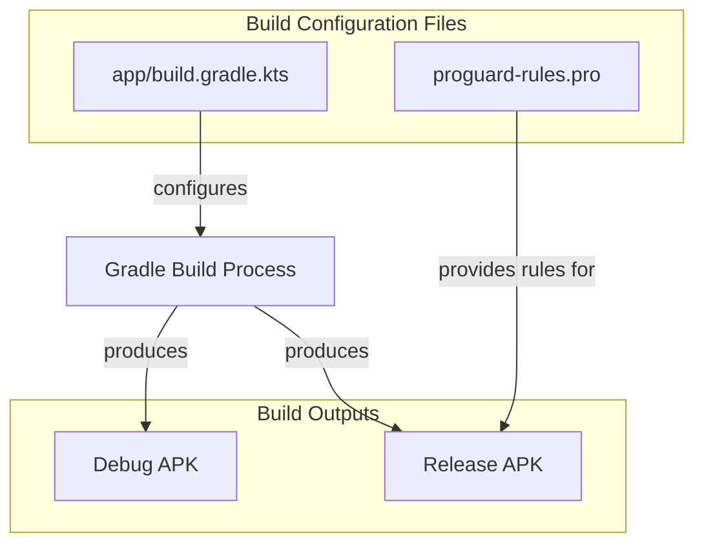
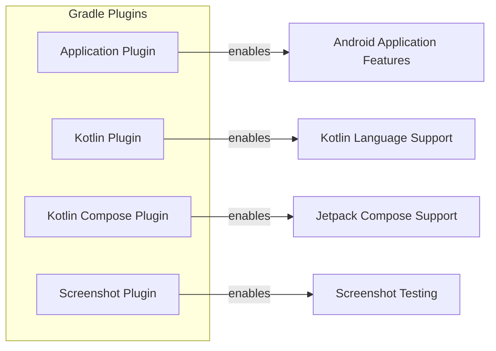
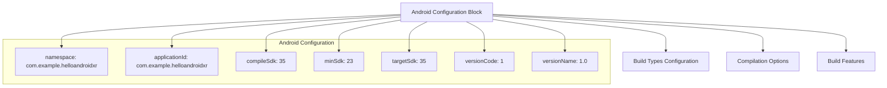
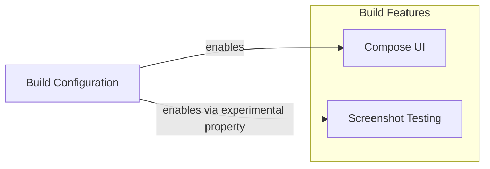
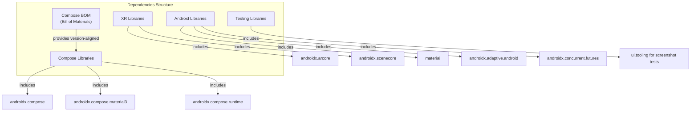
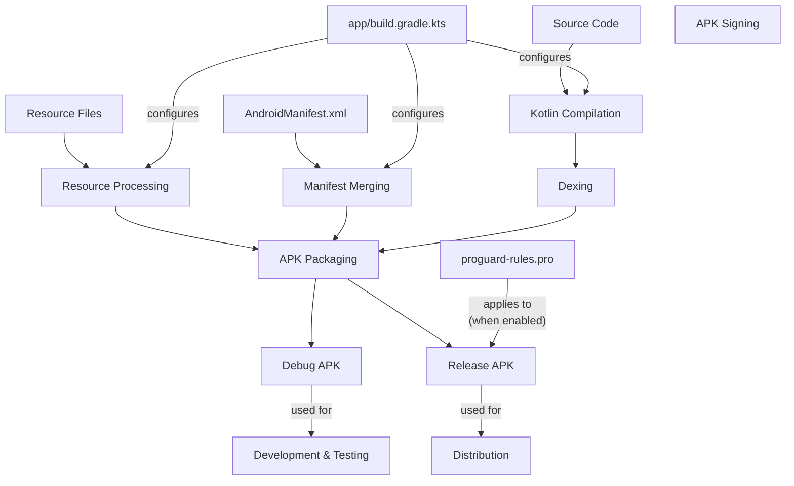

<!-- source: DeepWiki mcp.deepwiki.com · repo android/xr-samples · page 2.1 Build Configuration · fetched 2026-10-23 -->

# Build Configuration

Relevant source files

The following files were used as context for generating this wiki page:

- [app/build.gradle.kts](app/build.gradle.kts)
- [app/proguard-rules.pro](app/proguard-rules.pro)

This document explains the Gradle build configuration for the Android XR Samples application. It covers the build files, plugin structure, application settings, and dependencies that comprise the build system. For information about running the application, see [Getting Started](#2).

## Overview

The Android XR Samples application uses the Gradle build system with Kotlin DSL. The build configuration defines the application's properties, dependencies, and build processes necessary for compiling and packaging the XR sample application.

Sources: [app/build.gradle.kts:1-62](). [app/proguard-rules.pro:1-21]().

## Gradle Plugins

The application uses several Gradle plugins to enable specific functionality:

Sources: [app/build.gradle.kts:17-22]().

The primary plugins used include:
- `android.application` - Provides core Android application build functionality
- `kotlin.android` - Adds Kotlin language support for Android
- `kotlin.compose` - Enables Kotlin compiler extensions for Compose
- `screenshot` - Enables screenshot testing capabilities

## Android Configuration

The Android configuration section defines essential application properties:

| Property | Value | Description |
|----------|-------|-------------|
| Namespace | `com.example.helloandroidxr` | Application's package namespace |
| Application ID | `com.example.helloandroidxr` | Unique identifier for the app |
| Compile SDK | 35 | Android SDK version used for compilation |
| Min SDK | 23 | Minimum supported Android SDK version |
| Target SDK | 35 | Target Android SDK version |
| Version Code | 1 | Internal version number |
| Version Name | "1.0" | User-visible version name |

Sources: [app/build.gradle.kts:24-36]().

## Build Types

The build configuration defines different build types with specific settings:

### Release Build
- `isMinifyEnabled = false` - Code shrinking is disabled
- References ProGuard rules from:
  - Default Android ProGuard rules
  - Project-specific rules in `proguard-rules.pro`

Sources: [app/build.gradle.kts:38-46](). [app/proguard-rules.pro:1-21]().

## Compilation Options

The build system specifies Java and Kotlin compilation options:

- Java compatibility: Java 1.8 for both source and target
- Kotlin JVM target: 1.8
- Kotlin Compose compiler extension version: 1.5.4

Sources: [app/build.gradle.kts:47-59]().

## Build Features

The configuration enables specific build features:

- Jetpack Compose: `compose = true`
- Screenshot testing: enabled via experimental properties

Sources: [app/build.gradle.kts:54-60]().

## Dependencies

The build configuration defines the application's dependencies, which can be categorized as follows:

Sources: [app/build.gradle.kts:63-82]().

### Key Dependencies

1. **XR Dependencies**
   - `impress` - XR composable UI library
   - `androidx.arcore` - ARCore framework support
   - `androidx.scenecore` - 3D scene rendering framework

2. **Compose Dependencies**
   - Compose BOM (Bill of Materials) - Ensures compatible Compose library versions
   - `androidx.compose` - Core Compose framework
   - `androidx.compose.material3` - Material Design 3 components
   - `androidx.compose.runtime` - Compose runtime
   - `androidx.activity.compose` - Activity integration for Compose

3. **Kotlin Dependencies**
   - `kotlinx.coroutines.guava` - Coroutines integration with Guava

4. **Testing Dependencies**
   - `androidx.compose.ui.tooling` - UI tooling for screenshot tests

Sources: [app/build.gradle.kts:63-82]().

## Build Process Flow

The following diagram illustrates the build process flow:

Sources: [app/build.gradle.kts:1-82](). [app/proguard-rules.pro:1-21]().

## ProGuard Configuration

The project includes a ProGuard configuration file that defines code shrinking, obfuscation, and optimization rules for release builds. Currently, most rules are commented out in the template, providing guidance for:

- JavaScript interface preservation for WebView
- Preserving line number information for debugging
- Source file name obfuscation

Note that code shrinking is currently disabled in the release build configuration (`isMinifyEnabled = false`).

Sources: [app/proguard-rules.pro:1-21](). [app/build.gradle.kts:38-46]().

---

