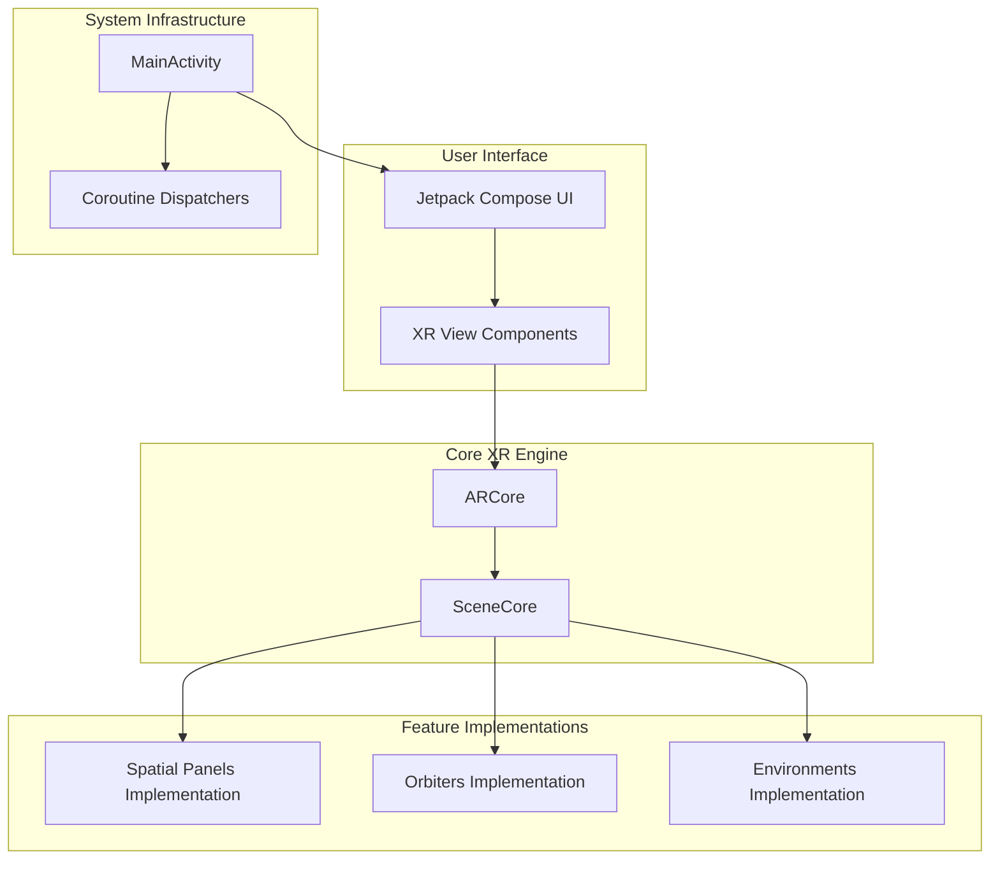
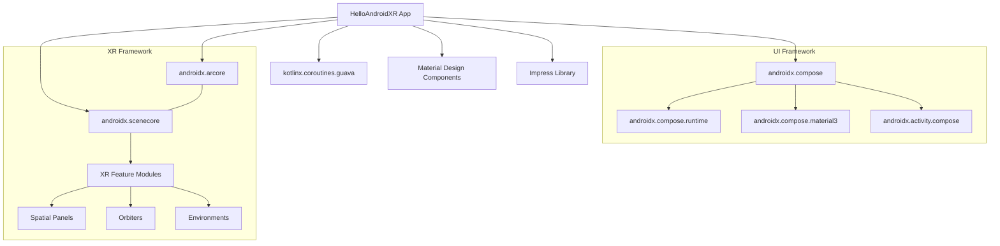
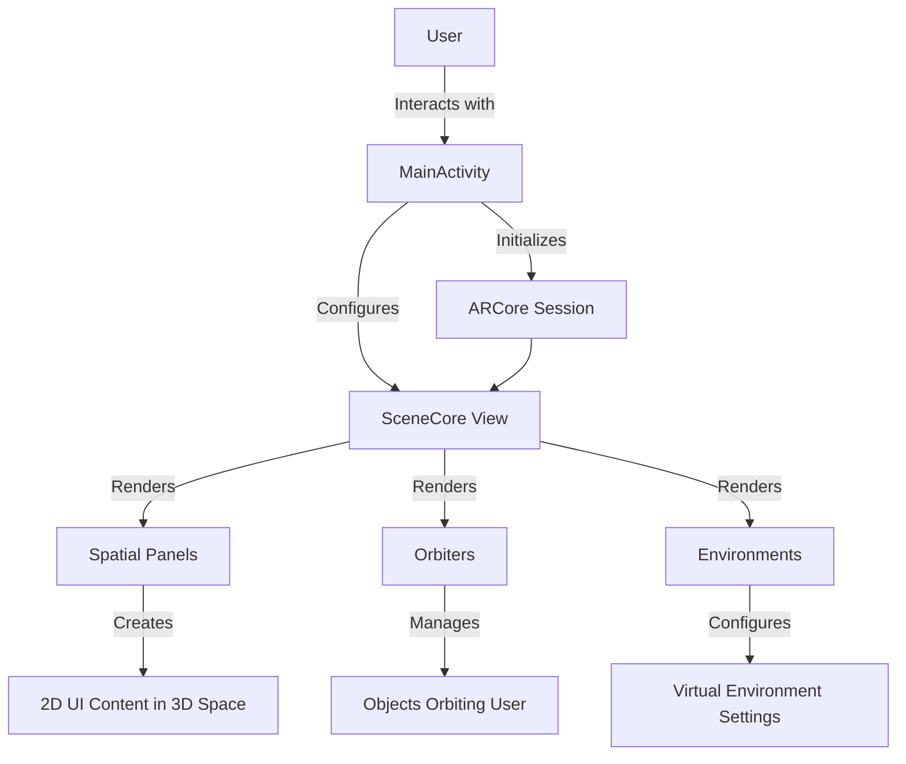
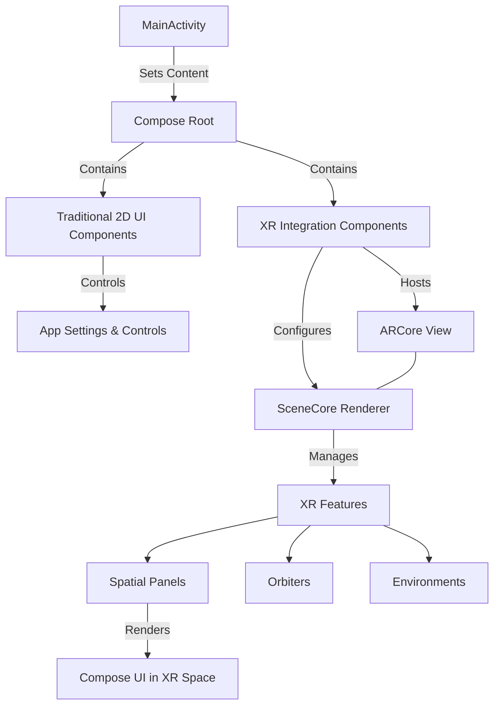

<!-- source: DeepWiki mcp.deepwiki.com · repo android/xr-samples · page 3 Application Architecture · fetched 2026-10-23 -->

# Application Architecture

Relevant source files

The following files were used as context for generating this wiki page:

- [README.md](README.md)
- [app/build.gradle.kts](app/build.gradle.kts)

This document describes the high-level architecture of the Android XR Samples application. It outlines the key components, their interactions, and how the XR features are integrated into the application structure. For specific details about individual XR features, see [XR Features Overview](#3.2).

## Core Architecture

The Android XR Samples application follows a modular architecture centered around demonstrating XR capabilities. The application is structured to showcase how various XR features can be integrated into a standard Android application.

**Core Component Relationships Diagram**

Sources: [app/build.gradle.kts:63-81](), [README.md:9-15]()

The architecture is built upon several key technologies:

1. **Core XR Engines**:
   - ARCore: Provides fundamental AR capabilities
   - SceneCore: Manages 3D scene representation and rendering

2. **UI Layer**:
   - Jetpack Compose: Handles UI composition and traditional Android UI elements
   - XR View Components: Bridge between traditional UI and XR content

3. **Feature Implementations**:
   - Dedicated implementations for Spatial Panels, Orbiters, and Environments

4. **Infrastructure**:
   - Activity components managing application lifecycle
   - Coroutine-based asynchronous operations

## Dependency Structure

The application leverages several key dependencies to enable XR functionality:

**Dependency Structure Diagram**

Sources: [app/build.gradle.kts:63-81](), [README.md:9-15]()

The application dependencies highlight the integration of modern Android UI frameworks with specialized XR libraries:

| Dependency Category | Key Components | Purpose |
|-------------------|----------------|---------|
| XR Core | androidx.arcore, androidx.scenecore | Provide fundamental XR capabilities |
| UI Framework | Jetpack Compose, Material3 | Handle UI composition and styling |
| Asynchronous | Kotlin Coroutines | Manage asynchronous operations |
| Utilities | Impress, Adaptive components | Support additional functionality |

Sources: [app/build.gradle.kts:63-81]()

## XR Feature Integration

The application architecture is designed to integrate three primary XR features as demonstration points:

**XR Feature Integration Diagram**

Sources: [app/build.gradle.kts:67-68](), [README.md:9-15]()

### Feature Implementation Details

Each of the three key XR features is implemented using a combination of ARCore and SceneCore:

1. **Spatial Panels**:
   - 2D UI content placed in 3D space
   - Integrated with Jetpack Compose for content rendering
   - Managed through SceneCore's spatial management capabilities

2. **Orbiters**:
   - Objects that maintain position relative to the user
   - Leverage ARCore tracking and SceneCore object management
   - Demonstrate spatial awareness and positioning

3. **Environments**:
   - Virtual environment configuration and rendering
   - Background and lighting settings for XR experiences
   - SceneCore-driven environment management

For more detailed information about each feature's implementation, see the respective wiki pages: [Spatial Panels](#3.2.1), [Orbiters](#3.2.2), and [Environments](#3.2.3).

Sources: [README.md:9-15]()

## UI Architecture

The application employs Jetpack Compose as its primary UI framework, which is integrated with XR components.

**UI Architecture Diagram**

Sources: [app/build.gradle.kts:54-59](), [app/build.gradle.kts:69-77]()

The UI architecture demonstrates the integration between traditional Android UI components and XR capabilities:

1. **Composition Approach**:
   - Compose-driven UI design for both 2D and XR elements
   - Shared component model across traditional and XR interfaces

2. **Integration Points**:
   - ARCore view components embedded in Compose hierarchy
   - SceneCore rendering integrated through Compose UI
   - Spatial panels demonstrating Compose content in 3D space

3. **UI-XR Communication**:
   - Bi-directional data flow between traditional UI and XR components
   - Event handling coordinated across UI paradigms

Sources: [app/build.gradle.kts:54-59](), [app/build.gradle.kts:69-77]()

## Build Configuration

The application is configured to target modern Android devices with XR capabilities while maintaining compatibility with a broader range of devices.

Key build configuration details:

- **Target Android SDK**: 35
- **Minimum SDK**: 23
- **Compose Compiler Version**: 1.5.4
- **Experimental Features**: Screenshot testing enabled

The build configuration demonstrates how XR features can be integrated into a standard Android application while maintaining modern development practices and tooling.

Sources: [app/build.gradle.kts:24-61]()

## Application Entry Point and Flow

The application follows a standard Android lifecycle with specialized initialization for XR components:

1. **Application Launch**:
   - MainActivity initialization
   - Permission handling for camera and sensors
   
2. **XR Session Setup**:
   - ARCore session configuration
   - SceneCore initialization
   - Environment configuration
   
3. **Feature Loading**:
   - Spatial panel creation
   - Orbiter initialization
   - Environment application
   
4. **User Interaction Flow**:
   - Input handling through traditional and XR interfaces
   - Feature demonstration and interaction
   - State management across XR components

Sources: [app/build.gradle.kts:65-81](), [README.md:9-15]()

## Technology Stack Summary

The application architecture leverages the following key technologies:

| Technology | Component | Purpose |
|------------|-----------|---------|
| Jetpack Compose | UI Framework | Modern declarative UI development |
| ARCore | XR Foundation | AR capabilities and device integration |
| SceneCore | 3D Framework | 3D scene management and rendering |
| Kotlin Coroutines | Async Framework | Asynchronous operations and threading |
| Material3 | Design System | Consistent design language |

Sources: [app/build.gradle.kts:63-81]()

This architecture provides a foundation for demonstrating XR capabilities on Android while providing developers with examples of best practices for integrating XR features into their applications.

---

