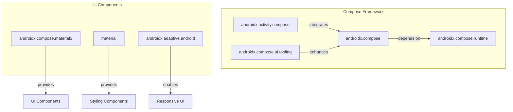
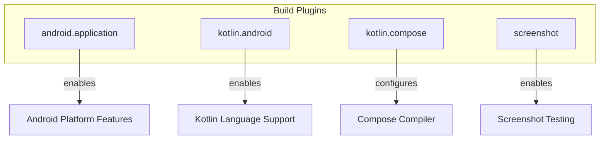
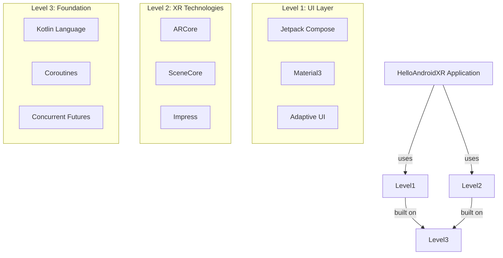

<!-- source: DeepWiki mcp.deepwiki.com · repo android/xr-samples · page 3.1 Dependencies and Technologies · fetched 2026-10-23 -->

# Dependencies and Technologies

<details>
<summary>Relevant source files</summary>

The following files were used as context for generating this wiki page:

- [app/build.gradle.kts](app/build.gradle.kts)

</details>


This document outlines the core libraries, frameworks, and technologies used in the Android XR Samples project. It focuses on explaining the technical stack that powers the XR functionality and application architecture. For information about specific XR features implemented with these technologies, see [XR Features Overview](#3.2).

## Technology Stack Overview

The Android XR Samples project is built on a modern Android technology stack, combining XR-specific libraries with standard Android development frameworks. The following diagram illustrates the main technological components:

```mermaid
flowchart TD
    subgraph "Application Layer"
        App["HelloAndroidXR Application"]
    end

    subgraph "UI Framework"
        Compose["Jetpack Compose"]
        Material3["Material3 Components"]
        AdaptiveUI["Adaptive Android"]
    end

    subgraph "XR Technologies"
        ARCore["ARCore SDK"]
        SceneCore["SceneCore Library"]
        Impress["Impress Library"]
    end

    subgraph "Foundation"
        Kotlin["Kotlin Language"]
        Coroutines["Kotlin Coroutines"]
        ConcurrentFutures["Concurrent Futures"]
    end

    App -->|built with| Compose
    App -->|uses| XRTechnologies
    Compose -->|styled with| Material3
    Compose -->|enhanced by| AdaptiveUI
    XRTechnologies -->|runs on| Foundation
    UI Framework -->|runs on| Foundation
```

Sources: [app/build.gradle.kts:63-78]()

## Core Dependencies

The project's dependencies can be categorized into several functional groups:

### XR and 3D Rendering Libraries

These libraries provide the core XR functionality:

| Library | Purpose | Implementation |
|---------|---------|----------------|
| ARCore | Google's augmented reality platform that provides fundamental AR capabilities | `implementation(libs.androidx.arcore)` |
| SceneCore | 3D scene rendering and management | `implementation(libs.androidx.scenecore)` |
| Impress | XR-specific library for enhanced functionality | `implementation(libs.impress)` |

Sources: [app/build.gradle.kts:66-68]()

### UI and Composition Framework

The application's user interface is built with modern declarative UI libraries:



Sources: [app/build.gradle.kts:69-80]()

### Asynchronous Programming Support

The following libraries facilitate asynchronous operations, which are critical for responsive XR applications:

| Library | Purpose | Implementation |
|---------|---------|----------------|
| Kotlin Coroutines | Asynchronous programming framework | `implementation(libs.kotlinx.coroutines.guava)` |
| Concurrent Futures | Promise-based concurrency utilities | `implementation(libs.androidx.concurrent.futures)` |

Sources: [app/build.gradle.kts:70-75]()

## Build System and Configuration

The Android XR Samples application leverages the Gradle build system with Kotlin DSL for configuration. The build script defines several important aspects of the application:

### Key Plugins

The project uses the following Gradle plugins to enable various features:



Sources: [app/build.gradle.kts:17-22]()

### Build Configuration

The application is configured with the following specifications:

| Configuration | Value | Description |
|---------------|-------|-------------|
| Application ID | `com.example.helloandroidxr` | Unique identifier for the application |
| Minimum SDK | 23 | Android 6.0 (Marshmallow) |
| Target SDK | 35 | Latest Android version support |
| Compose Compiler Version | 1.5.4 | Kotlin Compiler Extension for Compose |
| Java Compatibility | 1.8 | Java version compatibility level |

Sources: [app/build.gradle.kts:24-61]()

## Technology Dependencies Hierarchy

The following diagram illustrates the hierarchical relationship between the various dependencies:



Sources: [app/build.gradle.kts:63-82]()

## Experimental Features

The application enables experimental screenshot testing through a specific configuration:

```kotlin
experimentalProperties["android.experimental.enableScreenshotTest"] = true
```

This allows for visual testing of UI components and screens, which is particularly important for XR applications where the visual representation is critical.

Sources: [app/build.gradle.kts:60]()

## Conclusion

The Android XR Samples project leverages a comprehensive set of modern Android technologies, with special emphasis on XR-specific libraries (ARCore, SceneCore, Impress) and UI composition through Jetpack Compose. The asynchronous programming capabilities provided by Kotlin Coroutines and Concurrent Futures help ensure smooth performance in resource-intensive XR applications.

Understanding these dependencies and technologies is essential for working with the codebase, extending its functionality, or using it as a reference for other XR development projects.

---

