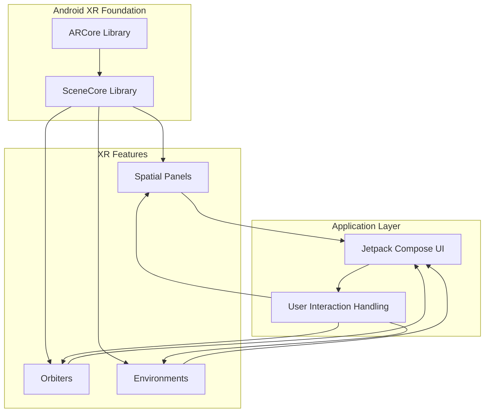
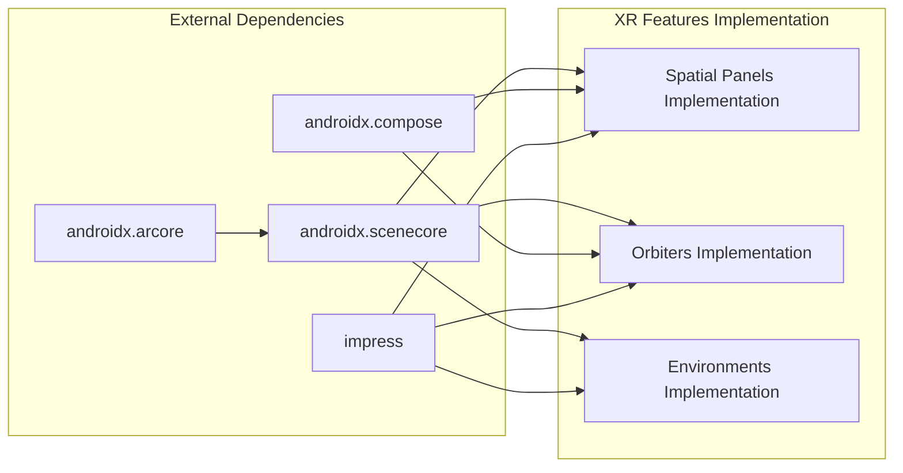
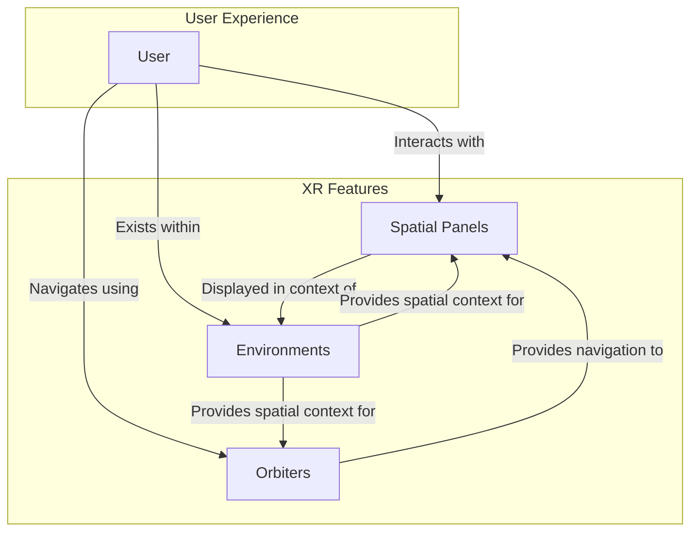

<!-- source: DeepWiki mcp.deepwiki.com · repo android/xr-samples · page 3.2 XR Features Overview · fetched 2026-10-23 -->

# XR Features Overview

<details>
<summary>Relevant source files</summary>

The following files were used as context for generating this wiki page:

- [README.md](README.md)
- [app/build.gradle.kts](app/build.gradle.kts)

</details>


This document provides a comprehensive overview of the XR (Extended Reality) features demonstrated in the Hello Android XR sample application. It covers the primary XR capabilities, their relationships, and how they enhance spatial computing experiences. For detailed implementation specifics of individual features, see the respective sub-pages: [Spatial Panels](#3.2.1), [Orbiters](#3.2.2), and [Environments](#3.2.3).

## Core XR Features

The Hello Android XR sample application showcases three primary XR features that demonstrate essential spatial computing capabilities for Android applications:

1. **Spatial Panels** - Placeable 2D content surfaces in 3D space
2. **Orbiters** - UI elements that follow and orbit around the user
3. **Environments** - Customizable spatial backgrounds that provide context

These features work together to create an immersive and functional XR experience while demonstrating implementation patterns for Android developers.

Sources: [README.md:10-15]()

## XR Features Architecture

The following diagram illustrates how the primary XR features relate to each other and integrate with the underlying Android XR framework:



The XR features are built on the foundation of ARCore and SceneCore libraries, with Jetpack Compose providing the UI framework for rendering and interaction. Each feature represents a distinct capability that can be used independently or in combination with others.

Sources: [app/build.gradle.kts:67-69](), [README.md:10-15]()

## Feature Implementation Relationships

The following diagram shows how the XR features map to specific code dependencies and implementation components:



This demonstrates how the key libraries from the build configuration support the implementation of each XR feature. The `androidx.arcore` and `androidx.scenecore` libraries provide the critical AR functionality, while Compose and Impress libraries facilitate the UI rendering and interaction components.

Sources: [app/build.gradle.kts:63-82]()

## Feature Summary Table

| Feature | Primary Purpose | Key Dependencies | Related Pages |
|---------|----------------|------------------|---------------|
| **Spatial Panels** | Displays 2D content (Compose UIs) on surfaces in 3D space | androidx.scenecore, androidx.compose | [Spatial Panels](#3.2.1) |
| **Orbiters** | Creates UI elements that follow and orbit the user as they move | androidx.scenecore, androidx.compose | [Orbiters](#3.2.2) |
| **Environments** | Provides customizable spatial backgrounds for context | androidx.scenecore | [Environments](#3.2.3) |

Sources: [README.md:10-15](), [app/build.gradle.kts:66-69]()

## Technical Integration

The XR features in the Hello Android XR sample are implemented using a combination of Android's latest XR libraries:

1. **ARCore** (`androidx.arcore`) - Provides the foundational AR capabilities including tracking, environmental understanding, and light estimation.

2. **SceneCore** (`androidx.scenecore`) - Builds on ARCore to provide higher-level abstractions for creating and managing 3D scenes.

3. **Impress** (`impress`) - Enables integration with the Android UI toolkit for creating immersive experiences.

4. **Jetpack Compose** - Provides the modern declarative UI framework that integrates with the XR features.

The integration of these libraries allows developers to implement immersive XR experiences while maintaining the familiar Android development patterns.

Sources: [app/build.gradle.kts:66-69]()

## Feature Relationships



This diagram illustrates the relationships between the XR features from a user experience perspective. Environments provide the spatial context in which both Spatial Panels and Orbiters exist. Users interact directly with Spatial Panels, navigate using Orbiters, and experience the overall XR application within the context of an Environment.

Sources: [README.md:10-15]()

## Build Configuration

The XR features rely on specific dependencies defined in the application's build configuration:

```
dependencies {
    implementation(libs.impress)
    implementation(libs.androidx.arcore)
    implementation(libs.androidx.scenecore)
    implementation(libs.androidx.compose)
    // Other dependencies
}
```

These dependencies provide the necessary libraries to implement the XR features demonstrated in the sample application.

Sources: [app/build.gradle.kts:63-82]()

## Cross-Feature Considerations

When implementing multiple XR features, developers should consider:

1. **Performance** - Managing render complexity across features
2. **User Experience** - Ensuring intuitive interaction between features
3. **Content Management** - Coordinating content display across Spatial Panels and Orbiters
4. **Environmental Awareness** - Making features responsive to changes in the Environment

Detailed implementation specifics for each feature are covered in their respective sub-pages.

Sources: [README.md:10-15]()

---

