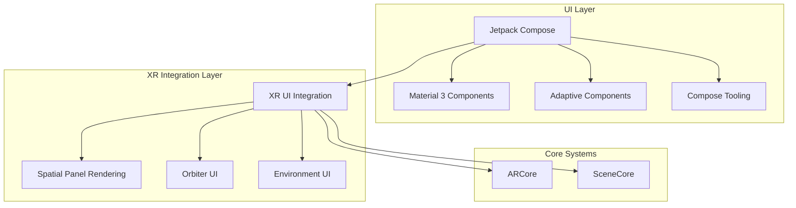
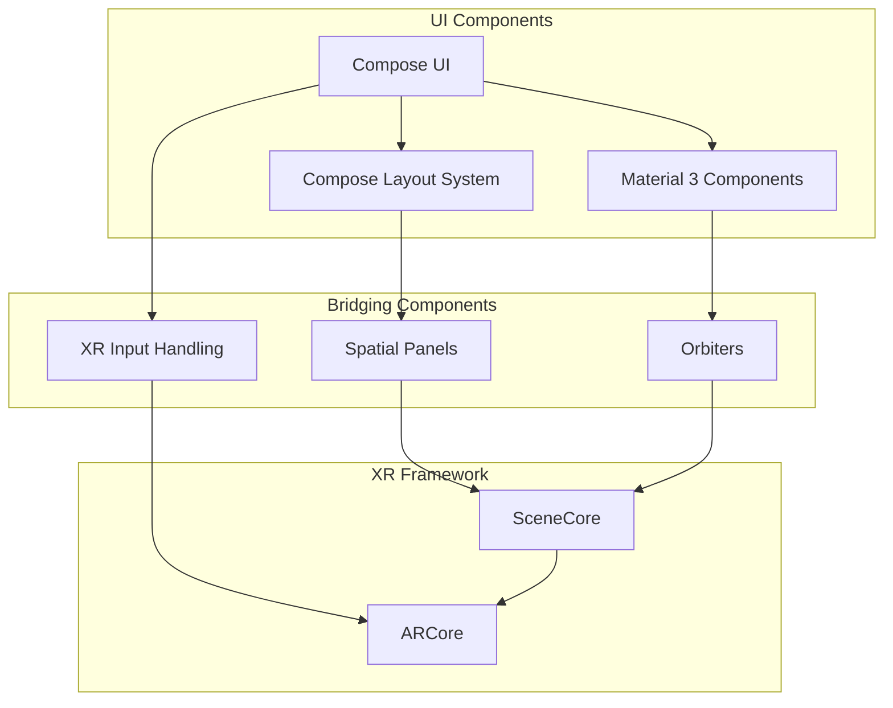
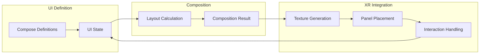
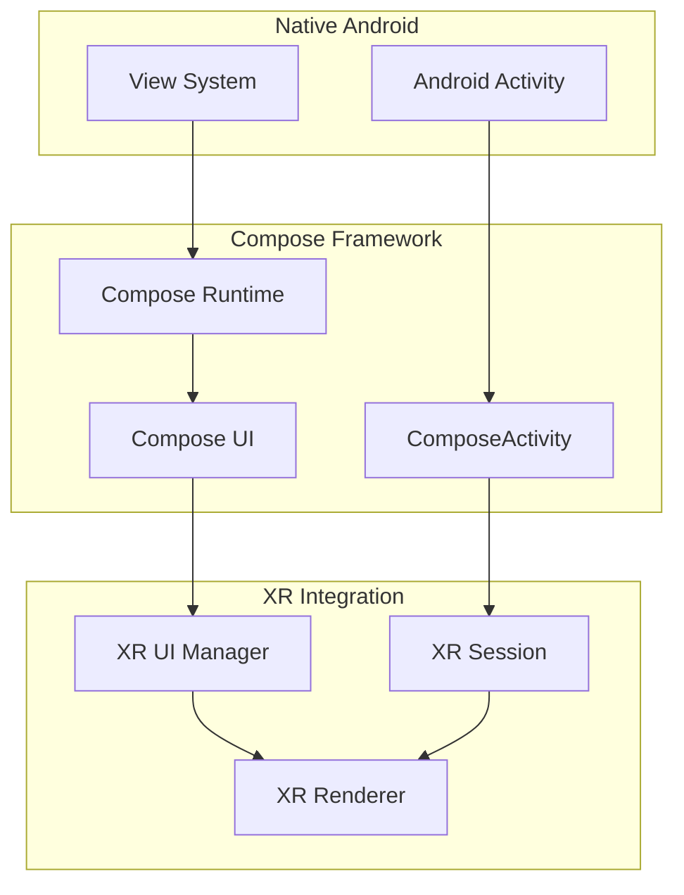

<!-- source: DeepWiki mcp.deepwiki.com · repo android/xr-samples · page 4 UI Components · fetched 2026-10-23 -->

# UI Components

<details>
<summary>Relevant source files</summary>

The following files were used as context for generating this wiki page:

- [app/build.gradle.kts](app/build.gradle.kts)
- [app/src/debug/screenshotTest/reference/com/example/helloandroidxr/ui/AppPreviewScreenshots/AppLayoutPreview_b6cdeb17_0.png](app/src/debug/screenshotTest/reference/com/example/helloandroidxr/ui/AppPreviewScreenshots/AppLayoutPreview_b6cdeb17_0.png)

</details>


This document provides a technical overview of the UI components used in the Android XR Samples application. It focuses specifically on the user interface elements, their implementation using Jetpack Compose, and their integration with the XR framework. For information about specific XR features like Spatial Panels, Orbiters, and Environments, please refer to their respective sections at [XR Features Overview](#3.2), [Spatial Panels](#3.2.1), [Orbiters](#3.2.2), and [Environments](#3.2.3).

## UI Architecture Overview

The Android XR Samples application uses Jetpack Compose as its primary UI toolkit. Compose is a modern declarative UI framework for Android that simplifies UI development by allowing developers to describe what the UI should look like for a given state, rather than how to construct it.

### UI Framework Diagram



Sources: [app/build.gradle.kts:63-79]()

## UI Dependencies

The application includes several key UI-related dependencies that form the foundation of its interface:

| Dependency | Description | Purpose in Android XR Samples |
|------------|-------------|-------------------------------|
| `androidx.compose.bom` | Bill of Materials for Compose | Ensures consistent versions across Compose dependencies |
| `androidx.compose` | Core Compose library | Provides the fundamental Compose functionality |
| `androidx.compose.material3` | Material 3 design components | Implements Material Design 3 components in Compose |
| `androidx.adaptive.android` | Adaptive UI components | Supports adaptable layouts for different form factors |
| `androidx.compose.runtime` | Compose runtime | Manages state and composition |
| `androidx.activity.compose` | Activity integration | Enables using Compose in an Activity |
| `androidx.compose.ui.tooling` | Design and preview tools | Supports UI design and preview capabilities |

Sources: [app/build.gradle.kts:63-79]()

## Compose Integration with XR

The Android XR Samples application demonstrates how to integrate traditional 2D UI components created with Jetpack Compose with immersive XR experiences. This integration allows for familiar UI patterns to be used alongside spatial interfaces.

### UI to XR Integration Architecture



Sources: [app/build.gradle.kts:65-78]()

## Key UI Components

The Android XR Samples application leverages several types of UI components:

1. **Standard Compose Components**: Basic UI elements like buttons, text fields, and layouts from the Jetpack Compose framework.

2. **Material 3 Components**: Enhanced UI elements following the Material Design 3 guidelines, providing a consistent and modern look and feel.

3. **Adaptive Components**: Components that adjust to different screen sizes and form factors, crucial for XR applications that may be displayed across various devices.

4. **XR-Specific UI Components**: Custom UI elements designed specifically for XR interaction, such as:
   - Spatial UI panels that exist in 3D space
   - Orbiter controls that follow the user's view
   - Environment selection interfaces

## UI Component Flow

When developing UI for XR applications, components go through a specific flow from definition to rendering in 3D space:

### UI Rendering Pipeline



Sources: [app/build.gradle.kts:65-78]()

## Best Practices for XR UI Development

When developing UI components for XR applications using the Android XR Samples framework, consider the following best practices:

1. **Separate UI Logic from XR Positioning**: Keep the UI component definitions independent from their spatial positioning to maintain code clarity.

2. **Use Reactive UI Patterns**: Leverage Jetpack Compose's reactive programming model to handle state changes efficiently.

3. **Consider Depth and Distance**: Design UI components with awareness of how they'll appear at different distances in 3D space.

4. **Optimize for Performance**: Minimize UI recomposition and texture generation, as these operations can be costly in XR environments.

5. **Accessible Input Handling**: Design UI interactions that work well with both traditional input methods and XR-specific interactions like gaze and gesture.

## Integration with Native Android Components

The Android XR Samples application demonstrates how to bridge between traditional Android UI components and XR experiences:



Sources: [app/build.gradle.kts:65-78]()

## Screenshot Testing

The Android XR Samples application includes support for screenshot testing of UI components, ensuring visual consistency across different builds and environments. This is particularly important for XR applications where visual presentation is critical to the user experience.

The build configuration enables screenshot testing via:

```
experimentalProperties["android.experimental.enableScreenshotTest"] = true
```

And includes the necessary testing dependencies:

```
screenshotTestImplementation(libs.androidx.compose.ui.tooling)
```

This allows developers to validate UI components both in standard 2D contexts and within XR environments.

Sources: [app/build.gradle.kts:60-81]()

## Summary

The UI Components in the Android XR Samples application demonstrate how to effectively bridge the gap between traditional 2D Android interfaces and immersive XR experiences. By leveraging Jetpack Compose, Material 3, and adaptive design principles, the application provides a foundation for building compelling and consistent user interfaces for XR applications.

The integration between Compose UI components and XR-specific features like Spatial Panels and Orbiters showcases best practices for developing interfaces that work well in both 2D and 3D contexts, providing a seamless experience for users across different interaction modes.

---

