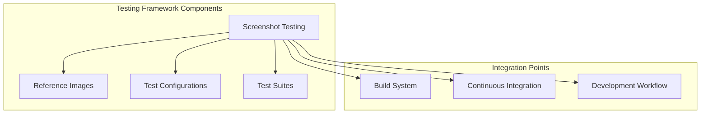
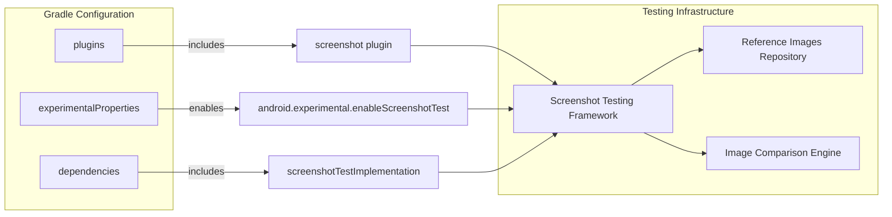
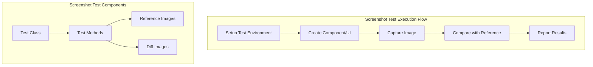
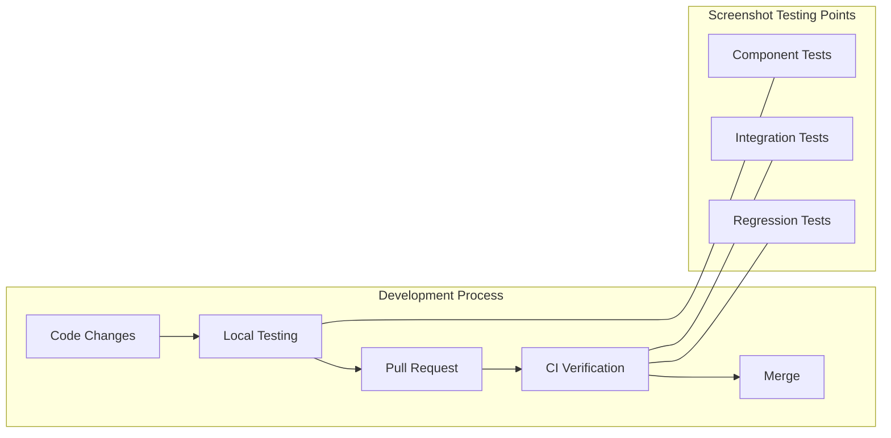

<!-- source: DeepWiki mcp.deepwiki.com · repo android/xr-samples · page 5 Testing Framework · fetched 2026-10-23 -->

# Testing Framework

<details>
<summary>Relevant source files</summary>

The following files were used as context for generating this wiki page:

- [app/build.gradle.kts](app/build.gradle.kts)
- [app/src/debug/screenshotTest/reference/com/example/helloandroidxr/ui/AppPreviewScreenshots/AppLayoutPreview_b6cdeb17_0.png](app/src/debug/screenshotTest/reference/com/example/helloandroidxr/ui/AppPreviewScreenshots/AppLayoutPreview_b6cdeb17_0.png)

</details>


This page documents the testing approach used in the Android XR Samples repository, with particular focus on the screenshot testing framework. This framework is essential for ensuring UI consistency and detecting visual regressions across the sample applications.

## Overview

The Android XR Samples project employs screenshot testing as its primary testing methodology. This approach is particularly valuable for XR applications where visual correctness is critical for user experience. The testing framework captures snapshots of the UI under specific conditions and compares them against reference images to detect visual regressions.



Sources: [app/build.gradle.kts:21-22](), [app/build.gradle.kts:60-61]()

## Screenshot Testing Configuration

The testing framework is configured in the project's Gradle build files. Screenshot testing is enabled through an experimental property and requires specific plugin and dependency configurations.



Sources: [app/build.gradle.kts:21-22](), [app/build.gradle.kts:60-61](), [app/build.gradle.kts:81-82]()

### Key Configuration Elements

The screenshot testing framework is configured with the following key elements in the build.gradle.kts file:

| Element | Description | Location |
|---------|-------------|----------|
| Screenshot Plugin | Enables screenshot testing capabilities | Line 21 |
| Experimental Property | Explicitly enables the screenshot test feature | Line 60 |
| Test Dependencies | Includes necessary libraries for screenshot tests | Line 81 |

Sources: [app/build.gradle.kts:21-22](), [app/build.gradle.kts:60-61](), [app/build.gradle.kts:81-82]()

## Reference Images

Reference images serve as the expected output for UI components and layouts. These images are stored in the debug build directory and are used for comparison during test execution.

The reference images are organized by test class and method name, making it straightforward to identify which component each reference image corresponds to:

```
app/src/debug/screenshotTest/reference/[package path]/[test class name]/[test method name]_[hash]_[index].png
```

For example, the repository contains a reference image:

```
app/src/debug/screenshotTest/reference/com/example/helloandroidxr/ui/AppPreviewScreenshots/AppLayoutPreview_b6cdeb17_0.png
```

This file is used to verify the layout of the main application UI.

Sources: [app/src/debug/screenshotTest/reference/com/example/helloandroidxr/ui/AppPreviewScreenshots/AppLayoutPreview_b6cdeb17_0.png]()

## Test Structure

Screenshot tests in the Android XR Samples project follow a structured approach to ensure consistency and maintainability.



### Test Organization

Screenshot tests are typically organized around UI components or specific user interactions:

1. **Component Tests**: Verify the appearance of individual UI components
2. **Layout Tests**: Ensure proper arrangement of components within layouts
3. **Interaction Tests**: Capture UI state changes resulting from user interactions
4. **XR-Specific Tests**: Test spatial interfaces and XR-specific UI elements

Sources: [app/build.gradle.kts:81-82]()

## Running Tests

Screenshot tests can be executed as part of the regular Android test suite. The framework integrates with the standard Android test runner while providing additional functionality for image comparison and failure reporting.

### Basic Test Execution

Tests can be run using the Android Studio test runner or via Gradle commands:

```
./gradlew screenshotTest
```

### Viewing Test Results

When tests fail, the framework generates detailed reports showing:

1. The expected reference image
2. The actual captured image
3. A difference visualization highlighting discrepancies

These reports help developers quickly identify visual regressions and their causes.

Sources: [app/build.gradle.kts:21-22](), [app/build.gradle.kts:60-61]()

## Best Practices

When working with the screenshot testing framework, consider the following best practices:

### 1. Test Isolation

Ensure each test focuses on a single UI component or interaction to maintain clarity and make it easier to identify issues when tests fail.

### 2. Reference Image Management

Carefully review and update reference images when intentional UI changes are made. Commit these changes alongside the corresponding code changes.

### 3. Device-Specific Considerations

Be mindful of device-specific variations. Consider parameterizing tests for different screen sizes and resolutions when necessary.

### 4. XR-Specific Guidance

When testing XR components:
- Test components in both 2D (preview) and 3D (immersive) contexts
- Verify spatial placement and scale of elements
- Test interaction with both traditional input (touch) and XR input methods

## Integration with Development Workflow

The screenshot testing framework is designed to integrate seamlessly with the development workflow, providing developers with immediate feedback on UI changes.



### Continuous Integration

The screenshot testing framework is integrated with the project's CI pipeline, ensuring that all UI changes are automatically verified before being merged.

Sources: [app/build.gradle.kts:21-22](), [app/build.gradle.kts:60-61]()

## Benefits for XR Development

Screenshot testing provides particular benefits for XR application development:

1. **Visual Consistency**: Ensures consistent visual appearance across different devices and platforms
2. **Spatial UI Verification**: Validates correct spatial positioning of UI elements in 3D space
3. **Interaction Validation**: Verifies that interactions with spatial UI elements work as expected
4. **Regression Detection**: Quickly identifies visual regressions introduced by code changes

## Summary

The screenshot testing framework in the Android XR Samples repository provides a robust mechanism for verifying the visual correctness of UI components. By comparing captured images against reference images, the framework helps maintain UI consistency and quickly detect visual regressions. This is particularly valuable for XR applications where visual correctness is critical for user experience.

The framework is integrated into the build system, making it easy to run tests during development and as part of continuous integration. By following the best practices outlined in this document, developers can effectively utilize the screenshot testing framework to ensure the quality of the Android XR Samples.

---

